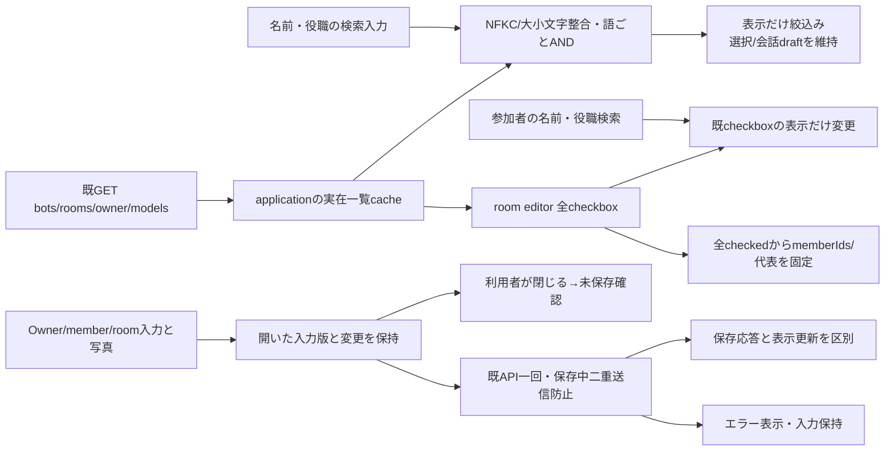
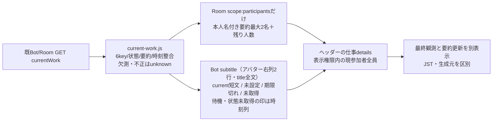
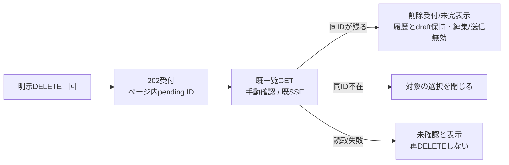

# Appleとの機能対応と追加改善

Web担当: アドミ。比較固定source: `afdc87316ee4bd234c169b65945ed1d831d5ae60`。Apple内部は変更しない。比較は実sourceのView→Core→公開HTTPで行う。表の「あり」はsource上の操作実装であり、本番・native実機成功の主張ではない。

## 対応表

Appleのpathは `ios/BellBot/BellBot/` 起点。Webは `web/` 起点。

| 機能 | Apple callerと公開API | 固定Webの実装 | 差分/保存・失敗・復帰 |
| --- | --- | --- | --- |
| 起動/認証/案内 | AppStore / LoginView / OnboardingView → session/setup/harness-auth | application/onboarding/harness-auth/auth-flow | あり。認証要求と接続失敗を分け、秘密は閉じる/非表示で消去 |
| 一覧/検索 | HomeView / DesktopWorkspaceView、AppStore → GET bots/rooms | application | Web検索なし。Appleもnameのみ。今回役職とroom参加者役職を追加。選択/下書きはフィルタで消さない |
| 今の仕事 | Home/Desktopはrecent.preview。仕事要約実装なし | recent本文 | Owner追加。両一覧currentWork契約/provider未供給。未取得表示。member稼働をroomへ帰属しない |
| ルーム管理/返信者 | ManagementView RoomEditor → POST/PATCH/DELETE rooms、ConversationView target picker | room-editor/application | 既存CRUDあり。名前/役職で参加者絞込み・選択保持・未保存警告を追加 |
| 会話/履歴/下書き | ConversationView / ConversationList / ConversationDraft → bots/rooms messages、timeline、queue、events | conversation-timeline/conversation-composer | 前後ページ/既読/下書き/送信中別入力/失敗回収あり。実mutationは局所fixtureで確認、本番配送とは分ける |
| 画像/書出し | ConversationView / BellAPI images/export | message-images/image-gallery/application | 複数画像/拡大/JSON exportあり。Webはbrowser file入力、URLは所有者が解放 |
| member編集 | ManagementView / BotSettings → GET/PATCH bots/:id、POST bots、models | bot-editor | CLI/model/effort/profile/personality/speech/position/role/colorあり。fastMode不足。保存応答不明のGET再照合が不足 |
| 写真/大小画像 | AvatarImagePicker / AvatarCropEditor / BotProfileComponents → BotSettingsRequest、GET bot、PATCH bot | avatar-editor/bot-editor | 小画像cropのみ。大画像独立編集、source/cropメタデータ保持、既存写真再cropが不足。更新しない画像は送らない |
| Owner編集/設定 | SettingsView ProfileEditor / FeatureSettings / HarnessAuthentication → owner/user-rules/settings/ai-control/session | owner-editor/onboarding/ai-control | 既存保存あり。profile保存後rules失敗は部分成功。今回階層/余白/ラベル/未保存確認を整理 |
| 予定 | SchedulesView → GET schedules（404だけ個別fallback）、target schedules CRUD/run | schedule-editor | 選択会話のCRUD/runあり。全件一覧/横断入口が不足。欠落を空成功にしない |
| Goal/実行制御 | GoalsView / ConversationView / SettingsView → goals、bot goal/stop/restart、ai-control | goals/member-stop/bot-editor/ai-control | 既存。受付とnative実適用を区別、失敗は再送せずGET確認 |
| 秘密/質問 | SecretRequestView / OwnerQuestionView / BellAPI protected submit → secret-requests/owner-questions | secret-input/owner-question | 既存。秘密入力と質問URLをexportへ混ぜず、応答後除去/失敗時入力保持の既契約を維持 |
| 通知 | BellNotifications / SettingsView → notifications、devices/unregister、APNs | eventsで画面内再同期 | APNs端末登録をbrowserへ転用不可。WebPush provider/APIは未供給。通知provider状態の表示は既GETで対応可能 |
| 購読 | SubscriptionView / BillingStore / AppleSubscriptionAccess、StoreKit | 汎用feature設定のみ | native StoreKit購入をWeb完成機能として載せない。Apple原文でWeb無料。Web購入は不足機能に数えず、設定に無料/Apple専用購読を説明する |
| 端末画面/設定画/記憶 | ConversationView screen、Appleにmemory/knowledge/character-sheet HTTP callerなし | bot-read-views/memory-view | Web既存機能を保持。Apple未実装部分をApple完成機能に数えない |
| 更新 | Appleに /api/updates callerなし | update-center | 既採用のinventory/container操作/同UUID復帰を保持。実Host/catalog/all-module未了を隠さない |

## 検索と編集の状態所有

フィルタはサーバーやAIへ要求しない。room選択は非表示行も含め、検索変更はプロフィールの未保存変更に数えない。保存後closeは確認を通さず、利用者Cancel/Escapeだけ未保存警告を通す。写真非同期decode後の変更も対象。profile/rulesの二段保存、入力版/開き直し世代、旧応答無視の既契約を保つ。

currentWorkのfield名/有限状態/null規約はMolly/Rootの正本供給後にのみ利用する。供給前の『今の仕事は未取得』は最新版の仕事状態やidleを主張しない。最終会話時刻/未読は既recentに由来する独立表示。

## 実行設定の編集

`/api/models`の実catalogを使い、error/fastUnavailable/defaultModel/各model.fastでfastの可否と理由を示す。既存trueは非対応でもOFFにできる。未知/手入力はサーバーの最終検証へ渡す。既存のfastModeが変わらない時はPATCHに含めず、現状維持で保存する。設定受付と稼働適用は既configurationApplicationで区別する。

## すべての予定

roster時計→schedules-overview→既GET /api/schedules。削除待ちを除く名簿の対象が揃うか検査し、不足/重複/未知kindを空成功へ変えない。404の旧本体だけ既target GETへfallbackする。他の失敗は前回一覧を保持して明記。source→管理は既schedule-editorの同一target CRUD/runへ接続し、Web独自の予定storeや新backendを作らない。再open/close/更新は読取世代で旧応答を無視。

## 大小画像と保存元

Bot editorは既GET botのappearanceを読んでから小/大の独立avatar-editorを有効化する。未対応/読取不能の大画像は理由付き無効。新しい写真はブラウザーで長辺2048以内のJPEG保存元と512のrenderを作り、正規化cropを保持する。既sourceとcropは『切り抜きを調整』で再編集。PATCHは変更したvariantのrender/source/cropだけを同時送信し、変更しないvariantを送らない。読取世代/decode世代で旧写真の復活を防ぐ。大小の元画像は独立し、Appleの設定画とは別。

member保存失敗後の「保存結果を確認」は同BotのGETを読み、送信snapshotのfieldsだけ照合する。変更していない画像の値は照合対象にせず、保存確認でPATCHを再送しない。成功確認後も後から書いた入力は保持。新規作成はIDが得られない通信断を成功にせず、架空のIDでGETしない。cropはpointerのほかfocus+矢印で移動できる。

設定はプロフィール/AIと動作/追加機能の見出しへ直接移動できる。notifications GETだけで実APNs provider状態を読み、失敗を未設定と同一にしない。WebPush登録/配信の公開契約は未供給で、閉じた後の通知を有効化済みと表示しない。

予定のready/schedules/bots/rooms通知は既SSEから一覧GETだけを再同期し、開いている予定editorの入力をリセットしない。

## ブラウザーの接続と表示設定

AppleのserverURL/接続先変更はブラウザーの別タブで同じ正本URLを開く操作に対応する。既supportsServerTransportを再利用し、資格入りURLは拒否、originだけを開き入力/秘密を転送しない。現在の会話draftは元タブに残す。Cloudflare認証時だけ公式logout linkを表示し、他Accessアプリにも及ぶsession logoutと説明する（[Cloudflare公式](https://developers.cloudflare.com/cloudflare-one/access-controls/access-settings/session-management/)）。localにはlogoutを偽装しない。

Appleの会話opening設定はこのブラウザーのrise/fade選択としてlocalStorageへ保持し、表示時に反映する。OSのreduced motionを優先する。保存失敗は端末設定としてエラーを表示する。サーバー設定やprofileの保存とは分離。

## 本差分で接続した範囲

名前/役職/Room参加者役職検索、参加者絞込時の選択保持、未保存確認、Owner/member編集の文字組/写真/保存取消/エラー、fastMode、独立大小画像/source/cropと再crop/拡大、同Bot保存結果GET確認、全予定一覧から既CRUD/runへの導線、設定の項目移動・端末内会話motion・別サーバー/公式Access logout導線・実通知provider状態/Web無料説明を実装した。現時点のsource実装であり通常main採用/本番成功ではない。

残工程はMollyの厳密currentWork DTO/有限例/source受領後のBot仕事/参加者仕事表示、Mika/Mollyの正規WebPush公開契約/provider受領後のservice worker/許可/購読/解除/通知クリック復帰。Rootから両供給を進める担当接続済み。供給済みと推測したJSON/仮backendは作らない。

## 検証範囲

局所Web 44件、公開static/import 2件を確認。実createBellTeamServerの公開HTTPとChromium 1440×1100/390×844で、役職検索/隠れた選択の保存/代表維持/未保存取消/失敗入力保持/GET保存結果/fastMode/独立大小写真とmetadata/拡大/全予定から管理/Owner複数行保存/端末motion/資格入りURL拒否を確認。JS例外0、横overflow0。HTTP先のregistry/profileは明示した人工fixtureで、mutation7件はそのメモリ内だけ。原本は担当席integrations/web-apple-parity-20261103/。Apple実機・本番・実Host・実AI・実Cloudflare logout/他サーバー遷移/正規WebPush配送は未実施。currentWork実接続とWebPushは供給後に別の限定検証を行う。既Updateの成功範囲を拡張せず、同fileを変更しない。

## currentWork v1の表示

Molly固定 `contract-artifacts.json` SHA256 `b9767b6668a6c70e64291408fe090ba6b63a0d793527eb8c7834bc977a22cced`、schema SHA256 `fb3d3dbac1694588c67886277c36bfa254e3ebd407ccb3a355c4d0b72373161a`、有限例 SHA256 `e58896bbd192eb5b60bce035ed8363b36264bfcf84eedb3abfb47a905ba0dbb6` を受領。backend実装SHAはこの時点でnull。供給がない旧本体も含めて表示する消費側だけを接続する。

`online/recent`は接続・最終会話の補助表示でありwork stateへ変換しない。Roomの仕事情報はRoom DTOからだけ読み、名簿からは名前と現在参加者だけを確認する。member DTOからRoom作業を合成しない。SSE→既loadBotsの再読取で同時に更新する。詳細を開閉してもAPI/AIを追加で呼ばない。期限/完了判定はproviderが所有し、Webは古い本文の表示fallbackや独自TTLを作らない。UIの有限例検証と実backend接続成功は別記する。

2026-11-05背景agent契約: 公開6keyを維持し、source `background_agent`はworking/idle/unknown × current/missing/staleの9tupleを許す。旧`self_reported`のcurrent/staleはworkingだけ。missingは全stateで本文/更新時刻/source=null。unknownのobservedAtだけnull可、それ以外はdate必須。詳細の「実行状態」と「要約の生成元」を分け、新値を「自動生成」、旧値を「本人記載」、missing/nullは「未取得」と表示する。idle/unknownでもcurrent本文を表示し、それぞれ「待機中」「実行状態未取得」を併記する。要約からworkingを推測しない。未知sourceはDTO全体をunknownとして扱い、成功ラベルや旧要約で補わない。本文がないworkingは「作業中・要約未取得」。Roomでも参加者ごとに状態/生成元を表示し、旧自己申告を自動生成へ変換しない。10分TTL・入力/設定revision・停止時失効とwriterはexecutionが所有し、Webは返却されたstale/missingを描画する。停止や不明を要約本文から推測しない。

2026-11-08要約幅（Owner裁定、Kiro供給側で幅80＝全角40/半角80以内に制限。16:2xにOwnerがカード全幅を否定し、アイコンの右と裁定）: Webは文字数を切らない。一覧のBot行はアバターを2段に跨らせ、その右列（名前の段の直下、時刻列の下まで）に要約ラベルを12pxで折り返して表示する。名前の段はサーバーのdisplayName（名前＋役職）を1行で出し、その下に役職だけの行は出さない（16:4xにOwnerが重複行の削除を裁定）。携帯（780px以下）は行の左右paddingを6px・列間を12pxにして右列を250px確保する。幅80の要約（全角40・半角80の通常文）はPCと360px幅の携帯でちょうど2行に省略なしで収まること。currentの要約にidle/unknownが付く時、一覧では「（待機中）」等を要約の後ろに足さず、時刻列に状態の印を出す（titleとヘッダーは従来どおり要約＋状態の全文）。W/Mのような幅広英字だけ3〜4行になり、4行を超えた分だけ末尾を省略する（旧本体の160字要約向けの上限）。ヘッダーの仕事detailsのsummaryは折り返して全文を表示する。Roomの参加者行は従来の1行表示。

currentWork消費側の限定確認: 供給6有限例、欠測/不整合/不正文字、Unicode160、Roomに最大2名＋残数/退室者除外/重複unknownを局所確認。実HTTPのfield欠測をunknownと描画。供給例はconsumerへの明示fixtureだけで注入し、画面には『レビュー用：供給契約の有限例 / backend実接続は未確認』を常設したPC/mobile画像を保存。既SSEで選択中の詳細もunknownへ再同期、mutation0/JS例外0。backend実装SHA到着後の実GET mapping照合は未完。原本は担当席integrations/web-current-work-20261103/。

## 削除受付と結果確認

Apple `AppStore.requestBotDeletion/confirmBotDeletion/applyFetchedBots` と [members削除契約](../members/deletion.md) は202を受付だけにする。固定Webの先行版は受付で名簿から一度除去するため、この不足を解消する。Webは202応答後のID集合だけをページ内に持ち、成功した一覧GETで不在を確認するまで履歴/下書きを破棄しない。サーバーdeletingとローカル受付のどちらも編集/送信/再起動を無効にし、一覧・詳細で『削除を受付、完了未確認』と表示する。GETは保存結果確認に使い、自動DELETE再送やWeb独自のcleanup/完了判定は作らない。

削除差分の限定確認: editor/composer/一覧等の28局所試験。公開HTTP+Chromium PC/mobileで202後の対象/下書き保持、編集/再起動/送信無効、強制submitからPOST0、結果GET失敗と再確認、一覧不在後だけ選択/editor解除を確認。DELETE1件は人工メモリregistry/workerのみ、実project/席/本番削除0。JS例外0、狭幅overflow0。原本は担当席integrations/web-deletion-parity-20261103/。他の同等化成果の再走は行わない。
