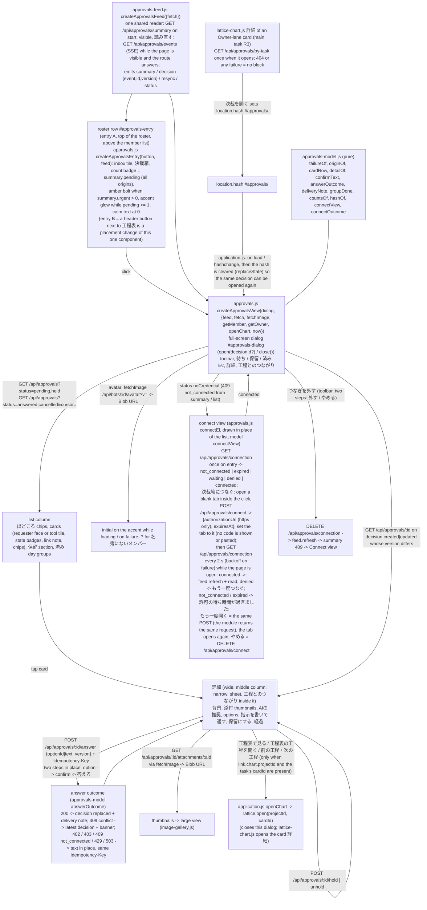

# Web 決裁箱 (Approval Box extension page)

Owner: Admi (bot-1f622329) for the Web screen. Data and wording are not decided here: the data contract is the 決裁箱拡張 module's `/api/approvals/*` (owner Delta, bot-ae42e3e9; canonical in `approval-box-extension/contract/approvals-contract.md` until that module lands in this repo), and what the user sees, the user path, failure views and motion are Delta's Owner-approved `screen-spec.md` (same design language as the [工程表 page](lattice-chart.md)). R6 (Trony, 2026-11-15) assigned the Web screen to Admi.

The Web calls **only** `/api/approvals/*` through the web-gateway, same-origin Owner session, exactly like `/api/lattice/*`. It never calls Approval Box. Until the module child is mounted the page is built and tested against Delta's `contract/fixtures/*.json` as canned responses.

## Function map

| Function | Input -> output |
| --- | --- |
| `failureOf(status, body)` | HTTP answer -> `old` (404 without `error.code`), `notEntitled` (403 `not_entitled`, state trial / none), `expired` (403 state expired / revoked, 402), `noCredential` (409 `not_connected`), `conflict` (409 with `decision`), `wait` (429), `reconnect` (503, network), `refused` (400, other) |
| `originOf(decision)` | `origin.kind` -> `{external, face: member | tile, tool, via, session, badge}`: bellteam = requester face + name; external = grey tool tile (terminal for Claude Code / Codex / Cursor, chat for Claude / ChatGPT, globe otherwise) + 「<tool> · <session>」 + badge 外部から; unknown = globe tile + 「出どころ不明」 + 外部から. Visibility never depends on `kind` |
| `cardRow(decision, now)` | state badges (回答待ち, 急ぎ, 保留, 修正あり, 外部から), age, title, note (工程表「…」が、この回答を待っています / 工程表につなげています / 工程表とはつながっていません / 保留中です…), chips (期限 今日 HH:MM JST, 推奨あり), aria label; no ids |
| `confirmText(decision, label)` | linked: 「<label>」で答えますか？ 答えると、<who>が続きに進み、工程「<task>」が済みになります。 External or unlinked: 答えると、<tool>に届きます。 |
| `answerOutcome(status, body)` | `ok` / `conflict` {decision} / `retry` {message} (503, network, 429) / `stop` {message} (402, 403, not_connected, 400) |
| `deliveryNote(decision)` | `delivered`/`fetched` green 答えました。<who>に届きました。; `waiting` violet …会話に戻ると受け取ります。; `unknown` amber 答えは保存しました。ただ、…届いたかを確かめられませんでした。… + 再開の文をコピー (`resumePhrase`, button reads コピーしました for 2 s) |
| `groupDone(items, now)` | 済み: newest `updatedAt` first, JST day headings (今日 / 昨日 / M月D日), AI-withdrawn rows struck through with `cancelReason` |
| `linkPanel(decision)` | right column: `linked` (previous / this / next cards, one sentence of what answering does, `ids` for 工程表の工程を開く), `connecting` (工程表につなげています, muted), `unlinked` (dashed neutral card つながっていません + the two explanations, no button) |
| `connectView({phase, server, note})` | connect state -> `{text, tone, spinner, actions}`: `idle` (決裁箱につながっていません。つなぐと、自動で決裁を読み込みます。 / after `server: expired` 決裁箱とのつなぎの期限が切れました。もう一度つないでください。; 決裁箱につなぐ, 読み直す), `opening` (spinner, button off), `waiting` (決裁箱の画面で、許可してください。終わると、ここが自動で読み込みます。 + spinner; もう一度開く, やめる), `denied` (許可されませんでした。もう一度つなげます。; もう一度つなぐ); `note` is one line under the buttons |
| `connectOutcome(status, body)` | POST /api/approvals/connect -> `ok {url}` (200 and `authorizationUrl` starts with `https://`), `again` (402 / 403 / 404 / 409: leave to the feed, `feed.refresh()` draws the right view), `retry {message}` (503, 429, network, bad body: いまは決裁箱につなげませんでした。少し待って、もう一度押してください。) |
| `countsOf(summary)` | ring `answeredToday / filedToday`, counters 待ち / 急ぎ / 保留, entry badge; every origin counted whatever the filter |
| `createApprovalsEntry(button, {feed, open})` / `createApprovalsView(dialog, {...})` | the entry row and the dialog; `view.open(decisionId?)` selects that decision (the hash form `#approvals/<id>` is read by `application.js`, `parseHash`) |
| `createApprovalsFeed({fetch, ...})` | `start()` / `stop()` / `refresh()` / `on(fn)`; `summary`, `status` (`connecting`, `live`, `drop`, `old`, `notEntitled`, `expired`, `noCredential`). Terminal statuses stop the stream and hold no timer; they leave on 読み直す, opening the page, or the page becoming visible |

## Data ownership

Memory only: the connect phase (`idle` / `opening` / `waiting` / `denied`) and the one-line note, the last summary, the lists, the selected decision, the origin filter (kept while the page lives, not stored), the answer step of one decision with its Idempotency-Key, thumbnail Blob URLs (revoked on close). The server stays the source; every first read, 読み直す, reconnect (`resync`) and version mismatch refetches. Nothing is stored in the browser and no id is drawn.

## Failure handling

The views are the `screen-spec.md` failure views 1-11. Each leaves on its own or by one action on the same screen; none is a guard.

| Failure | Shown | Exit |
| --- | --- | --- |
| route 404 | このサーバーではまだ決裁箱の拡張を使えません。サーバーが更新されると、自動で使えます。 + 閉じる | 読み直す / next open / page visible |
| 403 not_entitled (trial / none) | 決裁箱の拡張は、まだ使えません。… + 契約を確かめる (re-read), 閉じる | 契約を確かめる |
| 402 / 403 expired / revoked | 決裁箱の契約が切れています。… + 閉じる | 読み直す |
| 409 not_connected | the connect view: 決裁箱につながっていません。つなぐと、自動で決裁を読み込みます。 + 決裁箱につなぐ, 読み直す, 閉じる | 決裁箱につなぐ (waits for the Owner's allow in Approval Box's own tab, then reads by itself), 読み直す |
| connect waiting | 決裁箱の画面で、許可してください。終わると、ここが自動で読み込みます。 + spinner | the poll sees `connected` and reads; もう一度開く; やめる; 閉じる (the poll stops with the page) |
| connect denied / lapsed / not started | 許可されませんでした。もう一度つなげます。 / 許可の待ち時間が過ぎました。もう一度つないでください。 / いまは決裁箱につなげませんでした。… | もう一度つなぐ (a new request) |
| 503 / network / stream drop / 35 s silence | last view dimmed, pill 決裁箱に再接続しています… | backoff 1, 2, 4 … 30 s forever while the page is visible and open |
| 答える 503 / 429 / network | いまは送れませんでした。答えは残っています。少し待って、もう一度押してください。 | 答える again, same Idempotency-Key |
| 答える 409 conflict | violet banner 答える前に、◯◯が内容を直しました。もう一度、内容を確かめてください。; the screen shows the decision from the error | nothing is sent; options are on screen |
| 答える 200, delivery unknown | amber note + 再開の文をコピー | copy; the note stays |
| requester not in the roster | face ?, 名簿にないメンバー | appears once the member exists |
| decision gone (`deleted`, 404) | the card leaves the list; an open 詳細 closes | none |

No credential, billing or contract link is drawn on the Web (the Web has no contract page); the messages say what is wrong and the action is 読み直す or 閉じる.

## Tests

`test/web-approvals.test.mjs` (Delta's fixtures copied under `test/fixtures/approvals/` as canned bodies): `failureOf`, `originOf` for bellteam / external / unknown, `cardRow` (badges, notes, chips, no ids), `confirmText`, `answerOutcome`, `deliveryNote`, `groupDone`, `countsOf`, hash parsing; the feed with a fake fetch and clock (summary, events, backoff, terminal statuses hold no timer); the view with a fake DOM (open -> list, filter never hides, two-step answer with the same Idempotency-Key on retry, 409 replaces, hold / unhold, narrow sheet).
