# Webの会話選択・送信・表示更新

[全体図](../../feature-map.md)の画面側を、Web内の実装から説明する。APIは[入口索引](../../entrypoints.md)、編集・画像・Goalは[管理詳細](management.md)。基底の巨大なapp stateは既に分割した。一覧取得の競合も[最終照合で見つけた修理](../../web-final-gaps.md)で整理した。

## 選択と各機能の状態を分ける

appは組立て・一覧・会話選択・機能間の接続を持つ。各機能へ必要な対象やcallbackだけを渡す。画面の状態を持つことは、サーバーの記録やnativeの実行状態を所有することではない。

| 所有者 | 状態 / 実際の窓口 | callerと受渡し |
| --- | --- | --- |
| [application.js](../../../../web/application.js) | setup/authMode/settings、bots/rooms/owner、selected/type、SSE接続、既読、部屋別返信先 | `boot/startConversations/loadBots/selectBot/selectRoom/clearSelection`。一覧から明示的なtargetを各viewへ |
| [conversation-composer.js](../../../../web/conversation-composer.js) | 会話別drafts、送信中snapshot、sending、回収欄retained | app→`select/clear/addImages/send/update/showError`。`onAccepted/onSelect`をappへ返す |
| [conversation-timeline.js](../../../../web/conversation-timeline.js) | 対象、履歴Mapと前後ページ、queue、取得世代と読取順、scroll、色cache | app→`open/refresh/close/updateTarget/isBusy/updateStops`。`onQueueChange/onStop`だけappへ返す |
| [message-images.js](../../../../web/message-images.js) | 発言ID別preview、取得中Promise、失敗集合、所有URL | app→`remember/close`、timeline→`load/get/failed`。可変Mapをappへ公開しない |
| 各編集・補助view | 開いた対象、未保存入力、読取/保存中、局所URL/timer | app→各`open(target)`。一覧の変更通知と選択はappへ返す。[管理詳細](management.md) |
| [goals.js](../../../../web/goals.js) | Bot別snapshot、draft、binding、観測revision | app→`open/select/refresh/refreshSelected/refreshOnEvent`。Goalの正本はnative |
| appの既読 | `loadReadReceipts/markConversationRead`、localStorage | 最近IDから一覧の未読を描く。サーバーへ読了記録を送らない |

`loadBots`はBot/room/Ownerの三要求を並行して受け、その一式を一覧へ反映する。保存正本ではなく表示用cacheである。`catalogueRead`で一覧の読取順を持ち、最新の結果だけ適用する。Ownerプロフィール保存応答とBot/room削除受付は、先行読取を失効させて受理した値を表示する。timelineのtokenは履歴を守り、上流の一覧にはこの別の所有が必要になる。

`loadBots`は適用したらtrue、旧読取なら成功/失敗を表示へ反映せずnull、最新読取の失敗はthrowする。Bot/room保存と再起動後の自動選択はtrueの時だけ。composerの受付後更新はnullを表示失敗にせず、実GET失敗と履歴のfalseだけを扱う。起動・SSE・停止後にも同じ窓口を使い、古い結果を避けるための再GETは増やさない。

初回一覧が503でも、一覧上に未取得理由と「一覧を再取得」を表示し、既SSEを接続する。起動失敗を空一覧の取得成功へ変えず、案内Botの自動選択は一覧成功時だけ。最新の一覧GET失敗は取得済み表示と下書きを保持し、既SSEのready/変更通知又は明示buttonの読取だけで復帰する。成功した最新GETで案内を消し、古い応答は案内も変更しない。再取得はGETだけで、本文/画像の再POSTや新pollを行わない。

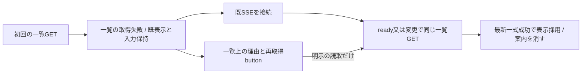

### 初回設定はあとへ回せる

`/api/setup`が`ready`でなければ`openOnboarding`の画面を出す。この画面は守る対象（データ消失・接続先違い・秘密・権限）を持たないので、閉じるのを止めない。Escと「あとで設定する」で閉じられる。閉じたら`onLater`→`startConversations`で一覧・Update・SSEを始め、一覧上に案内カード（icon・「初回設定がまだ済んでいません」・主ボタン「初回設定を続ける」）を出す。押すと`/api/setup`を読み直して同じ画面を開く。一覧が空の時の文は、検索語があれば検索の文、なければ「まだメンバーはいません」（setup未完了なら主ボタンへ案内）にする。`ready`になった時（画面の開始操作、又はSSEのsetup通知）は案内を消す。`startConversations`は二度目以降、Update/SSE/通知を再開せず、一覧の再読と案内Botの自動選択だけを行う。案内Botの自動選択は`phase=ready`の時だけ。サーバーの初回設定状態とAPIは変えない。

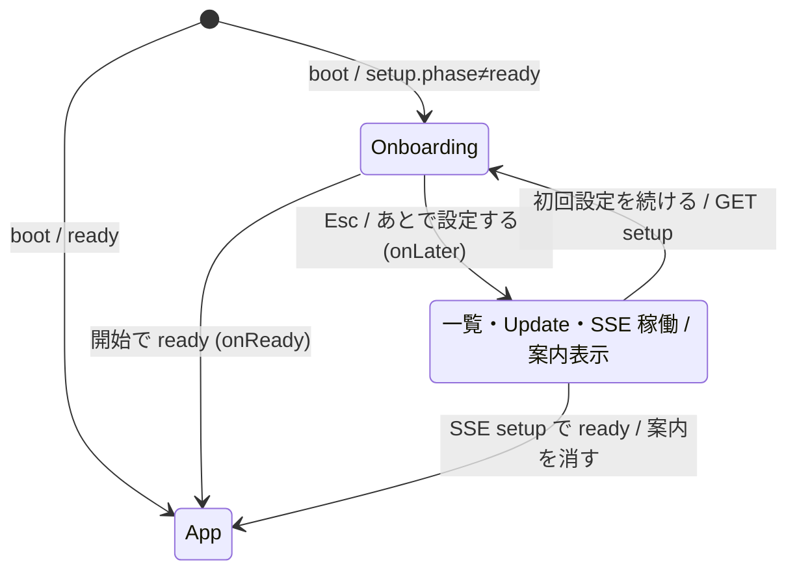

## 開いた会話の結果だけを描く

### D1 failed-input display: function map and data flow

Kiro owns queue/dispatch, N102 owns the closed history projection, and Web owns rendering only. The final dispatch policy observes actual state and prepares the desired configuration before sending; legacy uncertainty reasons are display compatibility, never a new Web gate.

| Existing Web function | Accepted input → presentation | Failure and ownership |
| --- | --- | --- |
| `renderQueueStatus` | `status:'failed'` and `errorCode` → failed label plus a fixed Japanese reason | No stop button for any failed row; unknown codes retain generic failure. Other queue states keep their current behavior |
| `isBusy` → application `updateSendButton` | Same queue entries, excluding `failed` → existing main stop/send affordance | A refused input cannot make the seat appear busy; the UI does not replay or restart it |
| `renderItemElement` / `deliveryLabel` | Direct/message/peer `delivery:'failed'` plus `delivery_error:{code}` → fixed plain Japanese | Known accepted/unknown tracking retains neutral precedence; non-failed items ignore stale reasons |
| `roomTimelineItem` | Affected `record.deliveries[*].delivery_error` → existing aggregate failure reason | No Room top-level reason. Preserve IDs, routing failure and accepted/unknown tracking semantics |

Closed code-only mapping:

| Code | Japanese display |
| --- | --- |
| `BOT_OBSERVATION_FAILED` | 席の状態を確認できず、送信できませんでした。席を再起動してください。 |
| `BOT_CONFIGURATION_FAILED` | 席の設定を反映できず、送信できませんでした。設定を確認してください。 |
| `BOT_LAUNCH_FAILED` | 席を起動できず、送信できませんでした。席を再起動してください。 |
| `BOT_SEND_FAILED` | 席への送信に失敗しました。送信結果を確認してください。 |
| `BOT_DELIVERY_FAILED` | 送信に失敗しました。会話を確認してください。 |
| `BOT_SESSION_UNCONFIRMED` (legacy) | 席の状態を確認できず、送信できませんでした。席を再起動してください。 |

DFD: existing HTTP queue/history → current conversation/read generation → unchanged delivery ID/groupId association → closed-code lookup → plain text failed row. Queue `failed` → excluded from busy → no main stop affordance. History accepted/unknown → existing neutral tracking label. A later non-failed status → old reason hidden. No failure-display edge produces POST, automatic replay, restart, native error text or a new poll. This changes only the Web internal diagram and existing rendering source; module.json and whole-system connection edges stay unchanged. The single new UI case is separate from Kiro's owned refusal writer/readback unit; old test groups are not rerun.

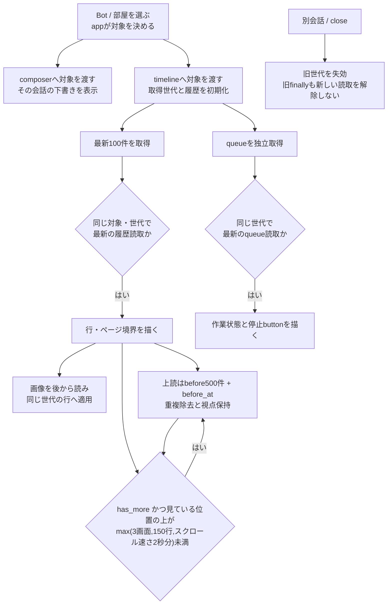

| 段階 | caller → 実関数 | 結果・失敗の行先 |
| --- | --- | --- |
| 選択 | app `selectBot/selectRoom → loadMessages(false)` | ヘッダ・composer・Goal/screen/返信先を接続。timelineのMapを触らない |
| 新しい会話 | `open → readHistory(openTimeline)` | 対象をcopyしtokenとhistoryRequestを進める。queueを待たず本文を描く |
| queue | `openTimeline/refreshTimeline → refreshTimelineQueue` | tokenとqueueRequest一致だけ適用。失敗は末尾に表示、本文読取とは独立 |
| 新しい履歴 | `refresh → readHistory(refreshTimeline)` | latest/afterを並行取得。同対象でも古い返却を適用しない。後着画像も同token |
| 機械の席の答え（吹き出し） | `renderItem` → `renderItemElement`（machine_event の `words` で `bubble:true`） | 本体が「終わったターンの最後の words 行」だけに付ける `bubble:true` を読み、通常の受信メッセージと同じ吹き出し・同じMarkdown（`richTextHtml`）で描く。最後かどうかはWebで決めない。他の words 行は今までどおり書かれた文字。吹き出しは行自身のid（`me-<seq>-<part>`）で返信・引用して返信・転送・コピーを出す（`bubbleMessage`：本文・引用・転送コメントは `machine_event.text` 全体。契約は conversation/machine-stream.md「Reply, forward, quote and copy of a bubble」）。書かれた文字の行・thinking・道具・カード・まだ印の無い行には出さない。行は同じidで置き換わるので、`bubble` が付いた時は `rerenderItem` が描き直す |
| 先読み（a471-scrollback-web） | `openTimeline` の末尾（最初の表示のあと、待たずに背景で）と scroll listener → `fillViewport` → `wantOlder` → `readHistory(loadOlderMessages)` | machine-stream.md「History pages of a long stream」。最初のページは100件（`TIMELINE_FIRST_PAGE`）、再読込（`refreshTimeline`）の直近確認は10件。見ている位置の上に `max(3画面, 150行, 上向きスクロール速さの2秒分)` が読み込み済みになるまで、前ページを1つずつ続けて読む（`has_more` の間。`clientHeight>0` の時だけ）。最初の表示のあとはスクロールしなくても前の1ページが読まれる。1ページごとに世代tokenと遡る位置を確かめ、読取失敗・位置が進まない・別会話に替わったら止まる（失敗は末尾の「もう一度読み込む」。次のスクロールで再び試す。ループしない） |
| 過去ページ | scroll listener → `fillViewport` → `loadOlderMessages` | `before=<最古の行のid>&before_at=<その行のat>` を500件（`TIMELINE_MORE_PAGE`）、重複除去して先頭へ。scrollHeight差を足して視点を保つ。finallyは同tokenだけ解除。サーバーの上限が小さい間は、その上限に切られるだけで動く |
| 行とカード | `renderItem/renderItemElement/roomTimelineItem` | 秘密・質問の既部品を使う。完了callbackも元token一致時だけ該当行を描き直す |
| 末尾 | `renderTail/renderQueueStatus/renderThinking` | queue/処理中/error/停止button。停止実行はappの`stopMember`へ |
| 読取失敗 | `readHistory` | 同じ世代/読取のエラーを履歴末尾へ表示しfalseを返す。SSEの切断へ変換しない |
| 画像 | `loadStoredMessageImages → messageImages.load → rerenderItem` | cacheが取得とURLを所有し、timelineが描画先の世代を所有する |

### Fork rows (read-only fork inquiry, 2026-11-10, N102)

Contract: [fork inquiry "Records and display"](../conversation/fork-inquiry.md#records-and-display) (N102). History items may carry the new optional key `seat:{kind:'fork', fork_id}` (inquiry, interim words, answer, and the relay row that also has `in_reply_to`). N102's projection passes it; the Web only reads it.

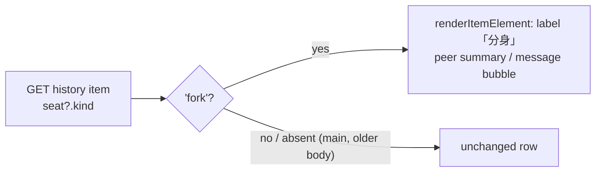

| Function | Contract |
| --- | --- |
| `seatLabel(item)` (conversation-timeline.js) | `item.seat?.kind === 'fork'` -> `分身`, else `null`. `fork_id` and `in_reply_to` are not read |
| `renderItemElement` | peer row: label at the start of the summary line; message/interim bubble: label above the text, after the sender line. Rows without `seat` render exactly as before |

No request, storage or guard added. Source reach: `web/conversation-timeline.js`, `web/styles.css`, `test/timeline-open-queue.test.mjs` (fork case).

サーバーは`createMessageViews.sources → timelinePage/webMessage`で保存履歴とカード索引を合成する。部屋には秘密、直接会話には秘密と質問カードがある。`TimelineIndex`はページ検索、`ConversationStore/RoomHistory`は保存記録の読取であり、WebがJSONLを書き換える経路ではない。

## 秘密カードのOwner向け公式認証リンク

既Owner向け履歴の `item.secret_request.ownerGuide?: {url:string}` を `renderItemElement → renderSecretRequest` へ渡す。直接/部屋、初回/latest/after/beforeは共通描画を使う。usageが管理runの許可・正常/pending・run15分と入力10分の最小期限を確認し、会話担当がページ後段でOwner向け応答だけに付与する。元shared row/秘密item/get、内部MCP/Bot通知、通常receipt、本文、exportには追加しない。共通投影への無条件追加やWebのexport後処理ではこの分離を代替しない。

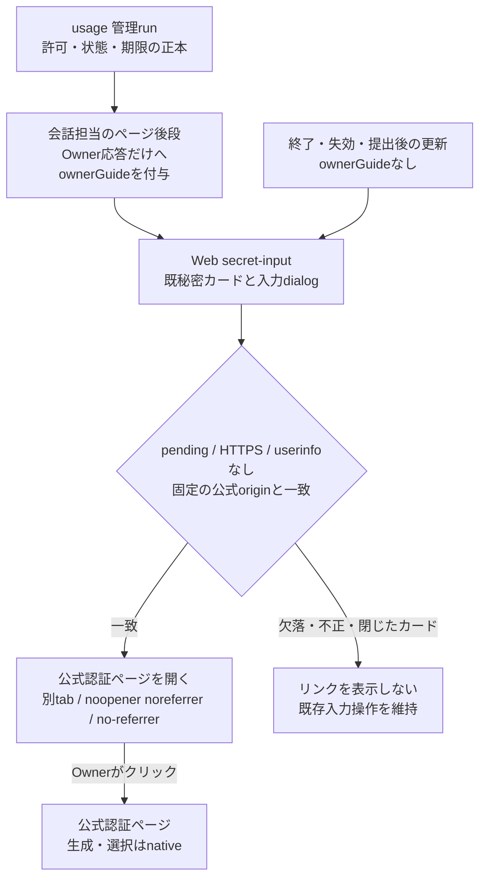

許可originは `https://claude.ai`、`https://console.anthropic.com`、`https://platform.claude.com` の完全一致。変更はRoot/nativeとの契約変更とする。リンク文言は固定し、URLを本文・console・エラー・storageへ書かず、先読み通信・自動認証・新URL RPC・poll・新認証画面を追加しない。入力dialogは同じ依頼のカード再描画時にリンク部分だけを更新し、入力値やsubmit/cancelの既契約を変えない。サーバーの期限判定を端末の時計や独自timerで補わず、履歴更新でfieldが除去された時にカードと開いているdialogからリンクを除く。クリックは認証完了の証拠にしない。

Webが所有するsourceは `web/secret-input.js`、既callerは `web/conversation-timeline.js:renderItemElement`。URLはブラウザーのanchorだけが持ち、新しいWeb資材/export/依存はない。機能間窓口は既HTTP/SSEのままなのでmodule.json/生成全体図の接続変更はなく、外部ページへの遷移をこの担当図へ記す。有限fixtureは `test/secret-owner-guide.test.mjs` の固定3origin/不正URL/旧カード/閉じた状態/既dialog/明示submitと取消、`timeline-open-queue` の直接・部屋と履歴更新時の除去。Owner専用投影とexport除外の実fixtureはサーバー担当との結合で確認する。人工DOM試験を公式認証/本番の成功と扱わない。

## 秘密入力dialogの1Password参照選択

usage（ミカ）が source/reference/handle/revision/resolution の正本を持つ。Webは既秘密カードの `item.secret_request.inputOptions?: {preferred:'onepassword'|'stored', onePasswordAvailable:boolean}` を読み、入力方法の選択と一回のsubmit本文だけを持つ。

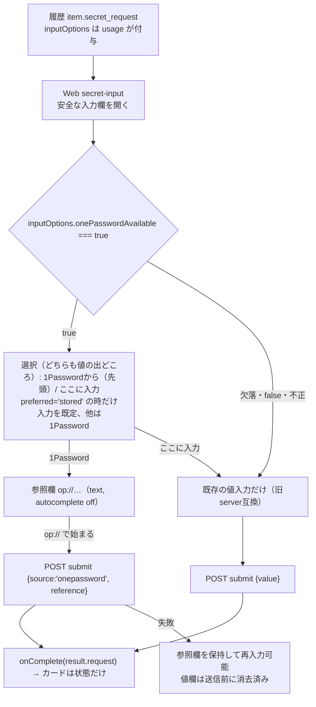

参照と値はカード・履歴・console・storage・エラー文へ出さない。参照欄はdialogを閉じる/画面を隠すと消去する。参照の構文と1Password接続・解決の正否はserverが判定し、Webは `op://` 接頭辞の確認だけを行う。`onePasswordAvailable` が無い旧serverでは画面も本文も既存のまま。Appleの同等UIはベルの担当。

端末鍵（Mika `credentials.requestTerminalKey`、2026-11-09）: `request.purpose === 'terminal.ssh'` の時だけ、値欄は複数行の `textarea`（OpenSSH秘密鍵の改行を保つ。autocomplete/spellcheck/autocapitalize off、`-webkit-text-security: disc` で伏せ字）。値はtrim・改行変換をせずそのまま `{value}` で一回送る。`terminal.sudo` と他の秘密は既存の一行password欄。1Password参照欄・既定選択・消去規則・submit経路は変えない。fixtureは `test/secret-onepassword-choice.test.mjs`。

端末鍵の1Password選択（Mika、2026-11-10、Owner要望）: `terminal.ssh` と `terminal.sudo` は、参照欄の代わりに `GET /api/secret-requests/:id/onepassword-items` の一覧から選ぶ `select` を出す（sudoはusageがLogin/Passwordのパスワード欄を返す）。sudoの選択肢は「1Passwordのパスワードから選ぶ」/「パスワードを入力して保存する」、値欄は一行password欄のまま。両方のselectの上に検索欄（`type=search`、「名前や保管庫で絞り込む」）を置き、入力のたびに題名か保管庫名に文字を含む項目だけへ選択肢を作り直す（大文字小文字を区別しない）。合わなくなった選択は外す。検索文字は秘密ではなく、送信しない。submit本文・消去規則は変えない。旧本体はどの用途にもSSH鍵の一覧を返すので、sudoのselectは参照が `/password` で終わる項目だけを残す（旧本体では選べる項目が無く、入力欄はそのまま使える）。

入力方法の言い方（Trony経由のOwner指摘、2026-11-11 14時台JST「対称性がない」）: 二つの選択肢はどちらも「値をどこから出すか」で言う。1Password側は picker なら「1Passwordから選ぶ」、`op://` 参照欄なら「1Passwordから読み出す」。入力側は「ここに入力する」（`terminal.ssh` は「ここに貼り付ける」）。保存するかどうかは選択肢に書かず、下の note だけが言う。一回だけ使う値（`purpose === 'terminal.login'`、または usage が付ける `oneTime === true`）は「保存」「登録」を一切言わない: note は login が既存文、`oneTime`（usage、Mika #1025: 値はusage子のメモリだけに置き最初の解決で消える、ディスクへ書かない）は「1回だけ使い、使い終わったら消します。保存せず、会話にも送られません。」、submit は「渡して続ける」。それ以外の submit は「登録して続ける」のまま。submit本文・消去規則・既定選択は変えない。

## 受付後の追跡故障を未達へ読み替えない

会話/実行担当が公開する任意の`deliveryTracking`を表示根拠にする。`delivery === 'failed'`で、`schema === 'bellteam.delivery-tracking.v1'`・`admission === 'accepted'`・`completion === 'unknown'`の全値が一致する場合だけ、直接会話は「受付済み・完了未確認」、部屋は「完了未確認の宛先あり」と中立表示する。fieldなしの旧failedと欠落/未知/不正tupleは従来の「配達失敗」を維持する。running/delivered/stopped等をこのtupleだけで変更しない。

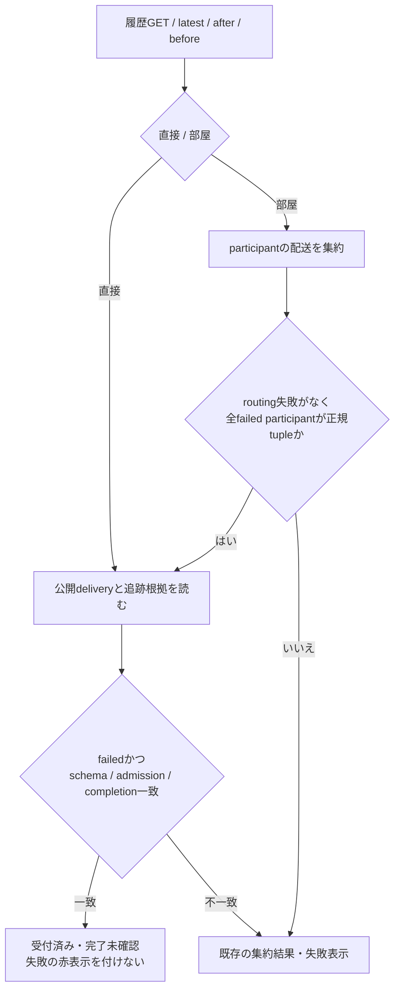

部屋で根拠のないfailedが混在する場合とrouting失敗は、全員受付済みと集約しない。公開wireは直接item.deliveryTrackingと部屋deliveries[]各要素.deliveryTrackingだけ。部屋トップレベルの根拠や保存用delivery_trackingを読まない。全failed participantの根拠が揃う場合だけ表示用projectionへ同じ根拠を渡す。部屋内のrunning/queued/stopped等を全体成功へ補完しない。保存されたdeliveryや過去履歴は変更しない。queueがある時の作業表示を維持し、queue解除後も同じ履歴根拠を表示する。本文/画像/自由error/native receipt内部は新しい根拠に使わず、自動再送や再送推奨を追加しない。

全callerは`normalizeItems → roomTimelineItem`と`renderItemElement → deliveryLabel`。直接/部屋の初回・最新・追加・過去ページは共通描画を使い、世代/読取順の契約は維持する。確認は`timeline-open-queue`の正規/旧/不正tuple、部屋の混在・routing失敗、ページ更新とqueue解除の人工fixture。公開窓口の接続は既HTTP履歴のままなのでmodule.json/生成全体図に接続変更はない。N102のcallback→JSONL→store→HTTPで生成した`test/fixtures/delivery-tracking-wire.json`を同じtimeline試験へ接続し、直接の中立表示・既peer詳細の配送失敗表示なし・根拠なしfailed混在部屋の失敗優先を確認する。peer詳細へ新しい配送状態欄は追加しない。

## Active-turn send: function map and data flow

| Function / caller | Input → output |
| --- | --- |
| `updateSendButton` ← selection, queue change, catalogue refresh, stop start/completion | Direct Bot queue activity → show both Send and Stop. Stopping hides Send and disables Stop; deleting hides Stop and keeps the composer-disabled Send visible. Room behavior stays unchanged. |
| form `submit` → `sendMessage` → `conversationComposer.send` | An explicit Send submits the current draft through the existing per-conversation single-flight and HTTP message path, including while the Bot is active. |

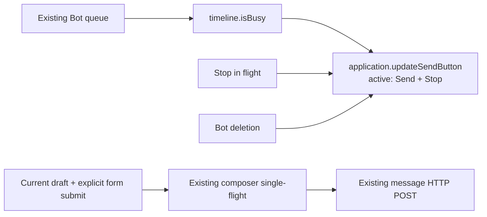

This changes Web presentation only. Existing HTTP/SSE interfaces, Room routing, draft ownership and send admission remain unchanged. The focused Web test covers the control states and an active-turn form submission with the existing composer; it does not establish live AI delivery.

## 送信受付と表示更新を別の段階にする

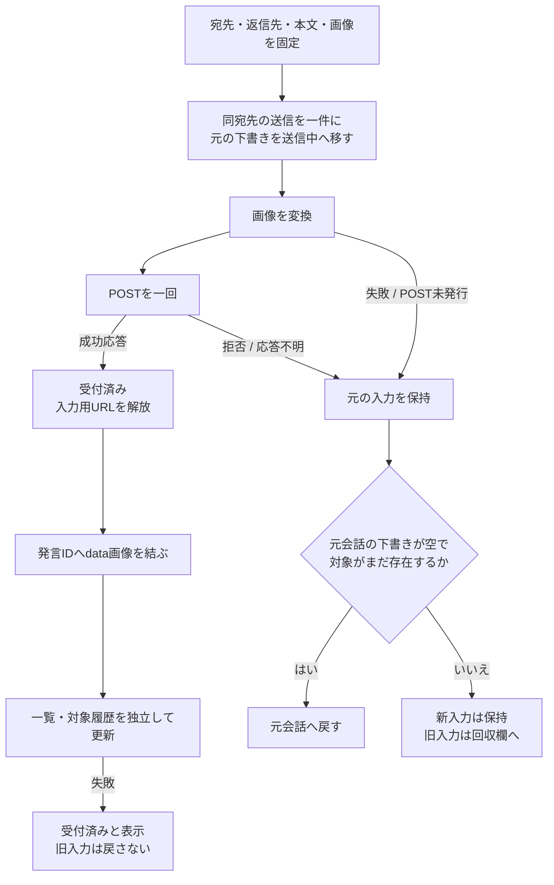

appの`sendMessage`は返信者必須条件を確認し、composerの`send`を呼ぶ。composerは`capture → claimMessageSend`で対象・本文・File/URL・返信先を**画像変換前**に固定する。送信中も新しい下書きを書けるが、同宛先POSTは受付まで一件。finallyでsendingを解除し、受付後の`onAccepted`失敗では元本文を戻さない。

`onAccepted`はappへ渡したcallback。画像previewをcacheへ渡し、一覧と現在表示中の対象履歴をallSettledで更新する。どちらかが失敗しても二回目POSTはしない。API成功はAI回答完了ではない。POST応答不明では未配送と断定せず、再送前に会話を確認するよう表示する。

明確な`MEMBERS_NOT_ACCEPTED`拒否では、メンバー機能が新しい操作を受け付けられないことと入力保持を説明する。容量/閉鎖/世代の原因はWebで推測せず、本文・画像・返信者の既回収と明示送信の契約を維持する。

`renderRecovery`は「保持した入力」に元本文、画像、宛先、理由を出す。新しい入力を連結・上書きしない。「入力欄に戻す」は空の元下書きへ移して会話を選ぶだけで、送信は利用者の明示操作。削除済み対象は復元不可だが、本文と画像は読める。「破棄」と添付削除はそのURLを解放する。これはページ内の状態であり、再読込後まで保管するstoreではない。

## 変更通知は履歴そのものではない

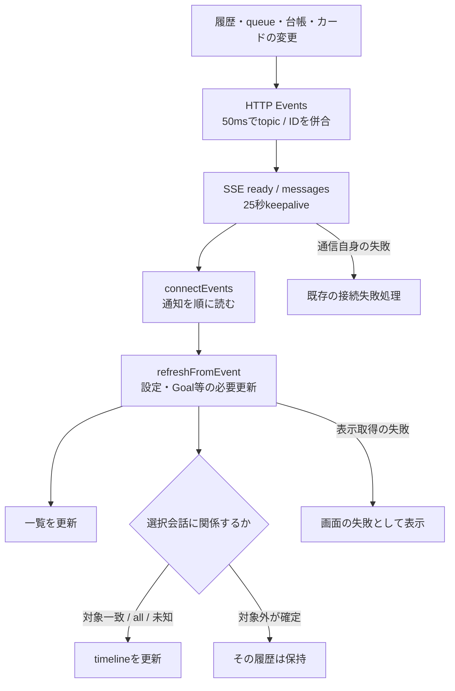

`createMessageEvents.startMessageWatch`はwatchを登録してtopicと対象を併合する。未知/欠落、履歴置換、対象不明はall。開始失敗でも既登録watchを閉じ、server終了時もwatch終了エラーを保持する。全producer表は[第一段の表](../../refactor-plan.md)を参照する。

appの`refreshFromEvent`はsettings/setup/Goal処理と一覧・必要履歴を接続する。`eventAffectsTimeline`はready/all/未知topic/不足IDを全更新へ戻す。一覧には他会話の活動も必要なので毎回読む。表示GETの失敗はcatchして表示へ返し、SSEの再接続理由にしない。

`application.connectEvents`は`client.watchEvents`へ通知と停止表示のcallbackを登録する。`client.watchEvents`の通信側はTypeError/429/5xxで既存の1.5秒再接続、Abortは終了、その他は接続停止を表示する。正常EOFは戻る分岐で、自動再接続があるとは扱わない。要求の取消と保留中の再接続timerは返却する解除関数が所有し、pagehideのpersisted=falseで終了する。persisted=trueでは維持する。

### Reply to a message (a269, Web client of N102's `reply_to`)

Contract and owner: [conversation/reply.md](../conversation/reply.md) (N102). The Web only draws the saved snapshot and sends the id of a picked item; it never builds a quote from loaded items. Additive: an older body returns no `reply_to`, so no quote is drawn; a body that ignores the sent field still delivers the message.

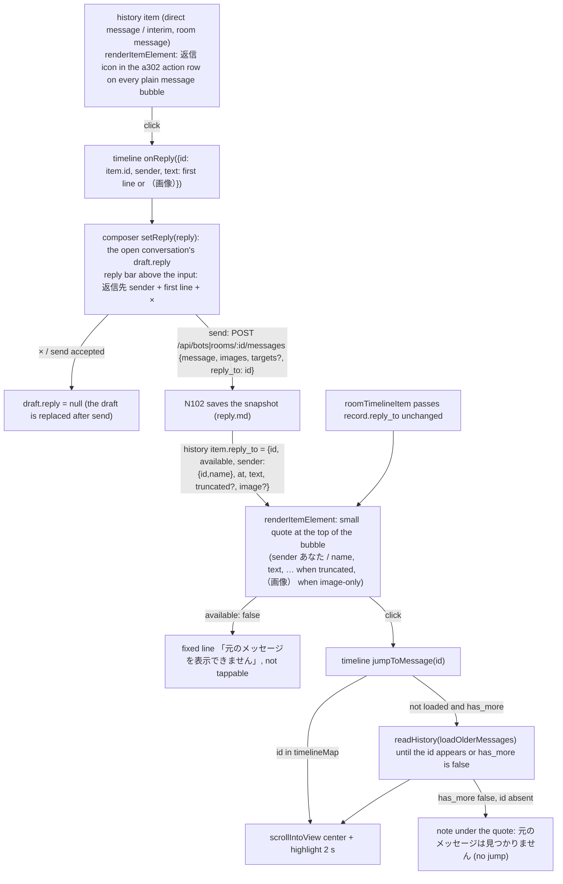

| Function | Contract |
| --- | --- |
| `renderItemElement` (conversation-timeline.js) | message bubble: `item.reply_to` -> quote button (`available`) or the fixed gone line; the a302 action row (返信 / 転送 / コピー icons) on plain message / interim bubbles. Peer rows, secret / question cards, queue cards and the thinking bubble get neither |
| `roomTimelineItem` | adds `reply_to: record.reply_to` (undefined when absent) |
| `jumpToMessage(id)` | single read path of a jump: finds the row in the loaded map, else pages older with the existing `before` cursor (`readHistory(loadOlderMessages)`, waits while another older read is running), no cap other than `has_more`; a failed page read shows the existing inline retry and stops the jump |
| `setReply(reply)` / reply bar (conversation-composer.js) | per-conversation `draft.reply`; shown above the input with ×; kept with the draft when a send fails or the conversation changes; the send body gets `reply_to` only from it; not counted as input (a reply alone cannot be sent) |

Data ownership: the reply target lives only in the composer's draft (memory, per conversation); the quote lives only in the history item. No storage, no id on screen. Failure handling: a failed send keeps the draft with its reply; an unavailable original is drawn as the fixed line and the message stays normal. No guard is added: no new refusal, lock or timeout.

Source reach: `web/conversation-timeline.js`, `web/conversation-composer.js`, `web/application.js` (wiring), `web/index.html` (`#reply-bar`), `web/styles.css`, `test/conversation-composer.test.mjs`, `test/timeline-open-queue.test.mjs`.

#### Quoting a selected part (a269r, wire shape: reply.md "Quoting a selected part")

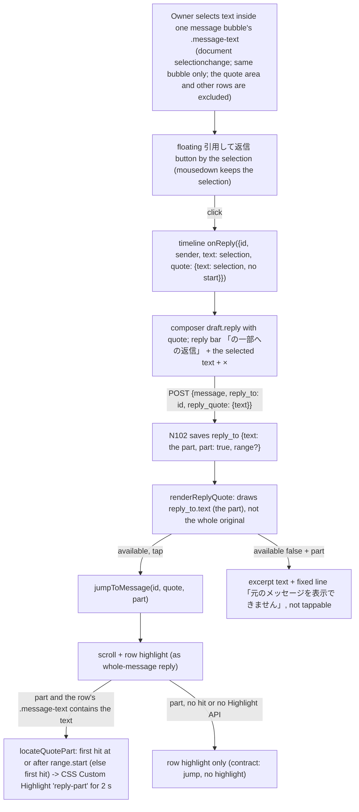

| Function | Contract |
| --- | --- |
| selection handler (conversation-timeline.js) | on `selectionchange`: a non-collapsed selection whose start and end are in the same `.message-text` of a plain message row in this timeline -> remember `{id, sender, text}` and place the button; anything else hides it. The text is the rendered selection (markup stripped), cut to 10000 characters; `start` is never sent (the bubble shows rendered markup, reply.md says to omit it) |
| `renderReplyQuote` | `part` -> the quote shows `reply_to.text` (already the part); `available: false` + `part` -> the excerpt plus the fixed line; no `part` as the whole-message reply |
| `locateQuotePart(texts, text, from)` (exported, pure) | searches the rendered text nodes for `text`: first hit at or after `from` (= `range.start`), else the first hit; returns `{startNode, startOffset, endNode, endOffset}` or `null` |
| composer | `setReply(reply)` keeps `reply.quote`; the send body adds `reply_quote: {text}` next to `reply_to` only when the reply has one |

Touch (a269t): on `(pointer: coarse)` the button is docked above the composer (CSS, not at the selection) so it never sits on the browser's own selection menu or the drag handles below the selection ends; while it is pressed (`pointerdown` until `pointerup` + 0.4 s) a selection cleared by the touch does not hide it, and the picked text is the one remembered at selection time; scrolling repositions it instead of hiding it (a handle drag near the edge scrolls the list). Native long-press selection and the handles cannot be emulated headless; what was checked is the Selection API path they feed (`selectionchange`) in a 390 px touch-emulated viewport.

Failure handling: nothing found -> row highlight only; Highlight API missing -> row highlight only; the selection button never blocks the whole-message 返信 button. No guard, no storage; the selection text lives in the draft only.

### Image viewer: zoom, pan, download, share (a276, Web client of [image-original.md](../conversation/image-original.md))

The bytes are already the originals: `image_urls[i]` serves the saved file unchanged (`messageImages` fetches it once into a Blob URL, as before). The viewer only adds what the Owner asked for; nothing new is requested from the server and nothing is stored.

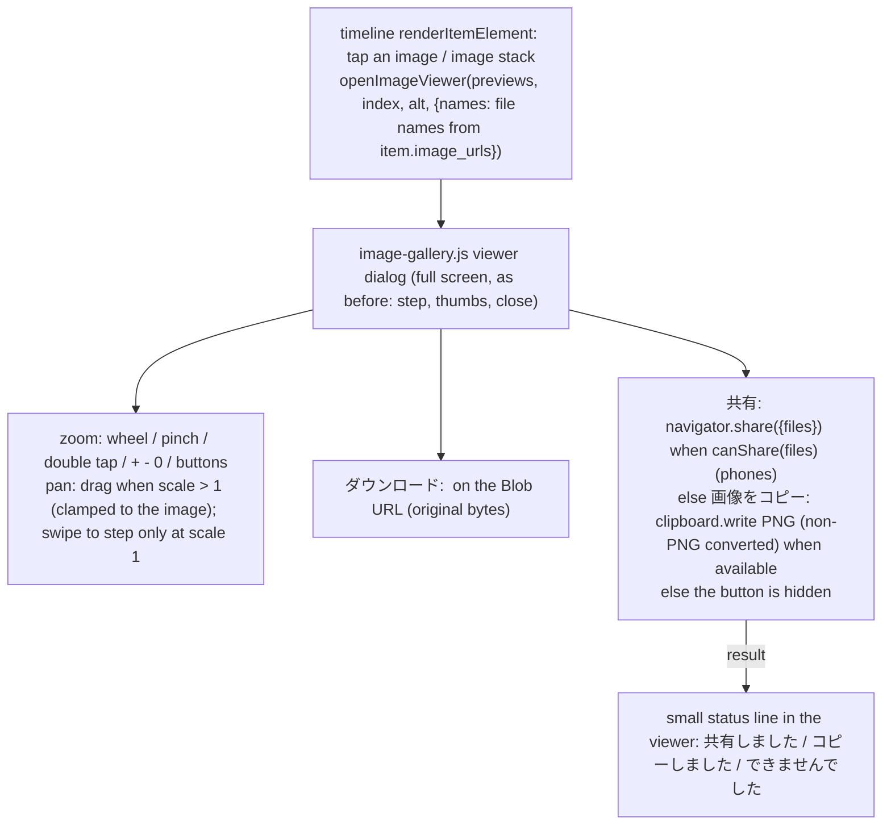

| Function (image-gallery.js, pure ones exported) | Contract |
| --- | --- |
| `zoomAt(view, scale, point)` / `clampView(view, size)` | `view = {scale, x, y}` (pixels from the stage centre). Zoom keeps the point under the pointer fixed; scale 1..8; the offset is clamped so the image never leaves the stage (an image smaller than the stage stays centred) |
| `pinchView(start, now)` | two pointers: scale by the distance ratio, pan by the centre movement |
| `fileNameOf(url)` | last path segment of an image URL, query dropped; `''` for none. Names come from the saved file name (contract: ASCII `{id}.{ext}`) |
| `shareKind(nav)` | `'share'` when `navigator.canShare` accepts a file, else `'copy'` when `clipboard.write` and `ClipboardItem` exist, else `null` |
| viewer | `show(index)` resets the view to scale 1; download name = `names[index]` else `image` + the Blob's type extension; share / copy read the current Blob URL |

`approvals.js` and `bot-editor.js` call `openImageViewer(urls, index, alt)` without names and get the same viewer (download name falls back). Failure handling: a failed share (`AbortError` = the Owner closed the sheet) is silent; any other error and a failed clipboard write show 「共有できませんでした」 / 「コピーできませんでした」 in the status line; the image stays. No guard, no timeout other than the 2 s status line. Source reach: `web/image-gallery.js`, `web/conversation-timeline.js` (names), `web/styles.css`, `test/image-gallery.test.mjs`, this page and `management.md` (the image-gallery row).

### Forward and share-in (a282, Web client of [forward.md](../conversation/forward.md))

The Web sends only the identifiers of the item the Owner picked (`forward`) or the content dropped from another app (`share`); N102 composes `message` + `origin`, the Web draws `origin`. A server without the feature ignores both fields, so the Web ships in the same train as the conversation module (a285, release order in forward.md); nothing is offered conditionally.

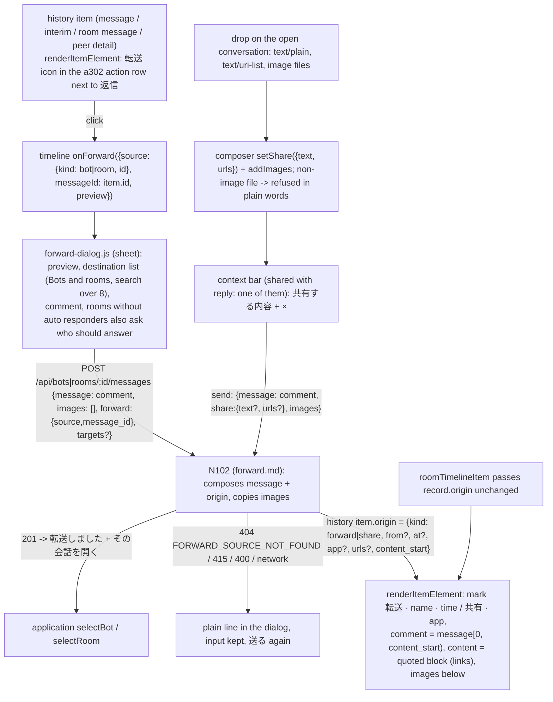

| Function | Contract |
| --- | --- |
| `splitOrigin(message, start)` (conversation-timeline.js, exported, pure) | splits at `content_start` counted in Unicode code points: `{comment, content}`; no `origin` -> the whole message is the comment |
| `forwardPayload({source, messageId, comment, targets})` (forward-dialog.js, exported, pure) | the POST body: `message` = comment, `images: []`, `forward: {source, message_id}`, `targets` only when given; never the text of the original |
| `forwardError(cause)` (exported, pure) | status -> plain Japanese: 404 転送する発言が見つかりません。会話を読み直してください。; 415 画像やファイルを含む発言は、まだ転送できません。; 400 転送できませんでした。; other -> 送信できませんでした（code） |
| `destinationsOf(bots, rooms, query)` (exported, pure) | the list the dialog shows: Bots then rooms, filtered by the search text on the name |
| `shareFromTransfer(dataTransfer)` (conversation-composer.js, exported, pure) | `{text, urls, images, refused}`: `text/uri-list` lines -> `urls` (http / https only, 20, 2000 characters), `text/plain` -> `text` (20000; a lone URL becomes a url), image files -> `images`, any other file -> `refused: true` |
| `installShareDrop(panel, {enabled, composer})` (conversation-composer.js) | `dragover` / `dragleave` / `drop` on the open conversation: shows 「ここへドロップして、この会話に共有」, turns the drop into `composer.setShare` + `addImages` through `shareFromTransfer`; a closed conversation or an unrelated drag is ignored; a non-image file adds the plain refusal |
| composer `setShare` / context bar | one of reply or share per draft; shared content alone is sendable (comment optional); the send body adds `share` and never `reply_to` with it; kept on a failed send like the reply |

Paste: pasting text or an image into the input stays a normal message (unchanged); the marked 共有 comes from dropping on the conversation. Data ownership: the dialog keeps the pick and the comment in memory until it closes; the share content lives in the draft. Failure handling: a failed forward keeps the dialog and its input; a failed share keeps the draft; images-in-forward and file refusals are shown in plain words (415 until N102's image copy and the files task are live). No guard, no timer. Source reach: `web/forward-dialog.js` (new, registered in `web/assets.mjs`), `web/conversation-timeline.js`, `web/conversation-composer.js`, `web/application.js`, `web/index.html`, `web/styles.css`, tests `forward-dialog`, `conversation-composer`, `timeline-open-queue`.

### Message action icons (a302, client UI only; reply.md / forward.md unchanged)

Owner spec (same on every platform): under every message bubble, at its right edge, one row of three small icons that are always visible (touch too): 返信, 転送, コピー. They replace the hover-only 返信 / 転送 text buttons.

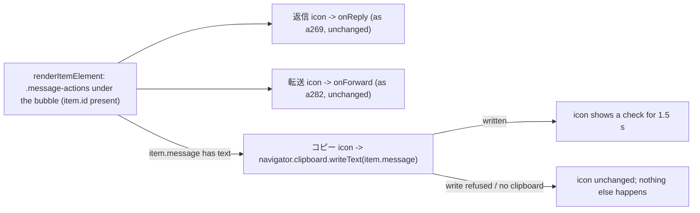

| Function | Change |
|---|---|
| `renderItemElement` | the row holds `replyButton`, `forwardButton` and (text only) `copyButton`; image-only rows have no コピー |
| `copyButton(item)` | new: copies `item.message` as stored (a forward / share row copies comment + content); no storage, no request |
| `replyButton` / `forwardButton` | same handlers; the label is now a fixed line icon with the same `aria-label`; 転送 is the box with an arrow straight up out of it (a308), so it does not mirror the 返信 arrow |

Data ownership: unchanged (the clipboard write is the only new effect; the page keeps nothing). Failure handling: a refused clipboard write leaves the icon as it was. The selection button 引用して返信 is untouched. Source reach: `web/conversation-timeline.js`, `web/styles.css`, `test/timeline-open-queue.test.mjs`.

### Machine seat entries, the question card and the fold view (a471-askuser-web, a471-fold-web, Web client of [machine-stream.md](../conversation/machine-stream.md))

Owner design 2026-11-20: a machine seat's question is a card in the chat log, answered as data. Web draws only what the Bot page `items` carry (`kind: "machine_event"`, `machine_event.view/display/request`); it never parses the raw line and never reads the screen.

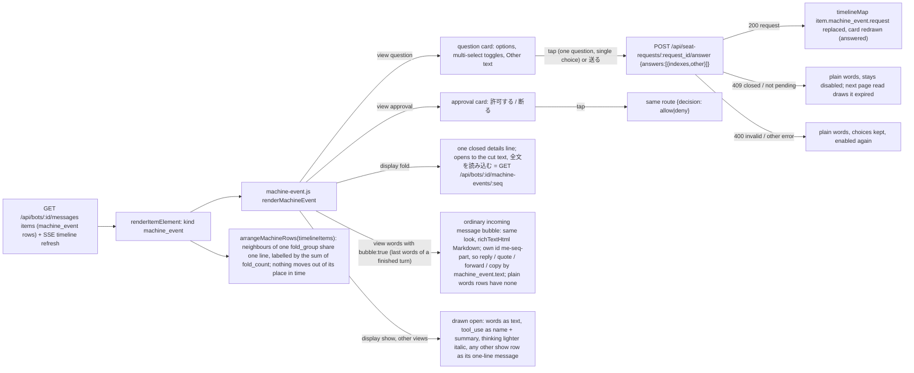

| Function | Input -> output and ownership |
| --- | --- |
| `renderMachineEvent(item, {api, sender, onChanged})` (web/machine-event.js, new) | entry -> node. Reads only `machine_event`. The only writer is the answer route; the card keeps its choices in the closure |
| question card | One block per question (header chip, text, options with description). Single choice with exactly one question: a tap sends at once. Otherwise taps toggle (`aria-pressed`) and 送る is enabled when every question has an option or Other text. Single choice: Other text clears the option and an option clears the text (server rule: one answer). Multi-select: options and Other add up |
| approval card | 許可する -> `{decision:"allow"}`, 断る -> `{decision:"deny"}`; pending only |
| answered / expired | no buttons: answered shows the chosen labels (by index) and the Other text; expired says the seat no longer waits |
| fold row (`display: "fold"`) | one closed `details` line (`item.message`); opening shows the cut `text`; `truncated` adds 全文を読み込む, which reads the stored line once and shows it. Open/closed is the app's state (`foldOpen`, per opened conversation, never stored) |
| `arrangeMachineRows(container, openKeys)` | Run after every render site of the timeline (open, refresh, older page, row replace, failed read). Idempotent: takes groups apart, then wraps 2+ consecutive rows of one `fold_group` into one line. Nothing is moved out of its place in time (Owner 2026-11-21: 「時系列をくずすな」; the old step that pulled a `tool_result` under its `tool_use` is withdrawn). Label (machine-stream.md "Tool calls fold and the order rule"): `n` = sum of the members' `fold_count` (1 when absent); `n>1` `<fold_group> ×<n>` (`tools ×2`, `background ×9`); `n=1` the `message` of the member that counts 1 (the tool name); `n=0` `<fold_group> ×<members>`. Opened, the members are listed in their own order, each still a closed line that opens to its text (`tool_use`: `tool.summary`). A `show` row or another group breaks a run |
| `display` | only `fold` folds; anything else (including an old `hide`) is drawn, never dropped (Owner 2026-11-20: 「畳むのはオッケー。消すのはダメ」) |
| `renderItem` / `rerenderItem` (conversation-timeline.js) | `machine_event` joins the card snapshot, so a page re-read that changes `request.status` redraws the same row in place; `onChanged` replaces the row's `request` with the 200 body |

Errors in plain words (code only in the data): 409 `SEAT_REQUEST_CLOSED` / `REQUEST_NOT_PENDING` / 404 -> この質問は、もう答えを待っていません。 (controls stay disabled); 400 `SEAT_REQUEST_ANSWER_INVALID` -> 選び直してください; 503 -> このサーバーはまだ答えを受け取れません; others -> もう一度選んでください. No automatic retry. No guard is added: a pending card leaves by the Owner's answer, by the seat (the card is redrawn as expired) or by the answer attempt itself.

Data ownership: unchanged. The page keeps no new storage; the request lives in conversation (`state/machine-stream`). A body without the machine rows shows nothing new. Source reach: `web/machine-event.js`, `web/conversation-timeline.js`, `web/assets.mjs`, `web/styles.css`, `test/machine-event.test.mjs`.

## 操作の接続と確認範囲

`stopMember`は対象Bot別single-flightで`requestMemberStop`を一回呼ぶ。停止応答と後続一覧/履歴GETを分け、表示は開始時の会話が同じ場合だけ。書出しはクリック時のtype/idを固定してexportをGETし、一時Blobをdownload後revokeする。一覧の競合と失敗の修理経緯は[追加修理](../../web-final-gaps.md)に記録する。

確認先：`conversation-composer`、`timeline-open-queue`、`message-images`、`web-event-refresh`、`chat-input`、`http-server`の局所試験。実Web＋人工APIで入力の回収とPOST回数も確認した。実配送やApple画面の成功の証明ではない。現在の分離の検証範囲と実行方法は[担当正本](README.md)を参照する。

## Working word (a471-spinner-words-web, 2026-11-21)

Contract: [conversation/working-word.md](../conversation/working-word.md) (N102). Web only draws; it keeps no word list, never chooses or rotates a word.

| Function | Input → output | Notes |
| --- | --- | --- |
| `renderQueueStatus` (+ local `workingWord`) | running queue row with `workingWord` → line `<bot>が作業中・<word>` with the existing animated "…" (`queue-working::after`) | Rooms use the same line per member. No `workingWord` (queued, failed, older server) → today's text |
| `renderTail` → `renderThinking(botId, word)` | first running row's `workingWord` → the bubble shows `<word>…` (same animated "…") instead of the three dots | No word → three dots as before |

DFD: existing queue read (`state.timelineQueue.items`, already unchanged rows) → `renderTail` → text only. No new request, SSE topic, storage, guard or asset; module.json and the whole-system diagram are unchanged. The word is a display label: not saved, not sent to the seat. Reduced motion keeps the static "…" (existing rule). Source reach: `web/conversation-timeline.js`, `test/timeline-open-queue.test.mjs`.
