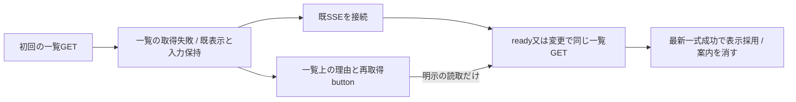
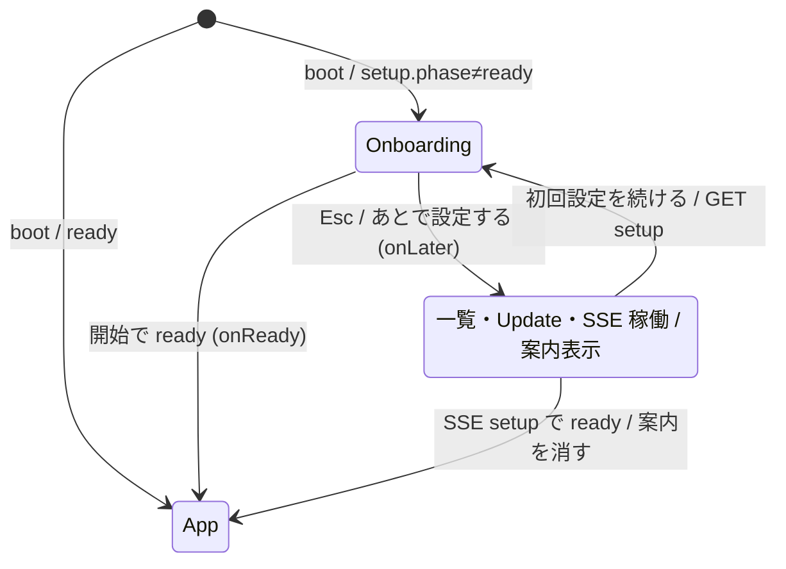
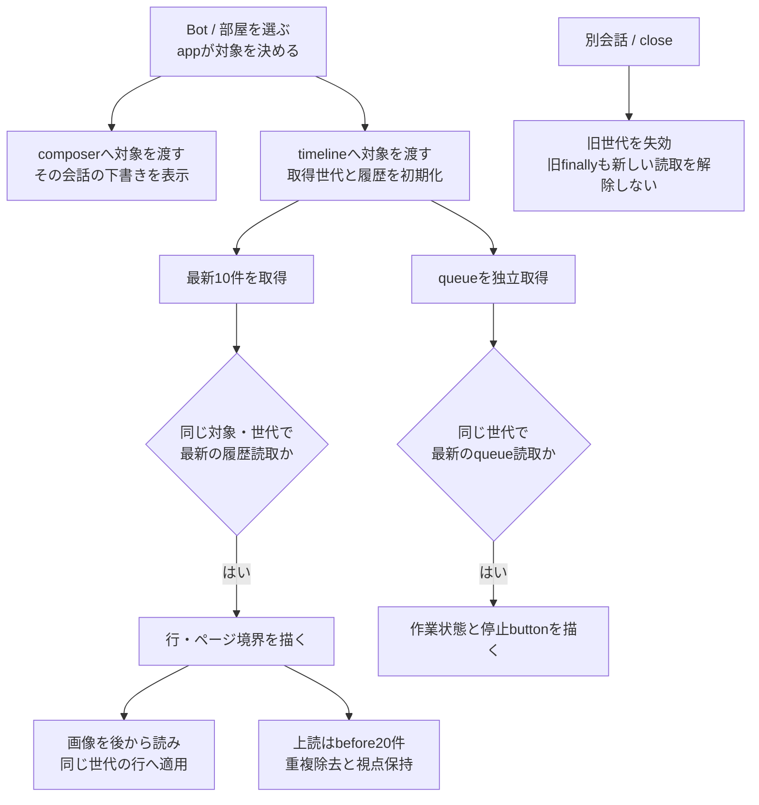
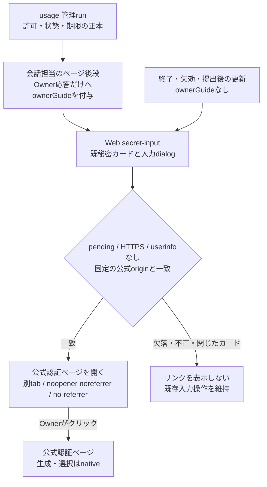
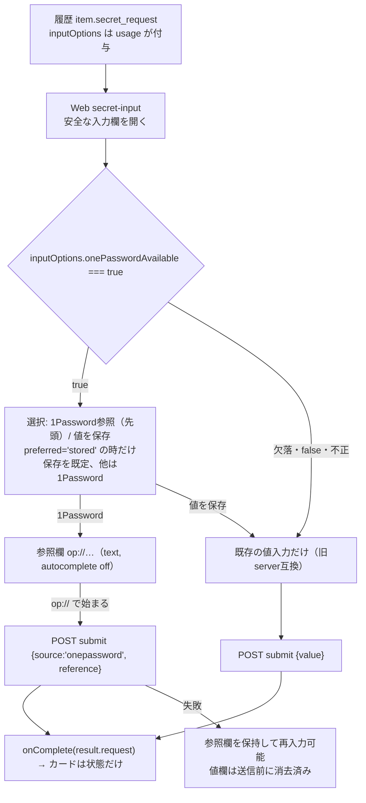
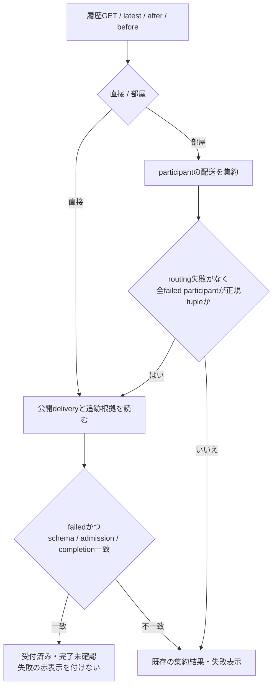
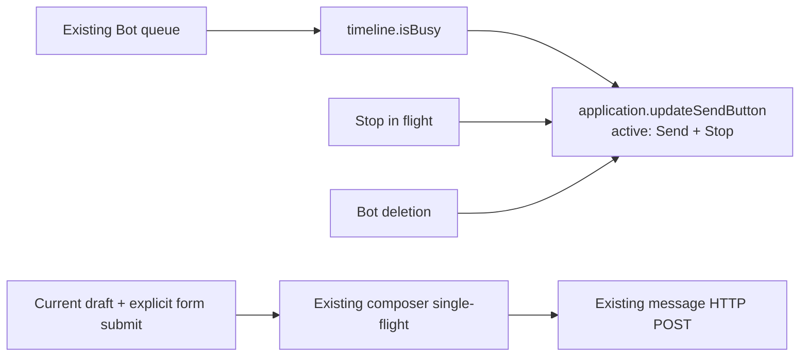
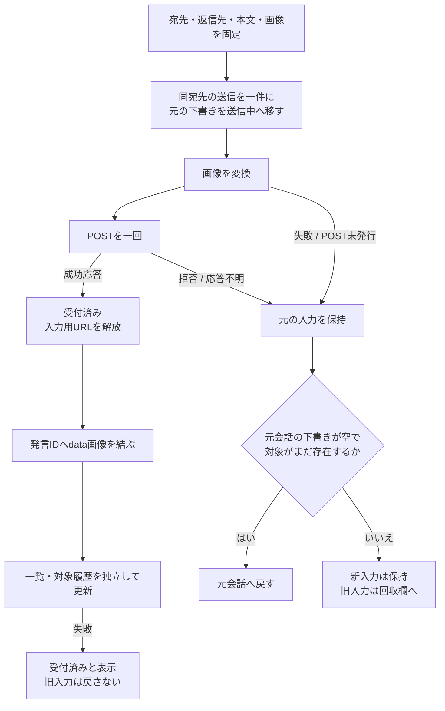
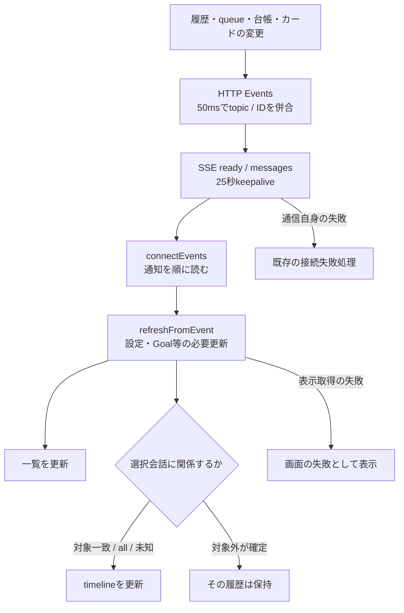

# Webの会話選択・送信・表示更新

[全体図](../../feature-map.md)の画面側を、Web内の実装から説明する。APIは[入口索引](../../entrypoints.md)、編集・画像・Goalは[管理詳細](management.md)。基底の巨大なapp stateは既に分割した。一覧取得の競合も[最終照合で見つけた修理](../../web-final-gaps.md)で整理した。

## 選択と各機能の状態を分ける

appは組立て・一覧・会話選択・機能間の接続を持つ。各機能へ必要な対象やcallbackだけを渡す。画面の状態を持つことは、サーバーの記録やnativeの実行状態を所有することではない。

| 所有者 | 状態 / 実際の窓口 | callerと受渡し |
| --- | --- | --- |
| [application.js](../../../../web/application.js) | setup/authMode/settings、bots/rooms/owner、selected/type、SSE接続、既読、部屋別返信先 | `boot/startConversations/loadBots/selectBot/selectRoom/clearSelection`。一覧から明示的なtargetを各viewへ |
| [conversation-composer.js](../../../../web/conversation-composer.js) | 会話別drafts、送信中snapshot、sending、回収欄retained | app→`select/clear/addImages/send/update/showError`。`onAccepted/onSelect`をappへ返す |
| [conversation-timeline.js](../../../../web/conversation-timeline.js) | 対象、履歴Mapと前後ページ、queue、取得世代と読取順、scroll、色cache | app→`open/refresh/close/updateTarget/isBusy/updateStops`。`onQueueChange/onStop`だけappへ返す |
| [message-images.js](../../../../web/message-images.js) | 発言ID別preview、取得中Promise、失敗集合、所有URL | app→`remember/close`、timeline→`load/get/failed`。可変Mapをappへ公開しない |
| 各編集・補助view | 開いた対象、未保存入力、読取/保存中、局所URL/timer | app→各`open(target)`。一覧の変更通知と選択はappへ返す。[管理詳細](management.md) |
| [goals.js](../../../../web/goals.js) | Bot別snapshot、draft、binding、観測revision | app→`open/select/refresh/refreshSelected/refreshOnEvent`。Goalの正本はnative |
| appの既読 | `loadReadReceipts/markConversationRead`、localStorage | 最近IDから一覧の未読を描く。サーバーへ読了記録を送らない |

`loadBots`はBot/room/Ownerの三要求を並行して受け、その一式を一覧へ反映する。保存正本ではなく表示用cacheである。`catalogueRead`で一覧の読取順を持ち、最新の結果だけ適用する。Ownerプロフィール保存応答とBot/room削除受付は、先行読取を失効させて受理した値を表示する。timelineのtokenは履歴を守り、上流の一覧にはこの別の所有が必要になる。

`loadBots`は適用したらtrue、旧読取なら成功/失敗を表示へ反映せずnull、最新読取の失敗はthrowする。Bot/room保存と再起動後の自動選択はtrueの時だけ。composerの受付後更新はnullを表示失敗にせず、実GET失敗と履歴のfalseだけを扱う。起動・SSE・停止後にも同じ窓口を使い、古い結果を避けるための再GETは増やさない。

初回一覧が503でも、一覧上に未取得理由と「一覧を再取得」を表示し、既SSEを接続する。起動失敗を空一覧の取得成功へ変えず、案内Botの自動選択は一覧成功時だけ。最新の一覧GET失敗は取得済み表示と下書きを保持し、既SSEのready/変更通知又は明示buttonの読取だけで復帰する。成功した最新GETで案内を消し、古い応答は案内も変更しない。再取得はGETだけで、本文/画像の再POSTや新pollを行わない。

### 初回設定はあとへ回せる

`/api/setup`が`ready`でなければ`openOnboarding`の画面を出す。この画面は守る対象（データ消失・接続先違い・秘密・権限）を持たないので、閉じるのを止めない。Escと「あとで設定する」で閉じられる。閉じたら`onLater`→`startConversations`で一覧・Update・SSEを始め、一覧上に「初回設定を続ける」を出す。押すと`/api/setup`を読み直して同じ画面を開く。`ready`になった時（画面の開始操作、又はSSEのsetup通知）は案内を消す。`startConversations`は二度目以降、Update/SSE/通知を再開せず、一覧の再読と案内Botの自動選択だけを行う。案内Botの自動選択は`phase=ready`の時だけ。サーバーの初回設定状態とAPIは変えない。

## 開いた会話の結果だけを描く

### D1 failed-input display: function map and data flow

Kiro owns queue/dispatch, N102 owns the closed history projection, and Web owns rendering only. The final dispatch policy observes actual state and prepares the desired configuration before sending; legacy uncertainty reasons are display compatibility, never a new Web gate.

| Existing Web function | Accepted input → presentation | Failure and ownership |
| --- | --- | --- |
| `renderQueueStatus` | `status:'failed'` and `errorCode` → failed label plus a fixed Japanese reason | No stop button for any failed row; unknown codes retain generic failure. Other queue states keep their current behavior |
| `isBusy` → application `updateSendButton` | Same queue entries, excluding `failed` → existing main stop/send affordance | A refused input cannot make the seat appear busy; the UI does not replay or restart it |
| `renderItemElement` / `deliveryLabel` | Direct/message/peer `delivery:'failed'` plus `delivery_error:{code}` → fixed plain Japanese | Known accepted/unknown tracking retains neutral precedence; non-failed items ignore stale reasons |
| `roomTimelineItem` | Affected `record.deliveries[*].delivery_error` → existing aggregate failure reason | No Room top-level reason. Preserve IDs, routing failure and accepted/unknown tracking semantics |

Closed code-only mapping:

| Code | Japanese display |
| --- | --- |
| `BOT_OBSERVATION_FAILED` | 席の状態を確認できず、送信できませんでした。席を再起動してください。 |
| `BOT_CONFIGURATION_FAILED` | 席の設定を反映できず、送信できませんでした。設定を確認してください。 |
| `BOT_LAUNCH_FAILED` | 席を起動できず、送信できませんでした。席を再起動してください。 |
| `BOT_SEND_FAILED` | 席への送信に失敗しました。送信結果を確認してください。 |
| `BOT_DELIVERY_FAILED` | 送信に失敗しました。会話を確認してください。 |
| `BOT_SESSION_UNCONFIRMED` (legacy) | 席の状態を確認できず、送信できませんでした。席を再起動してください。 |

DFD: existing HTTP queue/history → current conversation/read generation → unchanged delivery ID/groupId association → closed-code lookup → plain text failed row. Queue `failed` → excluded from busy → no main stop affordance. History accepted/unknown → existing neutral tracking label. A later non-failed status → old reason hidden. No failure-display edge produces POST, automatic replay, restart, native error text or a new poll. This changes only the Web internal diagram and existing rendering source; module.json and whole-system connection edges stay unchanged. The single new UI case is separate from Kiro's owned refusal writer/readback unit; old test groups are not rerun.

| 段階 | caller → 実関数 | 結果・失敗の行先 |
| --- | --- | --- |
| 選択 | app `selectBot/selectRoom → loadMessages(false)` | ヘッダ・composer・Goal/screen/返信先を接続。timelineのMapを触らない |
| 新しい会話 | `open → readHistory(openTimeline)` | 対象をcopyしtokenとhistoryRequestを進める。queueを待たず本文を描く |
| queue | `openTimeline/refreshTimeline → refreshTimelineQueue` | tokenとqueueRequest一致だけ適用。失敗は末尾に表示、本文読取とは独立 |
| 新しい履歴 | `refresh → readHistory(refreshTimeline)` | latest/afterを並行取得。同対象でも古い返却を適用しない。後着画像も同token |
| 過去ページ | scroll listener → `loadOlderMessages` | before20件を重複除去して先頭へ。scrollHeight差を足す。finallyは同tokenだけ解除 |
| 行とカード | `renderItem/renderItemElement/roomTimelineItem` | 秘密・質問の既部品を使う。完了callbackも元token一致時だけ該当行を描き直す |
| 末尾 | `renderTail/renderQueueStatus/renderThinking` | queue/処理中/error/停止button。停止実行はappの`stopMember`へ |
| 読取失敗 | `readHistory` | 同じ世代/読取のエラーを履歴末尾へ表示しfalseを返す。SSEの切断へ変換しない |
| 画像 | `loadStoredMessageImages → messageImages.load → rerenderItem` | cacheが取得とURLを所有し、timelineが描画先の世代を所有する |

サーバーは`createMessageViews.sources → timelinePage/webMessage`で保存履歴とカード索引を合成する。部屋には秘密、直接会話には秘密と質問カードがある。`TimelineIndex`はページ検索、`ConversationStore/RoomHistory`は保存記録の読取であり、WebがJSONLを書き換える経路ではない。

## 秘密カードのOwner向け公式認証リンク

既Owner向け履歴の `item.secret_request.ownerGuide?: {url:string}` を `renderItemElement → renderSecretRequest` へ渡す。直接/部屋、初回/latest/after/beforeは共通描画を使う。usageが管理runの許可・正常/pending・run15分と入力10分の最小期限を確認し、会話担当がページ後段でOwner向け応答だけに付与する。元shared row/秘密item/get、内部MCP/Bot通知、通常receipt、本文、exportには追加しない。共通投影への無条件追加やWebのexport後処理ではこの分離を代替しない。

許可originは `https://claude.ai`、`https://console.anthropic.com`、`https://platform.claude.com` の完全一致。変更はRoot/nativeとの契約変更とする。リンク文言は固定し、URLを本文・console・エラー・storageへ書かず、先読み通信・自動認証・新URL RPC・poll・新認証画面を追加しない。入力dialogは同じ依頼のカード再描画時にリンク部分だけを更新し、入力値やsubmit/cancelの既契約を変えない。サーバーの期限判定を端末の時計や独自timerで補わず、履歴更新でfieldが除去された時にカードと開いているdialogからリンクを除く。クリックは認証完了の証拠にしない。

Webが所有するsourceは `web/secret-input.js`、既callerは `web/conversation-timeline.js:renderItemElement`。URLはブラウザーのanchorだけが持ち、新しいWeb資材/export/依存はない。機能間窓口は既HTTP/SSEのままなのでmodule.json/生成全体図の接続変更はなく、外部ページへの遷移をこの担当図へ記す。有限fixtureは `test/secret-owner-guide.test.mjs` の固定3origin/不正URL/旧カード/閉じた状態/既dialog/明示submitと取消、`timeline-open-queue` の直接・部屋と履歴更新時の除去。Owner専用投影とexport除外の実fixtureはサーバー担当との結合で確認する。人工DOM試験を公式認証/本番の成功と扱わない。

## 秘密入力dialogの1Password参照選択

usage（ミカ）が source/reference/handle/revision/resolution の正本を持つ。Webは既秘密カードの `item.secret_request.inputOptions?: {preferred:'onepassword'|'stored', onePasswordAvailable:boolean}` を読み、入力方法の選択と一回のsubmit本文だけを持つ。

参照と値はカード・履歴・console・storage・エラー文へ出さない。参照欄はdialogを閉じる/画面を隠すと消去する。参照の構文と1Password接続・解決の正否はserverが判定し、Webは `op://` 接頭辞の確認だけを行う。`onePasswordAvailable` が無い旧serverでは画面も本文も既存のまま。Appleの同等UIはベルの担当。

端末鍵（Mika `credentials.requestTerminalKey`、2026-11-09）: `request.purpose === 'terminal.ssh'` の時だけ、値欄は複数行の `textarea`（OpenSSH秘密鍵の改行を保つ。autocomplete/spellcheck/autocapitalize off、`-webkit-text-security: disc` で伏せ字）。値はtrim・改行変換をせずそのまま `{value}` で一回送る。`terminal.sudo` と他の秘密は既存の一行password欄。1Password参照欄・既定選択・消去規則・submit経路は変えない。fixtureは `test/secret-onepassword-choice.test.mjs`。

## 受付後の追跡故障を未達へ読み替えない

会話/実行担当が公開する任意の`deliveryTracking`を表示根拠にする。`delivery === 'failed'`で、`schema === 'bellteam.delivery-tracking.v1'`・`admission === 'accepted'`・`completion === 'unknown'`の全値が一致する場合だけ、直接会話は「受付済み・完了未確認」、部屋は「完了未確認の宛先あり」と中立表示する。fieldなしの旧failedと欠落/未知/不正tupleは従来の「配達失敗」を維持する。running/delivered/stopped等をこのtupleだけで変更しない。

部屋で根拠のないfailedが混在する場合とrouting失敗は、全員受付済みと集約しない。公開wireは直接item.deliveryTrackingと部屋deliveries[]各要素.deliveryTrackingだけ。部屋トップレベルの根拠や保存用delivery_trackingを読まない。全failed participantの根拠が揃う場合だけ表示用projectionへ同じ根拠を渡す。部屋内のrunning/queued/stopped等を全体成功へ補完しない。保存されたdeliveryや過去履歴は変更しない。queueがある時の作業表示を維持し、queue解除後も同じ履歴根拠を表示する。本文/画像/自由error/native receipt内部は新しい根拠に使わず、自動再送や再送推奨を追加しない。

全callerは`normalizeItems → roomTimelineItem`と`renderItemElement → deliveryLabel`。直接/部屋の初回・最新・追加・過去ページは共通描画を使い、世代/読取順の契約は維持する。確認は`timeline-open-queue`の正規/旧/不正tuple、部屋の混在・routing失敗、ページ更新とqueue解除の人工fixture。公開窓口の接続は既HTTP履歴のままなのでmodule.json/生成全体図に接続変更はない。N102のcallback→JSONL→store→HTTPで生成した`test/fixtures/delivery-tracking-wire.json`を同じtimeline試験へ接続し、直接の中立表示・既peer詳細の配送失敗表示なし・根拠なしfailed混在部屋の失敗優先を確認する。peer詳細へ新しい配送状態欄は追加しない。

## Active-turn send: function map and data flow

| Function / caller | Input → output |
| --- | --- |
| `updateSendButton` ← selection, queue change, catalogue refresh, stop start/completion | Direct Bot queue activity → show both Send and Stop. Stopping hides Send and disables Stop; deleting hides Stop and keeps the composer-disabled Send visible. Room behavior stays unchanged. |
| form `submit` → `sendMessage` → `conversationComposer.send` | An explicit Send submits the current draft through the existing per-conversation single-flight and HTTP message path, including while the Bot is active. |

This changes Web presentation only. Existing HTTP/SSE interfaces, Room routing, draft ownership and send admission remain unchanged. The focused Web test covers the control states and an active-turn form submission with the existing composer; it does not establish live AI delivery.

## 送信受付と表示更新を別の段階にする

appの`sendMessage`は返信者必須条件を確認し、composerの`send`を呼ぶ。composerは`capture → claimMessageSend`で対象・本文・File/URL・返信先を**画像変換前**に固定する。送信中も新しい下書きを書けるが、同宛先POSTは受付まで一件。finallyでsendingを解除し、受付後の`onAccepted`失敗では元本文を戻さない。

`onAccepted`はappへ渡したcallback。画像previewをcacheへ渡し、一覧と現在表示中の対象履歴をallSettledで更新する。どちらかが失敗しても二回目POSTはしない。API成功はAI回答完了ではない。POST応答不明では未配送と断定せず、再送前に会話を確認するよう表示する。

明確な`MEMBERS_NOT_ACCEPTED`拒否では、メンバー機能が新しい操作を受け付けられないことと入力保持を説明する。容量/閉鎖/世代の原因はWebで推測せず、本文・画像・返信者の既回収と明示送信の契約を維持する。

`renderRecovery`は「保持した入力」に元本文、画像、宛先、理由を出す。新しい入力を連結・上書きしない。「入力欄に戻す」は空の元下書きへ移して会話を選ぶだけで、送信は利用者の明示操作。削除済み対象は復元不可だが、本文と画像は読める。「破棄」と添付削除はそのURLを解放する。これはページ内の状態であり、再読込後まで保管するstoreではない。

## 変更通知は履歴そのものではない

`createMessageEvents.startMessageWatch`はwatchを登録してtopicと対象を併合する。未知/欠落、履歴置換、対象不明はall。開始失敗でも既登録watchを閉じ、server終了時もwatch終了エラーを保持する。全producer表は[第一段の表](../../refactor-plan.md)を参照する。

appの`refreshFromEvent`はsettings/setup/Goal処理と一覧・必要履歴を接続する。`eventAffectsTimeline`はready/all/未知topic/不足IDを全更新へ戻す。一覧には他会話の活動も必要なので毎回読む。表示GETの失敗はcatchして表示へ返し、SSEの再接続理由にしない。

`application.connectEvents`は`client.watchEvents`へ通知と停止表示のcallbackを登録する。`client.watchEvents`の通信側はTypeError/429/5xxで既存の1.5秒再接続、Abortは終了、その他は接続停止を表示する。正常EOFは戻る分岐で、自動再接続があるとは扱わない。要求の取消と保留中の再接続timerは返却する解除関数が所有し、pagehideのpersisted=falseで終了する。persisted=trueでは維持する。

## 操作の接続と確認範囲

`stopMember`は対象Bot別single-flightで`requestMemberStop`を一回呼ぶ。停止応答と後続一覧/履歴GETを分け、表示は開始時の会話が同じ場合だけ。書出しはクリック時のtype/idを固定してexportをGETし、一時Blobをdownload後revokeする。一覧の競合と失敗の修理経緯は[追加修理](../../web-final-gaps.md)に記録する。

確認先：`conversation-composer`、`timeline-open-queue`、`message-images`、`web-event-refresh`、`chat-input`、`http-server`の局所試験。実Web＋人工APIで入力の回収とPOST回数も確認した。実配送やApple画面の成功の証明ではない。現在の分離の検証範囲と実行方法は[担当正本](README.md)を参照する。
