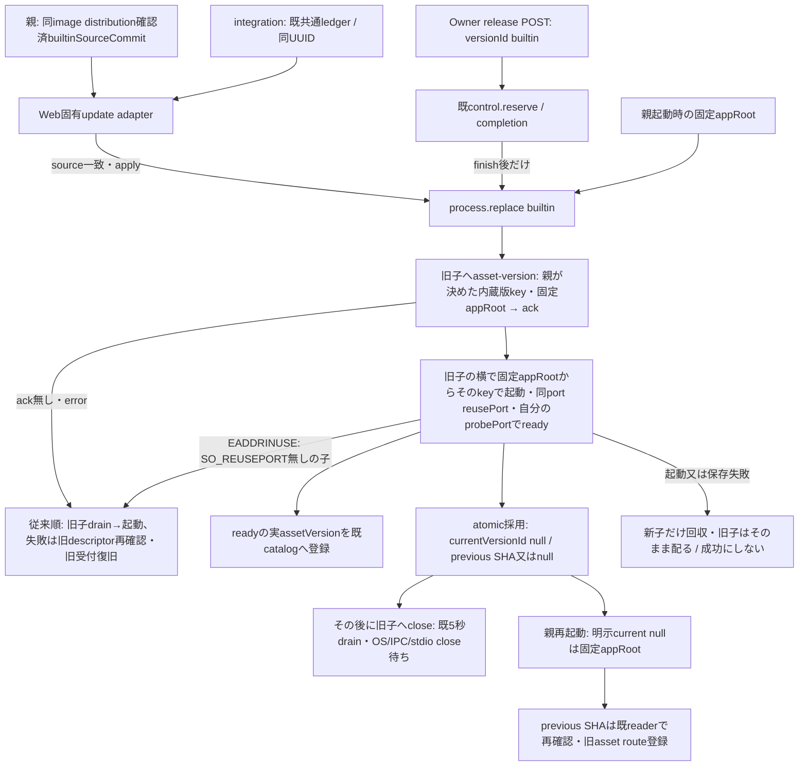
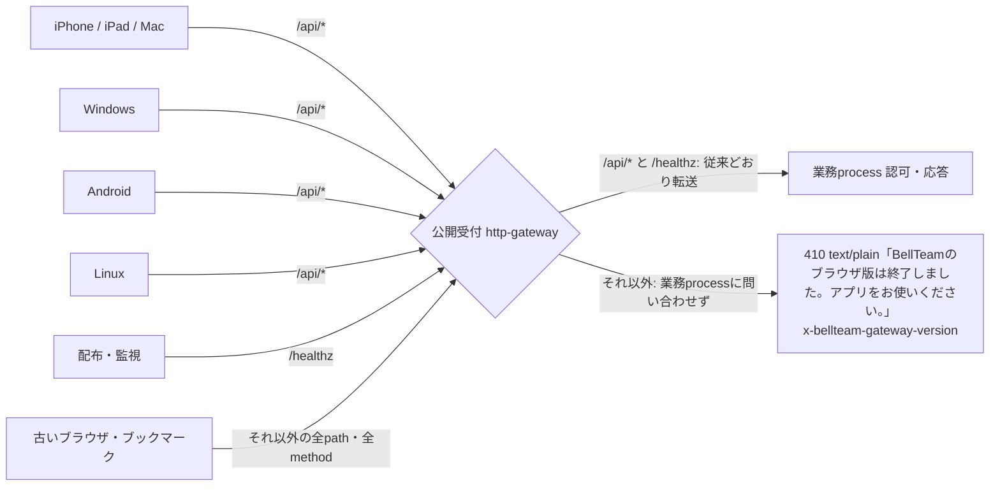

# Web受付固有の内蔵版戻し

Web担当の正本。固定資材のreader/配置は[runtime](../runtime/web-gateway-release.md)、Owner認可・共通排他・ledgerへの登録は[integration](../integration/README.md)が所有する。ここでは`http-gateway-process.mjs`の内蔵版選択/採用状態、`web-gateway-control.mjs`の予約境界、`web-gateway-update-adapter.mjs`の固有adapterだけを扱う。

公開制御の入力はSHA64又は文字列`builtin`だけ。任意path/command/sourceを受け取らない。`builtin`は既readerへ渡さず、親生成時の`appRoot`に固定したdescriptor `{versionId:null,appRoot,protocolVersion:1}`を使う。通常SHAは既readerのdescriptorとsourceCommit/platformをそのまま保持する。

`createWebGatewayUpdateAdapter({gateway,builtinSourceCommit,prepare})`は既current/capture/available/canRollback/prepare/applyを提供する。gatewayは同processを返すclosure、prepareは公開prepareGatewayReleaseの注入。同image distribution由来の確認済sourceSHA40を親が一度だけ渡し、controllerや公開bodyから補完しない。確認値がnull/不正なら内蔵currentは不明null、builtin戻し不可。currentは既version tuple、captureはgeneration:null/pid、availableは実process pidの有無。共通ledgerが計画/UUID/guard/成功確認を所有し、固有helperはそれを複製しない。

builtin targetのorigin/version/sourceCommit/digest:nullが確認済sourceと一致する場合だけcanRollback/prepare/applyを通し、applyは`replace('builtin')`の実Promiseを返す。別sourceや不整合targetはUPDATE_ROLLBACK_UNAVAILABLE、reader未供給はUPDATE_EXECUTOR_UNAVAILABLE。通常SHAはprepareでversion/sourceとcatalogのprotocol/platformを既条件で確認し、相違をUPDATE_TARGET_CHANGED/UPDATE_INCOMPATIBLEで拒否する。path/URLを新たに受け取らず既descriptorを起動へ転記しない。共通import/登録と親の確認済source注入はMollyが担当する。

採用記録は既schemaのまま、`currentVersionId:null`を内蔵版の明示採用として許可する。欠落/不正型/文字列builtin/未知SHAを内蔵版へfallbackしない。保存はready後・旧子停止前、失敗すれば新子だけを回収し旧子が配り続ける（従来順の時は旧子へ復旧する）。現在版の公開値はnull、操作対象はbuiltinで区別する。同版の再予約は既制御の冪等処理を使い、履歴/data/希望/ledgerを巻き戻さない。

asset catalogへnullやbuiltinという仮keyは追加しない。実子readyのassetVersionを登録する。再起動時は直前SHAの資材を再確認して旧URLへ接続する。全世代asset一覧の親再起動を跨ぐ保持は既shortcutの範囲外。

既Owner認可/内部403・finish前cancel・共通mutex/completion・prepare拒否時の旧子維持・同port・5秒drainは変更しない。親closeは交換中の旧子と新子の両方を止める（95eef79bの重ねた交換、[integration](../integration/README.md#公開web受付の二プロセス化初回差分)）。未配置Host設置や署名/実root受入は固有層から補完しない。process/control直接境界は`test/web-gateway-builtin.test.mjs`、adapter直接境界は`test/web-gateway-update-adapter.test.mjs`。人工descriptorと実子/HTTP/一時採用fileを使う。

新旧が並ぶ間、どちらの子も新旧両方の`?v=`資材を返す。旧子は新子の起動前に`asset-version`で新版（内蔵版は親が決めたkey）を版表へ足してackし、新子は旧版をassetCatalogで起動時から持つ。資材は各版の準備済みrootから返し、版を混ぜない。ackできない旧子とは重ねずに従来の順で交換するので、新しいページの資材要求が旧子で404になる時間は無い（Epinel差戻し 11/15）。

## 公開受付が返すもの（a487、2026-11-22、Owner「ブラウザ版を廃止しよう」「今すぐ廃止しよう」）

公式BellTeamはネイティブアプリだけになる。公開受付（`http-gateway.mjs`）はブラウザ画面を配らず、アプリが使う入口だけを残す。今夜の最小除去は受付の1か所（`createHttpGateway`の先頭分岐）で、画面コード（`web/`）と静的配信の枝は後続の全面撤去（a487-web-ui-removal）で消す。

| 経路 | 今夜 | 使うクライアント |
| --- | --- | --- |
| `/api/*`（一覧・会話・SSE `/api/events`・アバター `/api/bots/:id/avatar`・添付 `/api/.../attachments`・`/api/session`・設定・更新ほか） | 変えない（そのまま業務processへ転送） | 全ネイティブアプリ。Apple/Windowsのログイン表示は`/api/session`を開き、`/`は開かない（`LoginView.swift`、`AccessLogin.cs`で確認） |
| `/healthz` | 変えない | 配布・監視 |
| それ以外（`/`、`/index.html`、`/app.js`、`/sw.js`、`/manifest`…） | 画面を返さず、410と終了のお知らせだけ。セッション確認もファイル読みもしない。`x-bellteam-gateway-version`に受付の版を載せ、列車の反映を外から確かめられる | なし（ブラウザだけ） |

- 版交換のready確認（`http-gateway-process.mjs`）は`/`ではなく`/api/session`を新子へ1回読む（アプリが使う転送経路そのものを確かめる）。
- 古い画面の配信枝は`browserUi`（既定false、本番は常にfalse）の裏に残し、受付の版を内容で見分ける版交換試験（`gateway-version-switch`、`web-gateway-builtin`、`web-gateway-update-adapter`）だけがtrueにする。全面撤去で枝ごと消し、試験は`x-bellteam-gateway-version`で見分ける形へ替える。
- 既にブラウザへ登録済みのService Worker（`/sw.js`、通知用）は更新できず残るが、画面は出ない。Web通知の送出停止は全面撤去の範囲。
