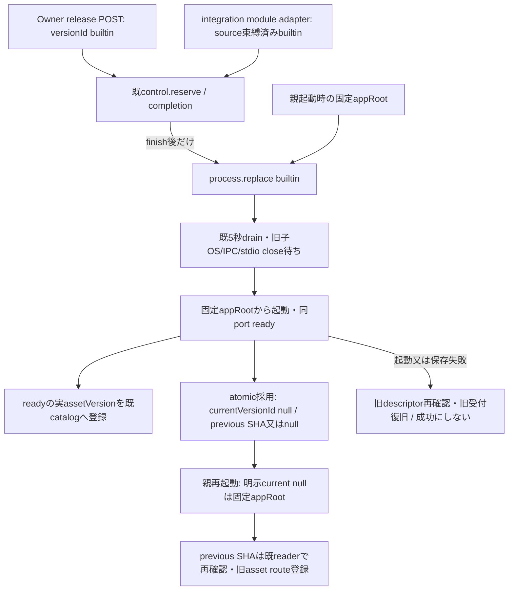

# Web受付固有の内蔵版戻し

Web担当の正本。固定資材のreader/配置は[runtime](../runtime/web-gateway-release.md)、Owner認可・共通排他・module adapterは[integration](../integration/README.md)が所有する。ここでは`http-gateway-process.mjs`の内蔵版選択/採用状態と`web-gateway-control.mjs`の予約境界だけを扱う。

公開制御の入力はSHA64又は文字列`builtin`だけ。任意path/command/sourceを受け取らない。`builtin`は既readerへ渡さず、親生成時の`appRoot`に固定したdescriptor `{versionId:null,appRoot,protocolVersion:1}`を使う。通常SHAは既readerのdescriptorとsourceCommit/platformをそのまま保持する。moduleの戻し可否とbuiltin source束縛は共通adapterが判定し、この固有層では推測しない。

採用記録は既schemaのまま、`currentVersionId:null`を内蔵版の明示採用として許可する。欠落/不正型/文字列builtin/未知SHAを内蔵版へfallbackしない。保存はready後、失敗すれば旧子へ復旧する。現在版の公開値はnull、操作対象はbuiltinで区別する。同版の再予約は既制御の冪等処理を使い、履歴/data/希望/ledgerを巻き戻さない。

asset catalogへnullやbuiltinという仮keyは追加しない。実子readyのassetVersionを登録する。再起動時は直前SHAの資材を再確認して旧URLへ接続する。全世代asset一覧の親再起動を跨ぐ保持は既shortcutの範囲外。

既Owner認可/内部403・finish前cancel・共通mutex/completion・prepare拒否時の旧子維持・同port・5秒drain・親close時の次子抑止は変更しない。未配置Host設置や署名/実root受入は固有層から補完しない。直接境界は`test/web-gateway-builtin.test.mjs`で、人工descriptorと実子/HTTP/一時採用fileを使う。
