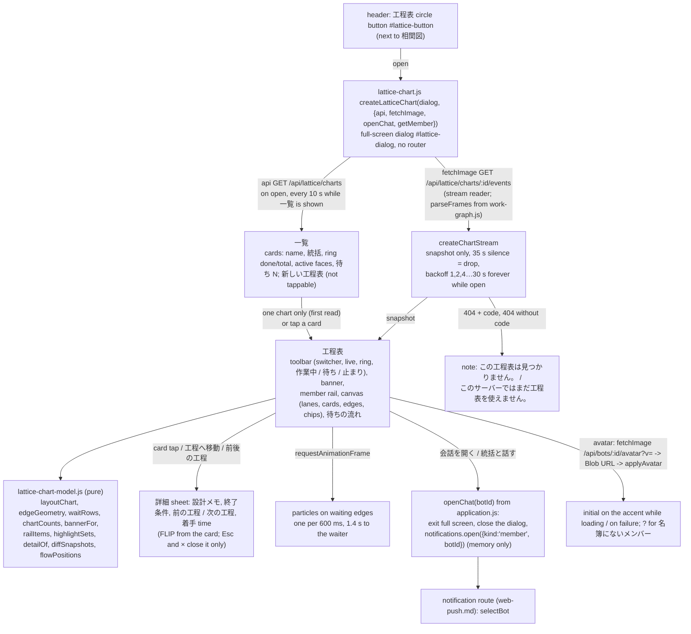

# Web 工程表 (Lattice chart page)

Owner: Flora (bot-7e777fe5); the shell registration lines (`index.html`, `application.js`, `assets.mjs`, `styles.css`) are reviewed by Admi (Web). Data is not decided here: the data contract is [lattice, public contract (apps)](../lattice/README.md#public-contract-apps) and what the user sees, the user path, failure views and motion are the shared [screen spec](../lattice/screen-spec.md) (visual reference: Flora's design mock, accepted by Trony 2026-11-11). This file maps that spec onto Web code. Same structure and conventions as the [相関図 page](work-graph.md). Requested by the Owner via Trony, 2026-11-11.

## Function map

| Function | Input -> output | Owner |
| --- | --- | --- |
| `ownerLookup(snapshot)` | card -> owner per the [owner rule](../lattice/README.md#projection-rules-projectionmjs): the `producer` member (or 名簿にないメンバー), else `{botId: null, name: lane, authored: true}` (initial face, no chat), else null (担当なし). Used by cards, lanes, 待ちの流れ, edge chips and 詳細 |
| `layoutChart(snapshot)` | -> `{lanes, cards: id -> {x,y,w,h,depth,lane}, order, width, height}`: one lane per owner (roster name order, then authored lane texts, then 名簿にないメンバー, 担当なし last), column = `depth` (pitch 232 px), cards of one owner and one depth stack; open cards are 104 px (badge row, 2-line title, note line stacked in a flex column so the note never overlaps the title); done / retired cards are compact (48 px) | `web/lattice-chart-model.js` (pure, no DOM) |
| `layoutTree(snapshot, name)` | -> `{nodes, links, arcs, cards: id -> box, width, height}`: chart root -> phases -> cards (by `parent`, else `phase`, else the root); leaves take one 40 px row, a parent sits at the middle of its children; x = parent right + 36 px; boxes 32 px tall (root 168, phase 196, card 300 wide); `links` are elbows parent -> child; `arcs` are `edges` drawn on the right of both boxes (waiting flag kept); phase boxes carry done/total and the phase tone | `web/lattice-chart-model.js` (pure) |
| `edgeGeometry` / `pointOnEdge` / `flowPositions(now)` | right-middle of the producer card to left-middle of the waiting card (cubic); one particle per 600 ms, 1.4 s travel, progress 0..1 | same file |
| `waitRows(snapshot, now)` | one row per `waits[]` in the server order (oldest first): 「◯◯が待っている」, awaited card title, producer, state text (作業中 N分 / 止まり: 理由 / 未着手: 担当 ◯◯ / 担当なし), wait length, `emphasized` when the producer is blocked, `canChat` only for a member in the roster, the spoken label | same |
| `chartCounts`, `railItems`, `highlightSets`, `detailOf`, `listItems`, `coordinatorBotId` | counters and ring; rail faces with working / blocked / waiting count; the cards and waits of one member; the detail sheet content; 一覧 rows (done, total, 待ち N); the coordinator Bot = `createdBy` of a `coordinator` chart in the list | same |
| `bannerFor`, `degradedPills`, `MESSAGES` | `unverified` -> amber banner, `last_verified` -> grey banner with the time in JST and the chart dimmed, both with 統括と話す; `degraded` -> 最新の記録を読み直しています… / メンバー情報を読み直しています… | same |
| `diffSnapshots(prev, next)` | added / removed / state-changed / completed cards, added / removed edges (by card id and `from>to`) -> animation | same |
| `createChartStream({fetch, url, ...})` | `fetchImage(url)` stream reader; frames with `parseFrames` (work-graph.js); only `snapshot` events; non-OK or bad JSON or other schema -> `unreadable`, end of stream or 35 s silence -> `drop`, both retry with the backoff; 404 + `LATTICE_CHART_NOT_FOUND` -> `notfound`, other 404 -> `missing` (both stop) | `web/lattice-chart.js` |
| `createLatticeChart(dialog, {api, fetchImage, openChat, getMember})` | `open()` / `close()`. `getMember(botId)` (application.js, from `state.bots`) names the faces on 一覧, where the list read has only ids; the chart itself uses `members` of the snapshot | same |
| Cards | one `<button>` per card kept by id; position by `transform` (spring `cubic-bezier(.34, 1.3, .5, 1)`, .45 s); state glyph + badge text + producer face (rotating arc while 作業中); label 「<title>、<state>、つくっている <producer>」; new card scale .92 -> 1 in 300 ms; a card that becomes 完了 blooms five petals (700 ms) | same |
| ツリー / 担当 | segmented control in the toolbar (`aria-pressed`), default ツリー, kept in memory while the page lives (no storage). ツリー draws `.lattice-tree` (SVG links + arcs with arrow markers, one `<button>` box per card, label = `cardLabel`, tap = 詳細); 担当 draws the lane plane. 詳細, highlight (boxes and arcs dim) and 工程へ移動 (scrolls to the box in ツリー) work in both; particles only in 担当 | `web/lattice-chart.js` + `styles.css` |
| 待ちの流れ | rows with 会話を開く (`openChat(producer)`, only for a producer in the roster) and 工程へ移動 (scroll the canvas to the card, open its 詳細); wide: right panel; under 1024 px: a horizontal pager above the chart, then the member rail | same + `styles.css` |
| Highlight | tap a face in the rail: that member's cards and waits stay, the rest dim; tap again or tap an empty canvas: clear | same |
| 詳細 | tap a card: sheet (FLIP from the card); 前の工程 / 次の工程 tappable (the canvas follows); × or Esc (dialog `cancel` is intercepted while a sheet is open) closes it and the card regains focus; same scroll position | same |
| Open the chat | `openChat(botId)`: `document.exitFullscreen()` if in browser full screen, close the dialog, then `notifications.open({kind:'member', botId, roomId:null, requestId:null, messageId:null})` (same route as the 相関図 face tap). The view remembers the chart it was on and opens it again the next time (Web has no back stack), skipping 一覧 | `web/application.js`, `web/lattice-chart.js` |
| Motion | `prefers-reduced-motion`: no particles, rotation, glow, bloom or morph, cross-fade only; hidden tab closes the stream and reconnects on return | `web/lattice-chart.js`, `styles.css` |

Nav: `#lattice-button` (stroke-only inline SVG, `aria-label` / `title` 工程表) sits right after `#work-graph-button`; the dialog `#lattice-dialog` has `<h2>工程表</h2>` and `data-close-dialog="lattice-dialog"` (closed by the shell's existing handler). The page talks only through `createWebClient`: `api()` for the list, `fetchImage` for the stream and the faces. No `EventSource`, no router, no storage.

## Data ownership

The view holds only in-memory drawing state (the last list, the snapshot, one DOM element per card, the avatar Blob URLs, the highlighted member, the open card). Nothing is stored; every Blob URL is revoked on close. The server stays the source; a reconnect, a new `epoch` and a first read all start from a fresh snapshot diffed against the drawing. Charts are named by `chartName` (`name`, else 「<作った人>の工程表」 through `getMember(createdBy)`, else 名前のない工程表); the project id is used only in API paths and `data-focus-key`. No code, reason, path or raw id is put on the screen or in a spoken label (blockedReason and designMemo are the plain sentences Lattice carries).

## Failure handling

| Failure | Shown | Exit |
| --- | --- | --- |
| 一覧 empty | 工程表はまだありません。メンバーがLatticeで工程をつくると、ここに並びます。 + 閉じる | the next list read (every 10 s) |
| `GET /api/lattice/charts` 404 (older server) | このサーバーではまだ工程表を使えません。 + 閉じる; non-blocking | the list read repeats every 10 s; it appears after the server update |
| 503 / network error on the list or the stream, 35 s silence, bad JSON, other schema | the last drawing stays, dimmed; top pill 工程表に再接続しています… with a spinner; the live pill hides | backoff 1, 2, 4 … 30 s forever while the dialog is open; a new snapshot redraws and removes the pill |
| 404 `LATTICE_CHART_NOT_FOUND` on the stream | この工程表は見つかりません。 + 一覧へ戻る | no retry (the chart is gone); 一覧へ戻る |
| 404 on the stream without that code | このサーバーではまだ工程表を使えません。 + 閉じる | close |
| `state: unverified` | amber banner 工程表の記録に食い違いがあります。読める分だけ表示しています。 + 統括と話す | the next verified snapshot removes it |
| `state: last_verified` | grey banner いまの記録が読めないため、最後に確認できた状態（… JST）を表示しています。, chart dimmed, 統括と話す | the next verified snapshot |
| `state: unavailable` | closed bud, この工程表はまだ読めません。 + 一覧へ戻る | the next readable snapshot shows the chart |
| `degraded` `lattice-read` / `members` | pill 最新の記録を読み直しています… / メンバー情報を読み直しています… (chart stays) | a snapshot without it |
| a verified chart with no cards | この工程表にはまだ工程がありません。 + 一覧へ戻る | a snapshot with cards |
| producer not in `members` | face ?, name 名簿にないメンバー, no 会話を開く | appears once the member exists |
| 会話を開く on a deleted Bot / route failure | the notification route's own notice (web-push.md) | the notice's 再確認 |

No guard: nothing is refused or stopped by the page; every failure view leaves on its own and the action (閉じる / 一覧へ戻る / 統括と話す) is optional. The coordinator for 統括と話す is `createdBy` of a `coordinator` chart in the last list read; without one the button is not drawn.

## Tests

`test/web-lattice-chart.test.mjs`: model (layout, wait texts, counts, rail, highlight, detail, banners, degraded pills, unknown member, snapshot diff, backoff, flow positions) and the view with a fake DOM, a fake `api`, a fake SSE and a fake clock (open -> 一覧 -> 工程表, single-chart shortcut and resume after 会話を開く, older-server note, 503 and drop pill with the 1, 2, 4 s backoff, CHART_NOT_FOUND, 詳細 open / close / Esc, banners and highlight, no raw ids or codes in text and spoken labels, particles and reduced motion, minute refresh).
