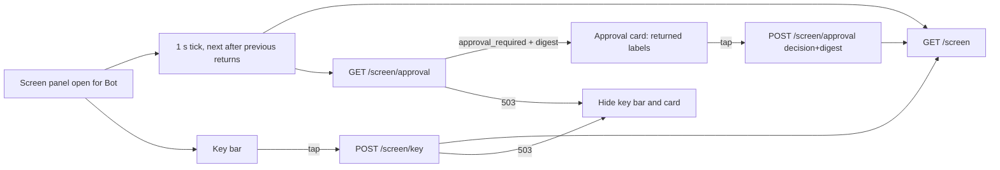
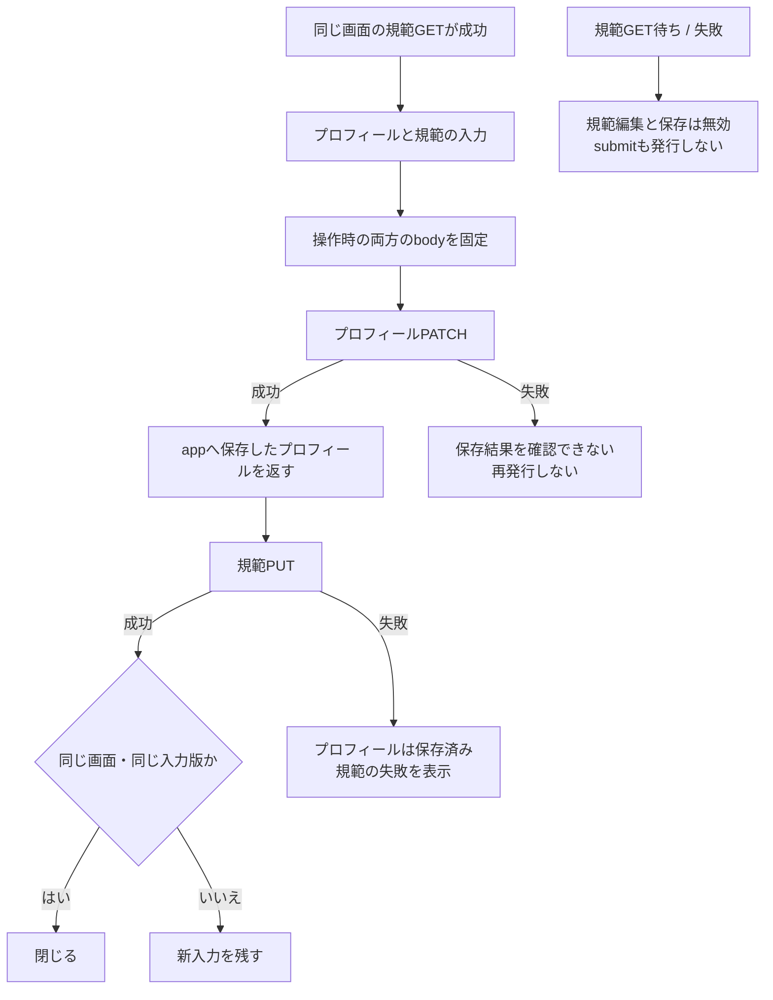
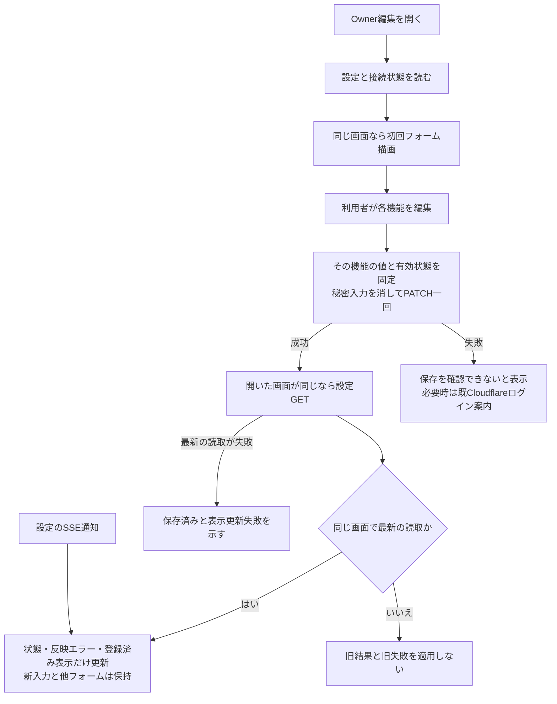
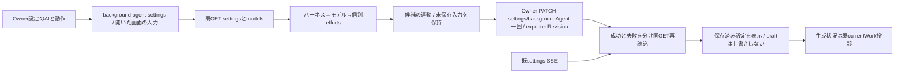
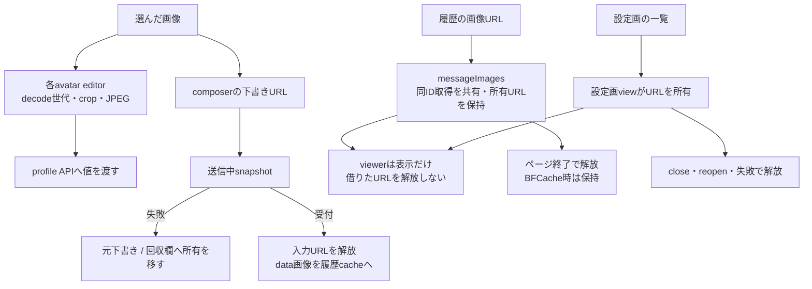
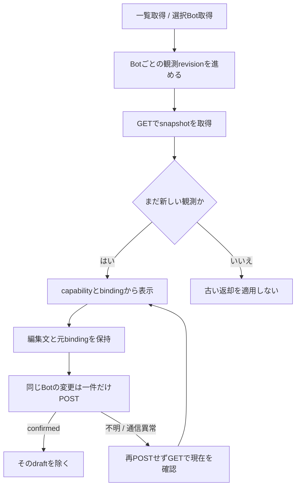

# Webの編集・画像・Goal

[会話Web](conversation.md)に加え、各画面が開いた対象と非同期結果をどう持つかを示す。本branchの実装を説明し、最終照合で見つかった問題と修理は[追加修理](../../web-final-gaps.md)へ記録する。Apple単独UIの設計ではない。

## 編集対象は各画面が持つ

```mermaid
flowchart TD
  Open["編集画面を開く"] --> Target["その画面が対象を保持<br/>フォームとavatarを初期化"]
  Target --> Edit["未保存の入力を編集"]
  Edit --> Submit["保存対象とbody<br/>その時の入力版を固定"]
  Submit --> API["機能固有のAPIへ一回保存"]
  API -->|"成功応答"| Saved["受付を記録<br/>新規作成なら返却IDを保持"]
  Saved --> Refresh["appへ一覧更新を依頼"]
  Refresh --> Current{"同じ画面かつ<br/>入力が変わっていないか"}
  Current -->|"はい"| Show["対象を選択 / 編集画面を閉じる"]
  Current -->|"いいえ"| Keep["新しい画面と入力を保持"]
  Refresh -->|"失敗"| ViewError["保存済みと表示<br/>新しい作成を自動発行しない"]
  API -->|"失敗"| Error["元の画面へエラー"]
```

| 機能 / app側caller | 実装と主な関数 | 所有・保存後の結果 |
| --- | --- | --- |
| Bot作成・編集 / `openBotDialog` | [bot-editor.js](../../../../web/bot-editor.js) `createBotEditor/open/saveBot` | owner.bot、saving、editRevision、avatar。保存時target/bodyを固定。成功後の一覧GET失敗でも返却Bot IDを保持し次の手動保存はPATCH |
| Botモデル・適用表示 / editor.open | 同上 `renderModelOptions/selectableEfforts/renderEffortOptions/renderBotConfigurationStatus` | models/AbortController。close/reopenで旧読取をabort。保存済み候補外effortは表示に残す。configurationApplicationと希望設定を区別。候補の表示名は`view-format.js` `modelChoices`（display_name、無ければid、同名はid併記）、保存値はid。`/api/models`応答前（models=null）は保存値だけを「読み込み中」と表示し、未対応と判定しない。読取失敗後は保存値をそのまま表示 |
| Bot再起動・削除 / editorのbutton | 同上 `restart/remove` → appの`onRestarted/onDeleted/onStatus` | 操作時Botを固定。再起動202と削除202は背景受付。appが一覧・選択を更新する。表示更新失敗でも背景削除の受付と示す |
| 部屋編集・削除 / `openRoomDialog` | [room-editor.js](../../../../web/room-editor.js) `open/saveRoom/remove/renderRoomRepresentativeOptions` | owner.room、参加者、代表、avatar。代表は選んだ参加者内。保存対象/bodyと再open後の結果所有を保持 |
| Ownerプロフィール・規範 / `openOwnerDialog` | [owner-editor.js](../../../../web/owner-editor.js) `open/save/renderOwnerLinkRows/addOwnerLinkRow` | 開いたprofile、入力版、saving、avatar。profile PATCH→rules PUTは別要求。部分成功を表示し自動再発行しない |
| 任意機能・公式認証 / Owner.open | 同上 `refreshFeatures` → 既`renderFeatureSettings/renderHarnessAuth` | openごとの子DOM。closeでpassword欄を空にしauth pollを停止。閉じても公式認証状態そのものを取消さない。設定保存後callbackも開いたowner/read順を照合する |
| 記憶・知識 / Bot editor→`onMemory` | [memory-view.js](../../../../web/memory-view.js) `open/write/search/renderResults` | 対象Bot、form別pending、resource別最新read。bodyとscopeを固定。保存後も新入力を消さず検索は同じ画面の最新結果だけ描く |
| 予定 / `openScheduleDialog` | [schedule-editor.js](../../../../web/schedule-editor.js) `open/loadSchedules/saveSchedule/editSchedule/resetScheduleForm` | type/id/name/memberIds、editingSchedule、read/edit版。保存後GETと受付を分離。run/removeはrow作成時対象、2.5秒timerは表示だけ |
| 予定の値変換 / editorの読取・保存 | 同上 `scheduleFormValues/scheduleRequest/localDateTimeValue/scheduleDescription` | once/cron/interval/timezoneを維持。roomではcommandを作らず、targetsは開いたmemberIdsから選ぶ |
| 部屋返信者 / appの選択 | app `selectedTargets/renderTargetPicker/renderTargetButton` | room別Setはページ内。退会者を除き、未選択nullと自動選定の可否を区別。投稿は全員へ配送 |
| native画面 / `openScreen/closeScreen` | [bot-read-views.js](../../../../web/bot-read-views.js) `createScreenView/open/refresh/close/fit` | 対象・最新読取・1秒間隔（前の読取が返ってから次を始め、重ねない。Owner 11/7 13:58、Appleと同じ）。初回GET待ち中closeからtimerを復活させず、80桁表示を維持 |
| native画面のキー入力・承認 / 同上 | 同上 `sendKey/readApproval/answer` ([契約](#native画面のキー入力と承認n5-2026-11-08)) | 開いたBotにだけ送る。キーは閉じた集合、承認は直近GETのpromptDigestだけ。自動再送なし。503で入力欄を隠す |
| 設定画 / Bot editor→`onSheets` | 同上 `createCharacterSheetView/open/release` | 開いたBotとURL集合。close/reopen後の画像は適用せず、途中失敗で作成済みURLを解放 |

機能ごとにAPI・検証・保存順・完了時点が違うので、汎用CRUDやtransactionにまとめない。共通avatar/表示関数を使い、appから全stateを渡す接続も作らない。

## native画面のキー入力と承認（N5, 2026-11-08）

Owner request: answer a stuck seat (e.g. a Claude permission dialog) from the Bot screen view. Server contract is Kiro's [screen input](../execution/screen-input.md); Web consumes it unchanged.

| Function / edge | Input -> output and ownership |
| --- | --- |
| Key bar | Shown whenever the screen panel is open. Buttons for the closed set Esc, Tab, ↑↓←→, Enter, 1-9, 0 and 中断 (C-c). One tap -> one `POST /api/bots/:id/screen/key {key}` for the Bot the panel was opened for; the pressed button is busy until the reply. 200 -> "〈key〉を送りました" + immediate screen read. No auto-retry on any error. |
| Approval card | Each 1 s screen tick also reads `GET /api/bots/:id/screen/approval`. `approval_required` -> card with the returned labels (approve_once primary, deny secondary), remembering that read's promptDigest. Tap -> `POST …/screen/approval {decision,promptDigest}`. `none` hides the card. No permanent approval, no free text. |
| Errors (plain words; code only in the button's title) | 409 SCREEN_SEAT_ABSENT -> 席が起動していません; 409 SCREEN_APPROVAL_CHANGED -> re-read approval; 422 SCREEN_APPROVAL_UNSUPPORTED -> hide the card, "このAIはキーで答えてください"; 502 SCREEN_INPUT_FAILED -> 届いたか確認できません。画面を見てから必要ならもう一度; 503 SCREEN_INPUT_UNAVAILABLE (older body) -> hide key bar and card until the panel is reopened. |
| Ownership | Results apply only while the same Bot's panel is open (same `owner` token as the screen read). Closing/reopening drops late replies. |
| Refresh cadence | Screen + approval reads form one read; the next starts 1 s after the previous returns (setTimeout chain, no setInterval). A read requested while one is in flight (after a key or answer) runs once after it, never in parallel. |

Source reach: `web/bot-read-views.js`, `web/index.html` (input container in the screen panel), `web/styles.css`, `test/bot-read-views.test.mjs`. `application.js` passes the new element only. No new guard: the busy state ends with the reply; hiding on 503 ends when the panel is reopened.

## Ownerは二つの保存結果を区別する

`onOwner`はプロフィール保存応答を一覧ヘッダへ返す。後段の規範失敗をプロフィール未保存へ戻さない。HTTP応答が失われた場合は、サーバーに何も保存されていないとは断定しない。

`open`は規範GET成功まで`rulesLoaded=false`。規範欄とform外の保存buttonを無効にし、`save`も未読なら発行しない。読取に成功した後で利用者が明示的に空にすることは許容する。close/reopen後の旧GETは適用しない。失敗後は利用者が閉じて開き直す。自動再送や別の規範storeは持たない。

### 任意機能の入力と適用状況

`refreshFeatures(opened)`が同openの`featureRead`を持つ。`renderFeatureSettings`は初回だけ、以後は`refreshFeatureSettingsStatus`がタイトル・適用エラー・秘密の登録済みplaceholderだけを更新し、input.value/checkboxを変えない。SSEも同じ状態更新窓口へ入る。

保存callbackは描いた時のopenedを捕まえる。古い画面の保存完了から新画面のGETを始めず、既に走ったGETも画面/read順を照合する。PATCHの成功後に表示取得だけ失敗した場合はその段階を表示する。Cloudflareの案内判断は送信時enabledを使い、後から変えたcheckboxには依存しない。秘密入力はsubmit/close/非表示で消し、自動再PATCHはしない。

### 全体の仕事要約agent

`owner-editor`は専用formのopen/closeと既settings通知を接続する。モデル候補の表示名はBot編集と同じ`modelChoices`で、保存値はid。`background-agent-settings.js`が全体一件のrecord・候補cache・未保存draft・読取世代・保存中を持ち、他Botの設定/要約writerは持たない。全体設定と組合せ検証の正本は[usage](../usage/README.md)、HTTP/モデル一覧は[integration](../integration/README.md)、生成/失効は[execution](../execution/README.md)。公開v1はGET settingsのトップbackgroundAgent、Owner PATCH `/api/settings/backgroundAgent`のexpectedRevision/harness/model/reasoningEffort厳密4key。既FeatureSetting配列へ7項目目を加えない。公開6設定・Ownerプロフィール保存と独立する。

未供給キー/不正record/取得失敗では編集と保存を無効にする。候補はモデル個別effortsだけを使い、空配列だけ空文字のCLI既定を許す。初期未設定は候補を自動選択しない。保存済み候補外値は残し保存不可。選択変更でPATCHを発行しない。候補はopen/手動再取得時だけ読み、settings通知は設定GETだけを行う。

保存は元revisionと3項目を固定して一回、200/不正応答/400/409/503/500/通信不明後にGETを一回行う。保存成功後のGET失敗は保存成功と取得失敗を別表示し、保存後apply失敗はGETで選択が保存されている事実と要約稼働未確認を区別する。別画面の409やSSEで保存済み値が変わってもdraftを消さず、利用者が差を確認してから次の操作をする。close/reopen前の旧結果を捨て、未保存/保存中は既close確認へ参加する。プロフィール保存も要約設定のdraftが残る間は閉じない。新AI/設定自己変更/別モデル代替/独自再送はない。

## 画像の所有者がURLを片付ける

| 部品 | 実関数と責任 |
| --- | --- |
| [avatar-editor.js](../../../../web/avatar-editor.js) | `createAvatarEditor/reset/value/changed/cancelRead`。各3editorの別instance。`readFile`はdecodeの世代を確認しURLをfinallyで解放。`zoomImage/startDrag/moveImage/endDrag/clamp/draw/syncPreview`はcropだけを更新 |
| composer | `addImages/paint/send/renderRecovery`。FileとURLは下書き→送信→回収へ移す。受付・破棄・添付削除で解放。失敗した旧画像と新入力の画像を混ぜない |
| messageImages | `remember/read/load/close`。同IDのfetchを共有し、複数画像の途中失敗も全完了を集めて不要URLを解放。旧fetchは新data previewを上書きしない |
| timeline | `loadStoredMessageImages/rerenderItem`。cacheを読むだけ、同tokenのDOMだけ更新。`avatarColor/rgbToHsl`は局所の色cacheで、台帳を更新しない |
| [image-gallery.js](../../../../web/image-gallery.js) | `renderImageStack/openImageViewer/stepIndex`。URL配列と現在index、矢印/swipe/alt。closeでsrcを外すがURLの生成者ではない |
| [rich-text.js](../../../../web/rich-text.js) | `richTextHtml/renderBlocks/renderList/renderTable/inlineHtml`。本文をescapeし対応Markdownと既linkifyだけをHTML化 |
| [view-format.js](../../../../web/view-format.js) | `applyAvatar/dayLabel/initials/memberDisplay/formatTime/formatDateTime/escapeClass/escapeHtml`。表示値の変換を共通化。台帳・選択・APIを読まない |

cacheの差替え前URLはviewerが使い得るためページ終了まで保持する。pagehideのpersisted=trueではBFCache復帰を妨げない。これは永続画像保存や全端末のcache管理ではない。

## Goal画面はnativeの観測を表示する

[goals.js](../../../../web/goals.js)の`goalsView`がsnapshots/pending/drafts/observationsを閉包に持つ。一覧revisionとBot別revisionは違う用途で、他Botの新しい変更結果を古い一覧で消さない。`refreshSelected/select/refreshOnEvent`がappの窓口。

`mutate`はBotとbindingを固定し、失敗時は一回GETだけ。finallyも同bindingの場合だけ照合し、別thread/unknownを古い結果で置換しない。combined=falseなら目的と予算を別々に編集し、空予算を消去へ変換しない。Goal・秘密・質問・認証は既存専用部品をそのまま使う。

確認先：editor-ownership、web-bot-avatar-list、bot-profile-ui、schedule-list/intervals、memory-view、bot-read-views、goals各試験。実dialog DOM＋人工APIで保存中の再open/部分成功も確認した。追加の一覧・未読規範・任意機能反例も局所修理を確認した。局所の成功を全体の完成へ広げない。

## 検索・編集の改善

[Apple対応表と担当図](apple-parity.md#検索と編集の状態所有)に検索の入力/選択保持/未保存確認を接続する。既editorの保存順・世代・部分成功契約内で実装し、サーバーAPI/保存形式は変更しない。
