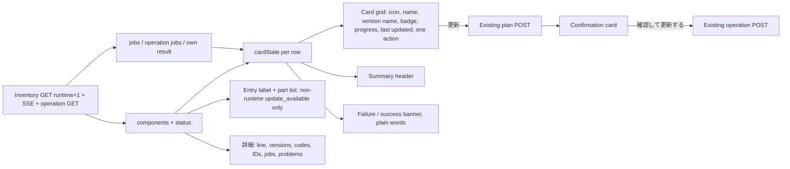
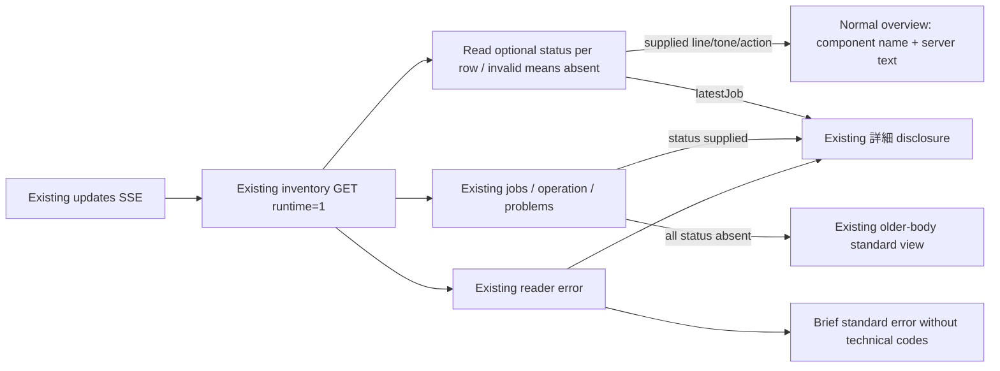
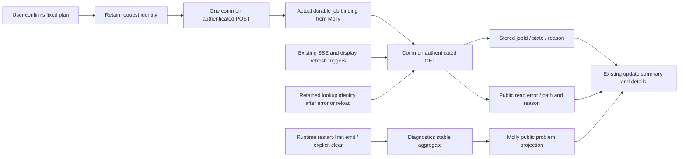
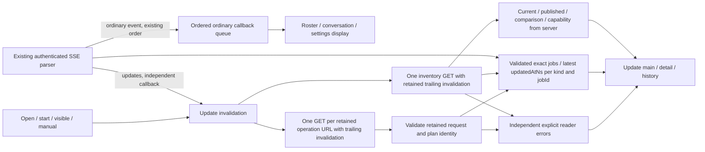
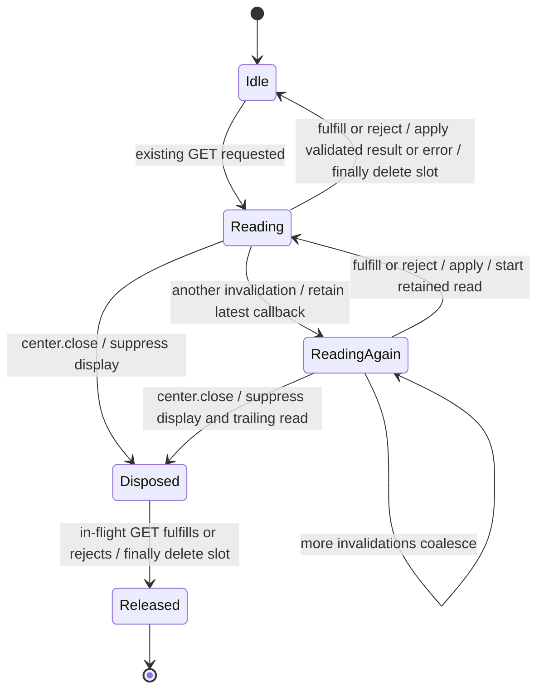
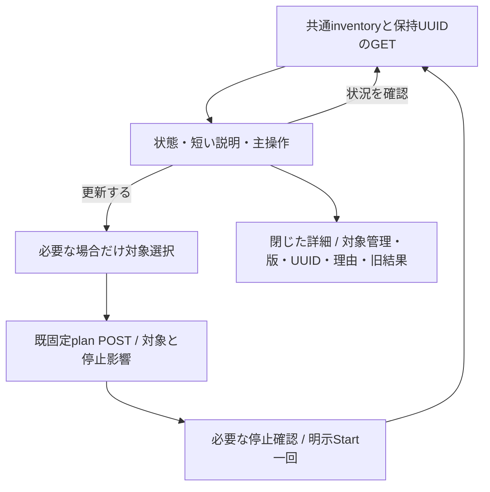
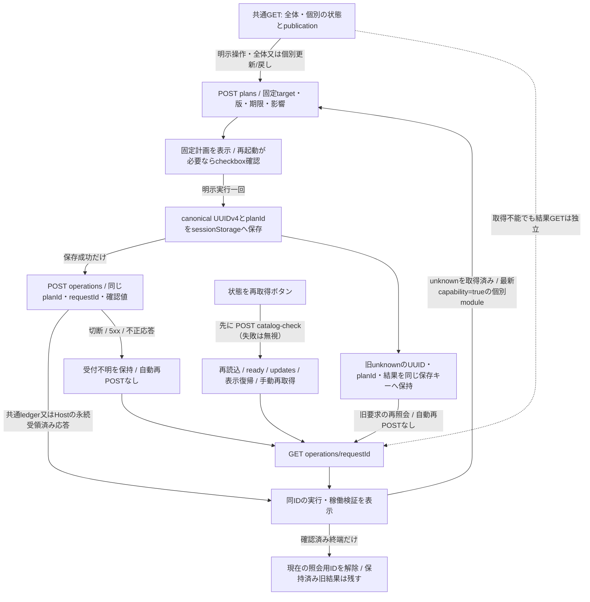
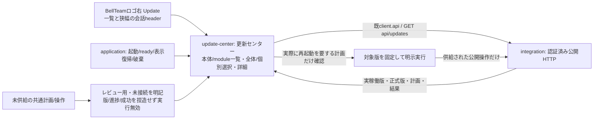
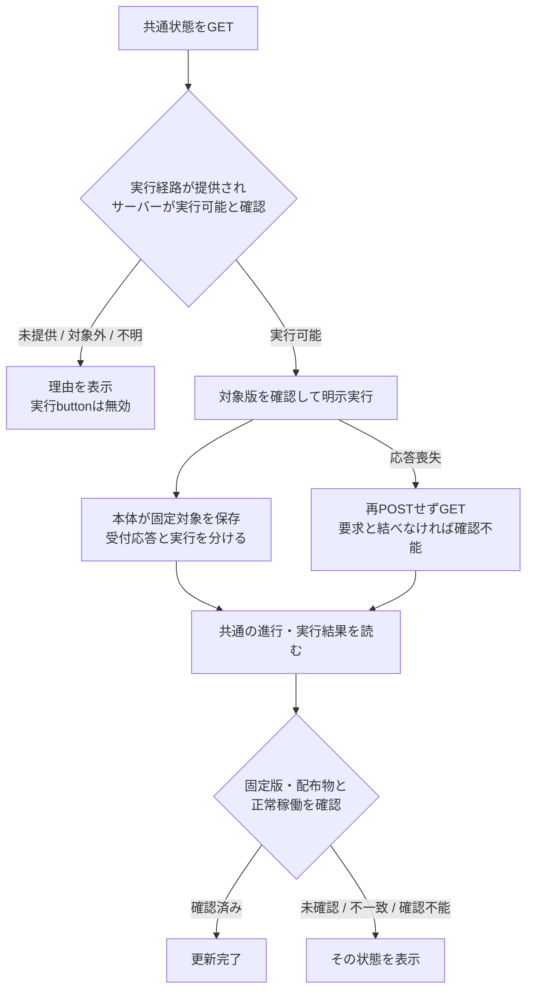

# Update通知の表示・操作設計

## Card overview redesign (2026-11-08, Owner via Trony)

Owner ruling: a text-only Update screen is rejected. This section supersedes the "Standard overview" and "Older-body fallback" rows of the per-component status section below for the normal surface; that section's reader, details and refresh rows stay in force. Data sources are unchanged: the same inventory GET, `components[].status`, `jobs[]`, operation GET and SSE. No new request, store, timer, route or server judgment.

| Function / edge | Input -> output and ownership |
| --- | --- |
| `cardState(component, records)` | Row + newest visible job record for that `moduleId` (own operation / current operation / inventory or SSE jobs; falls back to `status.latestJob`) -> `{badge, tone, job, step}`. Badge: running job -> 更新中 with step 1..4 of queued/downloading/verifying/swapping; `status.tone==='attention'` -> 要対応; failed latest job -> 失敗, except the server's own rule (part running and already up_to_date) hides it, unless its reason is `HOST_UPDATE_AITERM_STATE_FAILED` (the swap to the newest version itself succeeded and a later step failed); `update_available` -> 更新あり; `up_to_date` -> 最新; `incompatible` -> 使えない版; otherwise 確認できません. Web derives presentation only; Common still owns `line`, `action` and the latest-job choice. |
| Version name | Human version name, never a hash: release installed by this part's latest succeeded job -> `M/D HH:mm 版` (job time); part already up_to_date with a publication -> `M/D HH:mm 版` (catalog publishedAt); otherwise 本体に同梱の版 / 稼働中の版 / 更新で入れた版 / 版を確認できません. The origin (本体に同梱 / 更新で導入 / 本体) is a small secondary word when a dated name is shown. update_available adds `新しい版 M/D HH:mm` (catalog publishedAt). Hashes, digests and the server `line` (which carries a 7-hex name) move to 詳細. |
| Last-updated time | Card job time (JST, M/D HH:mm): 最終更新 for ready, 開始 for running, 失敗 for failed; none -> 更新の記録なし. |
| Summary header | Icon tile + title + observed time + 再確認 (secondary). Title priority: read error -> 更新情報を取得できません; first load -> 確認しています; submitting -> 受け付けています; plan -> 〈名前〉を更新します/戻します; running -> 更新しています; attention -> 対応が必要です; N candidates -> Nつ更新できます; failed only -> 前回の更新に失敗したものがあります; all ok -> すべて最新です; else 一部の状態を確認できません. Runtime rows are excluded from the summary count and are shown as a separate "AIの実行部品" card group: Owner rule, Aiterm/CLIs update only with the body release, so their version line is 本体に同梱 and their badge is the neutral 本体と一緒に更新 (running/failed runtime jobs still show 更新中/失敗). |
| Entry label and part list | The logo-right buttons read `Update · 更新あり` only when a non-runtime row has `update_available` (the same count as the summary header); runtime rows never raise it, and unavailable/incompatible/unknown rows never do. In the part list a runtime row's status is the neutral 本体と一緒に更新, matching its card; non-runtime rows keep the comparison words. The raw comparison of every row stays in its detail pane. |
| Card action | One button per card, only when `update_available` and `capability.supported` and no job is running for it: 更新 (or もう一度更新 after a failure). It sends the existing single-component plan request. No header primary; cards without anything to do have no button. |
| Plan review | Existing fixed plan -> one confirmation card (name, 現在 -> 新しい版, impact, existing restart checkbox, 確認して更新する, やめる). やめる only clears the local plan; nothing is sent. |
| Failure banner | Read/storage/operation errors, attention actions, failed latest jobs and open restart problems -> one plain-words banner: what happened + what to do (read errors point to the header 再確認; the banner has no second retry button, because 再確認 already re-reads after the catalog check). Codes, paths, job IDs and request IDs stay in the existing 詳細 disclosure (toolbar notice, support details, jobs, problems). A failed job never claims the old version still runs when `reason.code` is `HOST_UPDATE_AITERM_STATE_FAILED` (container-update-bundled.md, Trony 2026-11-10: `execution: succeeded`, `verification: failed`, swap kept): that line says the new version runs and names the failed step (席の状態を整える手順). Own completed operation -> a success banner 〈名前〉を更新しました. |
| Theme/layout | Tokens on `.update-center` with `prefers-color-scheme: dark` overrides; icons are CSS masks keyed by `data-icon=<component id>`; card grid auto-fills >=260px on PC, one column on mobile (<=780px). |

Source reach: `web/update-center.js` (renderProduct, card helpers), `web/styles.css` (update-center tokens, cards, dark mode), `test/web-update-product.test.mjs`. `index.html` markup, `application.js`, public API/SSE and module membership are unchanged. No guard is added or removed: card buttons use the existing `canPlan`; やめる clears local state only.

## Per-component standard status (2026-11-08)

This display contract supersedes the main-screen raw-job requirements below when `components[].status` is supplied. Source contract: Molly PR545, [per-component status line](../integration/update-jobs.md#per-component-status-line-2026-11-08). Common owns the latest job, status wording, time and action decision. Web never selects a latest job to compose its own standard status.

| Function / edge | Input -> output and ownership |
| --- | --- |
| Per-row optional display reader | Check each component `status:{line,tone:ok/updating/attention,actionRequired,action,latestJob}` only for that row's presentation. Malformed or newer-shaped status is treated as absent for that row and never rejects inventory or blocks any plan/start. Latest-job ID/kind/state/outcome/ISO time/reason are detail-only data when the status shape is readable. |
| Standard overview | Supplied component statuses -> one row per supplied component: name + exact server line, through text nodes. Attention rows receive visual/text emphasis and show the supplied action. The ordinary heading uses a neutral label and the server notice. No client-composed version/job sentence or interpretation of old failures. |
| Technical details | Existing combined jobs and restart-problem sections move under the existing 詳細 disclosure for status-capable responses. Latest-job fields are added to the selected component's support details; current/published versions and retained operation/history displays remain there. Standard errors use a brief read-error message; full codes/path/reason remain in details. |
| Older-body fallback | When no component supplies status, keep existing standard rendering unchanged, including the legacy job list. A mixed response uses valid supplied statuses and the existing comparison/capability rendering for rows with absent or invalid status, while keeping raw records in details. No missing server sentence is invented. Keep the last successful response mode through a read failure, so stale event jobs cannot leak onto the standard screen; a successful older-body response resets the mode. |
| Refresh and actions | Same opted-in inventory GET, retained operation GET and SSE invalidation; no new request, store, timer or server judgment. Existing plan/start/confirmation/UUID retention and runtime no-rollback policy remain unchanged. |

Overall Web -> integration HTTP/SSE composition remains unchanged; overall DFD U14 names the status projection. Source reach is `web/update-center.js`, `web/styles.css` and `test/web-update-center.test.mjs`; `application.js`, public routes/SSE, module.json and assets membership stay unchanged. No new guard is introduced; existing invalid-response/read-error handling clears through a later successful refresh. Optional status checks select a row display only; they are absent from the whole-inventory validator and cannot refuse an inventory or an update action. A readable status can arrive on any later refresh; malformed/newer optional shapes require no server repair or Web upgrade to use the existing update actions.

## Runtime updates in the normal Update screen (2026-11-08, Z-b2 slice D)

The public contract is [runtime slice D](../runtime/runtime-updates.md#inventory-plan-and-start-slice-d), supplied in PR517. Web opts in through GET `/api/updates?runtime=1`; it does not add a second jobs-list request. Existing operation GET, plan/start POST, retained UUIDs and scoped SSE invalidation remain the same.

| Function / connection | Input -> output and ownership |
| --- | --- |
| Inventory read and validation | Opted-in snapshot -> existing business rows plus the four fixed runtime IDs; validate consumed `runtimeApplication.policy:next_launch` and nullable generation SHA, and accept stored job `kind:runtime` in inventory, operations, retained history and SSE input. Server owns versions, availability and capability. |
| List and details | Supplied runtime rows -> existing current/published/changes/status display, with 「次回起動から適用。実行中の席は現在の版を継続」 visible on rows, details and runtime plan review. Unsupported capability retains its concrete supplied reason, including Aiterm MCP exclusive-scope unavailability. |
| Single-target plan and start | Selected runtime ID -> existing component plan -> one explicit start with `confirmContainerRestart:false` under the supplied `impact.containerRestart:false`. No runtime rollback control or request; all-scope plans stay server-owned and exclude runtime targets. |
| Refresh and result | Existing updates SSE -> opted-in inventory GET -> actual runtime job record in main/details/history. SSE itself filters runtime jobs; never interpret missing event jobs as completion. Existing per-URL coalescing, latest-record choice, disposal/identity checks and read-error display stay intact. |

```mermaid
flowchart LR
  Trigger[Open / ready / updates / manual / visible] --> Read[GET updates runtime=1]
  Read --> Validate[Existing inventory validator + runtime metadata and job kind]
  Validate --> Rows[Normal component rows and details / next-launch text]
  Rows --> Plan[Existing single-component plan POST]
  Plan --> Review[Runtime review / no restart confirmation / no rollback control]
  Review --> Start[Existing operation POST / retained request UUID]
  Start --> Result[Operation GET and opted-in inventory / stored runtime job]
  Result --> Screen[Main / details / retained history]
```

Overall function connections remain Web -> integration HTTP/SSE; overall DFD U14 now includes this opted-in read. Runtime P3/P8 and stores remain server-owned. Source reach: `web/update-center.js`; caller `application.js` and assets/module source membership unchanged; URL-sensitive fixtures in the four Web update test files change with the request. No new guard, store, timer, retry, permission decision or backend API is introduced. Existing validation prevents malformed responses overwriting the display; a later successful refresh replaces the read error through the existing state transition.

## Durable job display contract (2026-11-07)

Root's [job ledger contract](/srv/bellteam/bots/bot-7b140b27/docs/module-job-ledger-contract-20261107.md) supersedes the historical operation-result/unknown display below. Runtime's [exact record and DFD](/srv/bellteam/bots/bot-0b867848/work/BellTeam-module-job-ledger-20261107/docs/architecture/modules/runtime/update-jobs.md) owns job transitions. Job display consumes Molly's final [HTTP/SSE contract](../integration/update-jobs.md), supplied before Web source. Do not infer wire paths from runtime's private socket endpoints. The independent problems projection is final in [Signal PR456](https://github.com/kitepon/BellTeam/pull/456), `docs/architecture/modules/diagnostics/module-restart-limit.md`.

| Function | Input -> display/output | Ownership |
| --- | --- | --- |
| Explicit start | Fixed plan + retained request identity -> one authenticated POST; retain returned job binding | Existing update-center flow; Molly defines actual acceptance/idempotency mapping |
| Job read | Existing operation lookup/common projection -> stored jobId, state, failed reason | Runtime record is authoritative; parent requestId can differ from backend jobId |
| Job render | queued/downloading/verifying/swapping/ready/failed -> exact state and jobId visibly on the update screen; reason.code/message verbatim | Web only; no completed/unknown inference from legacy operation fields |
| Read error | UNREADABLE with supplied path/reason, or public API error -> visible error and preserved lookup identity | Error is separate from stored job state; no replay or invented failed/ready state |
| Problem render | Common public projection of Signal's stable module_restart_limit aggregate -> emitted module/count/window/lastExit/lastReason and explicit status | Signal stores; runtime explicitly clears; Web does not recalculate or expire it |
| Refresh | Existing open/start/ready/updates/manual/visible triggers -> authenticated GET | application/client; exact diagnostic invalidation follows Molly's contract |

Older bodies without component status keep the original main-screen job ID/state rendering. Status-capable bodies show those technical values only under 詳細. Display reason text with textContent; do not translate backend messages into browser diagnoses. No browser job store, automatic POST replay, server-judgment duplication, restart timer/counter, admin-key endpoint, or rollback feature is added. Preserve existing drafts, focus, selected targets and fixed plan confirmation. Unrelated version comparison and conversation deliveryTracking accepted/unknown retain their own contracts.

### Final problems projection

Existing authenticated GET `/api/updates` optionally includes `problems: [{fingerprint,status,kind:"module_restart_limit",moduleId,count,windowSeconds:1800,lastExit:{code,signal},lastReason}]`. Status is `open|resolved`; both null exit values mean no observed OS exit. Web checks the consumed display types, then renders a problems section on the existing main update view, using the supplied fingerprint for identity and inventory component names for labels. Show status, count, windowSeconds, exit code/signal and lastReason; null exit fields display as unobserved, never zero/success. Resolved rows retain the same exact evidence and show resolved. Use only text nodes and existing section styles. No separate fetch, storage, timer, calculation, recovery button or raw diagnostic fields. Each ordinary inventory refresh replaces the display from this projection; missing optional problems means no problem rows.

### Final job projection and browser ownership

GET/inventory may return `operation.admission:"pending"` while per-step durable admission is incomplete. The Web validator accepts this additive acceptance metadata alongside accepted/rejected/legacy unknown and renders any exact jobs[] already supplied. It does not display pending as a job state or infer an aggregate. POST still requires the actual accepted receipt after every admission; partial GET visibility changes no start/replay behavior.

POST `/api/updates/operations` keeps the existing body; caller idempotencyKey defaults to requestId, so Web keeps its existing single canonical UUID and does not generate per-step keys. 202 `{operation}` follows every durable per-step admission. `operation.jobs[]` contains full stored records; no aggregate job state exists. GET `/api/updates/operations/:requestId` refreshes the same bound records. GET `/api/updates` adds recent `jobs[]` (16) and problems[]. The Web uses these existing inventory/operation reads, without an extra recent-jobs request. The common contract also provides GET `/api/updates/jobs` and `/api/updates/jobs/:kind/:jobId`; Web need not duplicate its reads through these routes.

Render every stored record with its jobId, exact state, module target and failed reason.code/message in appropriate operation detail/history; only the older-body fallback repeats them on the main view. Do not derive an operation-wide state from these records or legacy phase/execution/verification. Legacy operations without jobs retain requestId/planId and display their supplied historical error, if any, plus the absence of a stored job; do not fabricate a job or show an unknown state.

Keep `bellteam-update-request.v1` current requestId/planId and historical snapshots. When an explicit new operation replaces an unresolved lookup, preserve its IDs as a previous reference even if no result was readable; previous entries may therefore be original historical operation snapshots or `{requestId,planId}` references. New history stores only these references, without copying full job records; preserve existing historical snapshots unchanged. GET recovery always uses those same IDs, including after terminal records, reload or reader failure. A browser snapshot is never a server ledger. No automatic POST retry. Capability/plan and server admission own concurrency decisions; a failed read or legacy unknown does not introduce a new browser admission guard. Retain fixed-target confirmation, double-click suppression and storage errors protecting lookup identity.

The shared client error reader retains its string result for existing callers and optionally returns closed message/code/path/reason details to client.api, which attaches them to the status-bearing Error. UNREADABLE HTTP503 exposes `message:reason,path,reason`; render those strings verbatim as an error, separate from last stored job records. Malformed responses produce a read error, not a job state. SSE type=updates still invalidates/refetches existing GETs; application passes the event to the update center so an explicit SSE reader error is also visible. Each new successful read replaces previous read failure; no browser timer or transition inference.

SSE updates.jobs[] is also a validated stored-record input to the in-memory recent display, so it remains visible if the subsequent inventory GET fails. A successful inventory GET replaces that display with its own jobs[]. The records remain separate from the reader error; no browser persistence or state transition is inferred. The source function map is createUpdateCenter -> display validation / same-ID GET / renderJobs shared by main and details/history; application.refreshFromEvent -> updateCenter.refresh(payload); client.api -> readApiError(details). Only this changed display/error boundary needs new tests. Peer runtime, diagnostics and common tests are inherited.

## Update invalidation and independent readers (2026-11-07 repair)

Overall connections remain [feature map](../../feature-map.md) Web -> integration.HTTP/SSE and [overall DFD](../../data-flow.md) U14/U16. This delta changes only Web scheduling/display. Common owns the completion-to-idle invalidation contract; that separate owner correction must preserve scoped events without inventory-read notifications.

| Function / edge | Maintained or changed; reason |
| --- | --- |
| client.watchEvents -> application.refreshFromEvent | Change: an optional independent updates callback receives updates while the existing ordered ordinary-event callback is awaiting roster/history. Ordinary notifications remain ordered; update GETs cannot wait behind another view's read. Parsing, authentication, retry classification, abort and EOF behavior remain unchanged. |
| application update callback -> updateCenter.refresh | Change scheduling only; pass the same updates payload, preserve all:false isolation. Existing startup/open/visible/manual triggers remain. No roster/timeline request for an updates event. |
| U14 inventory GET -> components/current/comparison/capability | Change: apply this read independently of active/history reads. Coalesce concurrent invalidations per existing URL and retain a final requested read. A slow past operation cannot block current versions. Existing schema/HTTP route and server comparison/capability judgments remain. |
| U14 same-UUID operation GET -> own/history display | Change: independently apply each response under retained request/plan identity and disposal/generation checks. Keep one in-flight read per URL with a trailing invalidation. Errors remain visible per reader; no POST retry or fabricated job state. |
| U16 jobs[] and U14 jobs[] -> main/detail/history | Change: for the same kind/jobId choose the supplied record with the greatest decimal updatedAtNs. This is record freshness only, never an inferred state transition. Main and details share the same latest supplied records. |
| capability.reason -> card/detail text | Change: MODULE_EXCHANGE_BUSY explains an update in progress; UPDATE_ALREADY_CURRENT explains that no update is needed. Preserve supported=false and all backend plan/start judgments. Unknown reasons retain the existing explicit failure explanation/code. |
| Explicit plan/start -> sessionStorage -> POST / same-ID GET | Maintain fixed target, confirmation, existing storage key/UUIDs, double-click suppression and one explicit start. Background GETs never issue a new plan/start. |
| Web source -> assets -> module archive | Maintain module.json source=[web/,src/web-gateway-update-adapter.mjs]; changed JS is already in web/, registered names/imports unchanged. No source deletion, adapter or other module asset changes. |
| Other UI / backend state | Maintain ordered ordinary SSE handlers, drafts/focus, conversation/history/list readers and runtime/diagnostics/ledger writers. Only update invalidations bypass the ordinary display queue. |

### Existing ordering and reader exit transitions

Named protection: prevent overwriting existing view state with an obsolete or mismatched response. Existing request/plan identity, execution generation and disposed checks retain that protection; server admission, supported flags and explicit POST decisions remain separate.

Ordinary callback ordering already existed as `await onEvent` before reading the next SSE frame. The Promise chain retains this ordering while allowing the independent updates callback to run. Fulfillment advances the next ordinary callback; rejection reports the error and aborts that watcher, suppressing callbacks not yet started. Abort/disposal likewise suppresses queued callbacks, but does not cancel an already running ordinary callback. No new unknown-state or backend admission guard is introduced.

Per-URL in-flight sharing is read scheduling: a concurrent invalidation sets `again` and replaces the apply callback instead of launching a competing read. It does not refuse a plan/start or add an admission lock. The existing loading gate still describes the inventory read; a historical URL cannot hold it. Fulfillment and rejection both settle the active API await; either is processed as a response/error, then one retained invalidation starts the next read, or `finally` deletes the slot. Generation/disposal checks suppress obsolete display application. A caught API rejection follows the same cleanup path as success.

Disposal does not force an unresolved fetch to settle: its slot remains until the network promise settles. It immediately prevents display application and trailing reads. No timeout or guaranteed network-completion claim is added; other URLs and independent SSE job display remain available. The ordinary watcher similarly cannot cancel an already running display callback. These are existing network/callback completion limits, not a new refusal condition.

No browser timer, repeated polling, new API, persistent job cache, backend success inference or production action. Regression scope is the existing public SSE -> application -> independent update reads -> real update renderer boundary, including a blocked ordinary read and a blocked historical request.

## 現行の製品画面（2026-11-04工程S）

Rootのupdate-page-product-design-20261104.mdに従い、標準は「アップデート」と状態一つ・利用者向け変更点・主操作一つ。以下の旧管理一覧layoutは閉じた詳細として保持し、標準画面にはしない。API/保存/実行可否の正本は既共通契約のまま。

状態は共通comparison/operationを消費しWebで版比較しない。取得不能や旧unknownを最新/成功へ変換せず保持、残候補があれば全体最新としない。candidateは既comparison=update_availableかつcapability.supportedを入口に使い、最終可否は既plan/実行直前判定を維持する。対象一つなら直接そのplan、複数なら短い名前だけ選択し一対象ずつ明示実行する。実行済みの後続Startを自動発行しない。

既管理一覧/生値/可否理由は閉じた詳細内、plan確認では対象名と必要な停止影響/明示checkboxだけを主操作に添える。変更点は実changesの短い文だけ、hash/code/commit表記は詳細に残す。未供給なら欄ごと省き、保存実装の説明も詳細内に留める。unknownの標準表示は結果をまだ確認できない事実と確認操作だけにする。詳細開閉とfocus、旧ID/結果・同GET・通知GETだけ/会話下書きを保つ。Web内部のproduct選択状態だけを追加し、module接続/公開schema/永続keyを追加しない。

状態：2026-11-03にWeb担当が継続を引受。共通inventoryの通常main採用に続き、PR274のcontainer個別plan/確認/start/同ID照会とpublication表示を接続。PR289固定APIのmodule/all更新・個別module戻し・結果照会を接続する。正式catalog/実Host設置や未配置archiveのinstallは別の未供給工程。既Ownerの実装許可を維持し、APIの供給範囲から継続する。入力はトロニーの[6機能定義](/srv/bellteam/bots/bot-7b140b27/docs/commercial-container-update-functions-20261102.md)、[継続工程](/srv/bellteam/bots/bot-7b140b27/docs/module-expansion-20261103.md)、[通知module契約](/srv/bellteam/bots/bot-7b140b27/docs/notification-update-contract-20261103.md)、[確定共通API](/srv/bellteam/bots/bot-7b140b27/docs/update-center-api-20261103.md)。Webの[現行図](README.md)、[runtime](../runtime/README.md)、[distribution](../distribution/README.md)、[Apple](../apple/README.md)へ接続する。公開版・比較・実行結果は本体が所有する。[runtime設計](../runtime/commercial-update-design.md)の状態分離を維持する。横断契約はRoot、共通組立て/APIはMolly、機構はEpi、正式公開版はCentiが持つ。

## 6機能との対応

| 機能 | 所有とWebの接続 |
| --- | --- |
| 1 商用版の発行 | センチが版と配布物を固定し正式公開する。Webは候補tagを探索しない |
| 2 接続先の更新状態 | サーバーが現在版・正式公開版・更新有無・取得不能を返す。Webは版番号を比較しない |
| 3 通知と表示 | アドミがWeb表示、ベルがApple表示。接続先サーバーの状態をロゴ右で示す |
| 4 更新指示の受付 | サーバーが利用者の明示操作と選んだ版を受け、受付/拒否/不明を返す。保存済み受付を実行完了にしない。応答喪失による受付不明はWebの通信状態として持つ |
| 5 更新実行 | エピネルが停止を跨ぐ実行・会話/ファイル/設定の保持と結果を持ち、センチの固定配布物を使う。WebからBot/予定を呼ばない |
| 6 結果確認 | サーバーが実稼働版・配布物と要求対象を照合する。Webは確認済み完了/失敗/確認不能をそのまま表示する |

## 通知と操作

現行Webの`.roster-title .eyebrow`にあるBellTeam表記をロゴとして保ち、同じ行の直後へ文字付き`Update` buttonを置く。`#owner-profile-button`はOwnerの設定/画像であり、別の機能として保つ。780px以下の会話中はchat header内にロゴ＋Updateの一行を設け、戻る操作・会話名・既ツールを保つ。両配置は同じ状態と詳細画面を使い、表示中の入口だけをfocus/読み上げ対象にする。会話中もロゴ右を保ち、細帯だけの代替配置にはしない。

Updateは共通状態の更新あり/進行/失敗/確認不能を文字で区別する。複数対象がある場合の代表状態も本体から受ける。色だけに頼らず、キーボードで開ける名前を付ける。通知表示だけでは更新を発行しない。

新版pushの閉routeは[通知図](web-push.md)に従う。`update-center.open()`をロゴ右buttonとapplication通知受入口で共用し、dialogを開いて既GETだけを行う。通知経由では表示中のロゴ右buttonへ戻りfocusを設定する。現在の選択・保持UUID/旧unknown結果を維持し、既に開いているdialogや編集中の画面を通知で閉じない。候補が消えた場合やGET失敗も共通応答のまま表示し、通知を更新成功や実行可否へ使わない。

常設見出しは`BELLTEAM / UPDATE CENTER`という中立表記を使う。最新版確認済みという状態語はAPIが確認した場合だけ表示する。`web-gateway`は画面資材と公開受付の交換単位なので表示名は「Web受付」。全API業務の独立更新と誤認させない。共通inventory接続後の一覧は実在するcomponentsを入力にし、未独立は本体の理由付きで実行無効にする。

右詳細の本文は「何が未取得か」「通知/更新にどう影響するか」を一文で示し、状態語と同じ意味の理由を重ねない。公開版の比較は公開情報の欄へまとめ、feedの失敗/未確定は短い説明で明示する。生の状態/エラー符号、完全版/digest、固定plan/requestIdは閉じた「サポート用の詳細」へ置く。対象と影響の版は既versionLabelと同じ短縮表示、詳細内はAPIの完全値を保持する。これは表示だけの変更で、判定・固定計画・ID・再送/受付/照会契約を変えない。詳細の開閉状態とfocusは更新時にも保つ。

詳細は製品全体を一望する更新センターとし、本体/各moduleの稼働版と一文の説明を並べる。「全体更新」と個別moduleを選べるようにする。全体更新は本体が返す互換性確認済みの計画を使い、不要な外箱更新を伴わせない。接続先、対象名、現在稼働版、正式公開された更新先、変更内容、対象と影響、取得時点と進行/実結果/稼働確認を表示する。最終操作は選択した計画と版を固定する。コンテナ入替/再起動が必要な計画に限り、確定前に影響警告と利用者の確認を要する。影響は本体から受け、名称や版から推測しない。対象や影響が不明なら理由を表示して実行を無効にする。入力は[Owner確定要件](/srv/bellteam/bots/bot-7b140b27/docs/update-center-20261103.md)。

| 対象 | 更新前に示す影響 | 更新成功と分ける状態 |
| --- | --- | --- |
| Web受付module | 公開HTTP/SSEの一時切断。親の会話/AI実行は継続する契約 | ブラウザーの復帰、新資材の表示確認。交換だけで全業務の独立更新とはしない |
| 通知module | 通知の一時利用不可。端末登録/設定適用は交換中に拒否され得る。会話保存/AI実行は継続 | module自体の稼働と通知providerの設定/利用可否。交換成功をAPNs実配送成功にしない |
| 外箱 | 全Botの会話・処理の一時中断を明示 | 本体再接続と固定対象版/配布物の稼働確認 |

初回の通知module基盤をimageへ導入する全体更新は外箱の影響で扱う。通常module更新へ全Bot中断の定型文を付けない。dialogは名前、戻りfocus、キーボード操作を既UIの方式で用意する。

要求時の接続先と更新先を固定する。通信中の二重クリックを抑え、受付後に公開版が変わっても対象を変更しない。受付応答不明なら「受付を確認できません」とし、再POSTせず共通状態を読む。受付後の状態読取で502/接続断となった時は「再接続後に結果を確認」と示し、成功/失敗を推測しない。受付応答を確認できていない場合は「受付を確認できません」を維持する。接続したサーバーが固定対象の版・配布物と正常稼働を確認した時だけ「更新完了」にする。installerの終了0は実行終了として表示し、稼働確認前に完了へ進めない。

## 必要な公開入出力（候補）

### 11/3 読取基準と実装への接続

読取基準はRoot固定source `03c952bf33b58b4eff322a8514f5448336c1a5be`。以前のWeb採用版`80f067de`からWeb source/担当文書の差はない。現行の画面にUpdateはなく、この文書が既保存案の正本。以下は現物と未供給を分けた記録である。

| 窓口 | 基準sourceでの供給 | 不足 |
| --- | --- | --- |
| GET/POST `/api/web-gateway-release` | GETは`{webGatewayRelease:{currentVersionId,update}}`。updateはnull又は`{versionId,status,error?}`、statusはaccepted/running/succeeded/failed/not_started。POSTは`{versionId:<SHA64>}`だけ、202 finish後開始、内部403/競合409/未提供503 | 正式公開版・比較・影響・変更内容・sourceに結んだ内蔵版表示・観測時点。交換成功を正式公開版ありに流用しない |
| GET/POST `/api/notifications-release` | Root契約には存在。基準sourceでは未実装 | 正確なGET field/state、利用可否と稼働の区別、builtin選択拡張、実装SHA/有限応答例 |
| 共通更新状態/全体計画/外箱更新 | 設計要件だけ。Webは未呼出 | 現在版と正式版catalog、互換計画、受付/結果、停止跨ぎ保存と相関、変更通知topic |

必要fieldは次の意味でRoot/Mollyへ渡す。名前は提案であり、確定schemaや提供済みAPIではない。

| field案 | 意味と供給元 |
| --- | --- |
| `schema/server/observedAt/notice` | 形式、接続先の既識別、タイムゾーン付き観測時点、複数対象をまとめる共通表示状態。Molly/Root。時刻表示はJST |
| `components[]:{id,name,description,current}` | 本体/固定moduleの名称・一文説明・実稼働版/source/digest、内蔵版も実在image/sourceへ束縛。Molly/Epi/各担当 |
| `published/comparison/changes` | 正式公開版・不変資材・変更本文、更新あり/なし/公開なし/取得失敗/比較不能の共通判定。Centi→本体。未公開CI候補を除く |
| `plans[]:{target,versions,compatibility,impact,capability}` | 全体/個別の互換計画、固定対象と版、実際のコンテナ再起動要否と影響、実行可否/未提供理由。Epi/Centi→Molly |
| `operation:{target,admission,phase,execution,verification}` | 受付済み/未受付/不明、引渡し/準備/交換/起動、実結果、実稼働未確認/一致/不一致/確認不能を分離。現在/直前結果と既相関の共通読取。Epi→Molly |
| `availability/reason` | module自体のreadyと通知providerの設定/利用可否を分離。Mika/Epi→Molly |

必要操作は、(1)共通状態GETの正式URL/全state/null/応答例、(2)互換性を確認した全体/個別計画の選択と対象版固定受付、(3)コンテナ再起動計画の明示確認、(4)再接続後の実結果GET、(5)変更時だけのSSE再読取topic。POSTの競合/拒否/受付不明を区別し、Webで新しいID/任意path/汎用dispatcherを作らない。更新はアプリの認可済み操作で完結し、AIの会話やSSH手順へ渡さない。

### Web内部の実装図

#### 全体・個別の計画・実行・戻し接続

公開契約の固定sourceはPR274/main`058f601d11ce9439b6a43e57dbbe2611e52d5389`。component.publicationを必須nullableとして追加し、受入catalogの日時/期限とfeed取得確認（verified/failed/unconfirmed）を分離する。取得失敗/未確認のcomparisonを最新版確認済みと表示しない。受入済みcatalogに更新先が残る場合の実行可否は本体capability/固定planに従い、Webがcatalogの採否を変えない。

Webは全体/個別の更新と個別moduleの戻し計画を同じ公開窓口へ要求する。action省略はupdate、戻しは明示rollback。plan responseのscope/component/actionと全target・互換・期限・可否を確認し、全固定対象を順序どおり表示する。戻し可否はbackend planだけで確定し、all/containerへ戻し操作を出さない。選択変更や新計画で再起動確認を解除し、impactが再起動を要求する場合だけcheckbox確認を必須にする。保存成功後の明示実行だけを許し、二重クリック/旧plan応答/期限切れ/409で別targetや新要求へ自動変更しない。

同origin・同tabで再読込を跨ぐ照会用の`bellteam-update-request.v1`をsessionStorageへ置く。現在のcanonical requestIdとplanIdに加え、新操作へ進む時は旧unknownの結果を`previous`配列へ保持する。旧結果内のrequestId/plan.planIdを使い再照会でき、サーバー台帳や受付・成功の正本にはしない。既存のID二項目だけの保存値も読める。現在の要求が終端又は明確に拒否された後もpreviousは残す。保存/復元ができない場合は新規実行を止めて理由を示す。POST応答が不明ならIDを残し同ID GETで復帰。GET結果のUUID/planIdが違う、形式不正、404/5xxも未受付や完了へ変えない。400/401/403/404/409の明確な受付拒否だけは新計画を要求する。

2026-11-04のRoot裁定：旧unknownは終端へ変えず、同tabに旧pendingがある場合も、正しい同ID結果を取得でき、最新公開component.capability=trueの個別moduleでは新planを明示照会できる。返却planの版・影響を確認した後、新UUIDで明示実行一回だけを送る。新要求と旧unknownの保存を一度に確認してからPOSTし、旧UUID/planId/結果の保持と再照会を続ける。全体/container、継続中の既操作、結果GET失敗、capability=falseではこの例外を使わない。親のactive/hostPending/publication判定を複製せず、busyは拒否として表示する。保持した結果は「保持している操作結果」から個別GETでき、既refreshでも再確認する。新tab回避、保存キーの手消去、旧POST再送、自動実行、新API/ledger変更はしない。元Rabbit tabの欠測を推測で再現しない。

更新結果GETはinventoryと独立に行い、catalog/feed障害で照会を塞がない。取得中の古いinventory/plan/operation応答を新操作へ適用しない。本番/実Hostは担当の既条件で、Webの人工例や隔離HTTPの成功を実配備へ加算しない。

11/3共通APIの採用sourceは`cc49ddbf8117035886ee6c8fa0c7095c8031846b`。公開JSONの一正本は`src/update-center-contract.mjs`、接続先図は[integrationの共通Update状態](../integration/README.md#共通update状態と受付段階接続)。Webは旧module別GETと固定3項目を廃止し、GET `/api/updates`の裸snapshotから実在componentsの名称/説明/current/published/comparison/capability/availabilityを表示する。schemaの独自field/nullは追加せず、表示に使う形と閉じた状態語を検証して不正時は確認不能にする。正式版/実行機構未供給のcapabilityfalse/plans[]を実行可能へ変えない。当時のinventory接続段階は読取だけ。container個別はPR274、module/allと個別module戻しはPR289/main226626abbbb30acb4e6f97932d98037fa3962f91の同正本に従う。戻し先をcurrent/publishedやWebの前回表示から生成しない。

操作と前回結果は正本にある場合だけphase/execution/verificationを分けて描画し、completedは実行/実稼働検証の両成功を必要とする。availabilityは版採用と別欄で表示。未独立の項目も一覧から隠さず、公開理由を表示して実行を無効にする。常設Updateの状態語はnotice、最新版はcomparisonのAPI確認時だけ。起動/ready/updates/表示復帰で既GETへ再同期し、新SSE/poll/ローカル保存の版は作らない。

所有するのは表示cache、選択、読取世代、dialog/確認の局所状態、実行中の固定値。正本の更新判定・互換・版・結果は本体。初回画面は実在GETの稼働観測と未接続のレビュー表示で構築できる。正式APIが届くまで仮backend/架空version/偽の成功は作らない。新部品のstatic登録と版置換をWebのassets正本へ含める。公開接続は既HTTP/SSE内のためmodule.jsonの変更不要。

RootがURLと要求相関を固定した。GET `/api/updates`、POST `/api/updates/plans`（scope=all/component、componentId）、POST `/api/updates/operations`（planId/requestId UUID/confirmContainerRestart）、GET `/api/updates/operations/:requestId`、既SSEのtype=updatesを使う。正確なfield/null/有限例と実装SHAはMollyが一か所で供給する。提供済みとは扱わず、それまで実行は無効。Webで別の相関方式や仮backendを作らない。

| 窓口 | Webが必要とする情報 | 提供する担当への確認 |
| --- | --- | --- |
| 提供可否 | 商用更新の提供、非商用のため対象外、実行経路未提供と理由 | エピネル/センチ：本体外の一回実行への引渡し、設置と権限。未提供なら実行buttonを無効にし理由を示す |
| 元情報・比較 | 現在版/正式公開版/変更内容/観測時点。正式公開版なし、取得失敗、比較不能を区別 | センチ/エピネル：不変の版と配布物の対応、共通の比較結果。「更新なし」は比較に成功した時だけ |
| 保存済み受付 | 固定版・配布物・設置対象・受付時点、又は未受付理由 | エピネル：応答前にcontainer置換後も残る場所へ保存。writer/権限/相関/保存世代は未合意 |
| 進行・実行結果 | 現在/直前の受付対象、準備/入替/起動、実行終了/明確な失敗/結果取得不能 | エピネル：同じサーバーの結果を全アプリへ共通公開。明確な失敗と確認経路の不通を分ける |
| 実稼働確認 | 未確認、対象版・配布物と正常稼働を確認、要求と不一致、確認不能 | エピネル：installer終了0や旧版へ接続できたことを更新完了へ変えない |
| 変更通知 | 更新状態が変わったこと。状態本文はGETで再取得する | 本体統合/ベル：WebとAppleの同じ結果・失敗・完了条件。通知だけで成功にしない |

## 表示する状態と実行条件

非商用の対象外と実行経路の未提供は、詳細にそれぞれの理由を示す。正式公開版なし・取得失敗・比較不能を「更新なし」へまとめない。進行状態、実行結果、稼働確認は独立に表示できるようにし、「実行は終了、稼働は未確認」や「実行結果を取得できず確認不能」を成功/失敗へ補完しない。

公開本体から限定Host受付・本体外workerへ渡すsourceはPR274で実装済み。実設置/正式catalogが未供給の環境ではcapabilityを無効にする。Hostの設定や実設置をWeb担当が変更せず、sourceの成立だけで実行可能と扱わない。

受付保存は本体、実行の進行/結果は本体外の一回実行が別の結果文書を所有するruntime案へ接続する。Webは複数writerの私有ファイルを直接読まず、本体の共通状態だけを表示する。受付保存済みでも、実行への引渡し未確認・開始失敗・開始したか不明を「更新中」へまとめない。結果が確認できないまま無期限に処理中の表示を続けず、確認不能として示す。

Root共通APIは応答前に固定対象を永続化し、利用者の一回の実行操作にrequestId UUIDを一つ割り当てる。応答喪失/再接続後は同じrequestIdのGETで照会し、自動再POSTしない。共通snapshotの現在/直前結果も各アプリから読む。同じ版だけで自分の要求に結び付けず、照会不能は確認不能のままにする。Webは同origin/tabのsessionStorageへ照会ID/planIdを保存し、再読込後に同IDのGETへ戻す。受付/結果の正本はMolly/Epiが持つ。

この図は表示・実行の条件を示す。今回の全体/個別更新・戻し接続は既HTTP/SSE内なのでmodule.jsonの接続変更はなく、全体図の再生成結果も不変。共通ledgerの全体/個別planと個別module rollbackへ同窓口で接続し、未配置/未対応の拒否は理由を示す。

## Appleとの互換・復帰契約

Appleの現在資料は[iOS README](../../../../ios/BellBot/README.md)と[iPad資料](../../../ipad-app.md)。独立したApple機能図は未作成であり、このWeb案にApple内部の状態や実装を複製しない。利用する接点は公開HTTPとSSE。Apple担当の返答をトロニーが中継・回収する。

| 条件 | 共通の表示・操作案 |
| --- | --- |
| 新アプリから旧サーバーへ接続し、更新機能の読取が404 | 完成版の更新あり通知は出さない。現在の段階導入はOwner指定のレビュー用入口を残して未接続を明記。認証失敗や未知stateを404相当にしない |
| 未知のstate、形式が解釈できない | 確認不能として表示。既知の成功や更新なしへ変換しない |
| 状態の変更通知 | 変更時だけSSEで再取得を促す。旧アプリは未知通知で全再読込するため、定期通知や同じ状態の反復送信を追加しない |
| POSTの通信/デコード/不正応答/5xx | 受付不明とし再POSTしない。共通状態をGET一回で確認。Appleの既存operationResultUnconfirmed分類に合わせ、Webはfetch/JSON/返却値の不明を対応させる |
| 再接続ready・foreground復帰 | 接続先の共通状態を再確認。Webでは表示復帰に対応させる。追加pollや更新POSTの自動再送を設けない |
| 保存済み受付を確認した後の502/切断 | 「再接続後に結果を確認」。停止を跨ぐ状態公開はruntimeの契約に従う |
| 接続先の変更 | 新接続先の状態へ切り替え、旧接続先の遅い応答を適用しない。旧サーバーで受け付けた更新は取消さない |
| 実行の権限 | 本体が要求時に判定する。アプリのbutton状態を権限確認の代用にしない |

共通APIの各state文字列は、本体担当の公開schemaで全種類と意味を固定してから実装する。現在の意味の表を各アプリで別々の文字列へ確定しない。取得時点はタイムゾーンを含むISO8601で返す契約とする。変更内容はplain textを候補とし、全アプリで同じ形式を合意して固定する。Markdownを使う場合は契約として明示し、未合意の本文を自動的にHTML/Markdownとして解釈しない。

審査環境が非商用か、どの設置に更新実行を提供するかはセンチとの未合意事項。旧サーバー互換、通知頻度、受付不明の読戻し方針を示したことを、配布/審査環境の判断完了にしない。

## 設計後の検証項目

古い公開版/候補/取得不能を更新ありにしない。固定した版で受付する。別アプリから操作した進行を同じように示す。二重クリック、POST応答喪失、SSE切断、旧版への再接続、対象版起動後の未確認/失敗、公開版なし/取得失敗/比較不能、旧404、未知state、復帰、古い応答を人工APIで確認する。新部品3+既Web組立/通信/SSE/所有17の計20試験成功。実ブラウザーは1440×1100と390×844、会話中のロゴ右入口、未接続表示、実行無効、横overflowなし、Escape/戻りfocus、JS例外0、mutation0を確認。画面検証用HTTPは静的資材とAPI404だけで、架空版や成功を返すbackendを作っていない。共通API/実更新との結合は供給後の残工程。

## 未合意事項と次の受け渡し

| 項目 | 判断・実行の担当 | 次に揃える情報 / 完了条件 |
| --- | --- | --- |
| 会話中の通知位置 | Webはアドミ、Appleはベル | Webは狭幅chat headerのロゴ右を実装/確認済み。Appleの配置変更をWebで裁定しない |
| 公開状態の形式 | 共通契約Root、実装Molly、Web/Appleは利用側 | PR274の厳密schema/9有限例/publication nullable/URL/SSEを供給済み。同sourceからWebを接続 |
| 停止を跨ぐ実行経路 | Epi、配布Centi、共通接続Molly、契約/実設置Root | Host限定受付/別workerのsourceを供給済み。実設置は未供給、環境のcapability falseをWebで変更しない |
| 受付保存と結果の相関 | Epi/Molly、契約Root | canonical UUIDv4と固定plan、Host永続受領後202、同ID GETの公開sourceを供給済み。WebはsessionStorageのIDで照会を復元 |
| 正式版と配布物、審査環境の区分 | Centi/Root | 署名catalog/発行・検証sourceは既工程。実正式catalogの供給/Host設置は未成立。publicationと実行可否をそのまま表示 |

inventory読取のWebはmain9e83c192へ採用済み。今回のcontainer操作接続は担当checkoutの差分で、通常main採用/本番反映は未成立。過去の分離mainや既配備を今回の実更新完了へ読み替えない。Rootの最新本番裁定を使う。

現在の供給範囲と未成立の実設置を分けた表である。同じ回答や採否を重複依頼しない。Apple内部やHost配置/権限をWeb担当が無断変更せず、各担当の公開窓口を使う。
