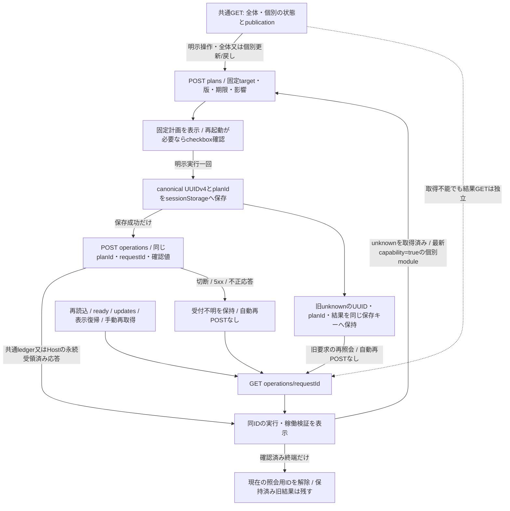
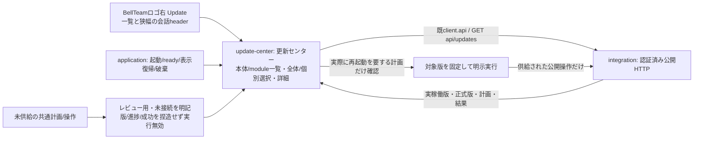
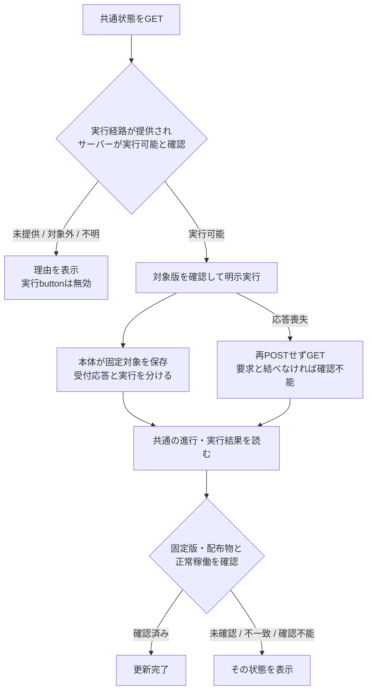

# Update通知の表示・操作設計

状態：2026-11-03にWeb担当が継続を引受。共通inventoryの通常main採用に続き、PR274のcontainer個別plan/確認/start/同ID照会とpublication表示を接続。PR289固定APIのmodule/all更新・個別module戻し・結果照会を接続する。正式catalog/実Host設置や未配置archiveのinstallは別の未供給工程。既Ownerの実装許可を維持し、APIの供給範囲から継続する。入力はトロニーの[6機能定義](/srv/bellteam/bots/bot-7b140b27/docs/commercial-container-update-functions-20261102.md)、[継続工程](/srv/bellteam/bots/bot-7b140b27/docs/module-expansion-20261103.md)、[通知module契約](/srv/bellteam/bots/bot-7b140b27/docs/notification-update-contract-20261103.md)、[確定共通API](/srv/bellteam/bots/bot-7b140b27/docs/update-center-api-20261103.md)。Webの[現行図](README.md)、[runtime](../runtime/README.md)、[distribution](../distribution/README.md)、[Apple](../apple/README.md)へ接続する。公開版・比較・実行結果は本体が所有する。[runtime設計](../runtime/commercial-update-design.md)の状態分離を維持する。横断契約はRoot、共通組立て/APIはMolly、機構はEpi、正式公開版はCentiが持つ。

## 6機能との対応

| 機能 | 所有とWebの接続 |
| --- | --- |
| 1 商用版の発行 | センチが版と配布物を固定し正式公開する。Webは候補tagを探索しない |
| 2 接続先の更新状態 | サーバーが現在版・正式公開版・更新有無・取得不能を返す。Webは版番号を比較しない |
| 3 通知と表示 | アドミがWeb表示、ベルがApple表示。接続先サーバーの状態をロゴ右で示す |
| 4 更新指示の受付 | サーバーが利用者の明示操作と選んだ版を受け、受付/拒否/不明を返す。保存済み受付を実行完了にしない。応答喪失による受付不明はWebの通信状態として持つ |
| 5 更新実行 | エピネルが停止を跨ぐ実行・会話/ファイル/設定の保持と結果を持ち、センチの固定配布物を使う。WebからBot/予定を呼ばない |
| 6 結果確認 | サーバーが実稼働版・配布物と要求対象を照合する。Webは確認済み完了/失敗/確認不能をそのまま表示する |

## 通知と操作

現行Webの`.roster-title .eyebrow`にあるBellTeam表記をロゴとして保ち、同じ行の直後へ文字付き`Update` buttonを置く。`#owner-profile-button`はOwnerの設定/画像であり、別の機能として保つ。780px以下の会話中はchat header内にロゴ＋Updateの一行を設け、戻る操作・会話名・既ツールを保つ。両配置は同じ状態と詳細画面を使い、表示中の入口だけをfocus/読み上げ対象にする。会話中もロゴ右を保ち、細帯だけの代替配置にはしない。

Updateは共通状態の更新あり/進行/失敗/確認不能を文字で区別する。複数対象がある場合の代表状態も本体から受ける。色だけに頼らず、キーボードで開ける名前を付ける。通知表示だけでは更新を発行しない。

常設見出しは`BELLTEAM / UPDATE CENTER`という中立表記を使う。最新版確認済みという状態語はAPIが確認した場合だけ表示する。`web-gateway`は画面資材と公開受付の交換単位なので表示名は「Web受付」。全API業務の独立更新と誤認させない。共通inventory接続後の一覧は実在するcomponentsを入力にし、未独立は本体の理由付きで実行無効にする。

右詳細の本文は「何が未取得か」「通知/更新にどう影響するか」を一文で示し、状態語と同じ意味の理由を重ねない。公開版の比較は公開情報の欄へまとめ、feedの失敗/未確定は短い説明で明示する。生の状態/エラー符号、完全版/digest、固定plan/requestIdは閉じた「サポート用の詳細」へ置く。対象と影響の版は既versionLabelと同じ短縮表示、詳細内はAPIの完全値を保持する。これは表示だけの変更で、判定・固定計画・ID・再送/受付/照会契約を変えない。詳細の開閉状態とfocusは更新時にも保つ。

詳細は製品全体を一望する更新センターとし、本体/各moduleの稼働版と一文の説明を並べる。「全体更新」と個別moduleを選べるようにする。全体更新は本体が返す互換性確認済みの計画を使い、不要な外箱更新を伴わせない。接続先、対象名、現在稼働版、正式公開された更新先、変更内容、対象と影響、取得時点と進行/実結果/稼働確認を表示する。最終操作は選択した計画と版を固定する。コンテナ入替/再起動が必要な計画に限り、確定前に影響警告と利用者の確認を要する。影響は本体から受け、名称や版から推測しない。対象や影響が不明なら理由を表示して実行を無効にする。入力は[Owner確定要件](/srv/bellteam/bots/bot-7b140b27/docs/update-center-20261103.md)。

| 対象 | 更新前に示す影響 | 更新成功と分ける状態 |
| --- | --- | --- |
| Web受付module | 公開HTTP/SSEの一時切断。親の会話/AI実行は継続する契約 | ブラウザーの復帰、新資材の表示確認。交換だけで全業務の独立更新とはしない |
| 通知module | 通知の一時利用不可。端末登録/設定適用は交換中に拒否され得る。会話保存/AI実行は継続 | module自体の稼働と通知providerの設定/利用可否。交換成功をAPNs実配送成功にしない |
| 外箱 | 全Botの会話・処理の一時中断を明示 | 本体再接続と固定対象版/配布物の稼働確認 |

初回の通知module基盤をimageへ導入する全体更新は外箱の影響で扱う。通常module更新へ全Bot中断の定型文を付けない。dialogは名前、戻りfocus、キーボード操作を既UIの方式で用意する。

要求時の接続先と更新先を固定する。通信中の二重クリックを抑え、受付後に公開版が変わっても対象を変更しない。受付応答不明なら「受付を確認できません」とし、再POSTせず共通状態を読む。受付後の状態読取で502/接続断となった時は「再接続後に結果を確認」と示し、成功/失敗を推測しない。受付応答を確認できていない場合は「受付を確認できません」を維持する。接続したサーバーが固定対象の版・配布物と正常稼働を確認した時だけ「更新完了」にする。installerの終了0は実行終了として表示し、稼働確認前に完了へ進めない。

## 必要な公開入出力（候補）

### 11/3 読取基準と実装への接続

読取基準はRoot固定source `03c952bf33b58b4eff322a8514f5448336c1a5be`。以前のWeb採用版`80f067de`からWeb source/担当文書の差はない。現行の画面にUpdateはなく、この文書が既保存案の正本。以下は現物と未供給を分けた記録である。

| 窓口 | 基準sourceでの供給 | 不足 |
| --- | --- | --- |
| GET/POST `/api/web-gateway-release` | GETは`{webGatewayRelease:{currentVersionId,update}}`。updateはnull又は`{versionId,status,error?}`、statusはaccepted/running/succeeded/failed/not_started。POSTは`{versionId:<SHA64>}`だけ、202 finish後開始、内部403/競合409/未提供503 | 正式公開版・比較・影響・変更内容・sourceに結んだ内蔵版表示・観測時点。交換成功を正式公開版ありに流用しない |
| GET/POST `/api/notifications-release` | Root契約には存在。基準sourceでは未実装 | 正確なGET field/state、利用可否と稼働の区別、builtin選択拡張、実装SHA/有限応答例 |
| 共通更新状態/全体計画/外箱更新 | 設計要件だけ。Webは未呼出 | 現在版と正式版catalog、互換計画、受付/結果、停止跨ぎ保存と相関、変更通知topic |

必要fieldは次の意味でRoot/Mollyへ渡す。名前は提案であり、確定schemaや提供済みAPIではない。

| field案 | 意味と供給元 |
| --- | --- |
| `schema/server/observedAt/notice` | 形式、接続先の既識別、タイムゾーン付き観測時点、複数対象をまとめる共通表示状態。Molly/Root。時刻表示はJST |
| `components[]:{id,name,description,current}` | 本体/固定moduleの名称・一文説明・実稼働版/source/digest、内蔵版も実在image/sourceへ束縛。Molly/Epi/各担当 |
| `published/comparison/changes` | 正式公開版・不変資材・変更本文、更新あり/なし/公開なし/取得失敗/比較不能の共通判定。Centi→本体。未公開CI候補を除く |
| `plans[]:{target,versions,compatibility,impact,capability}` | 全体/個別の互換計画、固定対象と版、実際のコンテナ再起動要否と影響、実行可否/未提供理由。Epi/Centi→Molly |
| `operation:{target,admission,phase,execution,verification}` | 受付済み/未受付/不明、引渡し/準備/交換/起動、実結果、実稼働未確認/一致/不一致/確認不能を分離。現在/直前結果と既相関の共通読取。Epi→Molly |
| `availability/reason` | module自体のreadyと通知providerの設定/利用可否を分離。Mika/Epi→Molly |

必要操作は、(1)共通状態GETの正式URL/全state/null/応答例、(2)互換性を確認した全体/個別計画の選択と対象版固定受付、(3)コンテナ再起動計画の明示確認、(4)再接続後の実結果GET、(5)変更時だけのSSE再読取topic。POSTの競合/拒否/受付不明を区別し、Webで新しいID/任意path/汎用dispatcherを作らない。更新はアプリの認可済み操作で完結し、AIの会話やSSH手順へ渡さない。

### Web内部の実装図

#### 全体・個別の計画・実行・戻し接続

公開契約の固定sourceはPR274/main`058f601d11ce9439b6a43e57dbbe2611e52d5389`。component.publicationを必須nullableとして追加し、受入catalogの日時/期限とfeed取得確認（verified/failed/unconfirmed）を分離する。取得失敗/未確認のcomparisonを最新版確認済みと表示しない。受入済みcatalogに更新先が残る場合の実行可否は本体capability/固定planに従い、Webがcatalogの採否を変えない。

Webは全体/個別の更新と個別moduleの戻し計画を同じ公開窓口へ要求する。action省略はupdate、戻しは明示rollback。plan responseのscope/component/actionと全target・互換・期限・可否を確認し、全固定対象を順序どおり表示する。戻し可否はbackend planだけで確定し、all/containerへ戻し操作を出さない。選択変更や新計画で再起動確認を解除し、impactが再起動を要求する場合だけcheckbox確認を必須にする。保存成功後の明示実行だけを許し、二重クリック/旧plan応答/期限切れ/409で別targetや新要求へ自動変更しない。

同origin・同tabで再読込を跨ぐ照会用の`bellteam-update-request.v1`をsessionStorageへ置く。現在のcanonical requestIdとplanIdに加え、新操作へ進む時は旧unknownの結果を`previous`配列へ保持する。旧結果内のrequestId/plan.planIdを使い再照会でき、サーバー台帳や受付・成功の正本にはしない。既存のID二項目だけの保存値も読める。現在の要求が終端又は明確に拒否された後もpreviousは残す。保存/復元ができない場合は新規実行を止めて理由を示す。POST応答が不明ならIDを残し同ID GETで復帰。GET結果のUUID/planIdが違う、形式不正、404/5xxも未受付や完了へ変えない。400/401/403/404/409の明確な受付拒否だけは新計画を要求する。

2026-11-04のRoot裁定：旧unknownは終端へ変えず、同tabに旧pendingがある場合も、正しい同ID結果を取得でき、最新公開component.capability=trueの個別moduleでは新planを明示照会できる。返却planの版・影響を確認した後、新UUIDで明示実行一回だけを送る。新要求と旧unknownの保存を一度に確認してからPOSTし、旧UUID/planId/結果の保持と再照会を続ける。全体/container、継続中の既操作、結果GET失敗、capability=falseではこの例外を使わない。親のactive/hostPending/publication判定を複製せず、busyは拒否として表示する。保持した結果は「保持している操作結果」から個別GETでき、既refreshでも再確認する。新tab回避、保存キーの手消去、旧POST再送、自動実行、新API/ledger変更はしない。元Rabbit tabの欠測を推測で再現しない。

更新結果GETはinventoryと独立に行い、catalog/feed障害で照会を塞がない。取得中の古いinventory/plan/operation応答を新操作へ適用しない。本番/実Hostは担当の既条件で、Webの人工例や隔離HTTPの成功を実配備へ加算しない。

11/3共通APIの採用sourceは`cc49ddbf8117035886ee6c8fa0c7095c8031846b`。公開JSONの一正本は`src/update-center-contract.mjs`、接続先図は[integrationの共通Update状態](../integration/README.md#共通update状態と受付段階接続)。Webは旧module別GETと固定3項目を廃止し、GET `/api/updates`の裸snapshotから実在componentsの名称/説明/current/published/comparison/capability/availabilityを表示する。schemaの独自field/nullは追加せず、表示に使う形と閉じた状態語を検証して不正時は確認不能にする。正式版/実行機構未供給のcapabilityfalse/plans[]を実行可能へ変えない。当時のinventory接続段階は読取だけ。container個別はPR274、module/allと個別module戻しはPR289/main226626abbbb30acb4e6f97932d98037fa3962f91の同正本に従う。戻し先をcurrent/publishedやWebの前回表示から生成しない。

操作と前回結果は正本にある場合だけphase/execution/verificationを分けて描画し、completedは実行/実稼働検証の両成功を必要とする。availabilityは版採用と別欄で表示。未独立の項目も一覧から隠さず、公開理由を表示して実行を無効にする。常設Updateの状態語はnotice、最新版はcomparisonのAPI確認時だけ。起動/ready/updates/表示復帰で既GETへ再同期し、新SSE/poll/ローカル保存の版は作らない。

所有するのは表示cache、選択、読取世代、dialog/確認の局所状態、実行中の固定値。正本の更新判定・互換・版・結果は本体。初回画面は実在GETの稼働観測と未接続のレビュー表示で構築できる。正式APIが届くまで仮backend/架空version/偽の成功は作らない。新部品のstatic登録と版置換をWebのassets正本へ含める。公開接続は既HTTP/SSE内のためmodule.jsonの変更不要。

RootがURLと要求相関を固定した。GET `/api/updates`、POST `/api/updates/plans`（scope=all/component、componentId）、POST `/api/updates/operations`（planId/requestId UUID/confirmContainerRestart）、GET `/api/updates/operations/:requestId`、既SSEのtype=updatesを使う。正確なfield/null/有限例と実装SHAはMollyが一か所で供給する。提供済みとは扱わず、それまで実行は無効。Webで別の相関方式や仮backendを作らない。

| 窓口 | Webが必要とする情報 | 提供する担当への確認 |
| --- | --- | --- |
| 提供可否 | 商用更新の提供、非商用のため対象外、実行経路未提供と理由 | エピネル/センチ：本体外の一回実行への引渡し、設置と権限。未提供なら実行buttonを無効にし理由を示す |
| 元情報・比較 | 現在版/正式公開版/変更内容/観測時点。正式公開版なし、取得失敗、比較不能を区別 | センチ/エピネル：不変の版と配布物の対応、共通の比較結果。「更新なし」は比較に成功した時だけ |
| 保存済み受付 | 固定版・配布物・設置対象・受付時点、又は未受付理由 | エピネル：応答前にcontainer置換後も残る場所へ保存。writer/権限/相関/保存世代は未合意 |
| 進行・実行結果 | 現在/直前の受付対象、準備/入替/起動、実行終了/明確な失敗/結果取得不能 | エピネル：同じサーバーの結果を全アプリへ共通公開。明確な失敗と確認経路の不通を分ける |
| 実稼働確認 | 未確認、対象版・配布物と正常稼働を確認、要求と不一致、確認不能 | エピネル：installer終了0や旧版へ接続できたことを更新完了へ変えない |
| 変更通知 | 更新状態が変わったこと。状態本文はGETで再取得する | 本体統合/ベル：WebとAppleの同じ結果・失敗・完了条件。通知だけで成功にしない |

## 表示する状態と実行条件

非商用の対象外と実行経路の未提供は、詳細にそれぞれの理由を示す。正式公開版なし・取得失敗・比較不能を「更新なし」へまとめない。進行状態、実行結果、稼働確認は独立に表示できるようにし、「実行は終了、稼働は未確認」や「実行結果を取得できず確認不能」を成功/失敗へ補完しない。

公開本体から限定Host受付・本体外workerへ渡すsourceはPR274で実装済み。実設置/正式catalogが未供給の環境ではcapabilityを無効にする。Hostの設定や実設置をWeb担当が変更せず、sourceの成立だけで実行可能と扱わない。

受付保存は本体、実行の進行/結果は本体外の一回実行が別の結果文書を所有するruntime案へ接続する。Webは複数writerの私有ファイルを直接読まず、本体の共通状態だけを表示する。受付保存済みでも、実行への引渡し未確認・開始失敗・開始したか不明を「更新中」へまとめない。結果が確認できないまま無期限に処理中の表示を続けず、確認不能として示す。

Root共通APIは応答前に固定対象を永続化し、利用者の一回の実行操作にrequestId UUIDを一つ割り当てる。応答喪失/再接続後は同じrequestIdのGETで照会し、自動再POSTしない。共通snapshotの現在/直前結果も各アプリから読む。同じ版だけで自分の要求に結び付けず、照会不能は確認不能のままにする。Webは同origin/tabのsessionStorageへ照会ID/planIdを保存し、再読込後に同IDのGETへ戻す。受付/結果の正本はMolly/Epiが持つ。

この図は表示・実行の条件を示す。今回の全体/個別更新・戻し接続は既HTTP/SSE内なのでmodule.jsonの接続変更はなく、全体図の再生成結果も不変。共通ledgerの全体/個別planと個別module rollbackへ同窓口で接続し、未配置/未対応の拒否は理由を示す。

## Appleとの互換・復帰契約

Appleの現在資料は[iOS README](../../../../ios/BellBot/README.md)と[iPad資料](../../../ipad-app.md)。独立したApple機能図は未作成であり、このWeb案にApple内部の状態や実装を複製しない。利用する接点は公開HTTPとSSE。Apple担当の返答をトロニーが中継・回収する。

| 条件 | 共通の表示・操作案 |
| --- | --- |
| 新アプリから旧サーバーへ接続し、更新機能の読取が404 | 完成版の更新あり通知は出さない。現在の段階導入はOwner指定のレビュー用入口を残して未接続を明記。認証失敗や未知stateを404相当にしない |
| 未知のstate、形式が解釈できない | 確認不能として表示。既知の成功や更新なしへ変換しない |
| 状態の変更通知 | 変更時だけSSEで再取得を促す。旧アプリは未知通知で全再読込するため、定期通知や同じ状態の反復送信を追加しない |
| POSTの通信/デコード/不正応答/5xx | 受付不明とし再POSTしない。共通状態をGET一回で確認。Appleの既存operationResultUnconfirmed分類に合わせ、Webはfetch/JSON/返却値の不明を対応させる |
| 再接続ready・foreground復帰 | 接続先の共通状態を再確認。Webでは表示復帰に対応させる。追加pollや更新POSTの自動再送を設けない |
| 保存済み受付を確認した後の502/切断 | 「再接続後に結果を確認」。停止を跨ぐ状態公開はruntimeの契約に従う |
| 接続先の変更 | 新接続先の状態へ切り替え、旧接続先の遅い応答を適用しない。旧サーバーで受け付けた更新は取消さない |
| 実行の権限 | 本体が要求時に判定する。アプリのbutton状態を権限確認の代用にしない |

共通APIの各state文字列は、本体担当の公開schemaで全種類と意味を固定してから実装する。現在の意味の表を各アプリで別々の文字列へ確定しない。取得時点はタイムゾーンを含むISO8601で返す契約とする。変更内容はplain textを候補とし、全アプリで同じ形式を合意して固定する。Markdownを使う場合は契約として明示し、未合意の本文を自動的にHTML/Markdownとして解釈しない。

審査環境が非商用か、どの設置に更新実行を提供するかはセンチとの未合意事項。旧サーバー互換、通知頻度、受付不明の読戻し方針を示したことを、配布/審査環境の判断完了にしない。

## 設計後の検証項目

古い公開版/候補/取得不能を更新ありにしない。固定した版で受付する。別アプリから操作した進行を同じように示す。二重クリック、POST応答喪失、SSE切断、旧版への再接続、対象版起動後の未確認/失敗、公開版なし/取得失敗/比較不能、旧404、未知state、復帰、古い応答を人工APIで確認する。新部品3+既Web組立/通信/SSE/所有17の計20試験成功。実ブラウザーは1440×1100と390×844、会話中のロゴ右入口、未接続表示、実行無効、横overflowなし、Escape/戻りfocus、JS例外0、mutation0を確認。画面検証用HTTPは静的資材とAPI404だけで、架空版や成功を返すbackendを作っていない。共通API/実更新との結合は供給後の残工程。

## 未合意事項と次の受け渡し

| 項目 | 判断・実行の担当 | 次に揃える情報 / 完了条件 |
| --- | --- | --- |
| 会話中の通知位置 | Webはアドミ、Appleはベル | Webは狭幅chat headerのロゴ右を実装/確認済み。Appleの配置変更をWebで裁定しない |
| 公開状態の形式 | 共通契約Root、実装Molly、Web/Appleは利用側 | PR274の厳密schema/9有限例/publication nullable/URL/SSEを供給済み。同sourceからWebを接続 |
| 停止を跨ぐ実行経路 | Epi、配布Centi、共通接続Molly、契約/実設置Root | Host限定受付/別workerのsourceを供給済み。実設置は未供給、環境のcapability falseをWebで変更しない |
| 受付保存と結果の相関 | Epi/Molly、契約Root | canonical UUIDv4と固定plan、Host永続受領後202、同ID GETの公開sourceを供給済み。WebはsessionStorageのIDで照会を復元 |
| 正式版と配布物、審査環境の区分 | Centi/Root | 署名catalog/発行・検証sourceは既工程。実正式catalogの供給/Host設置は未成立。publicationと実行可否をそのまま表示 |

inventory読取のWebはmain9e83c192へ採用済み。今回のcontainer操作接続は担当checkoutの差分で、通常main採用/本番反映は未成立。過去の分離mainや既配備を今回の実更新完了へ読み替えない。Rootの最新本番裁定を使う。

現在の供給範囲と未成立の実設置を分けた表である。同じ回答や採否を重複依頼しない。Apple内部やHost配置/権限をWeb担当が無断変更せず、各担当の公開窓口を使う。
