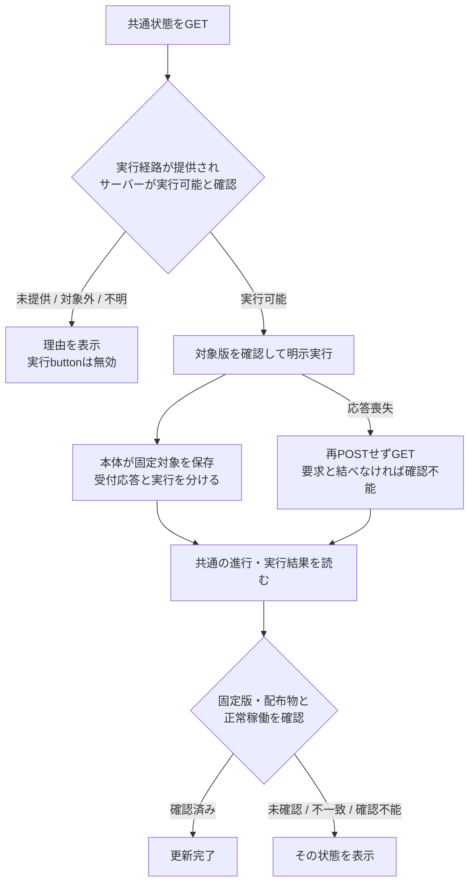

# 商用コンテナの更新表示・操作案

状態：設計案。API形式/実行主体の合意前で、新機能のコードは実装しない。入力はトロニーの[6機能定義](/srv/bellteam/bots/bot-7b140b27/docs/commercial-container-update-functions-20261102.md)。Webの[現行図](README.md)、[runtime](../runtime/README.md)、[distribution](../distribution/README.md)、[Apple](../apple/README.md)へ接続する。更新状態の比較・実行結果はサーバーが所有し、WebとAppleは同じ結果を表示する。[runtimeの設計案](/srv/bellteam/bots/bot-0b867848/work/BellTeam-runtime-20261102/docs/architecture/modules/runtime/commercial-update-design.md)の状態分離と受付保存を使用する。

## 6機能との対応

| 機能 | 所有とWebの接続 |
| --- | --- |
| 1 商用版の発行 | センチが版と配布物を固定し正式公開する。Webは候補tagを探索しない |
| 2 接続先の更新状態 | サーバーが現在版・正式公開版・更新有無・取得不能を返す。Webは版番号を比較しない |
| 3 通知と表示 | アドミがWeb表示、ベルがApple表示。接続先サーバーの状態をロゴ右で示す |
| 4 更新指示の受付 | サーバーが利用者の明示操作と選んだ版を受け、受付/拒否/不明を返す。保存済み受付を実行完了にしない。応答喪失による受付不明はWebの通信状態として持つ |
| 5 更新実行 | エピネルが停止を跨ぐ実行・会話/ファイル/設定の保持と結果を持ち、センチの固定配布物を使う。WebからBot/予定を呼ばない |
| 6 結果確認 | サーバーが実稼働版・配布物と要求対象を照合する。Webは確認済み完了/失敗/確認不能をそのまま表示する |

## 通知と操作

現行Webの`roster-title`にあるBellTeam表記をブランド表示として整理し、その右へ文字付きbuttonを置く。Ownerのアバター設定buttonとは分ける。Home/サイドバーではロゴ右を維持する。狭い幅の会話中・サイドバー非表示では、共通位置へロゴと通知を残す案と、更新時だけナビバー下へ細帯を出すApple案を検討する。後者はOwnerのロゴ右指定を変える代替案なので、採用済みと扱わない。通知が隠れる配置の解決は未確定とする。

文言はApp Storeのアプリ更新と区別し「BellTeam本体の更新あり」とする。進行/失敗/確認不能も本体の更新と分かる表示にする。色に加えて文字で示し、キーボードで開ける名前を付ける。

開いた詳細には接続先、現在稼働版、正式公開版、選択した更新先、変更内容、状態の取得時点と現在の進行を表示する。更新前に「全Botの会話・処理が一時中断する」と説明し、利用者が対象版を確認した実行buttonから一回要求する。詳細を開く行為や通知表示では停止・更新を発行しない。

要求時の接続先と更新先を固定する。通信中の二重クリックを抑え、受付後に公開版が変わっても対象を変更しない。受付応答不明なら「受付を確認できません」とし、再POSTせず共通状態を読む。受付後の状態読取で502/接続断となった時は「再接続後に結果を確認」と示し、成功/失敗を推測しない。受付応答を確認できていない場合は「受付を確認できません」を維持する。接続したサーバーが固定対象の版・配布物と正常稼働を確認した時だけ「更新完了」にする。installerの終了0は実行終了として表示し、稼働確認前に完了へ進めない。

## 必要な公開入出力（候補）

URLや新ID体系はここで決めない。既存公開HTTPとSSEの接続を使い、正確なschemaと通知topicは本体担当と合意してから固定する。

| 窓口 | Webが必要とする情報 | 提供する担当への確認 |
| --- | --- | --- |
| 提供可否 | 商用更新の提供、非商用のため対象外、実行経路未提供と理由 | エピネル/センチ：本体外の一回実行への引渡し、設置と権限。未提供なら実行buttonを無効にし理由を示す |
| 元情報・比較 | 現在版/正式公開版/変更内容/観測時点。正式公開版なし、取得失敗、比較不能を区別 | センチ/エピネル：不変の版と配布物の対応、共通の比較結果。「更新なし」は比較に成功した時だけ |
| 保存済み受付 | 固定版・配布物・設置対象・受付時点、又は未受付理由 | エピネル：応答前にcontainer置換後も残る場所へ保存。writer/権限/相関/保存世代は未合意 |
| 進行・実行結果 | 現在/直前の受付対象、準備/入替/起動、実行終了/明確な失敗/結果取得不能 | エピネル：同じサーバーの結果を全アプリへ共通公開。明確な失敗と確認経路の不通を分ける |
| 実稼働確認 | 未確認、対象版・配布物と正常稼働を確認、要求と不一致、確認不能 | エピネル：installer終了0や旧版へ接続できたことを更新完了へ変えない |
| 変更通知 | 更新状態が変わったこと。状態本文はGETで再取得する | 本体統合/ベル：WebとAppleの同じ結果・失敗・完了条件。通知だけで成功にしない |

## 表示する状態と実行条件

非商用の対象外と実行経路の未提供は、詳細にそれぞれの理由を示す。正式公開版なし・取得失敗・比較不能を「更新なし」へまとめない。進行状態、実行結果、稼働確認は独立に表示できるようにし、「実行は終了、稼働は未確認」や「実行結果を取得できず確認不能」を成功/失敗へ補完しない。

公開本体からHost installerへ明示操作を渡す経路は現状未提供。既存installerが停止を跨げることだけで実行可能にしない。起動経路・配置・writer/権限・受付の相関をruntime/配布/統合と合わせるまで、設計上も実行可能として扱わない。Hostの設定をWeb担当が変更しない。

受付保存は本体、実行の進行/結果は本体外の一回実行が別の結果文書を所有するruntime案へ接続する。Webは複数writerの私有ファイルを直接読まず、本体の共通状態だけを表示する。受付保存済みでも、実行への引渡し未確認・開始失敗・開始したか不明を「更新中」へまとめない。結果が確認できないまま無期限に処理中の表示を続けず、確認不能として示す。

受付は応答前に固定対象を永続化する案を前提とし、状態GETで同一サーバーの現在/直前の受付対象と結果を全アプリが確認する。ただし同じ版・対象の受付を発見したことだけでは、応答を失った個別要求と同一とは断定できない。要求に結び付けられなければ、共通の進行は表示しつつ自分の操作は確認不能のままにする。相関を推測して再POSTしたり、Webで新しいID体系を作ったりしない。

この図は設計中の表示・実行条件を明記するもので、現行のmodule.jsonへ未実装接続を追加しない。全体の現行図は変更不要。

## Appleとの互換・復帰契約

Appleの現在資料は[iOS README](../../../../ios/BellBot/README.md)と[iPad資料](../../../ipad-app.md)。独立したApple機能図は未作成であり、このWeb案にApple内部の状態や実装を複製しない。利用する接点は公開HTTPとSSE。Apple担当の返答をトロニーが中継・回収する。

| 条件 | 共通の表示・操作案 |
| --- | --- |
| 新アプリから旧サーバーへ接続し、更新機能の読取が404 | 更新機能なしとして非表示。認証失敗や未知state/不正応答を404相当にしない |
| 未知のstate、形式が解釈できない | 確認不能として表示。既知の成功や更新なしへ変換しない |
| 状態の変更通知 | 変更時だけSSEで再取得を促す。旧アプリは未知通知で全再読込するため、定期通知や同じ状態の反復送信を追加しない |
| POSTの通信/デコード/不正応答/5xx | 受付不明とし再POSTしない。共通状態をGET一回で確認。Appleの既存operationResultUnconfirmed分類に合わせ、Webはfetch/JSON/返却値の不明を対応させる |
| 再接続ready・foreground復帰 | 接続先の共通状態を再確認。Webでは表示復帰に対応させる。追加pollや更新POSTの自動再送を設けない |
| 保存済み受付を確認した後の502/切断 | 「再接続後に結果を確認」。停止を跨ぐ状態公開はruntimeの契約に従う |
| 接続先の変更 | 新接続先の状態へ切り替え、旧接続先の遅い応答を適用しない。旧サーバーで受け付けた更新は取消さない |
| 実行の権限 | 本体が要求時に判定する。アプリのbutton状態を権限確認の代用にしない |

共通APIの各state文字列は、本体担当の公開schemaで全種類と意味を固定してから実装する。現在の意味の表を各アプリで別々の文字列へ確定しない。取得時点はタイムゾーンを含むISO8601で返す契約とする。変更内容はplain textを候補とし、全アプリで同じ形式を合意して固定する。Markdownを使う場合は契約として明示し、未合意の本文を自動的にHTML/Markdownとして解釈しない。

審査環境が非商用か、どの設置に更新実行を提供するかはセンチとの未合意事項。旧サーバー互換、通知頻度、受付不明の読戻し方針を示したことを、配布/審査環境の判断完了にしない。

## 設計後の検証項目

古い公開版/候補/取得不能を更新ありにしない。固定した版で受付する。別アプリから操作した進行を同じように示す。二重クリック、POST応答喪失、更新中のSSE切断、旧版への再接続、対象版起動後の未確認/失敗、非商用、実行経路未提供、公開版なし、取得失敗、比較不能、同じ対象でも要求との相関が不明な場合、旧サーバー404、未知state、5xx/不正なPOST応答、復帰時の一回読取、接続先切替後の遅い応答を人工APIで検証する。色に頼らない表示、狭い画面/会話中の常設位置、focusと読み上げをブラウザーで確認する。実装承認前にこれらのテストやUIコードは追加しない。

## 未合意事項と次の受け渡し

| 項目 | 判断・実行の担当 | 次に揃える情報 / 完了条件 |
| --- | --- | --- |
| 会話中の通知位置 | Webはアドミ、Appleはベル。ロゴ右指定の変更はOwner | Webは狭い画面でもロゴと右側の通知を保つ案を維持。Appleの細帯は代替案のまま、指定変更として採用しない |
| 公開状態の形式 | runtimeはエピネル、共通公開契約はトロニー、Web/Appleは利用側 | stateの固定文字列と各軸の対応、ISO8601の取得時点、変更内容plain text案の採否を一つの公開契約へ固定する |
| 停止を跨ぐ実行経路 | エピネル、配布構成はセンチ、契約接続はトロニー | 本体外の既存一回実行への引渡しと起動の可否を確定。提供可能と確認されるまで実行不可 |
| 受付保存と結果の相関 | エピネル、契約接続はトロニー | 永続する保存世代、writer/権限、要求との相関、再接続後の共通結果読取を確定。結び付け不能をWebで補完しない |
| 正式版と配布物、審査環境の区分 | センチ | 正式公開版・不変の配布物・変更内容の元情報、審査環境の商用/非商用区分と更新提供範囲。現時点で合意未成立 |

初回Web分離はPR254からmain `84d3b1047350ff090e1a79cb67751a28113089c8`へ統合済み。最終PR head `637d9a362162bff21ba76ef9b009ee047603b887`とmerge treeは同一。本番/一般配布/更新UI実装は未成立。

この表は担当へ既に渡した設計案の残りを示す。回答を重複依頼しない。センチへの配送未達はトロニーと実行担当の正規復帰確認を受けて扱い、無条件再送しない。Appleとの連絡はトロニーの既通話中継を使い、Web担当が他者の通話を操作しない。未合意の配置や権限をWeb側で補完しない。
