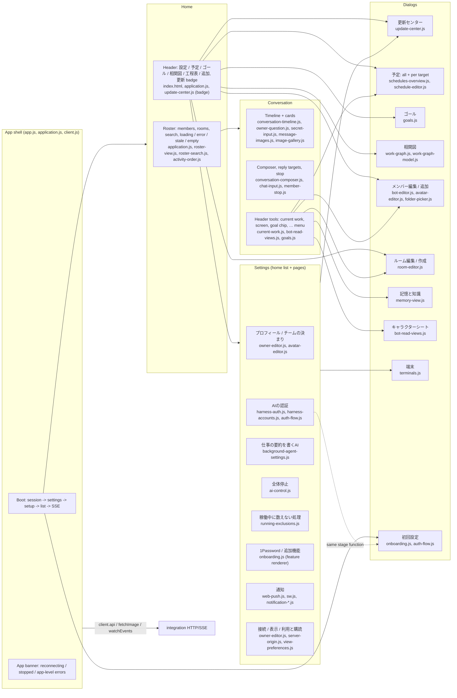

# Web: function map (screens -> functions -> public HTTP)

What the user can do in the Web app, which screen offers it, which view file owns it, and which public HTTP it uses. The paths between screens (states, buttons, failure exits, broken spots) are in [user paths](user-paths.md). Startup, the HTTP/SSE client and asset registration are in the [README](README.md#起動通信公開登録). The Web never calls MCP and never owns server state.

| Function | Screen | Reads | Writes | Owner of the data |
| --- | --- | --- | --- | --- |
| Boot, session, setup phase | shell | `GET /api/session`, `GET /api/settings`, `GET /api/setup` | — | integration, onboarding |
| Live updates | shell | `GET /api/events` (SSE) | — | integration |
| Member and room list | roster | `GET /api/bots?avatar=omit`, `GET /api/rooms`, `GET /api/owner`, avatars `GET /api/bots/:id/avatar` | — | members |
| Account limit banner | roster | `GET /api/accounts` | — | execution |
| Conversation history and queue | timeline | `GET /api/{bots,rooms}/:id/messages`, `GET …/queue` | — | conversation |
| Send, stop | composer | — | `POST /api/{bots,rooms}/:id/messages`, `POST /api/bots/:id/stop` | conversation, execution |
| Export | chat … menu | `GET /api/{bots,rooms}/:id/export` | — | conversation |
| Owner question, secret request | cards | `GET /api/secret-requests/:id/onepassword-items` | `POST /api/owner-questions/:id/answer`, `POST /api/secret-requests/:id/{submit,cancel}` | usage |
| Screen panel | chat | `GET /api/bots/:id/screen`, `GET …/screen/approval` | `POST …/screen/key`, `POST …/screen/approval` | execution |
| Goal | chat chip, goals dialog | `GET /api/bots/:id/goal`, `GET /api/goals` | `POST /api/bots/:id/goal` | goals owner |
| Owner profile, rules | settings | `GET /api/owner`, `GET /api/user-rules` | `PATCH /api/owner`, `PUT /api/user-rules` | members (owner), rules |
| AI auth | settings, onboarding | `GET /api/harness-auth[/:h]`, `GET /api/accounts` | `POST /api/harness-auth/:h/{start,input,cancel}[?slot=2nd]`, `POST /api/setup/{harness,start,auth/input}` | usage (HarnessAuth), execution |
| Summary AI | settings | `GET /api/settings`, `GET /api/models` | `PATCH /api/settings/backgroundAgent` | settings |
| Whole stop | settings | `GET /api/ai-control` | `PATCH /api/ai-control` | execution |
| Processes not counted as working (a63) | settings | `GET /api/running-exclusions`, member names from the list read | `DELETE /api/running-exclusions/:id` | execution ([current work](../execution/current-work.md) "Owner read and remove (a62)") |
| Features, 1Password | settings | `GET /api/settings` | `PATCH /api/settings/:id` | settings |
| Notifications | settings | `GET /api/web-push/status`, `POST /api/web-push/status`, `GET /api/notifications` | `POST /api/web-push/subscriptions`, `POST /api/web-push/unregister` | notifications |
| Connection, display | settings | `location.origin`, localStorage | localStorage, a new tab | this browser |
| Updates | update center | `GET /api/updates`, operation GETs, SSE `updates` | `POST /api/updates/catalog-check`, `POST /api/updates/plans`, `POST /api/updates/operations` | runtime, distribution |
| Schedules | schedule dialogs | `GET /api/schedules`, `GET /api/{bots,rooms}/:id/schedules` | `POST`, `PUT …/:sid`, `DELETE …/:sid`, `POST …/:sid/run` | schedules |
| Work graph | 相関図 | `GET /api/work-graph/events` (SSE) | — | work-graph |
| Member edit and add | member editor | `GET /api/bots/:id`, `GET /api/models`, `GET /api/terminals`, `GET /api/terminals/:id/folders` | `POST /api/bots`, `PATCH /api/bots/:id`, `POST …/restart`, `DELETE /api/bots/:id`, `POST /api/terminals/:id/folder` | members |
| Room edit and create | room editor | list | `POST /api/rooms`, `PATCH /api/rooms/:id`, `DELETE /api/rooms/:id` | members |
| Memory and knowledge | memory dialog | `GET /api/bots/:id/{memory,knowledge}` | `POST /api/bots/:id/{memory,knowledge}` | memory |
| Character sheet | sheet dialog | `GET /api/bots/:id/character-sheet` | — | members |
| Terminals | terminals dialog | `GET /api/terminals[/:id]` | `PUT`, `DELETE`, `POST …/check`, `…/keys/{ssh,sudo}`, `…/keys/ssh/authorize` | terminals |

The UI overhaul in [user paths](user-paths.md) changes screens, words, layout and where results appear. It does not add or change any public HTTP except the open points listed there (O1 `required` flag, O4 last-check result), which go to their owners first.
