# Web: user paths (screen state transitions)

Canonical place for **what the user sees, what they press, and what they see next** in the Web app. Companion: [function map](user-functions.md) (screens -> functions -> public HTTP). The internal state each view keeps stays in [conversation](conversation.md), [management](management.md) and the per-feature sections of the [README](README.md).

Input for this document: the production capture and review by Trony (2026-11-11, 86 shots, 2 PASS) at `/srv/bellteam/bots/bot-7b140b27/work/ui-all-20261111/web/review.md` (finding ids H1-H7, C1-C4, S1-S9, O1-O5 below are that file's), and a read of the Web source at main 1e835b36.

Apple keeps the same structure for Settings in [apple/settings-user-flow.md](../apple/settings-user-flow.md) (Rapi, branch `rapi/apple-auth-states`). Where both apps show the same thing, the words, badges and order are the same (section 9).

Marks: **⚠Wn** = broken today (main 1e835b36), to be fixed. **✓Wn** = fixed (W5-W18, W21 and W24 in step 2a, branch `feat/web-home-roster-20261112`; W19-W20, W22-W23 and W25-W28 in step 2b-1, branch `feat/web-member-chat-20261112`; W29-W36 in step 2b-2, branch `feat/web-cards-room-20261112`; W60-W63 in step 3, branch `feat/web-update-center-20261112`). **→** = target. A transition without ⚠ already works and stays.

## 0. Rules every screen follows (acceptance bar)

Owner, 2026-11-11 20:5x and 22:1x-22:2x JST, via Trony.

| # | Rule | Fails when |
| --- | --- | --- |
| P1 | **The result appears where the user pressed.** While waiting, the pressed button itself says 「…しています」. The result or failure sentence sits right above or below that button, inside the same card. A button that opens something opens it in front. | The result goes to the page top or bottom, another panel, the chat header behind a modal, or needs a scroll. |
| P2 | **Show only what this state needs.** No control that cannot act in this state, and no raw ids, hashes, URLs, model ids, cron, shell commands, codes, e-mail addresses or English DSL. Raw values live only in a closed 「サポート用の詳細」 with a copy button. | A disabled or inert control is visible with no reason, or an internal value is shown. |
| P3 | **Loading, empty and error look different.** Loading = skeleton or spinner with 「読み込んでいます」. Empty = icon + one sentence + the one action that fills it. Error = amber or red icon + one plain sentence (what happened + what to do) + a retry button **at that spot**. | A blank area, or the same words for loading and failure, or an error whose only exit is 「開き直してください」 or a page reload. |
| P4 | **Absent data shows nothing.** A field that is merely not there yet (no summary, no goal, no responders) shows nothing or one quiet line. Only a real failed read is shown as a failure, and only once per screen. | 「未取得」 or 「取得できません」 as the normal subtitle. |
| P5 | **One save model per screen.** A card that edits values saves with its own button at the bottom of that card. A switch acts at once. There is no second save somewhere else. Closing with unsaved input in any card asks once. | Two save buttons whose scope is unclear, or input lost silently on close. |
| P6 | **No hunting.** Tabs or items switch pages; they do not scroll one long page. A dialog title names its target (「トロニーの自動実行」). Long forms keep their save bar sticky at the bottom of the viewport, next to the error line. | The title hides under a sticky bar, the save is 10,000 px away, or the user must move sideways. |
| P7 | **One main button per state, and it is the real next step.** | The same primary button in every stage (O2), or two near-equal buttons. |

Shared visual vocabulary (same as Apple section 3): badge 「未設定」 gray, 「設定済み」/「使えます」/「最新」 green, 「待ち」/「確認中」 purple, 「失敗」/「ログインが必要」/「確認できません」 amber. `確認中` never carries an action button (S5).

## 1. App shell (boot and live updates)

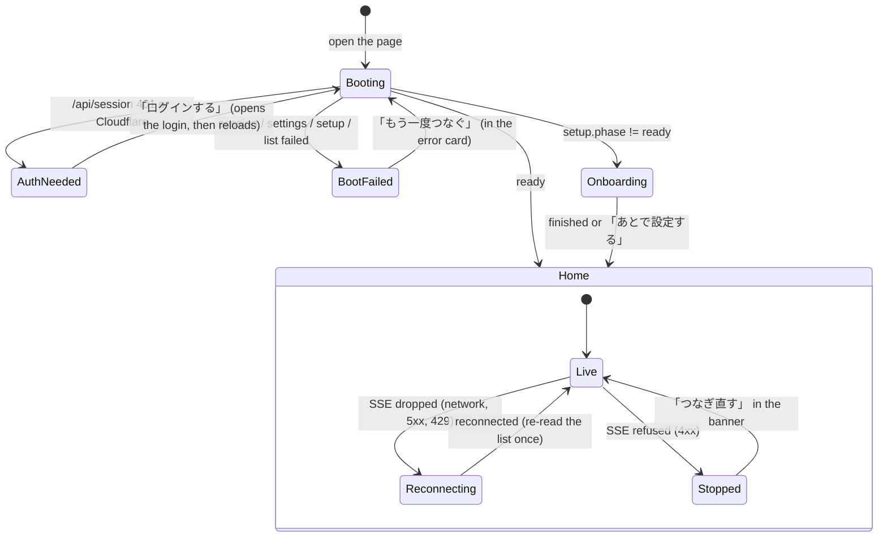

- ⚠W1 Boot failure is a bare red line 「BellTeamに接続できません: {message}」 at the top of `#app` with no button; only a browser reload recovers (`app.js:3-8`). → An error card in the empty right pane / full screen on phone: icon, 「BellTeamにつながりませんでした。通信を確かめて、もう一度つないでください。」, 「もう一度つなぐ」 (re-runs boot).
- ⚠W2 If the first list read fails (non-503), boot stops after the roster notice: SSE never connects and pending notification routes are never applied; 「一覧を再取得」 only reloads the list (`app:331-346`). → Retry re-runs the remaining boot steps (connect SSE, apply the held route).
- ⚠W3 While reconnecting there is no sign; when SSE stops, the message goes to the composer error line, which is invisible with nothing selected (`app:731-733`, `cc:168`). → Reconnecting: a small 「再接続中…」 pill at the top of the roster. Stopped: a top banner 「最新の状態が届かなくなりました。」 + 「つなぎ直す」.
- ⚠W4 Every app-level error raised with nothing selected is lost (`resumeSetup`, `onLater`, settings refresh, SSE stop all write to `composer-error`). → App-level errors go to the top banner (same element as W3), never to a conversation's composer.

## 2. Home: roster and header

### 2.1 Header

| Control (today) | Today | → Target |
| --- | --- | --- |
| Owner initial `O` (`#owner-profile-button`) | Opens 設定; silent no-op while the owner is not loaded; the avatar is squeezed and overlaps the clock (H5, Trony 2026-11-12 (a)) ✓W5 | Gear icon with the visible label 「設定」. Always opens Settings: when the list has not brought the owner yet, the button reads `GET /api/owner` itself (button disabled while reading). Every owner write (list read, this read, saved profile) goes through `applyOwner`: the value from the read that started last wins in any finishing order, and the rest of a list response still applies; Settings opens with the current owner (test `web-owner-open`); a failed read shows 「設定を開けませんでした…」 in the amber line under the header. |
| Clock / target / graph / chart icons | Icon-only; opens すべての予定 / ゴール一覧 / 相関図 / 工程表 (H5) ✓W5 | Same four, each with a visible short label under the icon (「予定」「ゴール」「相関図」「工程表」), tooltip kept. All header tools share one shape (`.tool-button`: 40 px circle + 11 px label), so nothing overlaps at 360 px. |
| Magnifier (`#search-button`) | Focuses the always-visible search box; does nothing visible ✓W6 | Removed. The search box stays. |
| `+` (`#add-button`) | Opens the add sheet | Labelled 「追加」; the sheet rows have icons and say 「メンバーを追加」 and 「ルームを作る」. |
| `Update` pill | English, no state; opens the update center even with nothing to do (H5, Trony (b)) ✓W7 | A badge beside the 「メンバー」 title, set by `update-center.js` in the same branch that sets the center title: 「更新 n件」 (accent), 「更新中」 (purple), 「更新に失敗」 / 「要対応」 / 「確認できません」 (amber, the last only for a failed read). Hidden when everything is latest, while the first read is running, and when only some rows are unknown (the center and the Settings row say that). Settings › アップデート is the always-present entry. The phone chat header has no update entry. |

### 2.2 Roster list

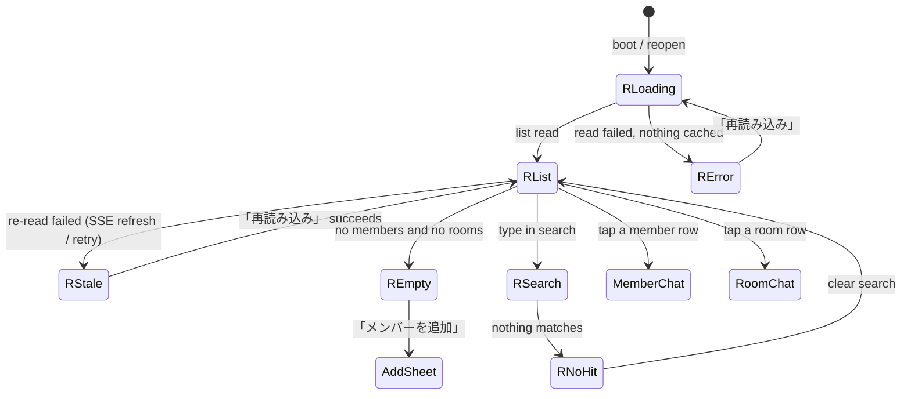

| State | Today | → Target |
| --- | --- | --- |
| RLoading | Empty container, no text ✓W8 | Three skeleton rows (static in index.html, replaced by the first render) + screen-reader text 「読み込んでいます」. |
| RError | Gray 「一覧を取得できませんでした。取得済みの表示と入力は保持しています。」 but nothing is shown; 「一覧を再取得」 looks like text (review "roster 503") ✓W9 | Error card in the list: icon, 「メンバー一覧を読み込めませんでした。通信を確かめて、もう一度読み込んでください。」 (503 `MEMBERS_NOT_ACCEPTED`: 「メンバー機能がいま応答できません。少し待ってから、もう一度読み込んでください。」), button 「再読み込み」 that says 「読み込んでいます…」 while reading. An SSE `ready` re-read also leaves this state. |
| RStale | Same gray notice above the old rows | Old rows stay; a thin amber line above them: 「最新の一覧を読み込めませんでした」 + 「再読み込み」. RError vs RStale = whether any list read has succeeded in this page. |
| REmpty | Gray 「まだメンバーはいません。」, no action (review "roster empty") ✓W10 | Empty card: icon, 「まだメンバーがいません。」, primary 「メンバーを追加」 (and 「初回設定を続ける」 while setup is not finished). |
| RNoHit | Gray text only | Search icon + 「見つかりませんでした。名前や役職を変えて探してください。」. A bare 「ルーム」 heading with zero rooms is not drawn ✓W11. |
| Room match reason | A room matching only through a member shows no reason | Second line 「参加者: トロニー」 when the match is a participant. |

**Member row** (H1-H4):

| Part | Today | → Target |
| --- | --- | --- |
| Line 1 | Name with the role glued on and a `2ndアカウント` pill; names cut to 「スノ…」 ✓W12 | Name only, never truncated before the time column. |
| Line 2 | `仕事状況を未取得` / `作業中・要約未取得` / `実行状態未取得` for almost every row (`cw:18-24`; absent and failed are the same) ✓W13 | The 要対応 reason when there is one; else the current work summary (`summaryStatus: current`); otherwise the role (`position`). Never 「未取得」 (P4). |
| State | `実行状態未取得` text in the time column, a green dot on every member, an unexplained black dot ✓W14 | One colored badge on the avatar corner: 作業中 (purple, `currentWork.state: working`), 要対応 (amber: 端末で起動できません when `seatLaunch` is present, 削除の結果待ち; beats 作業中), nothing when idle. The online dot is gone. The unread dot stays, with the tooltip 「未読」. |
| Time | The refresh time on every row (H4); no date ✓W15 | `recent.at` as 「12:10」 today, 「昨日」, 「11/9」 older. Nothing when there is no recent message. |
| Account | `1stアカウント` / `2ndアカウント` pill on most rows ✓W16 | Not on the row. Shown in the member editor's AI section only. |

**Room row** (H7): line 1 room name; line 2 the last message preview (「モリー: …」, the Owner's own as 「あなた: …」, an image-only one as 「画像」) or the purpose; a small avatar stack of up to 3 members who are working (+n beyond), tooltip 「作業中: …」. ✓W17 today: the label 「参加者の現在の仕事」 on every row, 「参加者の仕事要約を未取得」 on 7 of 8 rooms, a tiny 「ほか16人」.

Row content rules live in `roster-view.js` (`memberRow`, `memberState`, `roomRow`, `rowTime`); `application.js` only draws them.

### 2.3 Nothing selected (PC right pane)

- ✓W18 Shows a black `B`, 「話す相手を選んでね」 and live but inert export and schedule buttons (H6, `app:248`, `app:551`). → Illustration + 「左の一覧から、話す相手を選んでください。」. The chat header tools (edit, export, schedule, screen) are hidden until something is selected.

## 3. Conversations

### 3.1 Member chat

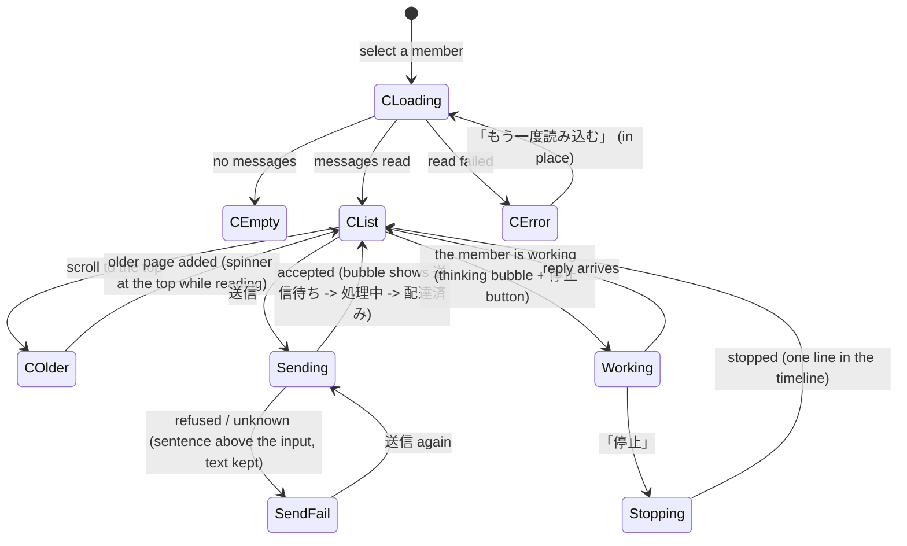

| Spot | Today | → Target |
| --- | --- | --- |
| CLoading | Blank pane on PC, no sign (review "member chat") ✓W19 | Skeleton bubbles + 「会話を読み込んでいます」 (`conversation-timeline.js` `loadingBubbles`, replaced by the first page). |
| CEmpty | Only the day label 「BellTeamでの会話」 | 「まだ会話がありません。メッセージを送ってみてください。」 above the input; gone as soon as anything (a message or a queued send) is shown. |
| CError | Red 「会話を読み込めませんでした。開き直して確認してください。」 with no button ✓W20 | Amber box at the end of the conversation: 「会話を読み込めませんでした。通信を確かめて、もう一度読み込んでください。」 + 「もう一度読み込む」 (says 「読み込んでいます…」 while reading). The retry repeats the read that failed: the open, the newest page, or the older page with its cursor. That read's own success (by the button or by scrolling) clears the box; a newest-page read settles a failed open or newest-page read, never a failed older page. A failed send-queue read is the same box with 「送信待ちの状態を読み込めませんでした。」 and re-reads only the queue. Older page: 「前の会話を読み込んでいます…」 at the top while reading. |
| Header subtitle | 「CLI接続あり」 / 「CLI接続なし · 送信時に起動」, never refreshed (C1, `app:482`, Trony 2026-11-12 (c)) ✓W21 | The role, plus the same state badge as the row (作業中 / 要対応, `memberState`). Refreshed on every list read. A room shows 「n人」. The header name is the member's name only. |
| Seat launch line | 「端末で起動できません：SEAT_TERMINAL_UNREACHABLE」 shows the raw code (P2) ✓ | 「端末で起動できません。」, plus the server's `action` sentence when there is one; never the code. |
| 「▶ 現在の仕事 · 仕事状況を未取得」 | Always shown; opens a table of 未取得 values (C2, `cw:49-57`) ✓W22 | Shown only when there is a current summary (`summaryStatus: current`): one line 「いまの仕事: …（5分前）」 under the header; tap opens a small card with the summary and 「最終更新 n分前」. No internal field names. A room shows 「いまの仕事: トロニー ほか1人」 and the card lists each participant with a current summary. |
| Goal chip | 「ゴール · 状態を取得できません」 on every chat; loading and failure read the same (C3, `goals.js:63, 211`) ✓W23 | Shown only when a goal exists (「目標に取り組み中」 etc.) or the seat is idle (`availability: unavailable` + `reason: seat_idle` → 「ゴール · 休止中」, #1108). 目標未設定, 未対応, loading and a failed read hide the chip. Loading shows nothing. A failed read shows nothing in the chip; the goals dialog shows it once. |
| Header tools | Edit, screen, export, schedule as icons; on phone they squeeze the name to 「トロニ…」 (C4) ✓W24 | Edit (tap on the name) and 画面 stay; 「自動実行」 and 「会話を書き出す」 move into a 「…」 menu (closes after a choice, outside click, Esc). The phone chat header drops the Update pill. Line 2 is one line: the state badge first, then the role, cut with 「…」. |
| Errors in the conversation | One persistent red line above the input, no dismiss (`cc:25-28`) | Same line, with a 「×」 (`#composer-error-close`) and cleared by the next success. |

**Screen panel** (画面 button):

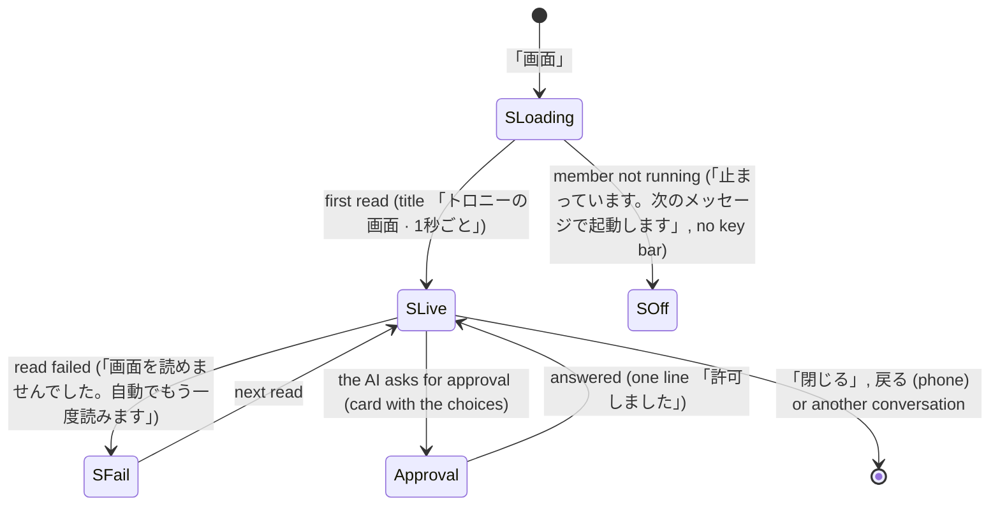

- ✓W25 PC: the panel opens black with an empty status line until the first read; the previous member's text stays when switching (`bot-read-views.js:119-129`). → SLoading text; clear on switch.
- ✓W26 The key bar shows while the member is not running, then every key fails. → No key bar in SOff.
- ✓W27 Phone text is about 7 px. → At least 11 px with horizontal scroll inside the panel only.
- ✓W28 Phone 戻る leaves the panel polling every second. → Closing the conversation closes the panel.

### 3.2 Cards in the conversation

| Card | Today | → Target |
| --- | --- | --- |
| Owner question, pending | Purple card, answer chips | Heading 「トロニーからの質問」, question icon, amber 「要対応」 badge, the chips. A failed answer says 「答えを送れませんでした。もう一度選んでください。」 under the chips (no raw message). |
| Owner question, answered | Same purple card, only 「回答: はい」 differs (review §2) ✓W29 | Muted card, green check, 「はい と答えました」. |
| Secret request, pending | Purple card with `TypeSafe / typesafe` (raw tool id) ✓W30 | Key icon, 「トロニーが「TypeSafe」を求めています」, amber 「要対応」, the request's sentence, primary 「入力する」. No tool id. |
| Secret request, done | 「登録済み」 in the same card | Muted, green check, 「渡しました」 / 「取り消しました」. |
| Secret input dialog | No field label; 「利用者領域へ保存します」; three equal buttons; phone 「最新へ ↓」 floats over the modal (review §2) ✓W31 | Field label (the request label, or 「秘密鍵」) + placeholder, 「表示」/「隠す」 for a password, one primary 「渡して続ける」 / 「登録して続ける」, quiet 「今はしない」 (closes; the request stays pending), and a small 「入力を断る」 (cancels the request) at the right. 「BellTeamに保存します」. Floating chat controls hide while any modal is open. |

### 3.3 Room chat

| Spot | Today | → Target |
| --- | --- | --- |
| Bubble meta | 「返信: なし」 on every bubble, also when `responders` is absent (`tl:424, 439`) ✓W32 | A small 「↩ トロニー」 chip only when there are responders. 「返信者を判定中」 as a small spinner. 「返信者の判定に失敗」 stays (amber). |
| Delivery | An empty or absent `deliveries` list shows 「配達済み」 (`tl` room aggregate) ✓W33 | No delivery word until a delivery exists. |
| Queue lines | 「モリー … · 処理中 ■」 stay after the reply; the `■` is unexplained (review §3) ✓W34 | One animated 「モリーが作業中」 line per working member, with a labelled 「停止」 button; removed when the queue entry ends (re-read on the reply event). |
| Reply-target picker | Runs off the top of the viewport; native checkboxes; no done button; no Esc (`app:564-617`) ✓W35 | Anchored popover inside the viewport (max 60% height, scrolls; bottom sheet on phone) titled 「返信する人」: 「自動で選ぶ」 row on top when routing is on (checked when nobody is chosen; checking it clears the choice), avatar rows with a check, search when more than 8, 「決定」. Esc closes. The chip says 「返信: 自動」 / 「返信する人を選ぶ」 / the chosen names. |
| Phone composer | Input squashed by `+` and 「自動選択」 ✓W36 | The target chip moves above the input. |

## 4. Settings (build first)

Same structure as Apple: a **home list of items** and **one page per item**. PC: the list is the left column of the settings dialog, the page on the right, and プロフィール opens first. Phone: the list, tap opens the page, 「戻る」 returns. Implemented in `settings-home.js` (list, pages, 要対応 band), `owner-editor.js` (each item's reads, lines and saves), `user-rules-view.js` (rules read view). There is no global 「保存」 in the header (P5); the header has 「閉じる」 and the title 「設定」.

### 4.1 Function map of Settings

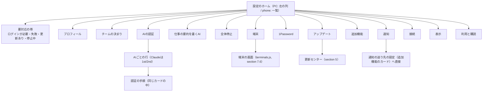

| Item | Row line 2 (current state, not a fixed description) | Reads | Writes | View file |
| --- | --- | --- | --- | --- |
| プロフィール | Owner name | `GET /api/owner` (list read) | `PATCH /api/owner` | owner-editor.js |
| チームの決まり | 「n個の決まり」 | `GET /api/user-rules` | `PUT /api/user-rules` | owner-editor.js (new rules view) |
| AIの認証 | Worst state: 「すべて使えます」 / 「Claude 2つ目のログインが必要」 / 「Claude 上限中（21:30まで）」 | `GET /api/harness-auth`, `GET /api/harness-auth/:h[?slot=2nd]`, `GET /api/accounts` | `POST /api/harness-auth/:h/{start,input,cancel}[?slot=2nd]` | harness-auth.js, harness-accounts.js, auth-flow.js |
| 仕事の要約を書くAI | 「Claude Code · Haiku · 低」 (display names) | `GET /api/settings` `backgroundAgent`, `GET /api/models` | `PATCH /api/settings/backgroundAgent` | background-agent-settings.js |
| 全体停止 | 「動作中」 / 「停止中」 | `GET /api/ai-control` | `PATCH /api/ai-control` | ai-control.js |
| 端末 | 「Mac・Windows・Linux」 when none; 「3台」 / 「3台・1台つながりません」 | `GET /api/terminals` | (terminals dialog) | terminals.js |
| 1Password | 「連携中」 / 「未連携」 / 「失敗」 | `GET /api/settings` `onePassword` | `PATCH /api/settings/onePassword` | onboarding.js feature renderer |
| 通知 | 「このブラウザーに届きます」 / 「このブラウザーは未登録」 / 「通知の送り先が未設定」 | `GET /api/web-push/status`, `POST /api/web-push/status`, `GET /api/notifications`, browser permission | `POST /api/web-push/subscriptions`, `POST /api/web-push/unregister` | web-push.js, owner-editor.js |
| 追加機能 | 「2つ使っています」 | `GET /api/settings` | `PATCH /api/settings/:id` | onboarding.js feature renderer |
| アップデート | Same as the update center title: 「すべて最新です」 / 「1つ更新できます」 / 「前回の更新に失敗しました」 | `GET /api/updates` (update-center) | (update center) | update-center.js |
| 接続 | 「このサーバー」 / 「Cloudflare Accessでログイン中」 | `GET /api/session`, `location.origin` | none (opens a tab) | owner-editor.js, server-origin.js |
| 表示 | 「会話は下から浮き上がる」 | localStorage | localStorage | owner-editor.js |
| 利用と購読 | static | — | — | index.html |

Notifications are one item (S8): today they are split over 追加機能 › プッシュ通知, 追加機能 › ブラウザーの通知, ブラウザー通知 and 通知. → The 通知 page owns the browser and the Apple-app status; the two server-side sender settings (中継URL, 公開連絡先) stay as 追加機能 cards and the 通知 page links to them directly.

### 4.2 Settings home and pages

```mermaid
stateDiagram-v2
  [*] --> SHomeLoading: 「設定」
  SHomeLoading --> SHome: items read (each item reads in parallel; an item still reading shows a gray 「確認中」 badge)
  SHome --> Page: tap an item / tap the 要対応 band
  Page --> SHome: 「戻る」 (phone) / another item (PC)
  Page --> PageDirty: edit a field
  PageDirty --> Page: save in that card succeeds
  PageDirty --> AskDiscard: leave the page or 「閉じる」
  AskDiscard --> PageDirty: 「編集を続ける」
  AskDiscard --> SHome: 「変更を捨てる」
  SHome --> [*]: 「閉じる」
```

- ⚠W37 (S1) Today the tab chips (プロフィール / AIと動作 / 追加機能) scroll one long page, have no current marker, the sticky bar covers each section title, and 4 of the 10 sections have no tab (`owner-editor.js:31-33`, `styles.css:805`). → Items switch pages; the current item is marked; the page title is always visible.
- ⚠W38 (S2, P5) Header 「保存」 saves only profile + rules; 「要約の設定を保存」, 「この機能を保存」 ×6 and 「保存して連携を確かめる」 save their own parts; header save closes the dialog and silently drops unsaved 追加機能 input (`owner-editor.js:61-78`, inventory §10). → No header save. Every page with editable values has its save at the bottom of its card; the unsaved-input guard covers every card.
- ⚠W39 Read failures of rules, 追加機能 and AI auth say 「設定を開き直してください」 and offer no retry; AI auth waits for rules and features to finish first (`owner-editor.js:136-156`). → Each item reads on its own; a failed item shows its error card with 「もう一度読み込む」 in its page and an amber 「確認できません」 badge on its home row.
- The 要対応 band (top of home): one row per item in an amber or accent state, tap goes to that page (and for AI auth, scrolls to that AI's row). Hidden when nothing needs action.

### 4.3 プロフィール and チームの決まり

```mermaid
stateDiagram-v2
  [*] --> PEdit: open (owner already read)
  PEdit --> PSaving: 「保存」 (bottom of the card; button reads 「保存しています…」)
  PSaving --> PSaved: 「保存しました」 next to the button (dialog stays open)
  PSaving --> PFail: 「保存できませんでした。{plain reason}」 next to the button, input kept
  PFail --> PSaving: 「保存」 again
```

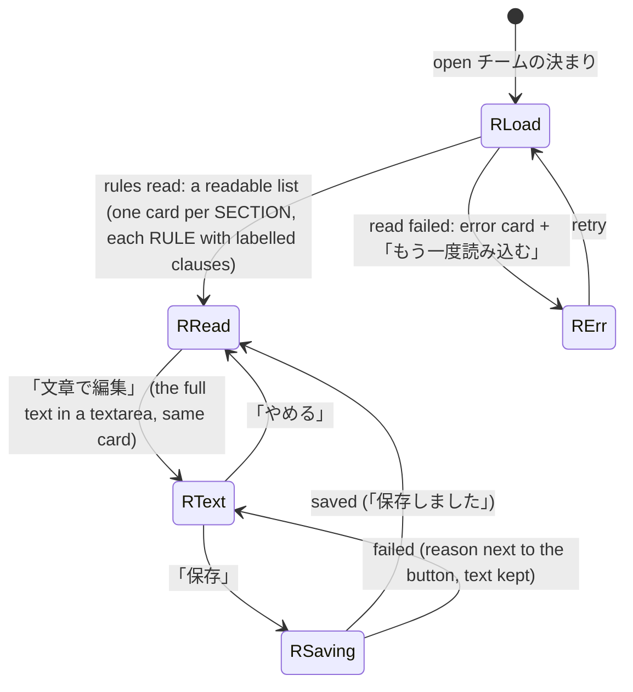

- ⚠W40 Profile and rules are saved by one header button with two requests; a partial save is one sentence at the bottom of the profile block (`owner-editor.js:158-185`). → Two items, two cards, two saves; no partial state exists.
- ⚠W41 (S3) The rules are a raw `RULES owner.user v1 / FORMAT / SECTION …` textarea. → Read view parses the published format (SECTION / RULE / clause keywords PURPOSE, FACT, WHEN, DO, MAY, NEVER, WHY, DEFAULT shown as 目的・前提・条件・する・してよい・しない・理由・既定). Text that does not parse is shown as plain text in the same card (never hidden). Editing stays the full text, so nothing the Owner wrote is rewritten.
- ⚠W42 The rules read failure keeps 「保存」 disabled for the profile too (`owner-editor.js:160`). → Fixed by W40.
- Validation: the browser bubble pointing at an off-screen field (header save outside the form) goes away; the error sentence names the field next to the save button.

### 4.4 AIの認証

Same state machine and labels as Apple [requests-and-auth.md](../apple/requests-and-auth.md#表示する認証の段階状態機械) (Rapi, `rapi/apple-auth-states`): one function decides the stage of a row from `/api/harness-auth/:h[?slot=2nd]` `auth` (`status`, `auth_ui.stage`, `session_id`) and, for Claude slots, `/api/accounts` `signedOutAt`; `/api/accounts` `loggedIn` is not used for the stage.

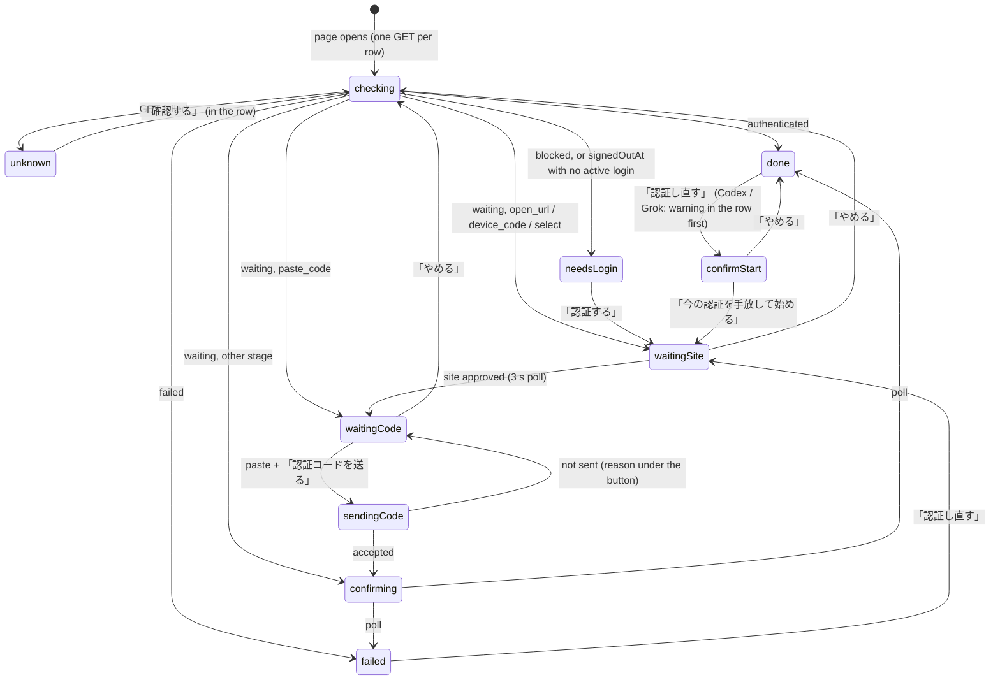

Priority: an active login (`status=waiting`) wins over a stale `signedOutAt`, which stays set until the slot's token changes. `signedOutAt` turns a row into needsLogin only when no login is running, so the URL and code field stay visible during the new login (Epinel review of #1085).

| Stage | Badge | The only button(s) in the row |
| --- | --- | --- |
| checking | 確認中 (gray, spinner) | none |
| unknown | 確認できません (amber) | 「確認する」 |
| done | 認証済み (green) | no primary; the row opens its detail (chevron). 「認証し直す」 is a quiet button inside the detail |
| needsLogin | ログインが必要 (amber) | 「認証する」 (primary) |
| failed | 失敗 (amber) + one plain sentence | 「認証し直す」 (primary) |
| waitingSite | 認証の途中 (purple) | 「ログイン画面を開く」 (primary) / code box with 「コピー」 for device_code, 「やめる」 |
| waitingCode | コード待ち (purple) | code field + 「認証コードを送る」, 「やめる」 |
| confirming | 確認中 (purple) | none |

- ⚠W43 (S5) While `確認中`, rows already draw 「認証する」 and 「状態を更新」 (disabled), reading as logged out (`harness-auth.js:110-144`). → No buttons in checking.
- ⚠W44 (S5) Claude 1st shows 「ログイン済み」 + green 「認証済み」 next to red 「Fableのみ上限中 (…)・上限中 (…)」 and a primary 「ログインし直す」; two sources (accounts vs harness-auth) decide two badges (`harness-accounts.js:89-94`). → The login badge comes only from the stage function. The usage limit is separate: ONE line under the badge, 「上限中・11/13 17:00 に戻ります（いまは2つ目で動いています）」 (Root review 2026-11-11, same as Apple). Only ログインが必要 / 失敗 / 途中 rows carry a primary button.
- ⚠W45 (S5) 「状態を更新」 appears 7 times. → One 「すべて確認し直す」 at the page top; per-row 「確認する」 only in unknown.
- W46 (S5, ruled by Trony 2026-11-11) Slots are named 「1つ目のアカウント」 / 「2つ目のアカウント」. On the AIの認証 page only, each slot shows its account e-mail (`slot.label`) as its label, so the Owner knows which Google account to sign in with. No other list shows the address.
- ⚠W47 (S5) 「Claude · 50人が使用」 and the slot counts (0 + 77) disagree. → The AI heading says 「52人が使用」 from `/api/harness-auth` `members` only; slot rows show no member count and no names (same as Apple).
- ⚠W48 Raw error text from the server (`errorText`) is shown in the row. → Plain sentence; the code under サポート用の詳細.

### 4.5 仕事の要約を書くAI

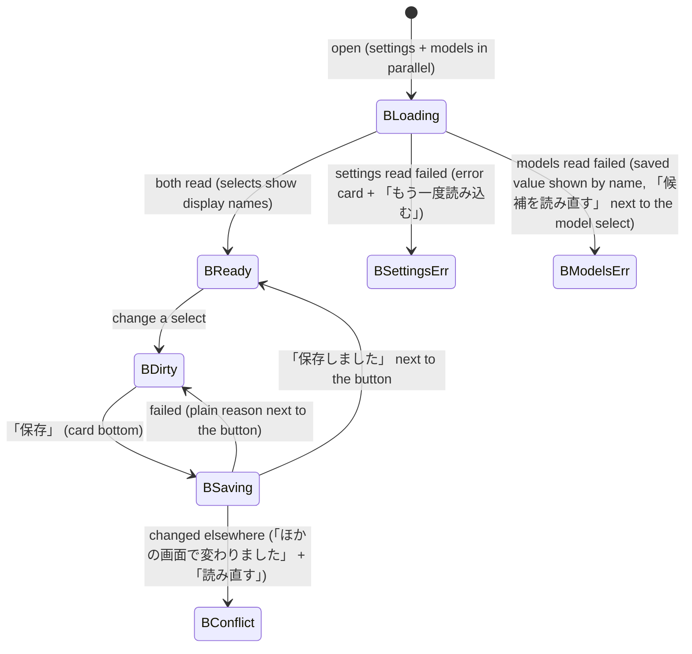

- ⚠W49 (S4) 「保存済み：codex / gpt-6-luna / low」 shows raw ids; while models load, the saved model shows 「（現在の候補にありません）」 (`background-agent-settings.js:33-47`). → Row and page show display names; while models load, the select shows the saved value with a spinner and is not judged.
- ⚠W50 The harness is named 「Claude Code」 here and 「Claude」 in AI auth. → One name per AI everywhere (the `/api/harness-auth` `name`).
- 「状態を更新」 and the generic status line go away; 「候補を読み直す」 only in BModelsErr.

### 4.6 全体停止

Works today (switch, status pill, reread on failure). Kept as is in its own page, plus the home row badge. ⚠W51 `unconfirmedBotIds` is validated but never shown. → 「止まったか確かめられないメンバーが2人います」 + names, + 「確認し直す」.

### 4.7 1Password and 追加機能

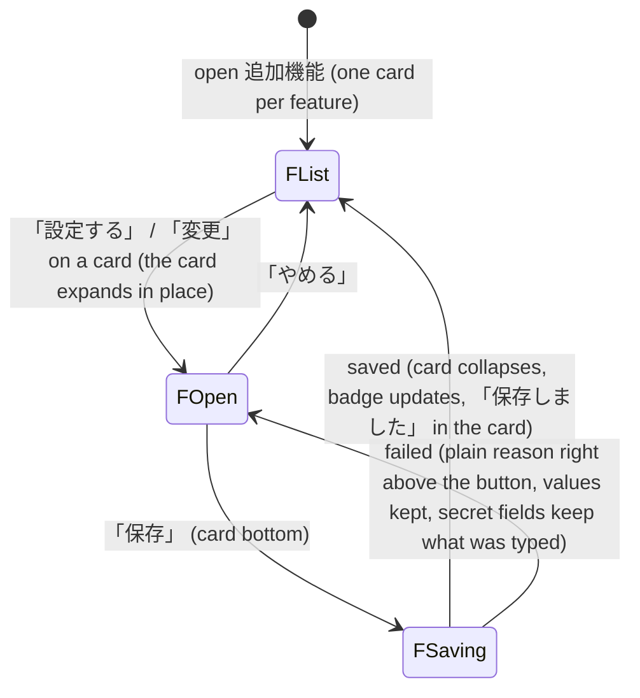

| Spot | Today | → Target |
| --- | --- | --- |
| Card | `▶ name · 有効` text rows; only 1Password has a badge; orphan label 「ローカル接続」 (S6) ⚠W52 | Icon, name, badge (使っています / 未設定 / エラー), one sentence on what it does, 「設定する」 or 「変更」. 「ローカル接続」 moves to 接続. |
| Fields | Raw values shown in the list: MCP URL with a LAN IP, Audience hash, team domain; native 「有効にする」 checkbox + 「この機能を保存」 per feature (S7) ⚠W53 | Fields appear only inside the opened card. Secrets are never shown; non-secret values are shown inside the opened card only. The enable switch is the card's first control. |
| 有効 with required fields empty | Feature says 有効 while e.g. 通知中継URL is empty (S7) ⚠W54 | The badge comes from the server status; when the server reports `enabled` but a field marked required is empty the card shows 「設定が足りません」 (amber). Needs the field `required` flag from the feature owner (open point O1). |
| Success | No message on success except 1Password (inventory §6.6) ⚠W55 | 「保存しました」 in the card for every feature. |
| Error text | `code: message` (`onboarding.js:161`) ⚠W56 | Plain sentence; the code under サポート用の詳細. |
| Secret fields | Cleared on send, also when the save fails ⚠W57 | Cleared only after a confirmed save. |
| 1Password | Its own item (same card, opened directly), as Apple B8 | Same states as today's 1Password card (they pass): 「保存して連携を確かめる」 -> 「連携を確かめています…」 -> result line above the button. |

### 4.8 通知 (this browser + the iPhone app)

```mermaid
stateDiagram-v2
  [*] --> NRead: open 通知 (status + permission read at once)
  NRead --> NUnsupported: this browser cannot (HTTPS needed / add to home screen on iPhone)
  NRead --> ServerOff: the server's Web notification is off or not set up
  NRead --> Denied: the browser blocked notifications
  NRead --> NotRegistered: allowed or not asked, not registered
  NRead --> On: this browser is registered
  ServerOff --> FeatureCard: 「通知の送り先を設定する」 (opens that 追加機能 card directly)
  FeatureCard --> NRead: saved, back
  Denied --> NRead: 「ブラウザーの設定で許可してから、確かめ直す」
  NotRegistered --> Prepared: 「このブラウザーで受け取る」 (installs the notification worker only)
  Prepared --> Registering: 「通知を許可する」 (the browser asks; subscribe; register)
  Registering --> On: registered
  Registering --> NFail: failed (reason under the button + 「もう一度」)
  NFail --> Registering: retry
  On --> Removing: 「このブラウザーでは受け取らない」 (quiet)
  Removing --> NotRegistered: removed
```

- ⚠W58 (S8) Today a five-row table of jargon (利用環境 / 通知の許可 / ブラウザー / 通知サーバー / サーバー登録) and two buttons, often both disabled with no reason (`web-push.js:38-58`). → The states above, one badge, one sentence, and only the button of that state (the others are not drawn). Preparing and allowing stay two presses on the same button, because the browser's permission prompt needs a fresh user press after the worker install wait (existing consent rule); the sentence between them says what the next press does.
- The iPhone app line (from `GET /api/notifications`): 「iPhoneアプリへの通知: 設定済み」 / 「未設定」 + 「設定する」 (opens the プッシュ通知 feature card). The old separate 「通知」 section with its own 「状態を更新」 goes away.

### 4.9 接続, 表示, 利用と購読, 端末, アップデート

- ⚠W59 (S9) 「接続先のURL http://127.0.0.1:4180」 + 「別のサーバーを開く」 are in the main page for everyone. → 接続 page: 「このサーバー」 card (Cloudflare login state and 「ログアウト」 when Cloudflare). 「別のサーバーを開く」 is inside a closed 「ほかのサーバーへ」 fold, with the URL field there; the current origin is not prefilled as an editable value.
- 表示: the conversation motion select stays (it works, saves at once with the result next to it).
- 端末: the row shows the count and the worst state; tap opens the terminals dialog (section 7.6) in front.
- アップデート: the row shows the update state; tap opens the update center (section 5).

## 5. Update center

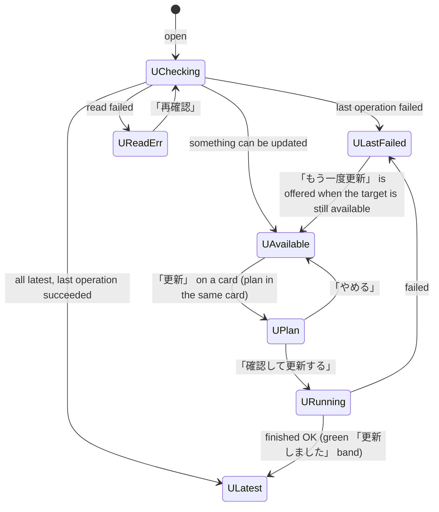

- ✓W60 (review §5, state problem 1) A failed body job (`HOST_UPDATE_STORAGE_BINDING`) appears only inside the collapsed 詳細 job list while the title says 「すべて最新です」; a serving, up-to-date component suppresses its 失敗 badge, and runtime failures never reach the title (`update-center.js:99-114, 393-428`). → Title priority puts 「前回の更新は失敗しました」 above 「最新」 whenever the newest operation of any component failed, with a red band above the cards: plain sentence 「本体の更新が始まる前に止まりました。本番は前の版のままです。」 + what to do. It clears when a later operation of that component succeeds. Built: `cardState` no longer hides a failed newest job on a serving, up-to-date part; the band says 「本体の更新は途中で止まりました。本番は前の版のまま動いています。」 for the body and 「前の版のまま動いています。」 for a part.
- ✓W61 Runtime cards carry 「新しい版 11/11 19:24」 inside an all-latest state (`update-center.js:513`, not guarded by `isRuntime`). → Runtime cards say 「◷ 次回起動で反映」 and never carry a 新しい版 chip.
- ✓W62 The plan text 「この更新で変わること」 stays after the operation ended. → Shown only in UPlan (`renderDetail` appends it only while a plan is shown).
- ✓W63 Inside 詳細: hashes, UUIDs, English kickers (`PRODUCT UPDATE`), `状態: ready`, codes, text overflowing cards, a disabled 「更新を実行できません」 with a generic reason. → Built so far: no English kicker; a job row says 「状態: 切り替え中」 etc. (順番待ち / 取り込み中 / 確認中 / 切り替え中 / 完了 / 失敗) and the failure message, with job ID, raw state and code under its own サポート用の詳細. Target, still open: 詳細 reuses the card layout; ids and codes only under サポート用の詳細 with a copy button; the run control appears only in UPlan; a disabled control always carries its real reason.
- Header pill and Settings row use the same title (section 2.1, 4.1).
- Theme (O2, Trony): the update center uses the app tokens, the same values as the Settings cards (violet primary), light and dark.
- Request identity (job ledger contract, Root 2026-11-07): a kept or unknown older request is never a browser guard; server capability and admission decide. A failed start POST (any status) keeps its new request ID, because the job ledger can persist a step before a later 4xx; the same-ID read drops it only on proof that nothing was stored (404 `UPDATE_OPERATION_NOT_FOUND`), and any other answer keeps it for later same-ID reads.

## 6. Schedules, goals, work graph

### 6.1 すべての予定 and a member's or room's 自動実行

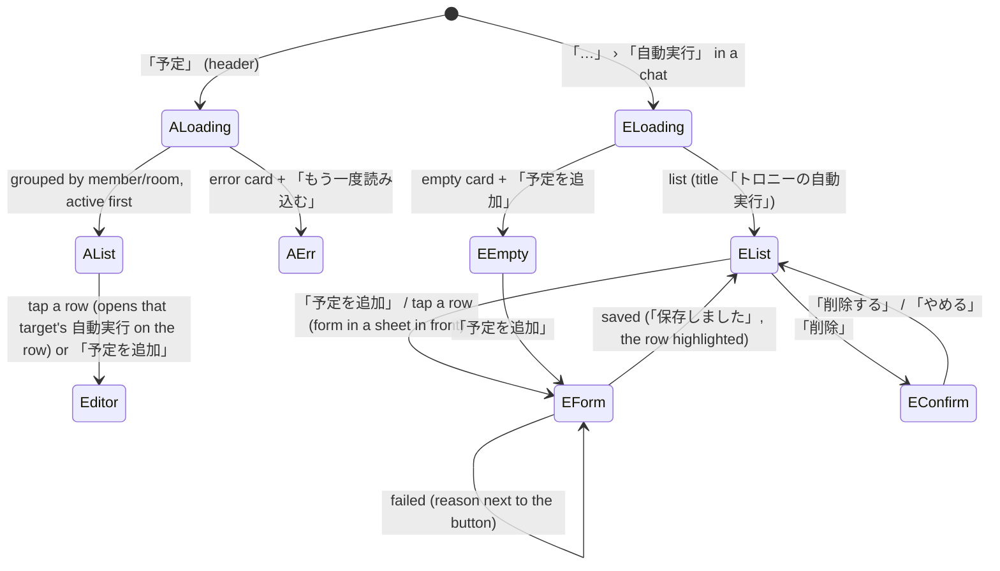

- ⚠W64 Title and button collide (「すべての予定更新」); 管理 buttons are red; `無効 · 次回` with nothing after it; raw cron `0 2 * * * · Asia/Tokyo`; finished items first (review §6). → Plain schedule 「毎日 2:00」 (cron that cannot be put in words: 「詳しい指定」 + the expression under 詳細); state badge 有効 / 停止 / 済み; 「次回 11/12 2:00」 only when there is one; finished one-time items under a closed 「終わった予定」.
- ⚠W65 The per-target dialog is cut off at the right edge, never names its target, shows raw shell commands and long prompts, leaves the previous target's rows while loading, has no delete confirmation, and saves silently (`schedule-editor.js:74-191`). → Fits the width; title names the target; body shown as a one-line summary, full text one tap away; loading clears; delete asks; save result next to the button.
- ⚠W66 Room schedule: the empty box with the full add form under it, English native date `mm/dd/yyyy`, a long native checkbox list. → EEmpty card; the form opens on 「予定を追加」; Japanese date/time fields; responders picked with the same picker as 3.3.
- ⚠W67 A weekly kind without a weekday shows the generic failure. → 「曜日を選んでください」 next to the weekday field.

### 6.2 Goals

- ⚠W68 The dialog body is empty while loading and when there are no goals (review §6, `goals.js:48, 221`). → GLoading skeleton; empty card 「ゴールはまだありません。」 + one sentence on what a goal is; error card with retry.
- ⚠W69 Pause, resume and delete act with no confirmation; errors go to the top notice, away from the card. → Delete asks; results and errors stay in the card that was pressed.
- ⚠W70 A card heading falls back to the raw bot id; Claude duration in raw milliseconds. → Name or 「（いないメンバー）」; 「3分20秒」.

### 6.3 Work graph (相関図)

- ⚠W71 Connecting shows a blank canvas; no legend, no summary (review §6). → 「つないでいます」 while connecting; one summary line 「いま 1件の依頼が進行中」; a legend for the edge style and faded nodes (「依頼を受けた側」).
- ⚠W72 Phone: a node is off-screen at 390 px. → The layout bounds include the label width on phone (work-graph-model).

## 7. Editors and dialogs

### 7.1 Member editor (edit and add)

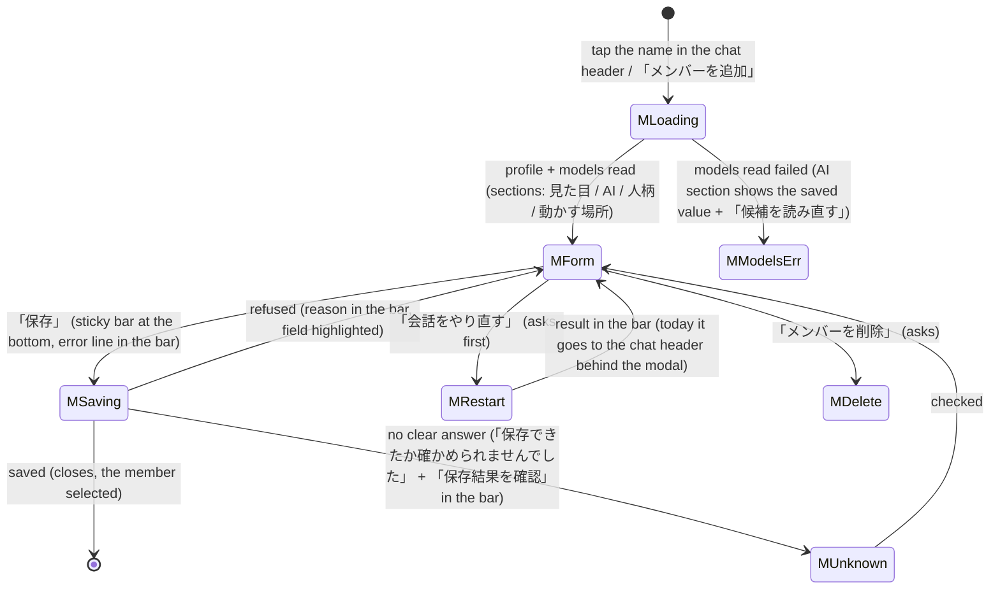

- ⚠W73 Save is in the header and every error at the bottom of a 2,700 px form (review §7, inventory §5.1). → Sticky bottom bar with 「保存」 and the error line; the header keeps 「キャンセル」 only.
- ⚠W74 「セッションを再起動」 has no confirmation and its failure is written only to the chat header behind the modal (`bot-editor.js:377-386`). → Label 「会話をやり直す」, confirmation, result in the bar.
- ⚠W75 Help texts in system words (「保存した希望設定と、稼働中の適用状態を区別して表示します」, 「CLIの既定（読み込み中…）」); no badge for the applied state. → A badge 「反映済み」 / 「反映待ち」 / 「反映できませんでした」 next to the AI section title, one plain sentence.
- ⚠W76 The add form on PC has no 動かす場所 section while the phone has one. → The section shows whenever `GET /api/terminals` works, on every width (check the PC read path).
- ⚠W77 Mojibake 「電��」 in a stored profile text. → Report to the members owner with the bot id (server data), Web shows the text as served.
- 記憶と知識 and キャラクターシート move to the member's 「…」 menu in the chat (they are not part of the form).

### 7.2 Room editor and add room

- ⚠W78 140 native checkbox rows, role printed twice, save only at the top, 10,000 px scroll; 代表 at the very end, unexplained (review §7). → Selected members as avatar chips at the top, a search field, only matching members listed (max 30 until searched), sticky bottom save bar with the error line; 「代表（このルームの窓口になる人）」 right under the chips.
- ⚠W79 Generic failure 「保存できませんでした。名前とメンバーを確認してね。」. → The server's reason in plain words, next to the save button.

### 7.3 Memory and knowledge

- ⚠W80 Four stacked forms with no list; success text lands in the next panel; all failures at the bottom; the memory kind shown as raw English (`fact`) (`memory-view.js:47-67`). → Two tabs 記憶 / 知識. Each: search on top, the result list in place, one 「追加」 that opens a small form in front; result next to its button; kind in Japanese. Title: just the name.

### 7.4 Character sheet

- ⚠W81 Shows the path `assets/character-sheet/` and the word 正本, then 「まだ置かれていない。」 (dead end). → 「キャラクターシートはまだありません。オーナーが選んだ1枚がここに出ます。」 with an empty-image placeholder; images with a plain caption (date only).

### 7.5 Add sheet

Works; add icons to both choices; word 「メンバー」 everywhere instead of 「Bot」.

### 7.6 Terminals

- ⚠W82 Every card shows 「未確認」 until the user presses 「届くか確かめる」; raw `kite@192.168.1.12`, 「設定済み・秘密入力」; the same help sentence on every card; 「外す」 looks like text; one icon for every OS (review §8). → Badge reflects the last server-recorded check with its time (「11/11 20:48 につながりました」), 「未確認」 only when never checked; OS icons; friendly name on top, address under 詳細; key rows 「鍵: 設定済み」; one help line at the top; 「外す」 as a quiet button.
- ⚠W83 The add form: header 「追加」 stays visible; 端末ID / ホスト / SSHのポート need internal knowledge; 「やめる」 is plain text. → A sheet in front: OS -> the exact steps for that OS -> address -> 「つながるか確かめる」 -> name; the id is derived from the name.

## 8. Onboarding (first run)

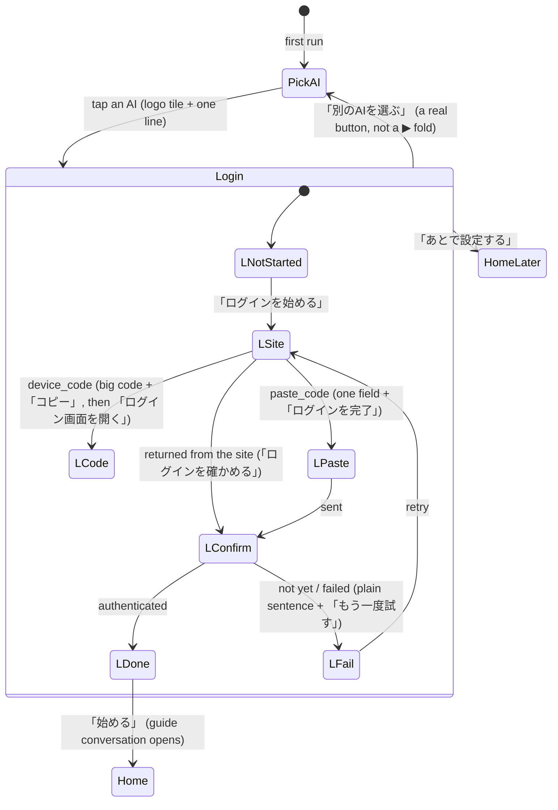

- ⚠W84 (O1-O3, review §9) Every stage shows the same primary 「認証を確認して始める」 plus 「認証の状態を更新」; the real next step is a link or a native button elsewhere; no step indicator; 「使う AI を変更」 is a ▶ fold; `not_started` says 「認証ボタンを押すと…」 but no such button exists (`onboarding.js`, `auth-flow.js:4-6`). → Stepper 1 AIを選ぶ / 2 ログイン / 3 始める; one primary per stage as in the diagram.
- ⚠W85 After a poll error, polling stops until a button is pressed (`onboarding.js:46-70`). → The error sentence carries 「もう一度試す」 which restarts polling.
- ⚠W86 (O5) paste_code: a black outline around the dialog; phone 「あとで設定する」 cut off at the bottom. → Sheet fits or scrolls.

## 9. Same as Apple

| Shown in both | Shared decision |
| --- | --- |
| Settings structure | Home list + one page per item, the 要対応 band, items in the order of 4.1, チームの決まり its own item (Rapi: yes, Apple U7b). A row inside a page (an AI, a terminal) opens inside the page; the item list stays (Apple B17). |
| Settings state vocabulary | Apple section 3 badges and colors, as in section 0 here. |
| AI auth stages | Apple's `AuthenticationProgress` stages and labels (4.4). The Web adopts them as written. |
| Account slots | 「1つ目のアカウント」/「2つ目のアカウント」 (Rapi: yes). The e-mail is the slot label on the AIの認証 page only (Trony ruling). Login badge and the one-line limit 「上限中・… に戻ります（いまは2つ目で動いています）」 are separate; a usable row has no primary button; 「52人が使用」 without names. |
| Notifications | One 通知 item: browser (Web) or this device (Apple), plus a direct link to the sender's feature card. |
| Update state words | update center title = Settings row = header pill (Apple update.md is the canonical list of words). |
| Roster row | Name, role or summary, one state badge, real last-activity time, no account pill (Rapi: yes). |

## 10. Open points (need another owner)

- **O1** Feature fields need a `required` flag in `GET /api/settings` so a card can say 「設定が足りません」 (W54). Owner of `src/feature-settings.mjs`.
- **O2** Update center theme: keep its own palette or use the app tokens (W63). Trony.
- **O3** `currentWork` absent vs. failed: today both arrive as absent. The Web shows nothing either way (W13); if the summary service is failing, that is the summary owner's defect (review state problem 4).
- **O4** Last-check result of terminals must come from the server to show reachability without a press (W82). Terminals owner (Crust).

## 11. Build order

1. Settings (section 4), with its function map, in one PR.
2. Home roster and header (2), conversations (3).
3. Update center (5).
4. Schedules, goals, work graph (6), editors (7), onboarding (8).

Each step ships this document's changed sections and the code in one diff; Trony accepts on production shots.
