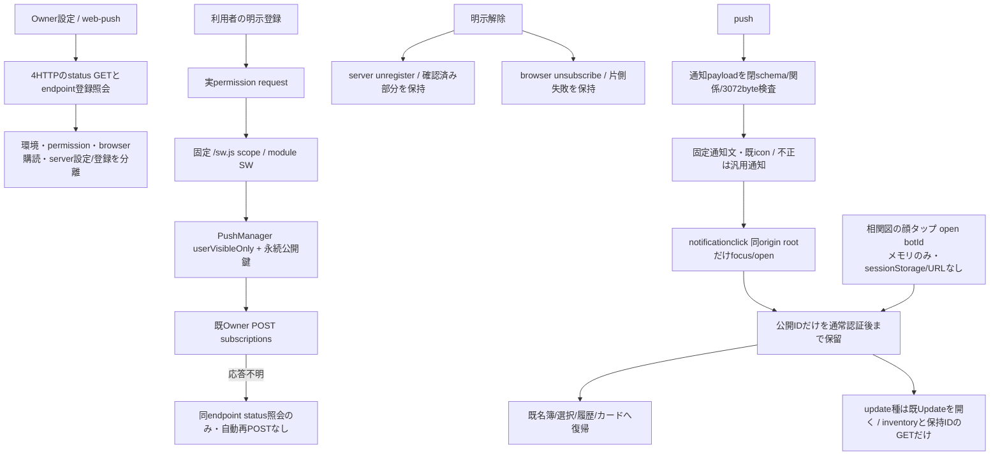

# Webの通知・許可・購読・復帰

所有: アドミ。Root契約v1.1 `/srv/bellteam/bots/bot-7b140b27/docs/web-push-contract-20261103.md` SHA256 `b64a7c27e8a6da21d5011d77e2bd749ee27048a5ebff7a620392becd91ed66a2` を消費する。provider/資格/writerはusage、HTTP認証/origin/静的SW配信はintegration。Webは暗号やbackendを作らない。

open/前面復帰/設定通知ではstatus GET、既SW/getSubscription、必要なendpoint登録照会だけを行う。permission/新SW登録/subscribe/設定保存は自動で行わない。未供給は未接続表示。Rootのbodyにorigin/server/秘密を追加せず、ブラウザーが送る同origin認証を既clientへ渡す。endpoint/authは本文表示/URL/query/localStorage/logへ出さない。公開鍵不一致/期限切れは解除後の明示再登録を案内する。解除片側失敗は同一画面のメモリに対象と両結果を保持し、次の明示操作で未完部分だけを再試行する。閉じる/再openは保存・解除処理を成功へ補完しない。

SWはmoduleとして登録し、/sw.jsとimportを既asset versionへ接続、updateViaCache:none。HTTP JS MIME/no-cacheはMollyの公開接点。fetch handler/オフラインcache/background登録/資格埋込は無し。payloadのURLを使わず、既IDから同origin URLを組む。アプリは通知IDをsessionStorageへ保留でき、認証/初期設定後に既APIで選択する。通知から既ページを開いても会話draftを保持。requestのカードが過去なら既before履歴を順に読み、別対象へ変わったら旧探索を止める。

通知文は既providerの固定4文と表示名、または下記update固定文から組む。秘密/質問/本文や任意title/bodyを通知へ反射しない。messageId/requestId/sender.id/room関係とUTF8上限、余剰keyをworkerとページ境界で検査する。不正はBellTeamの汎用通知とroot復帰のみ。

新版通知はMikaとの2026-11-04固定契約により、`{schema:'bellteam.web-push.v1',kind:'update',messageId:<小文字64桁sha256>,title:'BellTeam',body:'更新があります。Updateで確認してください。'}`の5key完全一致で受ける。既4通知の10key分岐と未知kind拒否を維持する。SWのtagだけに正式候補のmessageIdを使い、click/sessionStorage/URLは厳密な`{kind:'update'}`だけを渡す。同origin rootの既window focusまたはopenから、通常認証・初期設定後に既Updateを開く。編集中dialogは閉じず明示再確認まで保留する。Updateは現時点の共通GETと保持済UUID結果を再取得し、通知の候補を計画や実行へ変換しない。plan/start/設定POSTは0、比較・正式候補・重複判定は通知writer/共通APIの所有。

標準根拠: [WebKit iOS/iPadOSのホーム画面と明示操作](https://webkit.org/blog/13878/web-push-for-web-apps-on-ios-and-ipados/)、[PushManager.subscribe](https://developer.mozilla.org/en-US/docs/Web/API/PushManager/subscribe)、[notificationclick](https://developer.mozilla.org/en-US/docs/Web/API/ServiceWorkerGlobalScope/notificationclick_event)。版番号から配信成功を推測せず実機能/permission/getSubscriptionを見る。登録済みは配信済みを意味しない。

試験は人工browser API/合成公開鍵/provider fixtureと既認可HTTPで限定確認。実通知/実permission/外部push/資格/本番は別条件で未実施。Mika固定source供給後の実HTTP結合と通常main/配布は段階を分けて記録する。

通知クリック時は既GET bots/:id又はrooms/:idで認可と対象を確認し、名簿にまだ無い新規対象も実応答だけで開く。全一覧GETと起動時SSEの競合を通知成功へ使わない。編集中のdialogは閉じずにIDを保留し、閉じた後の明示再確認へ残す。過去カード探索のrefreshは表示済みカードの入力を差し替えない。

queue/最新GET/画像取得からの共通rerenderItemは、秘密/質問カードの同一DTOなら既存DOMを保持する。WeakMapで表示時snapshotだけを閉じ込め、回答済み/取消/ownerGuide除去などDTO変更時だけ既部品を再描画する。状態通知で未送信の回答入力を消さず、URLをDOMの隠し属性/永続保存へ追加しない。

## 固定入力と確認範囲

Mika実装head `2d8b4b1a4bb6e32f01d4d15a90bee81111155d00` の実4HTTP/strict body/4通知payloadと、`public-fixtures.json`（syntheticOnly/doNotSend）を読み、Webのvalidatorに有限例を接続した。Molly静的/origin helper `7cad59dddfb6d9add630a851746cdd7ac9cb183a` を通常取込してSW実配信を確認。backend内の無断修理は行わない。現時点の共通caller未配線はMollyが所有しており、assertWebPushOriginの同親settings実体からの注入source到着後に実API結合を追加する。

局所39件＋static/import2件。実Chromium PC/mobileで、実module SWの読込とno-cache、未供給503の無効、明示準備→許可/購読、応答不明を照会で確認（登録POST一回）、片側解除と未完部分だけの再試行、過去の実OwnerQuestionsカードへの既認可HTTP/before履歴での復帰、別質問の回答入力/会話draft保持、cold URLでの認証準備後復帰を確認。SWの通知表示/クリックは閉fake scopeで検証した。

ブラウザーpermission/PushManagerとWebPush APIの肯定値は明記した人工fixtureだけ。レビュー画像はmodal内にも『実provider未接続』を常設。実公開通知APIへの登録、実permission、実push、外部service、実資格、本番操作は0。既Web/source採用と実currentWork結合の成功をWebPush配送成功へ流用しない。原本は担当席 `integrations/web-push-review-20261103/`。
