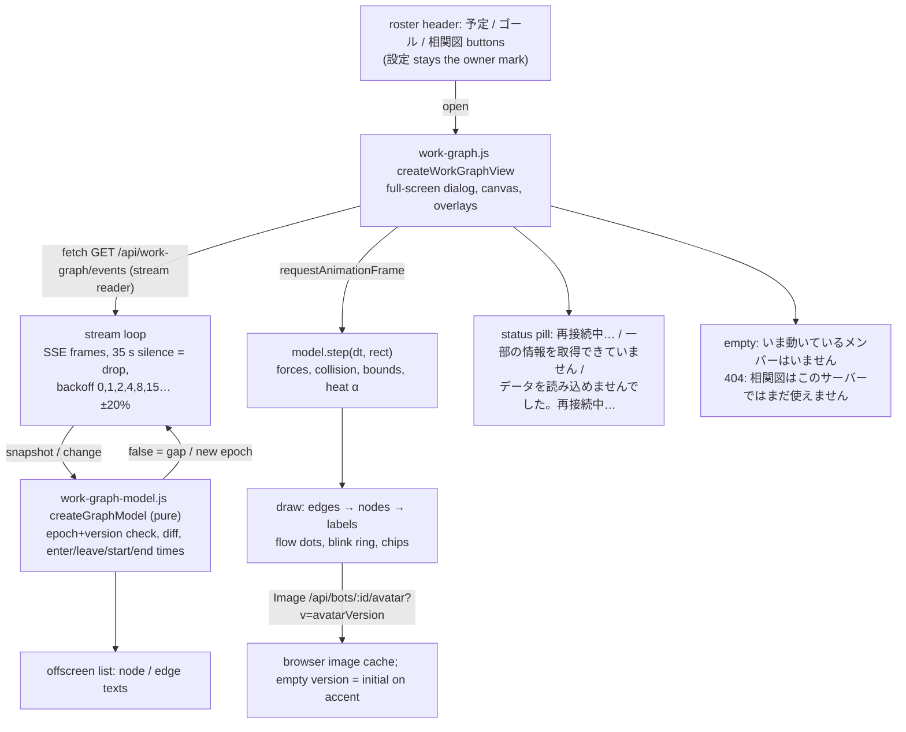

# Web 相関図 (work graph page)

Owner: Admi (Web). Data and motion are not decided here: the data contract is [work-graph](../work-graph/README.md#public-contract) (Arc Ranger Black) and what the user sees is the shared [behavior and visual spec](../work-graph/behavior-spec.md) (main 6b1f2570; layout revised a438f2e2). This file maps that spec onto Web code. Requested by the Owner via Trony, 2026-11-08.

## Function map

| Function | Input -> output | Owner |
| --- | --- | --- |
| `createGraphModel()` | `snapshot(data, now)` replaces/diffs (throws on unknown schema); `change(batch, now)` -> `true` applied, `false` reconnect; `step(dt, rect, now)`; `frame(now, rect)` -> draw list (positions, opacities, label rects with their wrapped lines) | `web/work-graph-model.js` (pure, no DOM) |
| Edge label chip (main 180ec7ba) | `wrapLabel(text, 168, measure)` -> every line, never truncated (breaks at a space when the line has one, else per character); chip `w = min(180, widest line + 12)`, `h = lines × 16 + 6`; the placement tries `t = 0.5 … 0.7` with this grown box against discs + 4 pt | same file; the view draws each line, no truncation |
| Sizes, forces, label placement, blink, curves | numbers exactly as behavior-spec "Sizes", "Layout", "Enter", "Leave", "Blink", "Edges" | same file |
| Layout (main a438f2e2) | forces in `D`-normalized `(u, v)`: `kr = 0.005/n`, spring `0.02`, `L = min(0.7, 1.4/√n)`, span-following gravity per axis toward 0.5 with `nameHeight` 18; collision `S × 2.2` and bounds in px (bounds keep the name width `S × 2.2` inside `D`, so narrow phones fill the x axis a little less than layout-sim.mjs) | same file; checked against `layout-sim.mjs simulate()` in the test |
| `createWorkGraphView(dialog, {fetch, reduceMotion})` | `open()` starts stream + rAF; `close()` aborts stream, cancels rAF and timers | `web/work-graph.js` |
| Stream loop | `fetch('/api/work-graph/events')`; non-OK, bad JSON, unknown schema -> unreadable pill; 404 -> "not on this server" state; socket end/error or 35 s silence -> 再接続中…; every case retries with the backoff while open; hidden tab closes the stream and reconnects on return | same file |
| Hover | pointer near a path or a node -> that edge label / that node name shown (crowded and hidden labels) | same file |

Nav: the header order becomes 予定 / ゴール / 相関図, then search and add. 設定 stays the owner mark at the left of the header (Web has no tab bar).

Drawable rect `D`: the dialog body below its header, minus 24 px on every side. Base avatar side `S0` = 64 px when the viewport is ≥ 1024 px wide (like Mac), else 56 px. Name font 15 px / 700 (list name), label 12 px (list detail).

## Data ownership

The view holds only in-memory drawing state (nodes and edges by id, positions, timers, the last epoch/version). Nothing is stored. The server stays the source; a reconnect always starts from a fresh snapshot.

## Failure handling

| Failure | Shown | Exit |
| --- | --- | --- |
| Socket end / error / 35 s silence | last graph kept, nodes 40 % saturation, no blink, no dots; pill 再接続中… | backoff reconnect, fresh snapshot diffed in |
| HTTP error (503 `WORK_GRAPH_UNAVAILABLE`, 500), bad JSON, unknown schema, version gap | last graph kept; pill データを読み込めませんでした。再接続中… (gap: 再接続中…) | same backoff, never stops while open |
| 404 (older body without the route) | centered 相関図はこのサーバーではまだ使えません | same backoff; the page works again after the body update |
| `degraded` non-empty | live graph; pill 一部の情報を取得できていません | cleared by a batch with empty `degraded` |

No guard: nothing is refused or stopped; closing the dialog is the only end.

## Tests

`test/web-work-graph.test.mjs`: model (snapshot diff, version/epoch gap -> false, unknown schema throws, sizes, forces keep nodes in `D` and apart, label placement avoids discs, crowded rule, blink phase, a11y texts) and the view's stream parser/backoff with a fake fetch.
