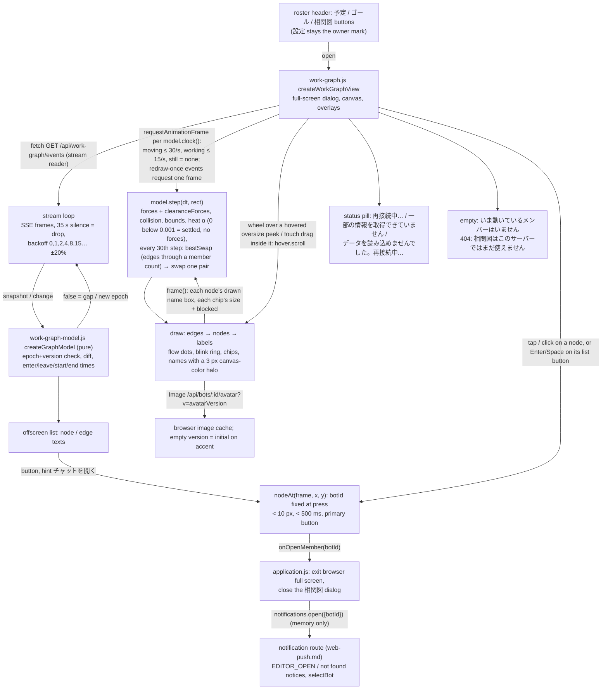

# Web 相関図 (work graph page)

Owner: Admi (Web). Data and motion are not decided here: the data contract is [work-graph](../work-graph/README.md#public-contract) (Arc Ranger Black) and what the user sees is the shared [behavior and visual spec](../work-graph/behavior-spec.md) (main 6b1f2570; layout revised a438f2e2; tap to open a chat 9d94cad6; steady chips 05a6490c; uncrossing swaps e55f1580; clearance 61e14d6a; chip spots f4a04a58; chips on screen 8882babb; clock and settle a72d1b47). This file maps that spec onto Web code. Requested by the Owner via Trony, 2026-11-08.

## Function map

| Function | Input -> output | Owner |
| --- | --- | --- |
| `createGraphModel()` | `snapshot(data, now)` replaces/diffs (throws on unknown schema); `change(batch, now)` -> `true` applied, `false` reconnect; `step(dt, rect, now)`; `frame(now, rect)` -> draw list (positions, opacities, label rects with their wrapped lines) | `web/work-graph-model.js` (pure, no DOM) |
| Edge label chip (main 180ec7ba, b5c4ea64, f4a04a58, 8882babb) | `max = min(180, D.w − 8)`; `wrapLabel(text, max − 12, measure)` -> every line, never truncated (breaks at a space when the line has one, else per character); chip `w = min(max, widest line + 12)`, `h = lines × 16 + 6`; the placement tries the 85 chip spots (main f4a04a58, behavior-spec "Chip placement" revised 2026-11-10): `CHIP_SPOTS` = `t = 0.5, 0.45, 0.55, … 0.1, 0.9` (17), at each centered, above, below, left, right of the path point (`side` in half chip sizes, screen directions; `chipBoxAt(line, {t, side}, w, h)`), position by position, same order and box as `layout-sim.mjs chipSpots` / `chipBox`, with this box against discs + 4 pt, (main 48cc05be) every drawn name box of a non-leaving node + 4 pt (hidden names are not obstacles; names are laid out before chips), and (main b5c4ea64) every chip already placed + 4 pt; chips are placed in edge start order (`startedAt`, then arrival, then id), so a placed chip does not jump when a newer edge arrives; slot keeping and `blocked` per the next row (05a6490c) | same file; the view draws each line, no truncation |
| Chips on screen (main 8882babb, behavior-spec "Chip placement > On screen", "Oversize chip") | every chip box (a slot, the kept slot, a blocked chip, the `t = 0.5` peek) goes through `intoRect(box, D)` before it is checked or drawn: the box grown by 4 slides inward per axis just enough to lie inside `D` (no move when inside; same as `layout-sim.mjs intoArea`); on an axis where the grown box is larger than `D` its start edge goes to `D`'s start. A slot is free only when its slid grown box is inside `D` (`onScreen`) and meets no obstacle. Oversize chip (grown height > `D.h`): never free, so it waits undrawn, or a drawn one stays `blocked` with its grown top on `D`'s top. Its hover/tap peek (waiting or drawn) is `{x: slid t = 0.5 x, y: D.y + 4, w, h: D.h − 8}` with `scroll` (px, clamped to `0 … lines × 16 + 6 − h`) from `hover.scroll`; the view clips the text to that box and offsets it by `−scroll`. `hover.scroll` starts at 0 (first line) whenever hover moves to another target; a mouse wheel / trackpad over the canvas while that peek is hovered adds `deltaY` (and `preventDefault`), a touch drag that starts inside the open peek adds the vertical move (it also cancels the tap as any ≥ 10 px move). Slot order and count, latch, fades, `nodeAt` and the hit order are unchanged | `web/work-graph-model.js`; `web/work-graph.js` clips and scrolls the peek |
| Chip start and slot (main 05a6490c, 48cc05be, spec #800) | started once per edge at the first frame with a non-null `label` whose two ends have finished their enter animation (700 ms; 200 ms with Reduce Motion), so a snapshot edge (open, reconnect) is not placed on fly-in positions (the latch frame, behavior-spec accepted by Black for #777), kept on the model's edge as `edge.chip {since, spot, appearAt, nullAt, lines}` (`spot = {t, side}`). From its first placement a chip stays until the edge ends (fading with the line), in any crowding and on any path length: no `brief` state, no 3 s window, and a placed chip is never hidden; the only hover/tap-only display is the temporary peek of a chip still waiting for a slot (spec #800) (Owner 2026-11-09 「札はずっと出しておこう」). Text change re-wraps only; `label` back to null fades 300 ms and frees the slot. Placement in edge start order: a chip with no `spot` takes the first free spot (else waits undrawn; spec #800: while its line is hovered with a mouse, or after a qualified touch tap (the Tap / click rule) on its line until the next qualified touch tap elsewhere, it is drawn at `t = 0.5` last in `labels`, on top, without taking a slot) and fades in over 200 ms when first placed; a chip keeps its `spot` while free, else moves to the first free one, else stays at its `spot` as `blocked`. The waiting peek (centered at `t = 0.5`) and the Clearance chip box (`t = 0.5`) do not use the spots. Free = no disc + 4, no drawn name + 4 and no earlier placed chip + 4. `frame()` returns `blocked` (drawn after edges, before nodes and names, so it never covers them) and `labels` (after names; the hovered drawn chip last, on top). Only an ended or nulled chip frees its slot | `web/work-graph-model.js`; `web/work-graph.js` draws the two lists |
| Edge text (offscreen list, main 173c5aab) | `edgeText(edge, names)` -> `AからBへ依頼: label`; `label` null or empty (summary not arrived yet) -> `AからBへ依頼` without the colon part, and no chip; `edge-update` fills it later | same file |
| Sizes, forces, label placement, blink, curves | numbers exactly as behavior-spec "Sizes", "Layout", "Enter", "Leave", "Blink", "Edges" | same file |
| Uncrossing swaps (main e55f1580) | every 30th `step()` (0.5 s): non-leaving nodes sorted by `botId`, non-ended edges with two non-leaving ends as straight segments between simulated centers in px; `bestSwap(points, edges)` (ported from `layout-sim.mjs`: A→B and B→A one segment, shared node never crosses, strict gain, max gain, first pair in order on ties, null when nothing improves) -> swap `x, y, vu, vv` of that pair, `α` unchanged. Each swapped node keeps `glide {from, at}` with `from` = its drawn position at that moment: drawn position = `from → simulated` by the enter curve over 700 ms; a node still in its enter animation keeps the enter interpolation (no glide); Reduce Motion: opacity 1 → 0 over 100 ms at `from`, then 0 → 1 over 100 ms at the new place. Edges, chips, names, `nodeAt` and Leave's start point use the drawn position | `web/work-graph-model.js`; checked against `layout-sim.mjs bestSwap()` in the test |
| Clearance (main 61e14d6a, behavior-spec "Clearance") | Node box `nodeBox(node, p, g)` = the avatar square `S` at `p` united with that node's drawn name box (offset from the last `frame()`; a hidden name adds nothing), grown by `g`. Every `step()`, for each unordered live pair (A→B and B→A once) and every other non-leaving node C, `clearanceForces(P, pairs, {box, chips, kc: 0.003})` (pure, same formulas as `layout-sim.mjs`): line pushes once per unordered pair (A→B and B→A one line): line through `box(C, 6)` → push C from the segment's closest point to C's box center (normal when on the line), ends take the opposite push split `1 − t` / `t`; chip pushes once per blocked edge chip (`chips = [{a, b, box}]`, every edge the last `frame()` left `blocked`, so opposite deliveries between the same two members each push with their own chip; box at the center midpoint `t = 0.5`, its real `w × h` grown by 4) meeting `box(C, 0)` → push C from the chip center, ends half each; that chip meeting one of its own ends' `box(·, 0)` → push the ends apart along the edge. Added to the forces before integration (scaled by `α`); collision, bounds and chip placement unchanged. `bestSwap(points, edges, {box})` also counts each edge through an unrelated `box(k, 0)` (each node keeps its own name box at the swapped place) like one crossing. Names: `strokeText` `lineWidth 3` in the canvas color (the dialog's own gradient mapped onto the canvas) before `fillText` | `web/work-graph-model.js`, `web/work-graph.js`; `segmentHitsBox` and `bestSwap(…, clear)` checked against `layout-sim.mjs` in the test, `clearanceForces` against hand cases built with its `nodeBox` |
| Fork edges (read-only fork inquiry, 2026-11-10, N102 / Black) | an edge with the optional `seat: {kind: 'fork', forkId}` (Black #952, main d61a7471; snapshot edges and edge-start / edge-update; behavior-spec "Fork edges"; [fork inquiry](../conversation/fork-inquiry.md#records-and-display)): `chipText(edge)` = 「分身：」 + `label`, wrapped and measured as one text; `label` null -> no chip, as for any edge (behavior-spec Chip placement, Black #952), only the dashed line and the offscreen text; `edgeText` -> `AからB（分身）へ依頼[: label]`; the view strokes the line dashed (6 / 4 px). Edges without `seat` are main and unchanged; `fork_id` is not read | `web/work-graph-model.js`, `web/work-graph.js` |
| Layout (main a438f2e2) | forces in `D`-normalized `(u, v)`: `kr = 0.005/n`, spring `0.02`, `L = min(0.7, 1.4/√n)`, span-following gravity per axis toward 0.5 with `nameHeight` 18; collision `S × 2.2` and bounds in px (bounds keep the name width `S × 2.2` inside `D`, so narrow phones fill the x axis a little less than layout-sim.mjs) | same file; checked against `layout-sim.mjs simulate()` in the test |
| Settle (main a72d1b47, behavior-spec "Layout" α) | `α = 1` on snapshot, applied change batch and resize (`heat()`); each `step()` `α × 0.985^(dt × 60)`, below 0.001 -> `α = 0` and every `vu, vv = 0`; with `α = 0` (or no live node) `step()` only drops finished leaving nodes and ended edges: no forces, collision, bounds, clearance or uncrossing, so positions stay until the next batch or resize (458 frames at 1/60 s, equal to `layout-sim.mjs` `settled`) | `web/work-graph-model.js` |
| Clock (main a72d1b47, behavior-spec "Clock and frame rate") | `model.clock(now, {animate})` -> `moving` when `α > 0` or a timed transition runs (a leaving node or ended edge still kept, enter 700 ms, swap glide 700 ms, edge grow 350 ms, chip fade-in 200 ms, label-null fade 300 ms; 200 ms each with Reduce Motion), else `working` when `animate` (status `live`, so the degraded pill still counts, and Reduce Motion off) and some node is `working`, else `still`. The view decides it before and after every frame: a frame in `moving` / `working` draws only when 1000/30 / 1000/15 ms − 4 ms jitter have passed since the last drawn frame (else it re-requests rAF and draws nothing); after drawing it re-requests rAF unless `still`. `redraw()` requests one frame if none is pending: snapshot, applied batch, status pill change, resize (with `heat()`), hover target change, peek scroll (wheel / touch drag), touch peek tap, pointer leave, avatar image `load`, `prefers-reduced-motion` change. Blink phase and flow dots are time-based (unchanged). Flow dots are drawn only while `animate` and some node is `working`, so `still` edges show line + arrowhead only. The empty-state text fade is CSS, not a canvas frame | `web/work-graph-model.js` (`clock`), `web/work-graph.js` (`draw`, `redraw`) |
| `createWorkGraphView(dialog, {fetch})` | `open()` starts stream + one rAF; `close()` aborts stream, cancels rAF and timers. Reduce Motion is read from `matchMedia` and followed on change: the view sets `model.reduceMotion` on the open model (positions, velocities, α and every enter/leave/glide/start/end time kept; from the next frame each transition uses the new mode and durations) and redraws once | `web/work-graph.js`, `web/work-graph-model.js` (`reduceMotion` setter) |
| Stream loop | `fetch('/api/work-graph/events')`; non-OK, bad JSON, unknown schema -> unreadable pill; 404 -> "not on this server" state; socket end/error or 35 s silence -> 再接続中…; every case retries with the backoff while open; hidden tab closes the stream and reconnects on return | same file |
| Hover | hit order node (`nodeAt` area) > unblocked chip > blocked chip > edge path -> that node's hidden name shown / that edge's chip on top (a waiting chip at `t = 0.5`); mouse: while pointing, cleared on leave; touch (spec #800): set only by a qualified tap (Tap / click rule; long press, ≥ 10 px excursion, non-primary, unmatched up and `pointercancel` leave it unchanged), kept until the next qualified tap; a pointer cursor over a node. Hover never opens anything | same file |
| `nodeAt(frame, x, y)` (main 9d94cad6) | -> `botId` or `null`: a drawn name box, else the avatar square grown to at least 44×44 px (last drawn wins for names and for avatars); leaving nodes still count; edges, chips and empty space -> `null` | `web/work-graph-model.js` |
| Tap / click | `pointerdown` (primary button) records `nodeAt` and the point; `pointerup` of the same pointer within 10 px and 500 ms is a qualified tap: `createTap.up` returns true and, when the press started on a node, calls `onOpenMember(botId)` with the botId recorded at press, even if the node left or the graph changed meanwhile (node first); a qualified touch tap also sets the touch hover (peek) at the release point; `pointercancel`, a move ≥ 10 px at any time during the press (an excursion that comes back still cancels) or a longer press do nothing | `web/work-graph.js` |
| Offscreen node buttons | each node in the offscreen list is a `<button>` (text `nodeText`, `aria-describedby` hint チャットを開く); Enter/Space -> `onOpenMember(botId)`; a focused button keeps focus across list refreshes | same file |
| Open the chat | `onOpenMember(botId)`: `document.exitFullscreen()` if in browser full screen, close the dialog, then `notifications.open({kind:'member', botId, roomId:null, requestId:null, messageId:null})` -> the existing notification `onRoute` (GET `/api/bots/:id`, `selectBot`). The tap route stays in memory only (no sessionStorage / URL) | `web/application.js`, `web/notification-navigation.js` |

Nav: the header order becomes 予定 / ゴール / 相関図, then search and add. 設定 stays the owner mark at the left of the header (Web has no tab bar).

Drawable rect `D`: the dialog body below its header, minus 24 px on every side. Base avatar side `S0` = 64 px when the viewport is ≥ 1024 px wide (like Mac), else 56 px. Name font 15 px / 700 (list name), label 12 px (list detail).

## Data ownership

The view holds only in-memory drawing state (nodes and edges by id, positions, timers, the last epoch/version). Nothing is stored. The server stays the source; a reconnect always starts from a fresh snapshot.

## Failure handling

| Failure | Shown | Exit |
| --- | --- | --- |
| Socket end / error / 35 s silence | last graph kept, nodes 40 % saturation, no blink, no dots; pill 再接続中… | backoff reconnect, fresh snapshot diffed in |
| HTTP error (503 `WORK_GRAPH_UNAVAILABLE`, 500), bad JSON, unknown schema, version gap | last graph kept; pill データを読み込めませんでした。再接続中… (gap: 再接続中…) | same backoff, never stops while open |
| 404 (older body without the route) | centered 相関図はこのサーバーではまだ使えません | same backoff; the page works again after the body update |
| `degraded` non-empty | live graph; pill 一部の情報を取得できていません | cleared by a batch with empty `degraded` |
| Tap on a deleted Bot / route failure / another dialog open | the notification route's own notice (通知の対象を開けませんでした… / 入力中の画面があります…); the graph adds no error | the notice's 再確認 retries the held route; dismiss clears the notice |

No guard: nothing is refused or stopped; closing the dialog is the only end.

## Tests

`test/web-work-graph.test.mjs`: model (snapshot diff, version/epoch gap -> false, unknown schema throws, sizes, forces keep nodes in `D` and apart, label placement avoids discs, chips on screen equal to `layout-sim.mjs intoArea` / `chipAt` with an area (slide at the edge, oversize blocked at `D`'s top, scrolled peek), crowded rule, `bestSwap` equal to `layout-sim.mjs` (with and without clearance) and the swap glide/fade, `segmentHitsBox` equal to the sim, `clearanceForces` cases, blink phase, a11y texts, `nodeAt` hit area, settle frame count equal to `layout-sim.mjs` `settled` and the clock states) and the view's stream parser/backoff with a fake fetch, plus a frame count with a fake 60 Hz rAF (settling ~30/s, working 15/s, still 0 frames and no pending request, one frame on a hover change, a Reduce Motion toggle while open: the next entering face is drawn reduced, working -> still -> working).
