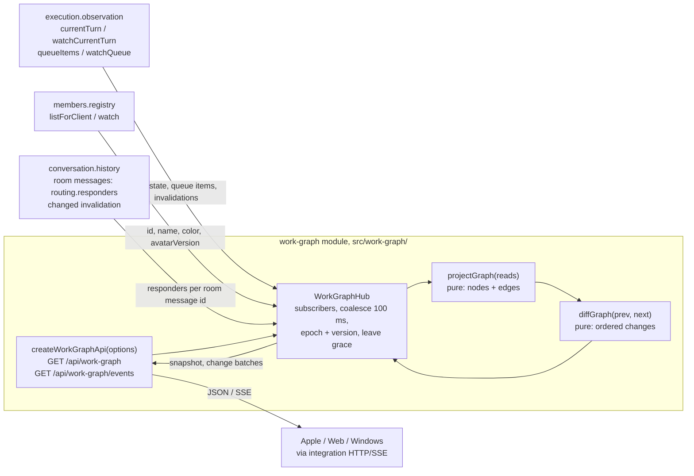

# 相関図 (work graph)

Owner: Arc Ranger Black (bot-c19019b6). Assigned by Trony on 2026-11-08 at the Owner's request.

This module owns the **data** of the 相関図 page only: which members are working now, and which work requests flow between them. Each app draws it natively, following the shared [behavior and visual spec](behavior-spec.md). Apple (Bell) draws first; Web (Admi) and Windows (Bell) follow.

The connections are in [module.json](module.json). The overall [function map](../../feature-map.md), [data flow](../../data-flow.md) and [ownership](../../module-ownership.md) trace callers and providers.

## Function map



## Data flow

| ID | From -> to | Data | Notes |
| --- | --- | --- | --- |
| W1 | providers -> hub | execution `watchCurrentTurn` `{botId,state,turnId,startedAt?}` and `watchQueue`; members `watch`; conversation `changed` (timeline/rooms) | Wake-up signals only. The hub subscribes before its first read and re-reads after every signal; it never builds state from signal payloads alone |
| W2 | hub -> execution | `currentTurn(botId, {startedAt: true})` per active member, `queueItems({})` | Live projections. No sequence, no replay. `startedAt` since main 7d5d1cee (PR #641); absent or null on older engines |
| W3 | hub -> members | `listForClient()` | id, name, color, avatarVersion. Rows with `deleting: true` and absent ids are not members. A failed read is unavailable, never an empty roster |
| W4 | hub -> conversation | recent messages of each room that has a live room queue item | `routing.responders` of the message whose id equals the item's `groupId`. Silent (non-responder) room deliveries are not work requests. Responders are cached per message id once routing is final |
| W5 | hub -> app | snapshot JSON, then SSE `snapshot` + `change` batches | Owner-authenticated `/api`, internal callers get 403 like other `/api` routes |

Recompute: any W1 signal schedules one recompute after 100 ms (coalesced). A recompute does W2 to W4, projects the graph, diffs it against the last published graph, and publishes one change batch if anything changed. With no subscriber, nothing runs; `GET /api/work-graph` computes one fresh graph on demand.

## Projection rules

What an edge means: a Bot-to-Bot delivery that the receiver is processing right now. BellTeam has no durable work or task id and no business completion signal (N102, 2026-11-08), so the graph shows live delivery processing, not task ownership. The edge appears when execution admits the delivery and ends when the job leaves the queue. It does not prove that the requested work finished or that a result reached the requester.

- **Edge**: a queue item with `status: 'running'`, `context` direct or room, `from` and `target` both active members, `from != target`. Room items count only if `target` is in that message's `routing.responders`; while routing is pending or the message cannot be read, the item is not an edge yet. `context: self`, items from the user, and `failed` items are not edges.
- Edge identity: `id = groupId + ':' + target` (durable delivery id / room message id plus receiver). `requestId = groupId`.
- Edge `state`: `running`, or `steered` once execution reports `steered: true` (accepted into the receiver's running turn).
- Edge `label`: first non-empty line of the request text, at most 40 characters; `画像` when the item has only images.
- **Node**: a member whose `currentTurn` is `working` (`state: 'working'`, blinks), or an endpoint of a live edge while not working (`state: 'linked'`, drawn quieter, no blink). Nobody else appears.
- `unknown` turn state holds the member's previous presence. It neither adds nor removes a node.
- `activeSince`: execution's `startedAt` when provided; otherwise the time this module first saw the member working. It is kept while the member stays on screen.
- **Leave grace**: a member that stops being working and linked leaves only after 4 s. Back-to-back turns do not flash out and in. Returning within the grace emits nothing.

## Public contract

### `GET /api/work-graph`

200 → snapshot:

```json
{
  "schema": "bellteam.work-graph.v1",
  "epoch": "b5c2…",
  "version": 42,
  "at": "2026-11-08T11:02:03.120Z",
  "degraded": [],
  "nodes": [
    { "botId": "bot-c19019b6", "name": "アークレンジャー・ブラック", "color": "violet",
      "avatarVersion": "3f1a…", "state": "working", "activeSince": "2026-11-08T10:58:40.000Z" }
  ],
  "edges": [
    { "id": "85a6…:bot-c4a34a0b", "requestId": "85a6…", "from": "bot-c19019b6", "to": "bot-c4a34a0b",
      "context": "direct", "roomId": null, "label": "For the NEW data-only 相関図 module…",
      "state": "running", "startedAt": "2026-11-08T10:33:10.000Z" }
  ]
}
```

- `color` is the member's accent name (`violet`, `rose`, `indigo`, `sky`, `mint`, `amber`); apps map it with their theme (Apple: `BellTheme.accent(_:)`).
- Avatar image: the existing `GET /api/bots/:id/avatar`, cached by `avatarVersion` (empty string = no avatar; draw the initial).
- `degraded` lists sources that failed in the last recompute: `turn`, `queue`, `members`, `responders`, or `turn-unsupported` (old execution engine). The graph keeps the last good data for a failed source. Empty means fully live.
- Errors: 401/403 as the common `/api` auth; 405 `METHOD_NOT_ALLOWED` for other methods.

### `GET /api/work-graph/events` (SSE)

- On connect: `event: snapshot`, `data` = the snapshot above.
- Then for each change batch: `event: change`, `id: <epoch>:<version>`, `data`:

```json
{ "epoch": "b5c2…", "version": 43, "at": "…", "degraded": [],
  "changes": [
    { "type": "member-enter", "node": { … } },
    { "type": "edge-start", "edge": { … } },
    { "type": "edge-update", "edge": { … } },
    { "type": "member-update", "node": { … } },
    { "type": "edge-end", "edgeId": "…" },
    { "type": "member-leave", "botId": "…" }
  ] }
```

- Order inside a batch: `member-enter`, `member-update`, `edge-start`, `edge-update`, `edge-end`, `member-leave`. An edge never references a node that is absent after the batch is applied.
- `version` increases by exactly 1 per batch within one `epoch`. A client applies a batch only when `epoch` matches and `version == last + 1`; otherwise it reconnects.
- Comment heartbeat `: hb` every 15 s. A client treats 35 s of silence as a drop.
- No replay: `Last-Event-ID` is ignored. Every connection starts with a fresh `snapshot`; the client diffs it against what it drew and animates the difference.
- A new `epoch` means the module restarted (for example, a parent restart). Versions from the old epoch are void.

## State ownership

No persistent state. Everything (last graph, epoch, version, first-seen working times, leave timers, subscribers) lives in memory and is rebuilt from the provider reads after a restart. The module writes no file and no other module's state.

## Failure handling

| Failure | Behavior | Self-exit |
| --- | --- | --- |
| A provider read throws | Keep the last good data for that source, add it to `degraded`, publish if `degraded` changed | The next W1 signal recomputes; success clears the entry |
| `currentTurn` returns `EXECUTION_REQUEST_INVALID` | `turn-unsupported` in `degraded`; nodes come only from live edges (`linked`) | Engine update; the next recompute retries |
| Subscriber socket closes | Drop the subscriber; stop watching providers when none remain | The next subscriber restarts watching |
| Parent restart | New epoch, empty in-memory state | Clients reconnect and draw the new snapshot |

No guard refuses a request. Reads never block on another module beyond the provider call itself.

## Tests (own range)

`test/work-graph.test.mjs`: projection rules, diff order and versioning, leave grace, degraded sources, SSE framing and handler routes, using fake provider ports.
