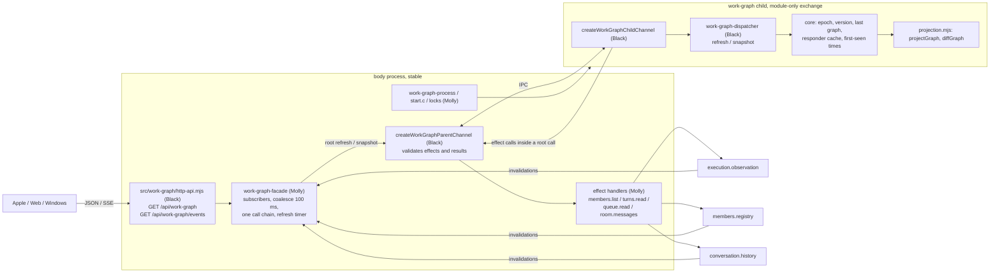

# 相関図 (work graph)

Owner: Arc Ranger Black (bot-c19019b6). Assigned by Trony on 2026-11-08 at the Owner's request.

This module owns the **data** of the 相関図 page only: which members are working now, and which work requests flow between them. Each app draws it natively, following the shared [behavior and visual spec](behavior-spec.md). Apple (Bell) draws first; Web (Admi) and Windows (Bell) follow.

The connections are in [module.json](module.json). The overall [function map](../../feature-map.md), [data flow](../../data-flow.md) and [ownership](../../module-ownership.md) trace callers and providers.

## Process placement (Trony ruling 2026-11-08)

work-graph runs as its **own module child**, like the other business modules, so every change to the graph logic ships as a module-only exchange without stopping the body. The body keeps only a thin, stable part: the HTTP/SSE handler, the facade and the effect handlers over the existing public ports. Splitting follows the diagnostics pattern: the module owner (Black) owns the protocol, both IPC channel ends, the dispatcher, the core and the entry. Runtime (Molly) owns the start binary, process wrapper, locks and closed sets. Integration (Molly) owns the facade, effect handlers and mount. Distribution (Centi) signs and installs the asset.

## Function map



## Data flow

| ID | From -> to | Data | Notes |
| --- | --- | --- | --- |
| W1 | providers -> facade | execution `watchCurrentTurn` and `watchQueue`; members `watch`; conversation `rooms.watch` | Wake-up signals only, forwarded while at least one SSE subscriber exists. Coalesced 100 ms into one root `refresh` |
| W2 | facade -> child | root `refresh {}` -> `{batch, nextRefreshMs}`; root `snapshot {}` -> snapshot | All child calls run on one chain, so a snapshot never interleaves with a refresh. `nextRefreshMs` arms one timer (leave grace) |
| W3 | child -> parent effects | `members.list {}` -> `{members:[{id,name,color,avatarVersion,deleting}]}` | From `bots.listForClient()`. Effects are accepted only inside a pending root call. A failed read is unavailable, never an empty roster |
| W4 | child -> parent effects | `turns.read {botIds}` -> `{turns:{[id]:{state,turnId,startedAt?,summary?,summaryStatus?}}}` or `{unsupported:true}`; `queue.read {}` -> `{items:[{status,context,contextId,groupId,from,target,requestSummary,image,steered,startedAt}]}` | From `currentTurn(id,{startedAt:true})`, the member's `currentWork.summary`/`summaryStatus` (execution's Japanese work summary, width 80) and `queueItems({})`; `requestSummary` is execution's once-per-request Japanese summary of the request (string or null), the raw `message` body is not passed (Owner ruling 2026-11-08). Live projections, no sequence. `summary`/`summaryStatus` are optional: a parent without them yields the neutral label |
| W5 | child -> parent effects | `room.messages {roomId}` -> `{items:[{id,routing:{responders,status}}]}` | From `messagePage('rooms', roomId, ?limit=50)`. Silent (non-responder) room deliveries are not work requests |
| W6 | facade -> app | snapshot JSON; SSE `snapshot` then `change` batches | Owner-authenticated `/api`; internal callers 403; child unavailable 503 `WORK_GRAPH_UNAVAILABLE` |

The child holds all graph state in memory (epoch, version, last graph, responder cache, first-seen working times). A new child generation starts a new epoch; by contract clients reconnect on an epoch change and draw the new snapshot.

## Projection rules

What an edge means: a Bot-to-Bot delivery that the receiver is processing right now. BellTeam has no durable work or task id and no business completion signal (N102, 2026-11-08), so the graph shows live delivery processing, not task ownership. The edge appears when execution admits the delivery and ends when the job leaves the queue. It does not prove that the requested work finished or that a result reached the requester.

- **Edge**: a queue item with `status: 'running'`, `context` direct or room, `from` and `target` both active members, `from != target`. Room items count only if `target` is in that message's `routing.responders`; while routing is pending or the message cannot be read, the item is not an edge yet. `context: self`, items from the user, and `failed` items are not edges.
- Edge identity: `id = groupId + ':' + target` (durable delivery id / room message id plus receiver). `requestId = groupId`.
- Edge `state`: `running`, or `steered` once execution reports `steered: true` (accepted into the receiver's running turn).
- Edge `label` is plain Japanese for the Owner and never comes from the message body (Bot-to-Bot bodies are English working text; Trony, 2026-11-08). It is the receiver's current work summary when that summary is `current` and non-empty, else `依頼を処理中`. All live edges into the same receiver share that label. A summary change emits `edge-update`.
- **Node**: a member whose `currentTurn` is `working` (`state: 'working'`, blinks), or an endpoint of a live edge while not working (`state: 'linked'`, drawn quieter, no blink). Nobody else appears.
- `unknown` turn state holds the member's previous presence. It neither adds nor removes a node.
- `activeSince`: execution's `startedAt` when provided; otherwise the time this module first saw the member working. It is kept while the member stays on screen.
- **Leave grace**: a member that stops being working and linked leaves only after 4 s. Back-to-back turns do not flash out and in. Returning within the grace emits nothing.

## Public contract

### `GET /api/work-graph`

200 → snapshot:

```json
{
  "schema": "bellteam.work-graph.v1",
  "epoch": "b5c2…",
  "version": 42,
  "at": "2026-11-08T11:02:03.120Z",
  "degraded": [],
  "nodes": [
    { "botId": "bot-c19019b6", "name": "アークレンジャー・ブラック", "color": "violet",
      "avatarVersion": "3f1a…", "state": "working", "activeSince": "2026-11-08T10:58:40.000Z" }
  ],
  "edges": [
    { "id": "85a6…:bot-c4a34a0b", "requestId": "85a6…", "from": "bot-c19019b6", "to": "bot-c4a34a0b",
      "context": "direct", "roomId": null, "label": "相関図の公開窓口を確認している",
      "state": "running", "startedAt": "2026-11-08T10:33:10.000Z" }
  ]
}
```

- `color` is the member's accent name (`violet`, `rose`, `indigo`, `sky`, `mint`, `amber`); apps map it with their theme (Apple: `BellTheme.accent(_:)`).
- Avatar image: the existing `GET /api/bots/:id/avatar`, cached by `avatarVersion` (empty string = no avatar; draw the initial).
- `degraded` lists sources that failed in the last recompute: `turn`, `queue`, `members`, `responders`, or `turn-unsupported` (old execution engine). The graph keeps the last good data for a failed source. Empty means fully live.
- Errors: 401/403 as the common `/api` auth; 405 `METHOD_NOT_ALLOWED` for other methods; 503 `WORK_GRAPH_UNAVAILABLE` while the child is not serving (both routes).

### `GET /api/work-graph/events` (SSE)

- On connect: `event: snapshot`, `data` = the snapshot above.
- Then for each change batch: `event: change`, `id: <epoch>:<version>`, `data`:

```json
{ "epoch": "b5c2…", "version": 43, "at": "…", "degraded": [],
  "changes": [
    { "type": "member-enter", "node": { … } },
    { "type": "edge-start", "edge": { … } },
    { "type": "edge-update", "edge": { … } },
    { "type": "member-update", "node": { … } },
    { "type": "edge-end", "edgeId": "…" },
    { "type": "member-leave", "botId": "…" }
  ] }
```

- Order inside a batch: `member-enter`, `member-update`, `edge-start`, `edge-update`, `edge-end`, `member-leave`. An edge never references a node that is absent after the batch is applied.
- `version` increases by exactly 1 per batch within one `epoch`. A client applies a batch only when `epoch` matches and `version == last + 1`; otherwise it reconnects.
- Comment heartbeat `: hb` every 15 s. A client treats 35 s of silence as a drop.
- No replay: `Last-Event-ID` is ignored. Every connection starts with a fresh `snapshot`; the client diffs it against what it drew and animates the difference.
- A new `epoch` means the module restarted (for example, a parent restart). Versions from the old epoch are void.

## Child protocol

`src/work-graph-protocol.mjs`: `WORK_GRAPH_PROTOCOL_VERSION = 1`, `WORK_GRAPH_STATE_COMPATIBILITY = {state:'none'}`, root methods `refresh` and `snapshot` (params `{}`), the four effect methods above with exact param and result validators, controls `initialize {generation, mode: bootstrap|restore}`, `quiesce`, `resume`, `exit`, and `validateWorkGraphReady({versionId, protocolVersion, stateCompatibility})`. Only fixed error codes cross the wire.

`src/work-graph-ipc.mjs`: `createWorkGraphParentChannel(child, {generation, onEffect})` returns `{ready, request, control, reaped, dispose, snapshot}` for the common controller. `createWorkGraphChildChannel({dispatcher})` runs in the child; the dispatcher reads providers only through `effect(method, params)` bound to the current root call.

`src/work-graph-dispatcher.mjs` wraps the core (`src/work-graph/core.mjs`) and `projection.mjs`. `src/work-graph-entry.mjs` is the child entry; `scripts/probe-work-graph-runtime.mjs` checks initialize/ready/resume/quiesce/exit on the real start binary.

`src/work-graph/http-api.mjs` stays in the body: `createWorkGraphApi({facade, internal, heartbeatMs?})`, calling only `facade.snapshot()` and `facade.subscribe(send)`.

## State ownership

No persistent state (`stateCompatibility {state:'none'}`). The child keeps the last graph, epoch, version, responder cache and first-seen working times in memory; the facade keeps subscribers and timers. Both are rebuilt from the provider reads after a restart or exchange. Nothing writes a file or another module's state.

## Failure handling

| Failure | Behavior | Self-exit |
| --- | --- | --- |
| A provider read throws | Keep the last good data for that source, add it to `degraded`, publish if `degraded` changed | The next W1 signal recomputes; success clears the entry |
| `currentTurn` returns `EXECUTION_REQUEST_INVALID` | `turn-unsupported` in `degraded`; nodes come only from live edges (`linked`) | Engine update; the next recompute retries |
| Subscriber socket closes | Drop the subscriber; stop watching providers when none remain | The next subscriber restarts watching |
| Child unavailable (exchange, crash) | `GET` and new SSE connections get 503 `WORK_GRAPH_UNAVAILABLE`; open streams keep the last graph | The common controller restarts or exchanges the child; the next call succeeds and the new epoch makes clients redraw |
| Parent restart or child exchange | New epoch, empty in-memory state | Clients reconnect and draw the new snapshot |

No guard refuses a request. Reads never block on another module beyond the provider call itself.

## Tests (own range)

`test/work-graph.test.mjs`: projection rules, diff order and versioning, leave grace, degraded sources, SSE framing and handler routes. `test/work-graph-ipc.test.mjs`: protocol validators, effect binding to a pending root call, control sequence, and a real child over a fork IPC pipe.
