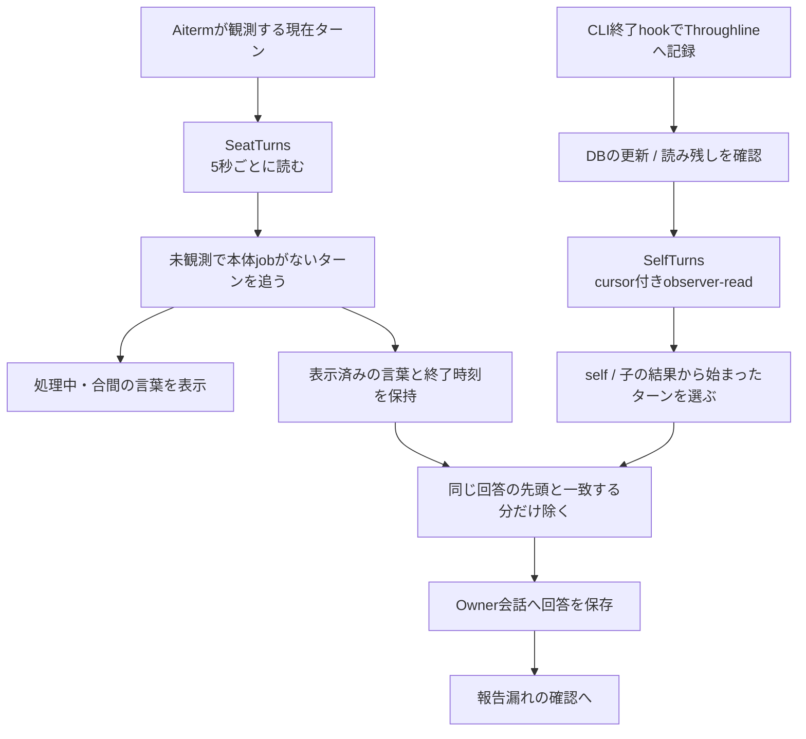
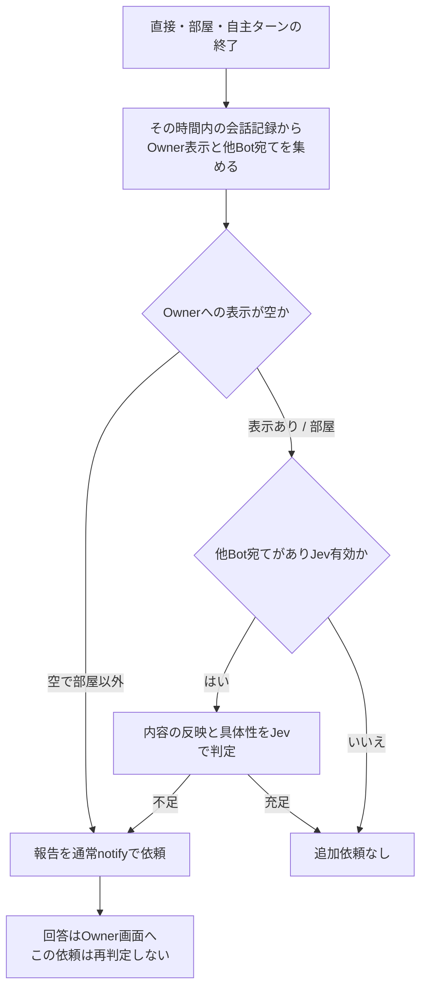
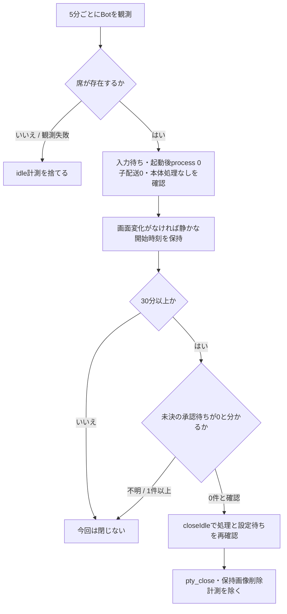

# 自主ターン・報告・idle観測

固定source `546f232180515a2a8cd9098b943673170c49e3d4`。本体から送った文以外で始まったターンも、処理中表示と回答を別の正本から拾う。

## nativeの現在と、保存された回答

| 状態所有 | 関数と契約 | 失敗後の状態 |
| --- | --- | --- |
| SeatTurnsのtimer/running/supported | `start/poll/stop → transport.watchSeatTurns`。未対応返却ならpoll終了 | RPC失敗はlog後に次poll。未対応を故障と混ぜない |
| SeatActivityのwatches/followedTurns/shownWords | `watchSeatTurns/watchTurn/beginWatch/endWatch`。取得前後の停止世代一致、idle、未追跡turnのみ開始 | nullは未知なので既watch継続。idle/別turn確認でend。wait異常は安全な途中経過またはstderrへ。回答はここで取得しない |
| SelfTurnsのcursor/seen/lastCompletedAt | `follow/accept/save`。Throughlineのsource_sha256で直近500件を重複抑止 | cursor/pendingはproject別。初回は現在位置へresetし、旧本文を一括再表示しない |
| Throughlineのページ | `readObserverTurns`。wire v2、after/through cursor、page token | projection_pendingは読み残しとして次poll、errorはそのBotをlog。他Bot処理は続行 |
| 古いcursor | `resync` | 最後に読んだ時刻より新しい分を受ける。返る直近会話/100件の範囲外を復元したとは言わない |
| 重複表示 | `withoutShownWords` | 既表示語が全て同順のprefix、同ターンとみなす60秒内、残文ありの時だけ除く。不一致なら全回答を保持 |
| 回答保存 | `appendAnswer → messenger.appendInterimWords` | seenを先に更新しappendをawaitする現順序。保存失敗時の再読を一般的なexactly-once保証と説明しない。永続cursor自体のsave失敗もlog対象 |

この二つは観測元も責任も違う。新しい共通poll managerを作る理由にはならない。Throughline内部やAiterm内部のターン判定は、公開返却との境界で留める。

## 報告が不足した時だけ、通常通知へ戻す

`TurnReports.afterTurn`は配送の終了を待たせないcallbackから呼ぶ。`turnView`は保存時間の幅で直接発言と途中経過を集める。部屋でsilentを守った場合を「表示なし」にしない。Jevのoutcome/substanceは0..1検証後、それぞれ0.35/0.5を使う。判定失敗はlogだけで依頼を送らない。`requestReport`はonTurnEndを渡さず、同じ報告要求の無限連鎖を作らない。追加notify自体も通常の全体停止/入力制御を通る。

## idle closeは時間だけで決めない

`IdleSessions.checkBot/quietSession`が観測のcursorとsinceを所有する。count未提供や未知を0にしない。既定の`pendingDecisionsByHarness`はClaudeだけ0、他はnullなので閉じない。`transport.closeIdle`はcloseのPromiseをconfigurationChangesへ登録し、その間の新送信を待たせる。これは本体側の既存idle整理であり、Aiterm自身のidle clockへ新しい設定を渡す機能ではない。

実装：[self-turns.mjs](../../src/self-turns.mjs)、[seat-turns.mjs](../../src/seat-turns.mjs)、[seat-activity.mjs](../../src/seat-activity.mjs)、[turn-reports.mjs](../../src/turn-reports.mjs)、[idle-sessions.mjs](../../src/idle-sessions.mjs)。確認先はself-turns、seat-turns、turn-reports、idle-sessions。自然30分の実席観測や旧ターンの再送は行っていない。
