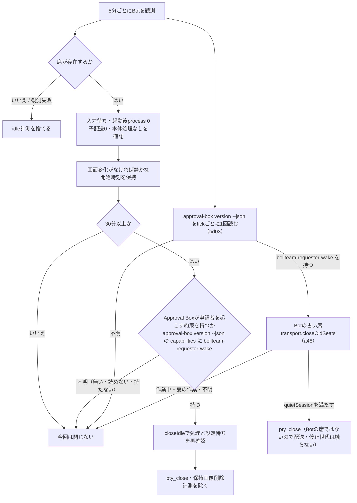

# 自主ターン・報告・idle観測

対象sourceと確認範囲は[全体図](feature-map.md)に従う。本体から送った文以外で始まったターンも、処理中表示と回答を別の正本から拾う。

## nativeの現在と、保存された回答

正本を[会話・履歴module](modules/conversation/observation.md#nativeの現在と保存された回答)へ移した。

## 報告が不足した時だけ、通常通知へ戻す

正本を[会話・履歴module](modules/conversation/observation.md#報告が不足した時だけ通常通知へ戻す)へ移した。

## idle closeは時間だけで決めない

`IdleSessions.checkBot/quietSession`が観測のcursorとsinceを所有する。count未提供や未知を0にしない。答えを待つ申請があっても、Approval Box（0.1.34以降）は受け手を失ったBellTeam発の申請について申請者へ公開sendmessageで一度起こしてresume_decisionを促す（ナユタの製品契約）。だから閉じてよいかは席ごとの件数でもプロセス木でもなく、入っている同梱物がその約束を持つかだけで決める（bd03、2026-11-14）：`$BELLTEAM_HOME/.approval-box/bin/approval-box version --json` の `{schema:"approval-box.version.v1", capabilities:["bellteam-requester-wake"]}`。tickごとに1回だけ読む。無い・終了コード非0・読めない・capabilityが無い時は不明で、どのハーネスの席も閉じない。`transport.closeIdle`はcloseのPromiseをconfigurationChangesへ登録し、その間の新送信を待たせる。これは本体側の既存idle整理であり、Aiterm自身のidle clockへ新しい設定を渡す機能ではない。同じtickで、アカウント移動が残した古い席を`closeOldSeats`が同じ`quietSession`で閉じる（30分の計測なし。契約はexecution harness-accounts.md「Old seat exit」）。

実装：[self-turns.mjs](../../src/self-turns.mjs)、[seat-turns.mjs](../../src/seat-turns.mjs)、[seat-activity.mjs](../../src/seat-activity.mjs)、[turn-reports.mjs](../../src/turn-reports.mjs)、[idle-sessions.mjs](../../src/idle-sessions.mjs)。確認先はself-turns、seat-turns、turn-reports、idle-sessions。自然30分の実席観測や旧ターンの再送は行っていない。
