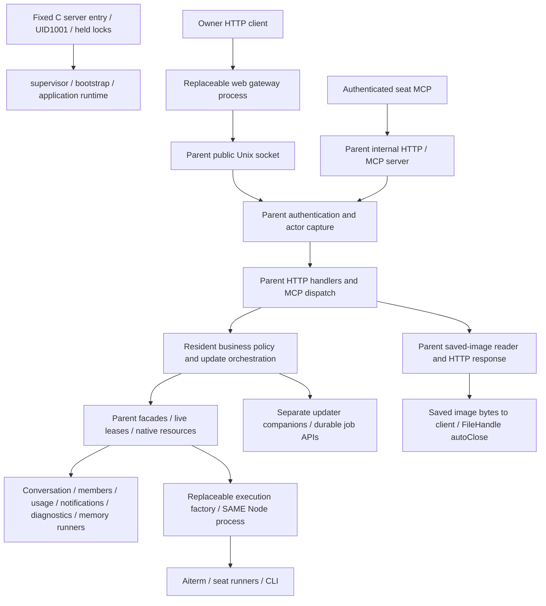

# Body-resident code and migration inventory (Z-b3)

## Snapshot and decision boundary

Maintainer: Molly, thin parent and common assembly. Requested by Trony's Z-b3 schedule on 2026-11-07; delivery due **2026-11-08 12:00 JST**. Code snapshot: `052ef752bf1fae0ec7736290adb624874d3eb3ae` (PR483 execution closure and PR484/485 image-reader repair); the documentation branch also retains catalog adoption `fd7f04830c65f0e37e91e3f79883c4a8ae3ac113`. This is a source inventory and proposed extraction backlog, not evidence of the code loaded in production or approval to replace the body.

The [overall function map](feature-map.md), [overall data flow](data-flow.md), [entrypoints](entrypoints.md) and [module ownership](module-ownership.md) remain canonical. This inventory adds execution-location and update-boundary information; internal contracts remain in their linked module diagrams. A file's repository owner, archive membership, runtime process and ability to update independently are different properties. In particular, an HTTP handler importing a module facade still executes in the body.

Scope is the normal `server-start` → `supervisor` → bootstrap/application graph, including its actual parent callbacks, HTTP/MCP handlers and controllers. Rows group related files into one handoff with one accountable owner. Pure transitive helpers are covered by their calling row; an imported fallback constructor is not classified as active when the normal assembly selects a child facade. No production process/FD probe or author-test rerun was performed.

## Current function and data flow

| Boundary | Data and current owner | Lifetime / failure contract |
| --- | --- | --- |
| Client → parent listener → domain handler | Authenticated request, captured actor and existing public DTOs; Molly owns the envelope, domain owners own semantics | Request errors keep existing HTTP/MCP mapping. A signed domain archive does not replace the parent handler closure. |
| Parent → child facade | Closed request/effect DTOs and generation-bound context; owning module executes its dispatcher | Parent opaque leases and real completion stay live until actual completion; do not serialize callbacks or substitute returned acceptance. |
| Parent → execution factory | Existing native/storage/observer ports; Kiro owns the selected engine, runtime owns loading | Execution is replaceable within the body PID. Factory replacement is not process isolation or survival of body replacement. |
| Parent image GET → reader → response | Parent reader validates fixed-root owner/file, opens the file and returns `{mime,size,stream}` | PR484/485 connect response termination to source destroy/autoClose, including disconnect during open. [Saved-image contract](modules/conversation/delivery.md#保存画像getの読取り寿命). |
| Parent update API → ledger/adapters → companion/controller | Molly owns common plans/claims/response composition; Epinel owns execution/controller mechanics | Preserve durable IDs, actual completion, stored unknown outcomes, authority and current version. Publishing a catalog does not execute an update. [Update contract](modules/integration/update-jobs.md). |

## Retain a stable parent contract

These are retained mechanisms, not exemptions for embedded business policy. Each mixed file's movable part has a migration row below.

| ID | Body-resident files / functions | Owner and reason to retain |
| --- | --- | --- |
| R01 | `scripts/server-start.c`; `src/supervisor.mjs`, `src/lifecycle.mjs`, `src/runtime-resume.mjs`, `src/server-source.mjs` | Runtime / Epinel, with Centi's image entry. Keep the minimal fixed UID/FD-lock admission, startup/shutdown and source identity root. Controller policy and native-package updates are M14/M15. Seat survival across body replacement (Z-c) was dropped by the same 2026-11-08 ruling. |
| R02 | `src/bootstrap.mjs`, `src/application-runtime.mjs`, `src/application-services.mjs` | Integration / Molly; runtime owns startup mechanisms. Retain construction of the same service identities and injected public ports, listener ownership and ordered cleanup. Domain seeds, timers and inline decision closures are M02/M05–M12, not a reason to retain all present code. |
| R03 | `src/http-server.mjs`, `src/seat-mcp.mjs`, `src/http-response.mjs`, `src/http-errors.mjs`, `src/http-request-log.mjs`, generic part of `src/mcp-tools.mjs` | Integration / Molly. Retain listener/authentication, resolved seat identity, bounded request transport, generic dispatch/error envelope and response ownership. Domain paths, schemas and formatting move through M02/M06/M08/M10–M12. Generic stream cancellation remains local to the actual socket owner. |
| R04 | `src/module-operation-context.mjs`, `src/module-exchange-mutex.mjs`, `src/conversation-authority.mjs`, `src/members-owner-authorization.mjs`; parent portions of `src/conversation-assembly.mjs`, `src/members-assembly.mjs`, `src/usage-assembly.mjs` | Existing integration/execution authority owners. Keep object-identity authority, live actor/lease capture, actual-completion accounting and stable facade binding. These cannot be copied as JSON proof. Move domain decisions behind ports; any changed lifetime contract needs Trony's disposition. |
| R05 | `src/direct-receipt-assembly.mjs`, `src/durable-message-receipts.mjs`, `src/messenger.mjs` | Integration parent assembly / Molly and conversation receipt contract / N102. Retain the minimum durable receive journal and target-lane bridge that accept input while a conversation child is unavailable. Preserve saved delivery IDs and single-writer ownership; do not move the whole writer into the failing child merely to shorten the parent. Formatting/report policy is M05. |
| R06 | `src/execution-assembly.mjs`, `src/execution-facade.mjs`; injected `AitermClient`, storage and observer resource references in `src/application-services.mjs` | Integration / Molly, Kiro's execution contract and Epinel's resource mechanism. Keep the stable host references used by a selected execution factory, so a module swap does not create a new native client or lose its current work. Mutable policy and runtime adapters are M06/M07/M15. |
| R07 | `src/update-host-adapter.mjs`, `src/container-update-client.mjs`; minimal authority/durable-claim ports currently exposed by `src/update-module-executor.mjs`, `src/update-install-inspection.mjs` | Integration / Molly; runtime companion implementation / Epinel. Retain a small fixed connection and authority/journal interface; update orchestration stays in the body (M01 dropped). Do not relocate or rewrite a live ledger writer without a handoff/restore contract, including the updater's own update. |
| R08 | `src/json-file.mjs`, `src/current-work-contract.mjs`; generic schema/value validation and fail-closed transport envelopes | Existing module owners; common adapter ownership remains Molly. Keep shared stable primitives where used by the parent. A primitive shared with child payloads is not parent-exclusive code; domain schema evolution belongs to its module and the rows below. |

| R09 | `src/bughub-security.mjs` and the fixed external-service relay in `src/seat-mcp.mjs` | Integration / Molly owns caller/credential transport; BugHub / Fragile and Bridge / Liter own external business semantics. Retain the narrow installed protocol and credential isolation. Endpoint/credential files already reload per call; external implementation repairs do not require body changes. New body-facing tool schema/transport ABI is part of the remaining monthly contract-change budget, not permission to move another product into the body. |

## Dropped migration rows

**Dropped 2026-11-08 by Owner ruling (11:13 JST, relayed by Trony).** Body code ships with each body release, so M01–M15 will not be started or continued; M01 is stopped. Code already on main stays. The rows below are kept only as the residency record: they still say which repairs need a body release.

**15 migration rows.** State of every row is **dropped**; before the ruling it was proposed design/handoff, never an implemented move or a change of role ownership. All row deadlines below are **2026-11-08 12:00 JST for Trony's design disposition and owner handoff**. They do not assert that another owner has promised implementation by that time. Z-b2/Z-c were dropped by the same ruling; their 11/9 milestones no longer apply, and no implementation dates follow from this table. No new runtime component ID, publisher, permission or public API is authorized by this table.

| ID | Currently resident function and files | Destination / accountable existing owner | Concrete handoff and completion criterion | Deadline / dependency |
| --- | --- | --- | --- | --- |
| M01 | Update inventory/eligibility, notification timer, plan/start/read/inspection policy: `src/update-center.mjs`, `src/update-center-contract.mjs`, `src/update-job-reader.mjs`, `src/update-module-catalog.mjs`, `src/update-module-executor.mjs`, `src/update-module-adapters.mjs`, `src/update-install-inspection.mjs`; update branches of `src/http-application-api.mjs` | Reloadable **integration update-control** implementation / **Molly**; runtime execution remains Epinel | Extract mutable update orchestration behind the existing public update contract, leaving R07 ports. Specify how its own update is started/read and how the same ledger/current/unknown state survives replacement. Existing `integration` is not a published update component: packaging/ABI selection requires Trony/Centi/Epinel design disposition. No arbitrary registry is implied. | Nov 8 12:00 JST; R07, runtime controller interface |
| M02 | Conversation/Room/export/history/SSE HTTP and conversation MCP schemas/formatting: `src/http-conversation-api.mjs`, `src/http-room-api.mjs`, `src/http-delivery-api.mjs`, `src/http-messages.mjs`, `src/http-events.mjs`, `src/mcp-conversation-tools.mjs`; conversation branches in common HTTP/MCP dispatch | **conversation / N102** | Publish domain route/tool descriptions and handlers from the selected conversation version; parent keeps R03 authentication, actor capture and socket relay. Preserve saved receipt IDs, current history shapes, streaming cancellation and actual completion. Image read mechanics are separately M03/M04. | Nov 8 12:00 JST; [conversation process](modules/conversation/process.md), R03/R04 |
| M03 | Saved-image GET orchestration, MIME/length/error response policy: `createConversationAssetsApi` in `src/http-conversation-api.mjs`; asset wiring in `src/conversation-assembly.mjs` | **conversation / N102**, with Molly's HTTP envelope | Define a versioned asset request/response port so a conversation-domain repair can activate without replacing the body. Preserve URL/headers/bytes, parent authority and disconnect during open/transfer. Keep `ServerResponse` in its owning process; do not send a Node stream as JSON. | Nov 8 12:00 JST; M04, N102's [reader lifetime contract](modules/conversation/delivery.md#保存画像getの読取り寿命) |
| M04 | File open/stat/path validation and FileHandle stream lifecycle: `createConversationAssetReader` in `src/conversation-assets.mjs`; parent reader binding and asset-removal gate use in `src/conversation-assembly.mjs` | **runtime / Epinel** for the existing reader mechanism; N102 owns asset semantics and Molly the authority bridge | Design a replaceable runtime reader/stream producer or equivalent scoped port. The process opening the FD must close it on normal EOF, error and cancellation; a stable local relay must propagate cancellation. Preserve fixed root, O_NOFOLLOW, size checks and per-Bot removal coordination. Do not transfer opaque gate authority or claim a current conversation archive includes this parent reader. | Nov 8 12:00 JST; M03, runtime/asset contract disposition |
| M05 | Direct-delivery failure/report and observer policy: `directFailureReport` in `src/direct-receipt-assembly.mjs`, `src/turn-reports.mjs`, `src/conversation-parent-effects.mjs`, `src/conversation-execution-effects.mjs`, `src/conversation/observer-parent.mjs`; conversation polling policy in `src/application-services.mjs` | **conversation / N102** | Separate replaceable domain formatting/selection from R05's minimum journal/bridge. Existing parent effect adapters carry only authenticated capabilities and actual completions. Keep receive-before-dispatch durability and no replay of unknown inputs. | Nov 8 12:00 JST; R04/R05, [durable receipt](modules/conversation/durable-receipt.md) |
| M06 | Global AI pause/resume decisions, model projection and execution MCP dispatch still bound in parent: `src/ai-control.mjs`, `src/model-catalog.mjs`; `/api/models` and goal/control branches of `src/http-application-api.mjs`, `src/http-goal-api.mjs`, `src/mcp-tools.mjs` | **execution / Kiro** | Move policy, schemas and model projection to the selected execution implementation; retain stable admission/resource references and state writer identity until an explicit restore contract exists. Distinguish existing replaceable `aiterm-transport` from the parent-created native client. | Nov 8 12:00 JST; R04/R06, [execution lifetime](modules/execution/conversation-lifetimes.md) |
| M07 | Team background-summary scheduler/runner constructed outside selected execution factory: `src/background-summary-assembly.mjs`, `src/team-background-summary.mjs`, `src/background-summary-runner.mjs`; restart-summary policy closure in `src/application-services.mjs` | **execution / Kiro**; usage settings remain Mika | Bind mutable summary/restart policy to the selected engine. Keep parent authority and original history-read completion at R04/R06; preserve input identity and discard stale summary results without repeating work. | Nov 8 12:00 JST; M06, [model handoff](modules/integration/model-handoff.md) |
| M08 | Members/Owner/profile HTTP and MCP business code plus initial domain setup: `src/http-bot-api.mjs`, `src/members/owner-http.mjs`, `src/members/profiles-http.mjs`, `src/members/profiles-mcp.mjs`, `src/members/deletion.mjs`; `BotRegistry`, `OwnerProfile`, `UserRules` and instruction refresh construction in `src/bootstrap.mjs`; members branches in `src/mcp-tools.mjs` | **members / Belorta** | Supply route/tool schemas and domain decisions from the selected members version. Replace parent bootstrap domain work with the minimum closed startup/registry port; retain live identity/projection handles. Preserve pending deletion and image-removal coordination. | Nov 8 12:00 JST; R02/R04, [members contracts](modules/members/README.md) |
| M09 | Scheduled work clock, prompt/command decisions and callbacks: `src/scheduler.mjs`, `src/http-schedule-api.mjs`, `src/members/schedules-mcp.mjs`; scheduler construction/start in application graph | **members / Belorta**; Epinel owns command execution | Make schedule definition, due calculation and issue decisions independently replaceable. Preserve durable intent/lastRun and original command/AI outcomes during handoff; retain only generic runner ports in the parent. Do not duplicate scheduled actions after restore. | Nov 8 12:00 JST; M08, runtime runner contract |
| M10 | Usage HTTP/MCP handlers and domain effects still running in parent: `src/usage/http-api.mjs`, `src/usage/mcp-tools.mjs`, `src/usage-parent-effects.mjs`, `src/usage/conversation-effects.mjs`, `src/submitted-secret-caller.mjs`, `src/olrw-management-caller.mjs`; policy portions of `src/usage/application-features.mjs` | **usage / Mika**; existing management authorization ports remain Molly-owned | Move settings/auth/question/secret/notification policy into selected usage code. Keep captured Owner authority, exact one-use secret consumption and provider resources behind current ports. Existing stopped OLRW work is not resumed by this design. | Nov 8 12:00 JST; R04, [usage contracts](modules/usage/README.md) |
| M11 | Memory tool schemas, argument/result projection and dispatch branches in `src/mcp-tools.mjs` / `src/seat-mcp.mjs` | **memory / Biscuit**; runner remains Epinel | Obtain domain schema/handler descriptions from the selected memory implementation, retaining common caller identity and MCP transport. The actual memory runner is already outside the parent; this row removes the remaining body-bound tool-policy changes. | Nov 8 12:00 JST; R03, [memory contracts](modules/memory/README.md) |
| M12 | Diagnostic HTTP intake/admin projection and code classification in `src/http-application-api.mjs`, `src/http-errors.mjs`, `src/module-child-exit-reporter.mjs`; diagnostic formatter callbacks in application graph | **diagnostics / Signal** | Move mutable classification/formatting into the selected diagnostics implementation; retain a minimal bounded parent error relay and startup/child-exit observation. Keep the existing sole diagnostic writer, secret redaction and original operation result when reporting fails. | Nov 8 12:00 JST; R03, [diagnostics contracts](modules/diagnostics/README.md) |
| M13 | Parent static-file fallback and mixed avatar/static helper: `src/http-assets.mjs` (`staticFile`, `sendAvatar`); parent static branch in `src/http-server.mjs` | **web / Admi** for static serving; Molly keeps common dispatch, Belorta keeps avatar semantics | Prefer the existing independently replaceable gateway for static assets. Split stable response/identity plumbing from domain asset policy so a static-serving fix does not require a body image. `staticFile` is also called by the gateway: this is **parent + gateway shared code**, not parent-exclusive. N102's separate `createReadStream(file).pipe(response)` disconnect-lifetime finding is a maintenance item in this row, not a reproduced FileHandle-GC crash or part of PR484/485. | Nov 8 12:00 JST; [web contracts](modules/web/README.md), R03 |
| M14 | Parent module controller/restart/load policy: `src/module-process.mjs`, `src/module-child-restart.mjs`, `src/module-ready-probe.mjs`, `src/execution-generation.mjs`, `src/execution-loader.mjs`, `src/execution-adoption.mjs`, `src/http-gateway-process.mjs`, module-specific `*-process.mjs` wrappers | **runtime / Epinel**; same existing common-runner scope | Keep R01's fixed boot entry, then design how controller policy can be replaced without losing child handles, held locks, old/current generation, actual completion or the controller's own update job. Source extraction alone is insufficient: state/resource handoff must be explicit. | Nov 8 12:00 JST; Z-b2/Z-c interfaces, [module process](modules/runtime/module-process.md) |
| M15 | Parent seat/native adapters and image-baked shared CLI/runtime delivery: `src/seat-runtime.mjs`, `src/seat-process.mjs`, `src/seat-stream.mjs`, parent `src/aiterm-client.mjs` binding, `src/throughline-context.mjs`; image-installed Aiterm/CLI/Throughline | **runtime / Epinel**, with Centi's image/profile and Elegg's native contract | Join existing **Z-b2**, not a duplicate runtime updater. Specify stable host ports and when a newly installed runtime applies to existing versus next-start seats. Join **Z-c** for survival across body replacement; never infer seat survival from a successful execution factory swap. | Z-b2/Z-c design Nov 8 12:00 JST; implementation follows their Nov 9 milestones |

## Already independent or shared: do not misclassify

| Code / mode | Actual boundary at this snapshot | Consequence |
| --- | --- | --- |
| `src/http-gateway-entry.mjs`, `src/http-gateway.mjs` and selected web assets | Gateway child process controlled by the parent | A gateway archive update does not replace the body HTTP handlers, nor the shared parent copy of `http-assets.mjs`. |
| Selected conversation/members/usage/notifications/diagnostics dispatchers and memory runners | Their business payload runs through existing child/runner interfaces | Their parent facades, imported HTTP/MCP handlers and effect callbacks are still covered above. Archive membership alone does not relocate a caller. |
| Selected execution dispatcher/transport/goals/administration | Runtime-loaded factory in the **same** body Node process | PR483 can be delivered by execution-module replacement after formal supply. This does not activate PR484 or provide crash/process isolation. |
| Direct `new Diagnostics`, `new BellTeamMemory`, `createManagedTransport`, `new BotGoals`, `new BotAdministration`, `new Onboarding`, `new SecretRequests` alternatives in `src/application-services.mjs` | Conditional fallback branches, when the normal module/SeatRuntime factory is absent | Do not report all imported constructors as normal parent business execution. Keep test/dev fallback behavior separate when migrating the owning row. |
| Host installer/updater companions, seat CLI processes and fixed privileged runners | Separate lifetimes and ownership | They are dependencies of the parent inventory, not automatically replaceable by a conversation or execution archive. Z-b2/Z-c were dropped by the 2026-11-08 ruling. |

## Image incident and monthly body-update target

**Deployment classification:** normal `application-services` selects `conversationAssembly.assets`; `application-runtime` supplies it to the parent HTTP server; `http-server` builds `createApplicationApi`; `conversation-assembly` overrides `assets.open` with `createConversationAssetReader`. Both the repaired handler and its FileHandle reader are parent-resident. PR484 therefore needs a **body replacement under Trony's separate Owner approval**. Tonight's five-module activation, including a conversation-only update, cannot activate it. PR485 corrects the diagram/test connection without changing PR484's executable behavior. Neither this classification nor M03/M04 authorizes replacement or migration implementation.

The monthly body-update target was **withdrawn with the 2026-11-08 ruling**: body code ships with each body release. M01–M15 identify current paths by which ordinary domain/runtime repairs require rebuilding the body; those repairs ship with the next body release. The two paragraphs below record the withdrawn target and are not acceptance criteria.

Reducing body changes to at most one per month was a **target, not an achieved result**. After accepted migrations, only the R01–R09 stable boot/transport/authority/resource contracts would have required body changes; domain route/schema/policy and shared-runtime updates would use their selected module/job paths. No deliberate crash experiment or live replacement is required to deliver this inventory.

For implementation acceptance, each row must demonstrate its affected repair can be delivered through the declared module/job while retaining body PID/start identity and the original authority, durable IDs and completion semantics. Trony then schedules remaining stable-parent ABI changes in a monthly maintenance window; urgent security/data-loss fixes remain separately decided. Observe the subsequent 30-day change record to evaluate the frequency target. Z-c (seat survival across body replacement) was dropped by the same ruling; body replacement keeps its current seat behavior.
