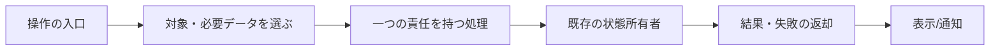

# 機能図に基づく接続の整理計画

状態：設計段階。製品コードはまだ変更していない。対象sourceは[全体図](feature-map.md)に記す。現状図と変更予定を混ぜない。

狙いは、症状が出た時に「入力・判断・副作用・結果の観測」のどこで食い違ったか追えること。機能図の箱、関数の責務、実際の呼出しが対応するようにする。関数を短くするために巨大なcontextを渡す、無意味な一行wrapperを増やす、保存状態を二重化する変更はしない。

## まず整理する接続

| 現状 | 変更後 | 保持する契約 |
| --- | --- | --- |
| scheduler → transport再export → Throughline | scheduler → throughline-context | 関数/値は同じ。transportの互換exportを不用意に消さない |
| 組立てとMessengerが同じログのstoreを各作成 | 組立てで作るstoreをMessengerにも渡す | JSONL形式/追記/通知/読取結果、単独constructorの既定を維持 |
| 直接・通話・再開が同じ4callbackを繰り返す | MessengerのnotificationCallbacksで接続 | metadata/実行起点/保存/受付と失敗の順序は各callerに残す |
| 復旧と起動closeで適用条件を重複 | 保存配送の取得と適用条件の一つの関数 | Bot間・本文だけ・failed等の現条件、明示操作/検証の順序 |
| 記憶の一操作にも全Bot台帳を渡す | initialize全件・personal対象1件・shared0件 | 呼出し時選択、子の検証/エラー順、UID/DB/scope所有 |
| 別会話のSSEで選択中履歴も再取得 | eventから対象を判定し、必要な再取得を接続 | 一覧更新、未知/ready/allのfallback、選択token、queueと入力保持 |

この変更で独立製品のAPIやDB移行は必要ない。記憶境界はビスケットの固定source確認と一致する。既存の認可の意味、secret値、停止条件を変更しない。

これは新しい共通フレームワークの提案ではない。下の既存関数の接続を説明するための形である。

## 実装順と小さい関数

### 1. 所有者への直接接続と読取りの共有

`scheduler.mjs` のimportをThroughlineの窓口へ揃える。`BellTeamMessenger` に `store = new ConversationStore({logPath})` を受ける既定を置き、`createApplicationServices` で既存storeを渡す。

writerはMessengerのappendのまま。storeのsnapshot直列化・ファイル変更検出・履歴projectionを変えない。既存の構築だけで監視を開始しない条件を守る。履歴・配送statusが同じstoreへ現れることを既存試験で確かめ、必要なら同一実体の組立てをassertする。単なるimportのための新テストは増やさない。

### 2. 通知の接続と復旧の条件

`notificationCallbacks(botId, deliveryId, context = 'direct')` など、目的を名前にした小さい関数でonStatus/onInterim/onAnswer/onTurnEndを束ねる。新しいcallback用クラスや汎用イベント基盤は作らない。

`resumeDelivery/closeDeliveryLaunch` の保存配送の取得・適用条件は共通化する。admitWorkの確保/解放、requireAccess、source/target確認、notify発行順を現callerから追う。既存例外のcode/status/診断fieldと保存済み状態を保つ。

ownerの `finishUserTurn/recordUserReply` と部屋の応答権限は別に保つ。新規/差し込み/元ターン所有の判定をcallback共通化へ押し込まない。直接・通話・再開の成功と失敗を既存試験で確認する。

### 3. 記憶操作へ渡す台帳を必要範囲へ絞る

SeatRuntime側に `memoryProfiles(registry, method, args)` 相当の選択関数を置く。選ぶだけであり、検証やDB操作は移さない。initializeは全件。ensureScopeは位置引数、通常操作は最終オブジェクトのbotId/scopeを使う。sharedで対象Botが存在しなくても、現在の子側契約に従う。

新Bot、全件/1件/0件、省略/null/不正scope、未知Bot、sharedを、子へ実際に渡るJSONと既存エラーで局所確認する。テスト専用に製品APIを増やさず、既存の注入可能なrunを使う。既存seat-memoryだけでは転送量を確認できないため、この境界の試験は必要。

### 4. Webの変更通知から必要な取得を選ぶ

イベントの読み取りループから `refreshFromEvent(payload)` を分け、選択中timelineに関係するかを一つの判定へ置く。既存のモジュール/テスト構成を先に調べ、純粋判定と通信副作用を分ける。

実装前に全通知producerのtopic/IDを表にする。Bot選択は該当botId、部屋選択はroomIdとその部屋に見せるqueue/カードの実仕様に従う。ID不十分・未知topic・all・readyは取りこぼさない。未知を「関係なし」にしない。一覧は他会話の活動を表示するため、最初の変更では現状の更新を保持する。

試験は、対象外イベントで開いている履歴への通信が減ることと、対象/全体/未知イベントで更新されること、会話選択が変わった時に古い結果を出さないことを確認する。判定関数の返り値だけを真似る試験では足りない。

### 5. 実行の段階と停止対象の窓口

`AitermTransport.submit` の責務は、受付前準備、receipt確定、完了待ち、回答所有、失敗/清掃へ分かれる。長いsubmitを最初から分割して並行性を変えず、上の低リスクな接続整理後に段階を細かくする。

具体的には `followInterim` の開始・waitUntilDone・最終read・native失敗の補足表示を `waitForTurnCompletion(job, delivery, onInterim)` 相当へまとめられる。回答所有が確定した後のtranscript/onAnswer/終了通知を別関数にできるか、引数と副作用を照合する。自主ターンのwatchTurnは停止/失敗表示の契約が違うので機械的に共通化しない。

特にreceipt受理後のfollower選択と `job.follows` 設定の間はawaitを増やさない。受付Promiseのresolve/reject、checkpoint順、差し込み画像の保留、finallyの解放、表示callback失敗の扱いを変えない。結果不明と既知未送信を同じ復旧へ流さない。

停止側の現在の内部参照は `stopRegisteredWork → transport.jobs`。SeatActivityには既に `stopTargets()` がある。既存窓口を使うか、Botのsnapshotだけを返す窓口にするかを実装時にcaller/fake adapterも含めて確定する。削除済みBotの進行中jobを落とさず、全対象の停止障壁を同期的に作る。未使用だと未確認のままMap別名を一括削除しない。

この段階はまだ分割の最終形が未確定。該当sourceと反例を見て設計を更新してから編集する。全停止・実行を別設計へ置換する許可ではない。

## 今回、別物として保つ機能

- 秘密入力と質問：通知失敗の保存/返却が違う。既存のCardTimelinesは共通部分としてそのまま使う。
- 配送結果、設定受付、AI停止意図、native状態、画面状態：それぞれが何を証明するか違う。
- SeatTurnsとSelfTurns：前者は現在のnative活動、後者は保存済み回答。
- Goal：公開Aiterm契約の対象/結果の検証。BellTeamへ新しいGoal正本を作らない。
- 配布/backup：この段階で重複実装を増やさない。入口図から先の改変が必要になった場合にだけ、全分岐と戻し方を追う。
- Appleの独立改良：本体の公開API境界を維持し、進行中の画面改良を横取りしない。

## 確認と完了の条件

1. 変更前に全caller/test/config/exportを確認。変える接続の入出力・失敗・副作用を図へ記録する。
2. 各段階で必要な局所試験。DB/秘密/nativeの境界を跨ぐ新しい実席操作や既成功全体の再走を追加しない。
3. 未完項目を保持し、図の「予定」を変更済みに見せない。実装後は関数名と接続、現行設計の古い説明を同期する。
4. 本体/API/Webで残る責務混在がないか確認する。薄い移動だけでOwnerの全体リファクタ完了とはしない。
5. 実装完了時に全体試験一回とセンチの独立採否。通常統合/候補へ進める。既本番停止の承認条件は変更しない。

モデルはこの設計をAstra xhighで行い、具体化した1〜3の実装からSol Highへ戻す。4〜5で新しい境界判断が必要なら記録して設計を補う。各関数の変更だけで頻繁に往復しない。
