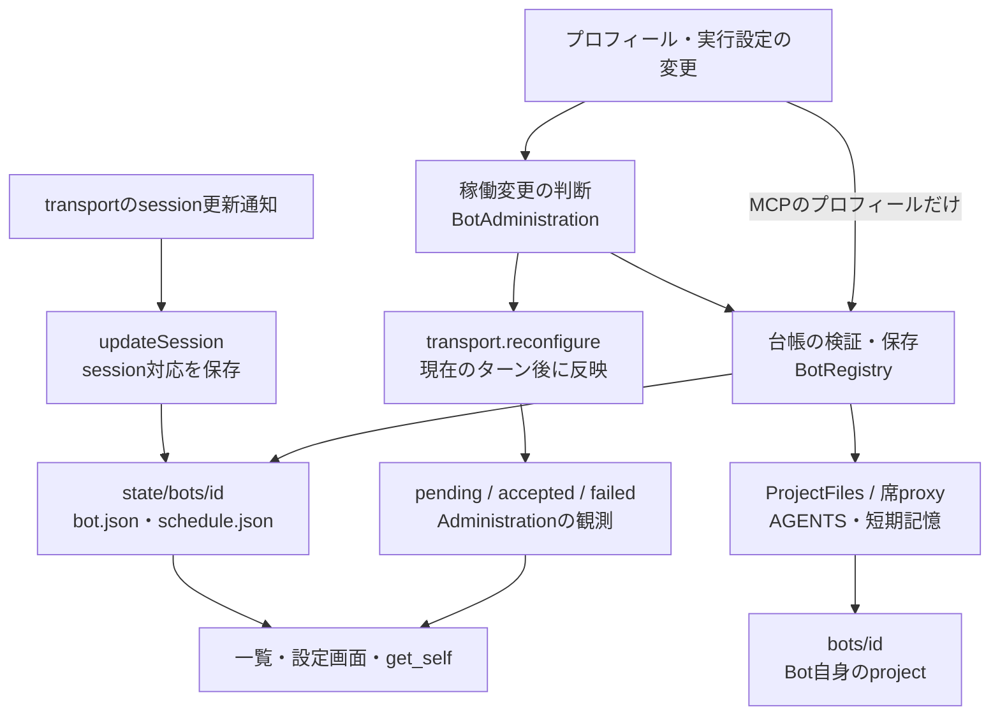
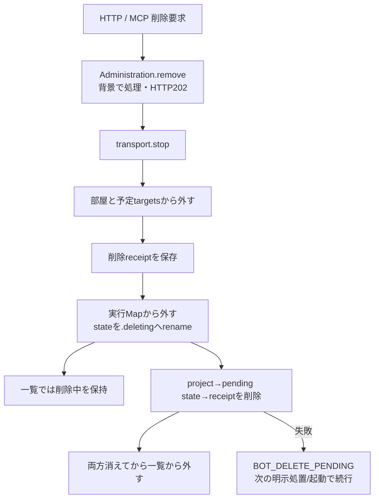
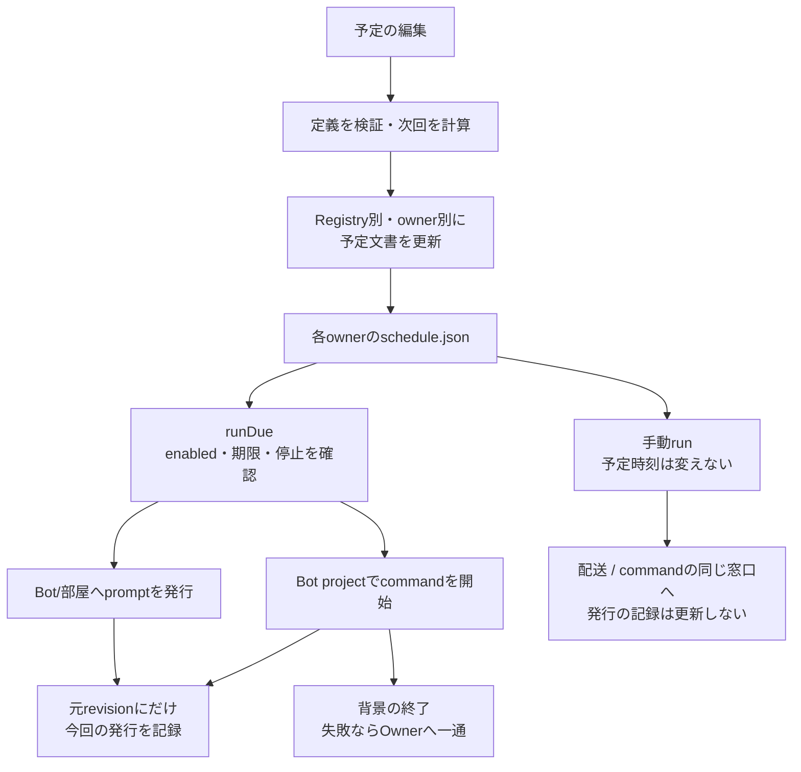

# メンバー・部屋・予定と正本の関係

本branchの実装を説明する。調査起点と確認範囲は[全体図](feature-map.md)を参照。外部入口は[入口索引](entrypoints.md)、native停止/反映の主要図は[制御](control-and-state.md)。ここでは、台帳を変えたことと実行中の席を変えたことを分ける。

## メンバーのデータは三つに分かれる

通常構成の`state/bots`は本体の状態、`bots`は席のprojectである。席分離なし構成では同一rootを使う互換経路がある。`config/bots.json`は未初期化時のseedであり、毎回のrefreshで現在のプロフィールを上書きする物ではない。

| 責務 | caller → 実関数 | 保存/失敗/副作用 |
| --- | --- | --- |
| 起動読込 | `bootstrap` → `BotRegistry.initialize` | 分離状態の移行不足を拒否。seed、`.initialized`、未完削除再開、旧profile移行、指示生成、refreshの順 |
| 台帳読取 | HTTP/MCP/実行前 → `refresh/#readProfiles/readProfile` | stateRootのmetadataでcacheを検証。Mapは投影、削除予定は実行用Mapへ戻さない |
| 作成 | HTTP POST / MCP create_bot → `create` → memory.ensureScope | 入力/effort/fast検証→project新規取得→profile/空予定/指示生成→refresh→onChange。後段失敗でも前段保存は存在し得る |
| プロフィール更新 | `update/previewUpdate/#mutateProfile` | Bot別に直列化。許可field、画像とcrop、model/effort/fastの契約を確認→profile保存→指示生成→通知 |
| 実行設定 | HTTP PATCH / MCP configure → `BotAdministration.update/apply` | preview、変更/再適用要否、wasRunningを確認して保存。稼働中は背景reconfigure、返却はpendingになり得る |
| 反映結果 | `apply`のthen/catch → `applications` | 最新application実体だけを更新。開始前拒否を確認したfast変更のみ、現保存値を照合して希望値を戻す。unknownは戻さない |
| session対応 | transport callback → `updateSession` | profileのsessionだけ更新。通常編集fieldとして外部から受けない |
| 起動指示 | `prepareStartupContext` → `ProjectFiles.prepareStartupContext/writeInstructions` | 引継ぎ文をprevious-sessionへ保存して指示を再生成。プロジェクト管理をnative transport内へ複製しない |
| モデル一覧 | `LiveModelCatalog` → Aiterm | effort/fast検証に使用。保存値だけでnativeの変更成功を証明しない |

`BotAdministration.applications`はメモリの反映観測であり、profile JSON内の別の設定正本ではない。`view`はその観測を公開profileへ添える。[bot-administration.mjs](../../src/bot-administration.mjs)、[bot-registry.mjs](../../src/bot-registry.mjs)、[project-files.mjs](../../src/project-files.mjs)を参照。

## 削除は「実行から外す」と「ファイルを消す」を区別する

| 段階 | 実関数 | 維持する条件 |
| --- | --- | --- |
| 要求 | `BotAdministration.remove` | stop→rooms.removeBot→bots.removeの順。背景の失敗はwriteLog、202を完了へ読み替えない |
| 部屋側 | `RoomRegistry.removeBot` | 参加者/代表から外し、各予定のtargetsも除く。投稿履歴は消さない |
| state退役 | `BotRegistry.remove` | receipt保存後、`deletionIntents`とMap除外をrename前に同期適用。rename失敗時はMapを戻す |
| 実体削除 | `finishRemoval` | project・退役state・receiptの順。失敗時に一覧から完了として消さない |
| 再開 | `resumePendingRemovals` | active stateが残り退役dirが無い場合は準備receiptだけを除く。active/pending両方は競合として拒否 |
| 一覧 | `listForClient/clientListingState` → HTTP一覧の再確認 | 未完receiptをdeleting表示。HTTP一覧のawait中に状態が変わった場合も最後に再確認 |

同じ「削除」でも、room削除は`RoomRegistry.remove`が部屋dir全体を消してから204を返す。Botの背景削除と共通の削除関数へまとめない。

## 部屋定義と会話の所有

`RoomRegistry.create/update/normalizeRoom`が名前・目的・メンバー・代表・アバターを検証し、`rooms/<id>/room.json`に保存する。`refresh`はファイルmetadataでcacheを確認し、現在のBot台帳に照らして正規化する。MCPの参加者/代表資格は`runBellTeamTool`側、投稿の資格と参加者snapshotはRoomMessenger側であり、保存の型検証とは別である。

`appendMessage`が`messages.jsonl`のwriter。`messages/messageView`は同じRoomHistoryを使用する。`watch`はroom/schedule/messagesのstat差分をtopicへ変換する。履歴初出・inode置換・縮小・同サイズ書換えは全体通知へ、通常追記は対象roomへ。Macで親名しか来ない時は既存fileのstatで確認し、名前から対象を推定しない。監視で失敗した時も未知の変更を無視せずallを通知する。

## 予定：定義、発行、実行結果は別

| 段階 | caller → 関数 | 契約 |
| --- | --- | --- |
| 編集 | HTTP/MCP → Registry.setSchedule → `mutateSchedules` | 既存IDの存在を確認しrevisionを増やす。prompt/commandはちょうど一方 |
| 次回計算 | `normalizeSchedule/intervalDaysNext/cronNext` | once/cron/interval_days/interval_hours。timezoneと暦日で計算。disabledはnextRunAtなし |
| 部屋特有 | `RoomRegistry.setSchedule` | command拒否。targetsは部屋参加者内で重複除去。共通normalizeだけではtargetsを所有しない |
| 更新の順序 | `mutateSchedules` | registry実体とownerごとの短命Promise。read→edit→write、finallyで解放。配送queueではない |
| 自動発行 | `BotScheduler.runDue` → dispatch → markScheduleRun | 二重tickと全体停止を確認。配送失敗/unknownも今回の試行として消化し自動再送しない |
| 実行記録 | 各Registry.markScheduleRun | expectedRevisionが違えば編集後の予定を変更しない。onceを無効化、次回を計算。roomはtargets保持 |
| command | `runCommandSchedule/performCommandSchedule` | jobを登録しAbortSignalを渡す。発行と終了を分け、成功/中断では失敗通知を出さない |
| command停止 | AiControl → `interruptCommands` | 全jobへ先にabortし、completionを集めstopConfirmedを確認 |
| 手動 | HTTP run → `runBotSchedule/runRoomSchedule` | 既存予定を読むがmarkScheduleRunしない。返却202は発行まで |
| 全体再開 | AiControl → `prepareResume` | 進行tickを待ち、停止解除要求時刻以前の期限をskippedで区切る。後の過去時刻予定まで消さない |
| 定時の席整理 | `restartLongSessions/restartLongSession` | 東京03時、当日一回、idleかつrunning、Throughline完了ターン閾値。現役jobを閉じる処理へ一般化しない |

予定定義と文書共通処理は基底のBotRegistryから`schedule-definition.mjs`と`json-file.mjs`へ移し、Bot/roomが直接使う。BotRegistryの既exportは互換窓口として残す。[整理案D2](detail-status.md#d2-機能の所有者を経由している共通処理を分離する)はこの依存方向を対象にする。時刻計算やwriter順序を作り直す必要はない。

## Ownerプロフィールと規範

`OwnerProfile.get/update`が`owner/profile.json`、`UserRules.get/update`が`owner/user-rules.md`を所有する。HTTPの更新と別owner MCPは、保存後に`refreshGlobalInstructions`を呼ぶ。`createGlobalInstructionsRefresher`はOwner情報→ユーザー規範→製品規範の順に生成して、`writeGlobalInstructions`または席proxyに渡す。Bot個別のAGENTS生成とは別責任である。

Webの`createOwnerEditor.save`はprofile PATCH→rules PUTの順であり、一括transactionではない。後段に失敗した時にも前段の保存は残り得る。指示生成失敗も、正本保存の失敗と同じ意味にはしない。[owner-profile.mjs](../../src/owner-profile.mjs)、[user-rules.mjs](../../src/user-rules.mjs)、[global-instructions.mjs](../../src/global-instructions.mjs)を参照。

ここまでの確認はsource読取。削除・予定発行・席再起動・実データの更新は行っていない。実装時の確認先はBot/RoomRegistry、profile mutation、deletion listing、schedule-generation、scheduler-failure、bot-administration、model-application-stateの既存試験である。
