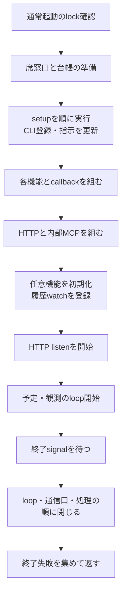
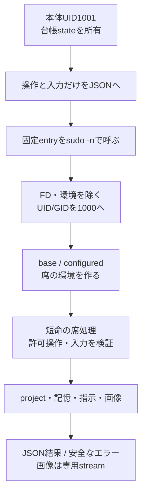
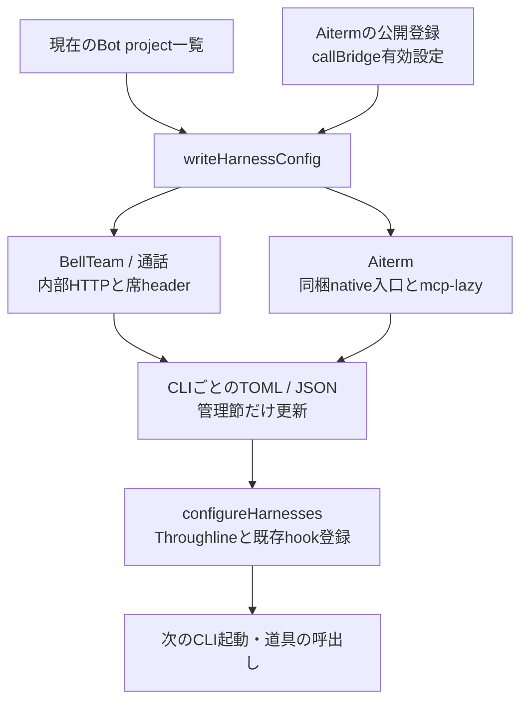
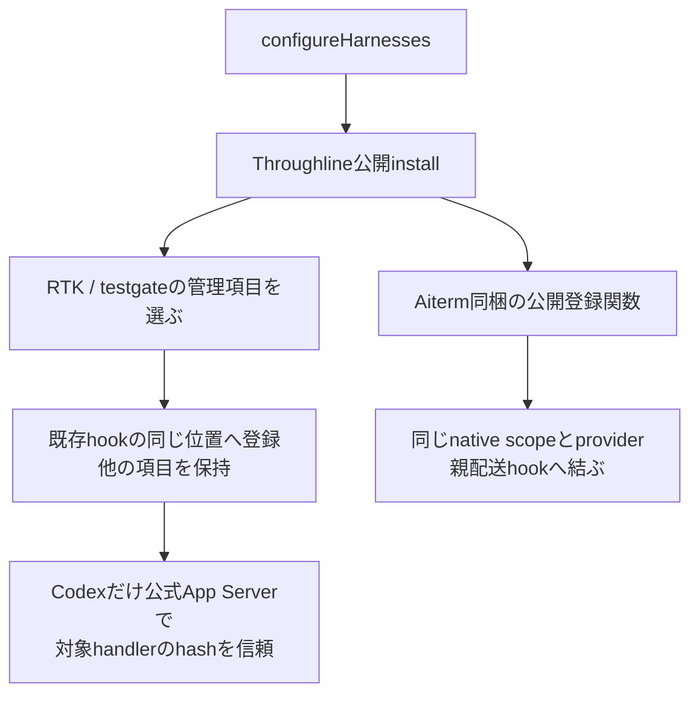

# 起動・席の短命処理・CLI登録

固定source `546f232180515a2a8cd9098b943673170c49e3d4` の現状。[機能図](feature-map.md)の起動と席境界を詳しくする。ここで示すUID/設定は製品のコード上の契約であり、Host設定の新しい変更指示ではない。

## 正本を用意してからサービスを開始する

| 段階 | 実関数 | 正本・副作用・失敗 |
| --- | --- | --- |
| 通常起動の入場 | `supervisor.mjs`のUID1001分岐 | 固定entryから受けたFD3/4のinode/metadata/flockを検証。失敗はbootstrapより前に126 |
| 組立て前 | `bootstrap.mjs` | top-levelで実処理を行う。席側でnative Aiterm登録を解決→settings/Owner/rules/Bot台帳→directory→旧CLI写し整理→setup→CLI登録→指示生成 |
| service生成 | `createApplicationServices` | 台帳/会話/制御/記憶等の同じ実体を組む。詳細は各機能図へ。HTTPごとに別writerを作らない |
| 入口の生成 | `createApplicationRuntime` | 同じserverOptionsで公開HTTPとloopback内部HTTPを構築。内部MCPは同じserviceと内部API中継を使う |
| 開始 | `start` | features.initialize→公開serverのwatch→既停止意図のenforce→両listen→各loop.start。同期/awaitで捕えた失敗はcloseも試し、両方の例外を保持 |
| 終了待ち | `waitForShutdown` | SIGINT/SIGTERMを待ち、keepaliveをfinallyで除く |
| 終了 | `close` | 一つのclosing Promiseに集約。各終了を順に試し、失敗しても次を閉じる。最後にAggregateError |

`createApplicationRuntime`のfactoryをimportしただけではportは開かないが、`bootstrap`のimportは設置や設定更新を行う。二つを同じ「読取り」と扱わない。`server.listen`の呼出しと、OSのlistener準備完了を確認することも同義ではない。この図では新しい起動・停止を実行していない。

## 本体の状態と席のファイルを分ける

| 窓口 | 主な実装 | 維持する契約 |
| --- | --- | --- |
| 操作のproxy | `SeatRuntime.call/projectFiles/memory` | serverの全環境や設定文書を渡さず、操作ごとの入力。response.errorはname/message/code/statusを復元 |
| コマンド構成 | `seatCommandSpec/requireSeatProject` | 絶対project、mode、command/argsを検証。渡す環境は最小PATH。root-owned entryをcheckoutへ置換しない |
| identity変更 | `scripts/seat-exec.c` | FD3以降・継承環境・groupsを除き、実効/実/保存UID/GIDを1000へ。変更後にだけNode/対象commandを実行 |
| env選択 | `run-seat-command` → `baseBotEnvironment/loadBotEnvironment` | configuredのみprojectのenv.shを評価。baseはsetupや短命操作用。env.shのJSON値を通常logへ出さない |
| 子の取消 | `run-seat-command.run/signalGroup` | detached process groupへsignal。250ms後のKILLを受信時に予約し、leader終了後もgroupが残れば待つ |
| JSONの回収 | `createSeatProcessRunner` | stdout/stderr合計maxBuffer、stdin EOF、start/input/nonzero/abortを区別。stdio close前に取消完了を返さない |
| 許可操作 | `run-seat-runtime.operate` | UID/cwd/root/home検証後、project/memoryは公開method集合だけ。通常memory操作で全件initializeしない |
| project管理 | `ProjectFiles.claim/initialize/writeInstructions/prepareStartupContext/remove` | 既存projectをclaimしない。docs/environment/設定画、git初期化、個別AGENTSと短期記憶を所有 |
| 設定画 | `CharacterSheets.list/open` | 正本直下の許可画像のみ。openはO_NOFOLLOWとfile検証。draftsを一覧へ出さない |
| 画像stream | `createSeatStreamRunner/run-seat-character-sheet` | 先頭metadata→body、size/終了codeを確認するまで最後の1byteを保留。HTTP切断で子を停止 |

streamの役割は巨大な画像を全量JSONへ載せないこと。通常の`SeatRuntime.readImage`は小さい会話添付をbase64で回収する別窓口であり、二つを同じbuffer方式へ統合しない。

席のenv.shは席のUIDで動く。本体専用の診断合鍵は`runtimeEnvironment`が除き、bootstrapからの席呼出しでは固定C entryでも継承環境を除く。これを「全Botが互いのprojectから隔離される」と広げない。全席UID1000という既存の責任境界である。

## CLIごとの違いは登録箇所へ閉じ込める

| 段階 | 関数 | 差分と保持範囲 |
| --- | --- | --- |
| 起動準備 | `restoreBotEnvironments/removeSeatClaudeCopies` | setupを各Bot順に実行、一席失敗で全体を止めない。除くCLI写しは既知packageとそれを指す入口に限定 |
| setup結果 | `run-seat-setup` | base環境でsetup.sh、本人setup.logへ出力。親へpresent/codeだけ返す。取消時の直子終了は150ms、外側group停止と役割が別 |
| MCP登録 | `writeHarnessConfig` | BellTeam/bridge/Aitermの管理項目。Codex/GrokはTOML、Claude/Cursor/AGYはJSON |
| CLI差異 | `tomlSeat/jsonSeat/aitermFor`等の局所関数 | Codex env_http_headers、Grok/Claude展開header、Cursor env参照、AGYはstdio中継。形式差を各機能serviceへ広げない |
| native遅延起動 | `relayedAiterm` | mcp-lazyは起動後idle停止なし。nativeでは旧profile/旧tool cache/wakeを使用しない。独立製品の実装は変えない |
| 管理節の置換 | `writeCodexConfig/writeGrokConfig/mergeMcpConfig` | BellTeam管理MCPと対象project trustを更新、他MCPを保持。無効MCPの扱いはplatform条件を維持 |
| hook登録 | `configureHarnesses` | Throughline install後、Cursor instructions/RTK/Aiterm hookを個別登録。後三者の失敗は報告し続行。Throughline installまで成功扱いに広げない |

全体指示はOwner/profile/rulesと製品規範、個別指示はBotのプロフィールと短期記憶という別の元データを持つ。CLI設定文書が変わったことと、既に起きているCLIが読み直したことを分ける。任意機能からの再設定は[利用支援](support-details.md)の背景反映へ接続する。

## hookは所有する登録項目だけを更新する

`configureRtk → setGroupHook/addCursorHook/ownedCommands`は、自分のdirect/gated commandだけを同じ位置で置換する。二重の自分の登録はどちらかを勝手に削除せずエラー。`writeGrokHook/grokHookConfig`は既存Grok専用入口、`trustCodexHook`はhooks/listのsourcePath/key/currentHashに一致したhandlerだけをconfig/batchWriteし読戻す。`codexAppServer`は設定用stdio接続をfinallyで終了し、thread/turnを作らない。

`aitermExecutionRegistration`はAitermの`localParentWorkerRuntime.scope`からstate root/socketを受け、BellTeam側で規則を複製しない。`configureAitermHooks`はnative登録ならその公開setup/argument parser、旧登録ならmergeClaudeParentHooks/mergeCursorParentHooks/ensureCodexParentSteerへ渡す。旧Codex登録の確認が一時的なCLI起動を含むことと、通常のBot起動を区別する。ここではいずれも実行していない。

実装：[application-runtime.mjs](../../src/application-runtime.mjs)、[bootstrap.mjs](../../src/bootstrap.mjs)、[seat-runtime.mjs](../../src/seat-runtime.mjs)、[harness-config.mjs](../../src/harness-config.mjs)、[rtk-hooks.mjs](../../src/rtk-hooks.mjs)、[aiterm-hooks.mjs](../../src/aiterm-hooks.mjs)。参照する確認先はapplication-runtime、seat-command/process/stream/stdio/memory、character-sheets、harness-config、bot-environment、runtime-home、rtk-hooks、aiterm-hooks。native長命実行は[配送詳細](delivery-details.md)、通常installer/backupは[供給詳細](distribution-details.md)へ接続する。
