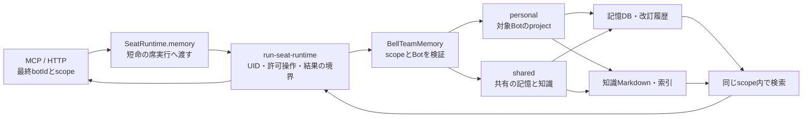
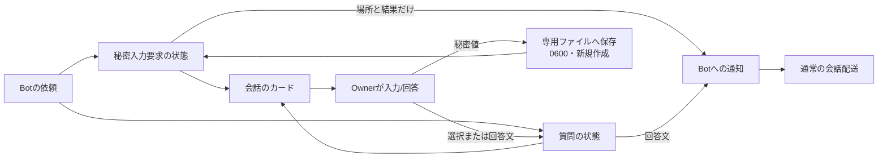
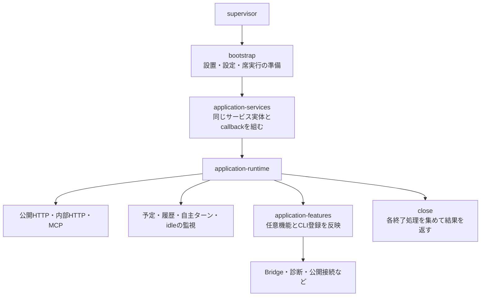
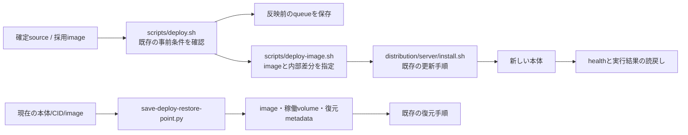

# 記憶・利用支援・起動・配布

[全体図](feature-map.md)を支える機能。外部製品の内部をBellTeam側の機能として再実装しない。

## 記憶と知識

席実行を使わない構成では同じBellTeamMemoryを直接組み立てる。DB/知識ファイルを本体の別機能から直接読む経路は増やさない。

基底のSeatRuntimeは全操作で全Botの `{id, project}` を渡していた。通常の操作で必要なのは対象scopeだけなので、現在はmemoryProfilesで次の範囲へ絞る。

| 操作 | 子へ渡すBot台帳 | 検証・保存の所有者 |
| --- | --- | --- |
| initialize | 全件 | BellTeamMemoryがsharedと各personalを初期化 |
| ensureScope(botId, scope) | sharedは0件、それ以外は存在する対象1件 | 同じscopeRoot。独自にscope正規化を追加しない |
| 通常8メソッド | sharedは0件、それ以外は最終引数の存在する対象1件 | 子側のnormalizeScope → requireBot等をそのまま使う |

台帳はproxy作成時でなく呼出し時に選ぶ。後から作ったBotを見落とさない。通常の省略/null scopeはpersonal、不正scope/未知Botのエラーと順序は子が決める。未知Botを渡す配列は空であり、親で先に例外へ変えない。

MCPの `{botId: from, ...args}`、HTTP更新系の `{botId, ...body}` という現在の引数順まで対象である。今回の転送量整理でactorやURLのIDへ固定すると意味が変わる。認可方針の再定義をこの変更へ混ぜない。

ビスケットが固定sourceの通常全メソッド、内部consolidate/search/rebuild、公開callerを独立確認した。通常操作が対象外Botの台帳を必要とする契約は見つからず、上の条件で足りる。元記録は担当側 `docs/memory-runtime-boundary-review-20261101.md`、照合用原本はRootの工程記録へ保存する。この確認は変更後の試験結果ではない。

## 認証・秘密入力・質問・通知

秘密値はSecretRequests.submitだけが受け、通常の一覧・イベント・診断・本文へ流さない。publicのOwner経路とinternalのBot作成/取下げ経路を分ける。protected操作はHTTP側の認証、接続元、JSONの検証を維持する。

二つのカードを一つの汎用更新関数へまとめると、失敗の意味を失う。

| 機能 | 保存と通知の順序 | 通知失敗 |
| --- | --- | --- |
| SecretRequests.finish | 入力状態/notification pendingを保存 → 通知 → 結果保存 | notification failedを保存して状態を返す。秘密ファイルを再作成/再送しない |
| OwnerQuestions.answer | answeredを保存 → 通知 | 例外を呼出し元へ返す。保存済み回答は残る |
| SecretRequests.withdraw | 依頼Botを検証 → cancelledを保存 | 自分への通知を起こさない |

Onboardingは導入段階、HarnessAuthはCLI認証手順の状態と公開結果を持つ。認証情報を保存するCLI自体の責任と混ぜない。SubscriptionsはAppleの利用契約/検証を扱うが、Webと本体の会話・配送・予定へ購読制約を足さない。

PushNotificationsは保存後に通知を依頼し、本文/秘密値をpayloadへ加えない。Diagnosticsは観測された失敗と既知/未知を記録する。通知失敗や診断保存の成功を、本来の配送の成否へ転用しない。安全なrequest参照とHTTP応答の結合はdiagnostic-request-context / http-errorsの既存窓口を使う。

## アプリを組み立てる

factoryのimport/構築と通信口・監視のstartを分ける。HTTPとMCPへ同じサービス実体を渡す。機能handlerへ保存の別実装を足さない。共通失敗応答・認証・要求ログはHTTP入口の責任、業務の判断は各サービスの責任である。

| 接続先 | BellTeamの責任 | 接続先の責任 |
| --- | --- | --- |
| Aiterm/Steer | Bot/session/配送の対応、公開結果の検証、表示 | native起動・差し込み・停止・Goal・実行観測 |
| Throughline | 起動時に必要な文脈を渡し、保存済みターンを読む | 会話の記録と引継ぎ情報 |
| call-bridge | 通話を会話へ入れる、event/seq対応 | 公開の通話配送 |
| Jev/TypeSafe | 有効な時の返信者/報告判定を依頼し結果を使う | 判断の実行 |
| CLI設定・RTK等のhook | 自分が置いた登録項目だけを書く | 各独立製品の実装・公開契約 |
| Caveat/Approval Box等の別MCP | 既存の利用/登録境界を保つ | 各製品の状態と操作 |

今回の接続整理に、この表の製品内部の変更はまだ必要と判明していない。必要になった時は根拠・新窓口・互換・移行を所有者と合わせる。

## 通常反映と保全

deploy.shのfetchは親umask077と分けた022のsubshellで行い、private生成物のmodeを変更しない。指定imageは再buildせず、必要な通常経路に渡す。installerの所有するcompose/保守状態/volume処置を別のdeploy実装へ複製しない。

復元点は元CID/imageとの対応を確認して保存する。稼働中volumeのSQLiteなどには専用のarchive処理がある。この図は通常入口と呼出し関係までの確認であり、installer全体・全backup/restore分岐の再監査や復元試験の代用ではない。ここを変更する段階では、所有するデータと失敗時の戻り先を追加で詳細化する。

## 関数と確認先

| 機能 | 主な実装 | 変更時に確認する試験 |
| --- | --- | --- |
| 記憶の席境界 | seat-runtime.mjs: memory / run-seat-runtime.mjs | seat-memory、helpers/seat-runtime-boundary |
| 保存・検索 | memory-service.mjs / memory-search.mjs | memory-service、memory-search、knowledge-rebuild-retention、各write/close-error試験 |
| 秘密/質問 | secret-requests.mjs / owner-questions.mjs / card-timelines.mjs | secret-requests、owner-questions、http-server |
| 認証/購読/通知 | onboarding.mjs / harness-auth.mjs / subscriptions.mjs / push-notifications.mjs | onboarding、harness-auth、subscriptions、push-notifications |
| 組立て/終了 | application-services.mjs / application-runtime.mjs / application-features.mjs | application-runtime、http-feature-routing、feature-settings |
| 本番反映/保全 | scripts/deploy.sh、deploy-image.sh、save-deploy-restore-point.py | deploy-*、archive-live-volume.test.py、deploy_restore_test.py、server-state-* |

実装は指定がなければ `src/`。試験は参照先であって今回の実行済み一覧ではない。
