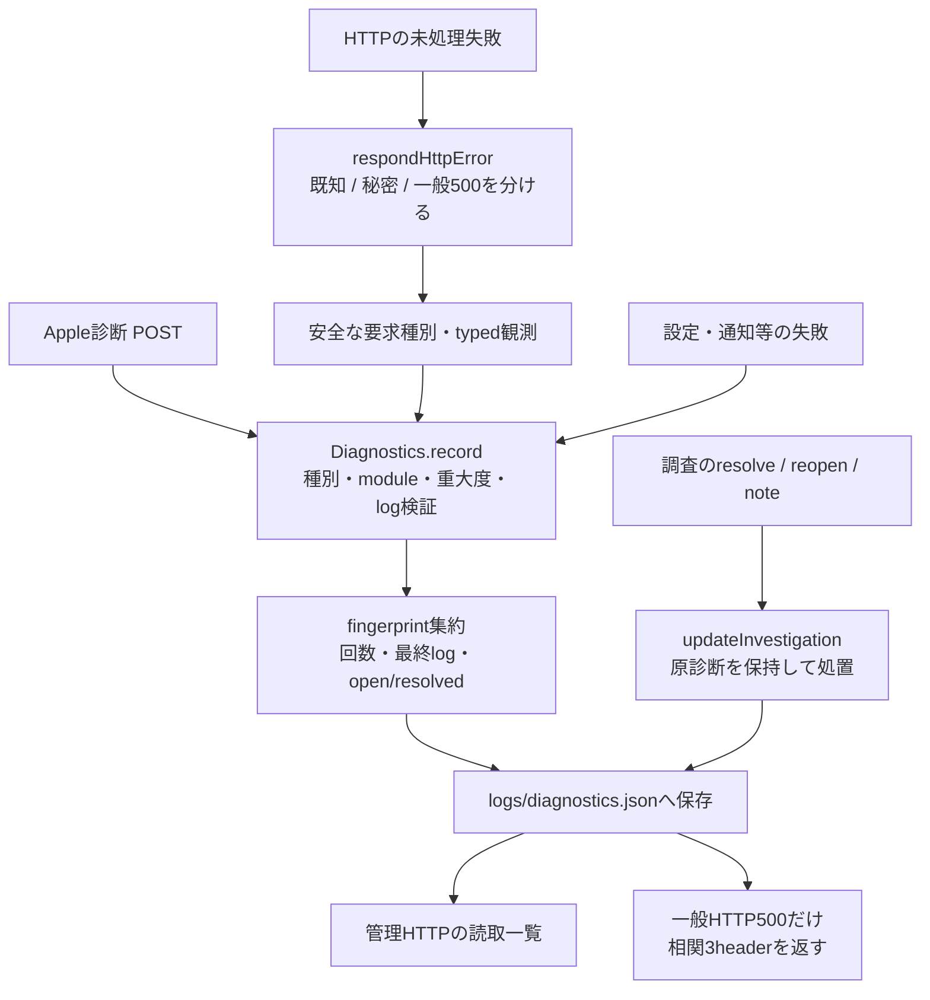

# 入力支援・認証・設定・通知の詳しい関係

[機能図](feature-map.md)から、利用を支える各機能を辿るための現状図。対象sourceは[全体図](feature-map.md)に従う。この文書は実装済みの振る舞いを説明する。改善案は[詳細化の進捗と整理案](detail-status.md)へ分ける。

矢印は呼出しまたは渡す値、破線は保存後の通知。応答の成功、記録の保存、Botの受付、Botの処理完了は別の到達点である。下の関数表は、図からコードへ降りる入口になる。

## 秘密入力：値の保存とBotへの知らせは別

[利用設定・通知の正本](modules/usage/flows.md)へ移管した。

## 質問：回答の保存後に会話へ渡す

[利用設定・通知の正本](modules/usage/flows.md)へ移管した。

## 認証：公式CLIの状態を保持するのはAiterm

[利用設定・通知の正本](modules/usage/flows.md)へ移管した。

## 任意機能：設定を保存したことと適用できたことを分ける

[利用設定・通知の正本](modules/usage/flows.md)へ移管した。

## 通知と購読：サーバー会話の成功とは別の機能

[利用設定・通知の正本](modules/usage/flows.md)へ移管した。

## 診断：観測、集約、調査注記を分ける

`createControlApi`はIOS_受付、`respondHttpError`は本体HTTP、設定/通知の各サービスは固定codeで`record`を呼ぶ。`diagnosticReportContext`がlogから安全な分類を抽出し、同fingerprintの後発はcountを増やし再openする。診断原文・相関と、調査で分かったことを同じ値に上書きしない。

管理APIは別listener/合鍵で`list/setStatus/setNote`へ接続。`list`の追加調査ファイルは読取投影で、`updateInvestigation`のnoteは処置時のcount/statusと共に保存する。BugHubはその報告元を読む側であり、本体のDiagnosticsのMapを直接所有しない。

一般500は安全なframes/要求種別を記録し、保存成功時のみfingerprint/count/receivedのheaderを付ける。秘密経路は固定診断だけ、既知typedエラーは先に返す。[http-errors.mjs](../../src/http-errors.mjs)の順序が責任境界であり、共通catch一つへ潰さない。

接続確認で見つかったGoal診断の不一致（基底ではcode/moduleが未登録）は、現branchでDiagnosticsへ既callerの定義を登録して修理した。本物の組立てを使う局所試験で、inspectのunavailableとmutationのunconfirmedを返し、安全なstackを保存する。元の実障害との相関と本番反映を示すものではない。詳細は[整理と実装状況](detail-status.md)を参照。

## この文書の確認範囲

usageの詳細図は[担当の正本](modules/usage/flows.md)を参照する。診断の入口・関数・保存順序・返却を固定sourceから確認した。保存中断やnative/外部通信を新たに実行した結果ではない。既存の検証先は `test/secret-requests.test.mjs`、`owner-questions.test.mjs`、`harness-auth.test.mjs`、`onboarding.test.mjs`、`auth-ui-server.test.mjs`、`feature-settings.test.mjs`、`push-notifications.test.mjs`、`subscriptions.test.mjs`、`diagnostics.test.mjs`、`application-runtime.test.mjs`。具体的な変更を行う時に関係する境界だけを確認する。
