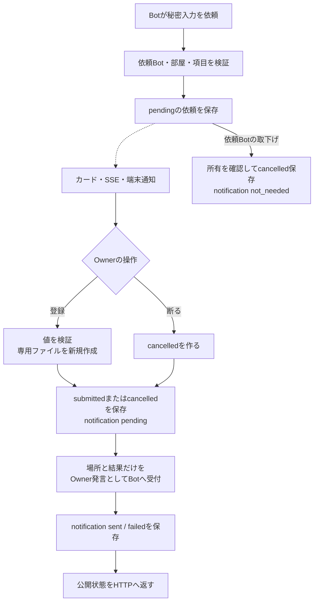
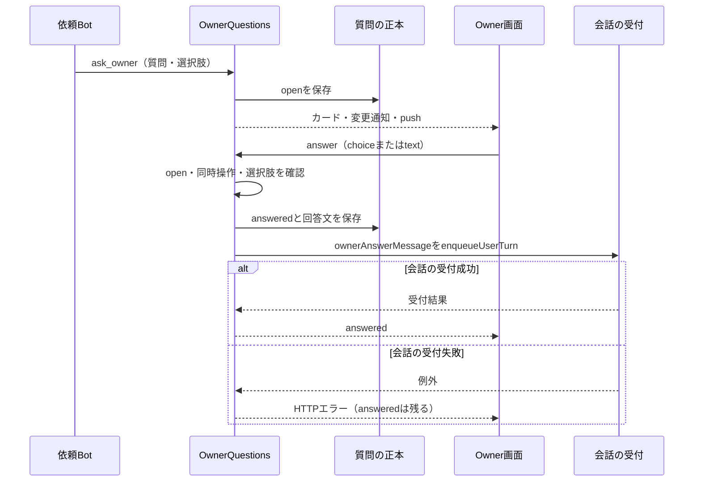
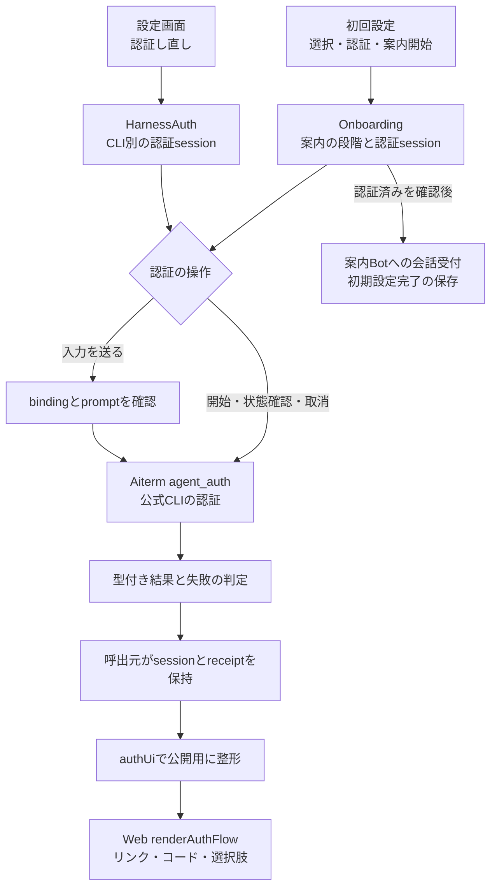
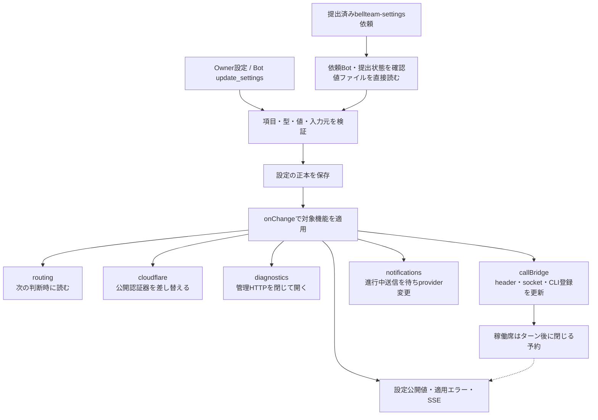
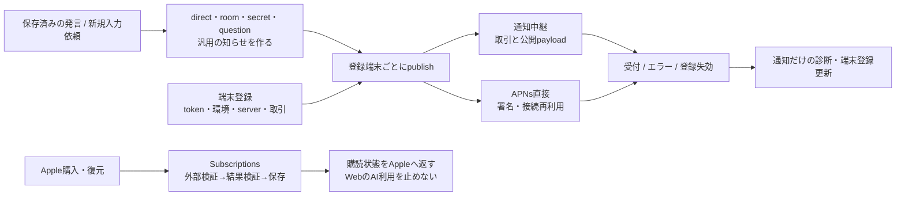
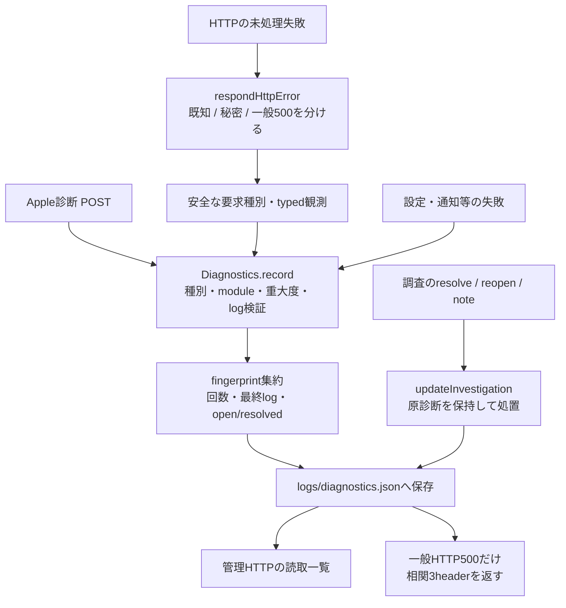

# 入力支援・認証・設定・通知の詳しい関係

[機能図](feature-map.md)から、利用を支える各機能を辿るための現状図。固定sourceは `546f232180515a2a8cd9098b943673170c49e3d4`。この文書は実装済みの振る舞いを説明する。改善案は[詳細化の進捗と整理案](detail-status.md)へ分ける。

矢印は呼出しまたは渡す値、破線は保存後の通知。応答の成功、記録の保存、Botの受付、Botの処理完了は別の到達点である。下の関数表は、図からコードへ降りる入口になる。

## 秘密入力：値の保存とBotへの知らせは別

| 処理 | caller → 実関数 | 読むもの / 変更するもの | 失敗時・返却 |
| --- | --- | --- | --- |
| 依頼 | MCP `request_secret` → `internalApi.requestSecret` → `createControlApi` → `SecretRequests.create` | Bot台帳・任意roomの参加者を読む。`state/secret-requests/<id>.json`へ保存 | 検証失敗は作成前に返す。保存後に`onRequest`を呼ぶ |
| カード | `create/get/initialize/save` → `CardTimelines.put` → `timelineView` | itemをBot/room別の表示索引へ投影 | 索引は正本ではない。値そのものを含まない |
| 値の提出 | Web `openSecretInput.finish` / Apple → public HTTP → `submit` → `finish` | `busy`で同じ依頼の同時処理を抑え、`state/secret-values/<toolId>/secrets/<id>`を0600/`wx`で新規作成 | 値・NUL・byte長を検証。既存ファイルを上書きしない |
| Owner取消 | public HTTP → `cancel` → `finish` | 状態だけを変更し、依頼Botへ通知 | 値ファイルは作らない |
| Bot取下げ | MCP `cancel_secret_request` → internal HTTP → `withdraw` → `finish` | `botId`一致・pendingを確認。取消と`not_needed`を保存 | 自分への新しい配送を起こさない |
| 結果を知らせる | `finish` → 組立ての`notify` → `secretCompletionMessage` → `messenger.enqueueUserTurn` | `path`と結果を通常会話へ保存。秘密値は渡さない | ここでの`sent`は会話の受付まで。通知例外は`failed`として保存して返す |
| HTTPの失敗 | `respondHttpError`のsecret専用分岐 | 既知エラーは404/409/400。不明エラーは固定文だけをDiagnosticsへ | 例外本文/stackを診断へ渡さない。500 `SECRET_OPERATION_FAILED`。この分岐は一般500用の相関3headerを付けない |

Webの入力値は送信前・画面非表示・dialog終了時に空にする。POSTはredirect拒否/no-store。HTTPはinternalからの値登録を拒否し、publicでは接続・Content-Type・cross-siteを確認する。これらは[secret-input.js](../../web/secret-input.js)、[http-application-api.mjs](../../src/http-application-api.mjs)、[secret-requests.mjs](../../src/secret-requests.mjs)がそれぞれ持つ責任である。

値ファイル作成後に状態保存が失敗する場合、HTTPエラーだけから「値は未保存」とは言えない。`finish`は値ファイルと依頼状態を一つのtransactionにしていない。現状の順序を図に残し、今回の図整理で自動再送やrollbackを加えない。

## 質問：回答の保存後に会話へ渡す

`runBellTeamTool.ask_owner → internalApi.askOwner → createControlApi → OwnerQuestions.create`が作成経路。`web/owner-question.js:renderOwnerQuestion.send → answer`が回答経路。保存は`state/owner-questions/<id>.json`、表示は既存`CardTimelines`、新規依頼の端末通知は`PushNotifications.question`である。

`OwnerQuestions.answer`は秘密入力の`finish`と違い、通知失敗を保存した`failed`値に変換せず例外を返す。画面の「送れませんでした」は回答未保存の証明ではない。再取得したカードはansweredになり得る。共通化できるのは既存の表示索引であり、回答・秘密値・通知失敗の状態機械は同一にしない。秘密入力にも質問にも新しい永続配送キューはない。

## 認証：公式CLIの状態を保持するのはAiterm

| 処理 | 実関数 / caller | 所有と境界 |
| --- | --- | --- |
| 初回状態 | `Onboarding.initialize/status/snapshot` ← GET setup | `state/onboarding.json`（席分離なしではshared）。既存Botがある導入では案内を再要求しない |
| CLIを選ぶ | `select` → `bots.create/update` → `callAuth(start)` | 旧authSession取消→harness保存→案内Bot準備→認証開始→session保存。途中失敗を一括rollbackしない |
| 案内を始める | `start` → `callAuth(status/cancel)` → `startConversation` | 認証済みを確認。会話受付後にstartedを保存。`prepareStartup`は未完案内Botの指示だけを追記 |
| 案内終了 | `complete` → `Subscriptions.completeSetup` → `save` | 内部MCP `complete_setup`はcallerのbotIdを渡し案内Bot一致を検証。publicは既存guideを使用 |
| 認証一覧と状態 | `HarnessAuth.list/status/observe` ← harness-auth GET | membersは台帳から数える。`sessions/receipts`はメモリ。認証情報本体は公式CLIが持つ |
| 認証開始・取消 | `start/end/cancel` → `call` | relogin対応、session有無、旧資格情報を失う警告を保持。end成功後にMapから削除 |
| 入力 | 両サービス`input` → `authResponse` → `call/callAuth(respond)` | 最新公開UIとbinding/session/prompt digestが一致する入力だけを送る。typed失敗のnot_issued/unknownを区別 |
| native応答 | `call/callAuth` → `authReceipt` → typed失敗/schema/status判定 | Aiterm結果を検証してからauth/receiptsへ保存。schema/statusの同順判定はauth-uiが所有し、各serviceは状態を保存する |
| 画面 | `openOnboarding` / `harnessAuthItem` → `renderAuthFlow` | UI部品は既に共通。pollは3秒、非表示・終了・errorで止め、revisionで古い取得結果を捨てる。入力エラー後は同入力を自動再送しない |

コードは[onboarding.mjs](../../src/onboarding.mjs)、[harness-auth.mjs](../../src/harness-auth.mjs)、[auth-ui.mjs](../../src/auth-ui.mjs)、[Web認証部品](../../web/auth-flow.js)。GETの状態取得でも、認証完了した旧認証端末を閉じる副作用がある。単なるDB読取りとして扱わない。

## 任意機能：設定を保存したことと適用できたことを分ける

`FeatureSettings.update`は入力検証、秘密ファイルの参照、設定の保存、適用を接続する。公開`list`は秘密値を空文字にし、`configuration`は本体内の適用先にだけ実値を渡す。内部HTTPはsecret直値を許さず、MCPが確定したbotIdと提出済みrequestIdで読む。外部HTTPではOwnerのvaluesを受ける。

| 対象 | 状態の持ち主 / 呼ばれる関数 | 失敗後に残るもの |
| --- | --- | --- |
| 設定正本 | `FeatureSettings.save` → `shared/tools/bellteam-settings/settings.json` | save後のonChange失敗でも設定は残る。`errors`はメモリ、公開値に適用失敗を付ける |
| 初期取込み | `initialize` | 保存済みJSON優先。無い時だけ環境・旧APNs設定・橋headerから作る |
| 起動時適用 | `createApplicationFeatures.initialize` | diagnostics/callBridge/notificationsの各失敗を記録し、他の適用を続ける |
| Cloudflare | `configureCloudflare/authMode/authorize` | localと公開JWT認証の選択。JWT検証は`cloudflareAccessAuthorizer` |
| 通話 | `configureCalls` → `listenCallBridge/writeHarnessConfig` → `stopForConfiguration` | header/socket/登録変更後の席反映は背景処理。設定HTTP200だけで全席の再読込完了としない |
| 自動振分け | `automaticRouting/judge`のcallbackが`configuration('routing')`を読む | 設定保存で新しい常駐処理を開始しない |
| 通知 | `PushNotifications.configure` | 旧providerを外す→inflight待ち→close→新provider。失敗時はproviderなし・診断ありになり得る |

実装は[feature-settings.mjs](../../src/feature-settings.mjs)と[application-features.mjs](../../src/application-features.mjs)。設定エラーを消すために保存値を架空の旧値へ戻す変更はしない。

## 通知と購読：サーバー会話の成功とは別の機能

| 機能 | caller → 関数 | 保存・返却の意味 |
| --- | --- | --- |
| 端末登録 | HTTP → `PushNotifications.register/unregister/save` | `state/push-devices.json`。token/環境/serverを検証、previousTokenを置換 |
| 返信/入力依頼 | `Messenger/RoomMessenger/SecretRequests/OwnerQuestions` → `direct/room/secret/question` → `publish` | 本文・秘密値を含まない通知。publishは呼出し元へ配達完了を返さずinflightを所有 |
| 通知結果 | provider.send → `recordFailure` / `unregister` | APNs失効は登録を除く。他は通知種別の診断。通知診断保存失敗も会話配送の再送にはならない |
| 通知終了 | `configure/close` → inflight待ち→provider.close | providerを変える前に既送信を待つ |
| 中継 | `NotificationRelayProvider.initialize/send/call` | 環境一覧、signedTransaction、acceptedを検証。30秒timeout、ここで反復再送しない |
| APNs | `APNsProvider.create/send/close` | 環境別署名Promise・接続を共有。idle接続は閉じ、次の送信で作る。15秒request timeout |
| 購入/復元 | HTTP verify → `Subscriptions.install/verify/validate/save` | 外部検証のアプリ/環境/期限/状態を検証し、利用者サーバーに保存 |
| 状態/再確認 | HTTP GET/refresh → `current/refresh/status` | 保存エラーや期限を反映。自動refreshは保存エラー時に進めず、明示forceで再確認。`canUseAI`はtrue |
| 旧動作確認 | HTTP setup-test → idle確認 → `runSetupTest` → `transport.setupTest` | 返信を確かめてsetupCompleteを保存。Onboardingの案内完了とは入口が異なる |

購読の外部検証サービス/Apple署名検証内部はこの本体図の境界外。BellTeam本体が所有する[subscriptions.mjs](../../src/subscriptions.mjs)と[push-notifications.mjs](../../src/push-notifications.mjs)の公開応答だけを扱う。端末へ表示されたかは通知の受付だけでは分からない。

## 診断：観測、集約、調査注記を分ける

`createControlApi`はIOS_受付、`respondHttpError`は本体HTTP、設定/通知の各サービスは固定codeで`record`を呼ぶ。`diagnosticReportContext`がlogから安全な分類を抽出し、同fingerprintの後発はcountを増やし再openする。診断原文・相関と、調査で分かったことを同じ値に上書きしない。

管理APIは別listener/合鍵で`list/setStatus/setNote`へ接続。`list`の追加調査ファイルは読取投影で、`updateInvestigation`のnoteは処置時のcount/statusと共に保存する。BugHubはその報告元を読む側であり、本体のDiagnosticsのMapを直接所有しない。

一般500は安全なframes/要求種別を記録し、保存成功時のみfingerprint/count/receivedのheaderを付ける。秘密経路は固定診断だけ、既知typedエラーは先に返す。[http-errors.mjs](../../src/http-errors.mjs)の順序が責任境界であり、共通catch一つへ潰さない。

接続確認で見つかったGoal診断の不一致（基底ではcode/moduleが未登録）は、現branchでDiagnosticsへ既callerの定義を登録して修理した。本物の組立てを使う局所試験で、inspectのunavailableとmutationのunconfirmedを返し、安全なstackを保存する。元の実障害との相関と本番反映を示すものではない。詳細は[整理と実装状況](detail-status.md)を参照。

## この文書の確認範囲

上記の入口・関数・保存順序・返却を固定sourceから確認した。保存中断やnative/外部通信を新たに実行した結果ではない。既存の検証先は `test/secret-requests.test.mjs`、`owner-questions.test.mjs`、`harness-auth.test.mjs`、`onboarding.test.mjs`、`auth-ui-server.test.mjs`、`feature-settings.test.mjs`、`push-notifications.test.mjs`、`subscriptions.test.mjs`、`diagnostics.test.mjs`、`application-runtime.test.mjs`。具体的な変更を行う時に関係する境界だけを確認する。
