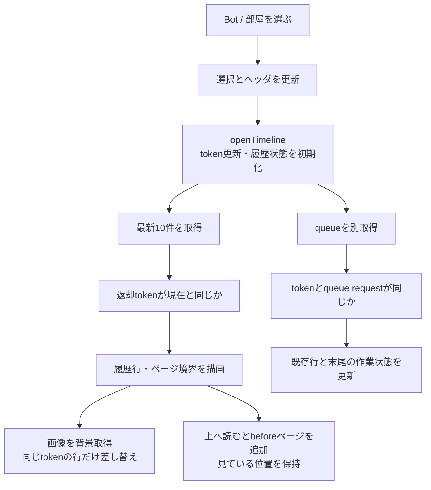
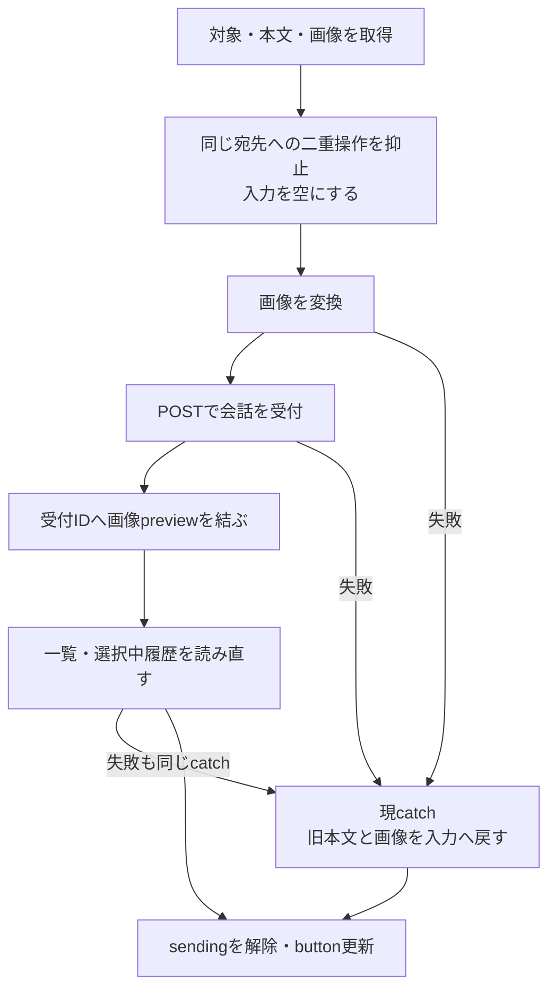
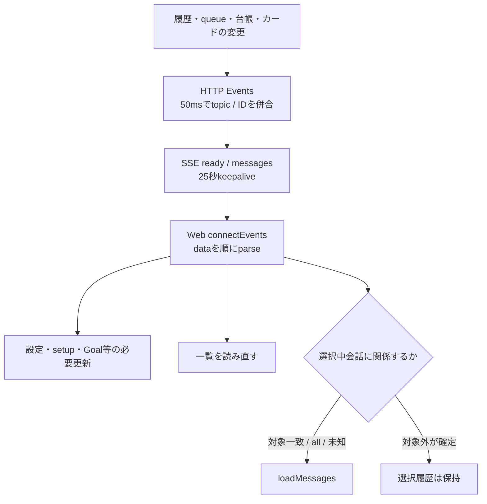

# Webの会話選択・送信・表示更新

固定source `546f232180515a2a8cd9098b943673170c49e3d4` の現状。[会話全体図](conversation-flow.md)の画面側を展開する。APIは[入口索引](entrypoints.md)、追加整理は[detail-status](detail-status.md)。Webの確認からAppleの画面回復を推定しない。

## 一つの画面で別々に持っている状態

| 所有する処理 | 現在の値・関数 | 他の処理へ渡すもの |
| --- | --- | --- |
| 接続・導入 | `setup/authMode/settings`、`boot/startConversations` | 初期設定終了後の会話開始。認証不能なら画面案内 |
| 一覧・Owner | `bots/rooms/owner`、`loadBots/renderBots/renderOwner` | 選択候補と最近の活動。サーバー正本の複製cache |
| 選択 | `selected/selectedType`、`selectBot/selectRoom/clearSelection` | 会話種別とID、ヘッダ、Goal/screen対象 |
| 履歴 | `timelineMap/token/oldestId/hasMore/loadingOlder` | 現在選択の行、前後ページ、古い応答を破棄する世代 |
| queue | `timelineQueue/request/error`、`refreshTimelineQueue` | 同じ会話の処理中行と停止button。履歴GETとは別の失敗 |
| 入力 | input DOM、`pendingImages/sending`、`claimMessageSend/sendMessage` | 送る時の本文と画像、対象ごとの一回の送信 |
| 表示補助 | `imagePreviews/imageFailures/stickToBottom` | 画像後読・末尾追従。nativeや配送状態の正本ではない |
| 既読 | `readReceipts`、localStorage | 会話ごとの最近ID。一覧の未読表示にだけ使う |
| 編集dialog | `editingBot/editingRoom/editingSchedule/models` | 送信対象の選択とは別の編集中情報 |

現在はこれらを`web/app.js`の同じstate objectから読み書きする。表は新しいstoreを実装したという意味ではなく、分割時に越えてはいけないデータ所有の整理である。

## 開いた会話の結果だけを描く

| 段階 | 実関数 | 入出力と失敗の行先 |
| --- | --- | --- |
| 選択 | `selectBot/selectRoom` | BotはGoal/screen、部屋は返信者pickerを設定。`loadMessages(false)`後に入力focus |
| 新しい会話 | `openTimeline` | tokenを増やしqueueを空にする。queueは待たず、履歴を先に描く。返却tokenが違えば捨てる |
| queue更新 | `refreshTimelineQueue` | token＋request番号で最新だけ適用。失敗はtimelineQueueErrorとして末尾に表示、履歴取得の失敗へ変換しない |
| 新しい履歴 | `refreshTimeline` | latest＋afterを並行GET。既存直近行を更新し、新IDだけ末尾へ追加。末尾追従中だけscroll |
| 過去ページ | `loadOlderMessages` | before＋20件、重複を除き前に追加。scrollHeight差で視点保持。finallyでloading解除 |
| 行 | `renderItem/renderItemElement` | 秘密カード、質問、本文/画像/配送/queueを描く。状態の変更要求は専用APIへ |
| 部屋の投影 | `roomTimelineItem` | routingと参加者別deliveryを表示用の一行へ。serverの部屋記録を直接書き換えない |
| 末尾 | `renderTail/renderQueueStatus/renderThinking` | 履歴にまだ無いqueue、Botのthinking、失敗表示、停止buttonを組む |
| 保存画像 | `loadStoredMessageImages/rerenderItem` | Blob URLをcache。取得失敗はimageFailures、token違いは描画しない |
| 既読 | `markConversationRead/loadReadReceipts` | 最新IDをlocalStorage。サーバーへ読了記録を送らない |

サーバーは`createMessageViews.sources`で直接/部屋の履歴にカード索引を合成し、`timelinePage/webMessage`でページと画像URLを返す。部屋には秘密カード、直接会話には秘密と質問カードがある。`TimelineIndex`は表示順/ページ検索、`ConversationStore/RoomHistory`は記録の読取であり、Webのstateはそれらの保存を代行しない。

## 送信は三つの段階を持つ

これは現状図。送信受付と表示更新の失敗が同じcatchへ集まっていることが整理対象である。

`sendMessage`はtargetType/targetId/sendKeyを最初に取る。`claimMessageSend`は空本文＋画像なし、または同じ宛先が送信中なら受付しない。その後inputを空にして画像を変換し、会話POSTを一回呼ぶ。成功後に一覧を更新し、同じ選択なら履歴を開き直す。POST応答が読めたこととAIの回答完了は別である。

現catchは画像変換・POST・後続GETの失敗を区別せず入力を戻す。また失敗の間に会話が切り替わった場合や新しい入力がある場合でもinput DOMへ旧本文を直接書く。`stopMember`は同じ会話か確認して表示するが、sendMessageのcatchには同じ所有の確認がない。これらを[整理案D4](detail-status.md#d4-webの送信結果と表示更新結果を分ける)で切り分ける。実際の発生履歴や配送結果を、このsourceだけから補完しない。

## 変更通知は履歴そのものではない

`createMessageEvents.startMessageWatch`は各watchを登録し、既知topicと対象を併合する。未知/欠落、履歴の置換、対象不明はallへ戻す。起動途中のwatch失敗でも既登録分を閉じる。`server.close`はSSEを終え、watch終了エラーをclose結果へ返す。

Webの`refreshFromEvent`はsettings/setup/Goalの特定処理の後、loadBotsと必要なloadMessagesを接続する。`eventAffectsTimeline`は第一段で追加した対象判定。ready `{}`・all・未知topic/ID不足は全体更新する。一覧は他の会話の活動にも関係するので毎回取得する。

現`connectEvents`はstream読取と各GET更新を同じtryでawaitする。TypeError/429/5xxは1.5秒後に再接続し、Abortは終了、その他は画面へ停止を表示する。正常EOFはloopを抜けて戻る。これは現在の分岐を示したもので、正常EOF後の自動再接続があるとは書かない。履歴GETの失敗とSSE自体の失敗の分離も、今後の設計確認対象である。

## 編集と補助機能への接続

| 操作 | 主な関数群 | 現在読むもの / 処理先 |
| --- | --- | --- |
| Owner・規範・任意設定・認証 | `openOwnerDialog/saveOwner/refreshFeatureSettingsForm`、各view部品 | Owner正本、規範、settings、HarnessAuth、AiControl。profile保存とrules保存は別要求 |
| Bot作成/編集 | `openBotDialog/renderModelOptions/renderEffortOptions/saveBot` | editingBotとmodel catalog、Bot API。進行中の設定反映表示はconfigurationApplication |
| Bot停止 | `stopMember/requestMemberStop` | botIdごとのsingle flight、別会話へ結果を表示しない。停止後GET失敗と停止失敗は既に別catch |
| Bot再起動/削除 | `restartSelectedSession/deleteSelectedBot` | editingBotのID、202後に一覧再取得。完了を202だけで確定しない |
| 記憶/知識 | `openMemoryDialog/remember/recallMemory/recordKnowledge/searchKnowledge` | 選択Bot、scope、各memory/knowledge API |
| 部屋編集/削除 | `openRoomDialog/renderRoomRepresentativeOptions/saveRoom/deleteSelectedRoom` | editingRoom、現在のBot一覧、Room API |
| 予定 | `openScheduleDialog/editSchedule/scheduleRequest/saveSchedule/loadSchedules` | 選択owner、editingSchedule、各予定API。手動run/削除は一覧内のbutton |
| アバター | `createAvatarEditor/avatarColor/rgbToHsl/applyAvatar` | 各編集のimage/cropと表示cache。共通editorは既存 |
| 会話画像 | `addPendingImages/readImage/renderPendingImages`、image-gallery | 入力添付と保存済み画像viewerを区別 |
| terminal画面 | `openScreen/refreshScreen/closeScreen` | 選択Botのscreen API、表示中のtimer |
| Goal | `goalsView` | 選択Bot/一覧、native binding付き操作。独自Goal正本は持たない |
| 書出し・設定画 | export button / `openCharacterSheetDialog` | 保存履歴export / character-sheet一覧とfile |

この最後の表は接続の索引であり、全dialog内部の関数分割はまだ確定していない。会話周りのsource順序は確認したが、新しいGUI操作や通信失敗試験は行っていない。
