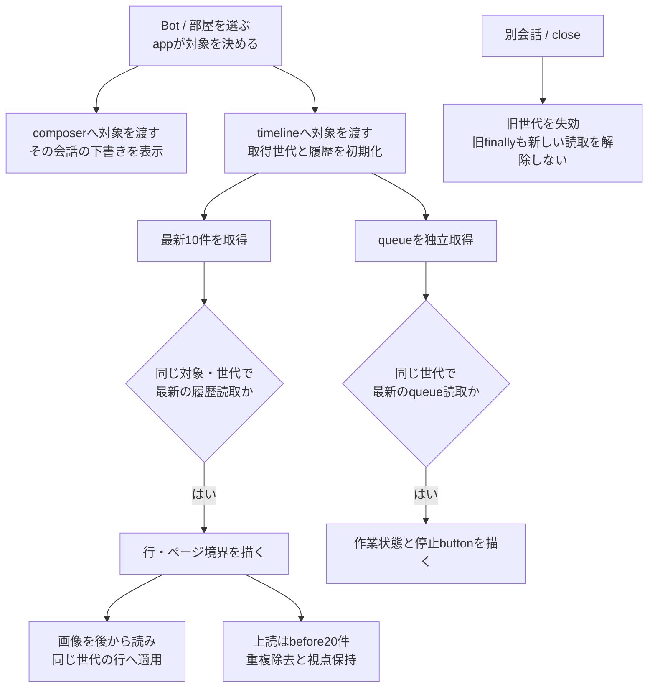
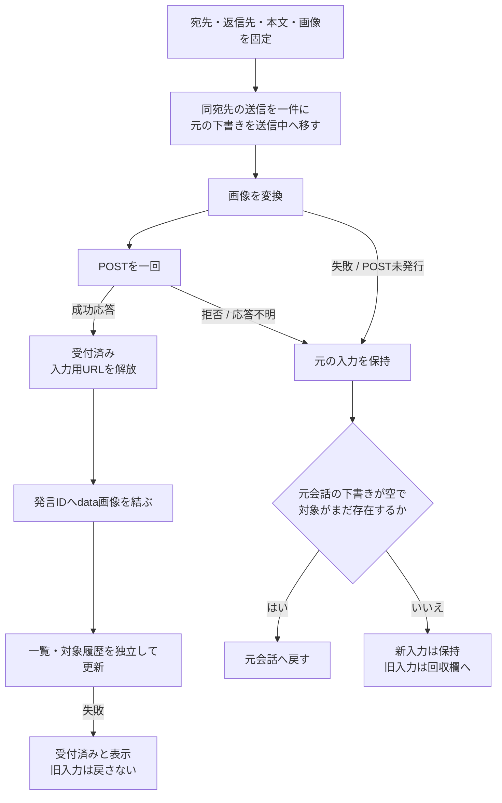
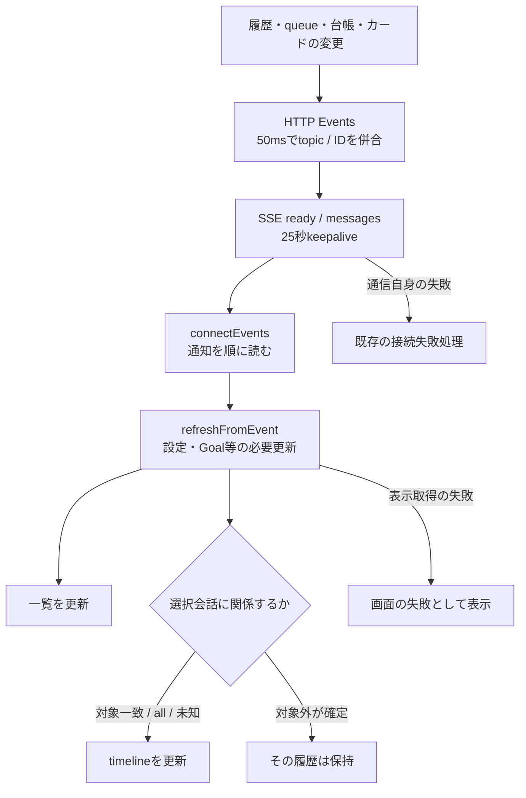

# Webの会話選択・送信・表示更新

[全体図](feature-map.md)の画面側を、本branchの実装から説明する。APIは[入口索引](entrypoints.md)、編集・画像・Goalは[管理詳細](web-management-details.md)。基底の巨大なapp stateは既に分割した。一覧取得の競合も[最終照合で見つけた修理](web-final-gaps.md)で整理した。

## 選択と各機能の状態を分ける

appは組立て・一覧・会話選択・機能間の接続を持つ。各機能へ必要な対象やcallbackだけを渡す。画面の状態を持つことは、サーバーの記録やnativeの実行状態を所有することではない。

| 所有者 | 状態 / 実際の窓口 | callerと受渡し |
| --- | --- | --- |
| [app.js](../../web/app.js) | setup/authMode/settings、bots/rooms/owner、selected/type、SSE接続、既読、部屋別返信先 | `boot/startConversations/loadBots/selectBot/selectRoom/clearSelection`。一覧から明示的なtargetを各viewへ |
| [conversation-composer.js](../../web/conversation-composer.js) | 会話別drafts、送信中snapshot、sending、回収欄retained | app→`select/clear/addImages/send/update/showError`。`onAccepted/onSelect`をappへ返す |
| [conversation-timeline.js](../../web/conversation-timeline.js) | 対象、履歴Mapと前後ページ、queue、取得世代と読取順、scroll、色cache | app→`open/refresh/close/updateTarget/isBusy/updateStops`。`onQueueChange/onStop`だけappへ返す |
| [message-images.js](../../web/message-images.js) | 発言ID別preview、取得中Promise、失敗集合、所有URL | app→`remember/close`、timeline→`load/get/failed`。可変Mapをappへ公開しない |
| 各編集・補助view | 開いた対象、未保存入力、読取/保存中、局所URL/timer | app→各`open(target)`。一覧の変更通知と選択はappへ返す。[管理詳細](web-management-details.md) |
| [goals.js](../../web/goals.js) | Bot別snapshot、draft、binding、観測revision | app→`open/select/refresh/refreshSelected/refreshOnEvent`。Goalの正本はnative |
| appの既読 | `loadReadReceipts/markConversationRead`、localStorage | 最近IDから一覧の未読を描く。サーバーへ読了記録を送らない |

`loadBots`はBot/room/Ownerの三要求を並行して受け、その一式を一覧へ反映する。保存正本ではなく表示用cacheである。`catalogueRead`で一覧の読取順を持ち、最新の結果だけ適用する。Ownerプロフィール保存応答とBot/room削除受付は、先行読取を失効させて受理した値を表示する。timelineのtokenは履歴を守り、上流の一覧にはこの別の所有が必要になる。

`loadBots`は適用したらtrue、旧読取なら成功/失敗を表示へ反映せずnull、最新読取の失敗はthrowする。Bot/room保存と再起動後の自動選択はtrueの時だけ。composerの受付後更新はnullを表示失敗にせず、実GET失敗と履歴のfalseだけを扱う。起動・SSE・停止後にも同じ窓口を使い、古い結果を避けるための再GETは増やさない。

## 開いた会話の結果だけを描く

| 段階 | caller → 実関数 | 結果・失敗の行先 |
| --- | --- | --- |
| 選択 | app `selectBot/selectRoom → loadMessages(false)` | ヘッダ・composer・Goal/screen/返信先を接続。timelineのMapを触らない |
| 新しい会話 | `open → readHistory(openTimeline)` | 対象をcopyしtokenとhistoryRequestを進める。queueを待たず本文を描く |
| queue | `openTimeline/refreshTimeline → refreshTimelineQueue` | tokenとqueueRequest一致だけ適用。失敗は末尾に表示、本文読取とは独立 |
| 新しい履歴 | `refresh → readHistory(refreshTimeline)` | latest/afterを並行取得。同対象でも古い返却を適用しない。後着画像も同token |
| 過去ページ | scroll listener → `loadOlderMessages` | before20件を重複除去して先頭へ。scrollHeight差を足す。finallyは同tokenだけ解除 |
| 行とカード | `renderItem/renderItemElement/roomTimelineItem` | 秘密・質問の既部品を使う。完了callbackも元token一致時だけ該当行を描き直す |
| 末尾 | `renderTail/renderQueueStatus/renderThinking` | queue/処理中/error/停止button。停止実行はappの`stopMember`へ |
| 読取失敗 | `readHistory` | 同じ世代/読取のエラーを履歴末尾へ表示しfalseを返す。SSEの切断へ変換しない |
| 画像 | `loadStoredMessageImages → messageImages.load → rerenderItem` | cacheが取得とURLを所有し、timelineが描画先の世代を所有する |

サーバーは`createMessageViews.sources → timelinePage/webMessage`で保存履歴とカード索引を合成する。部屋には秘密、直接会話には秘密と質問カードがある。`TimelineIndex`はページ検索、`ConversationStore/RoomHistory`は保存記録の読取であり、WebがJSONLを書き換える経路ではない。

## 送信受付と表示更新を別の段階にする

appの`sendMessage`は返信者必須条件を確認し、composerの`send`を呼ぶ。composerは`capture → claimMessageSend`で対象・本文・File/URL・返信先を**画像変換前**に固定する。送信中も新しい下書きを書けるが、同宛先POSTは受付まで一件。finallyでsendingを解除し、受付後の`onAccepted`失敗では元本文を戻さない。

`onAccepted`はappへ渡したcallback。画像previewをcacheへ渡し、一覧と現在表示中の対象履歴をallSettledで更新する。どちらかが失敗しても二回目POSTはしない。API成功はAI回答完了ではない。POST応答不明では未配送と断定せず、再送前に会話を確認するよう表示する。

`renderRecovery`は「保持した入力」に元本文、画像、宛先、理由を出す。新しい入力を連結・上書きしない。「入力欄に戻す」は空の元下書きへ移して会話を選ぶだけで、送信は利用者の明示操作。削除済み対象は復元不可だが、本文と画像は読める。「破棄」と添付削除はそのURLを解放する。これはページ内の状態であり、再読込後まで保管するstoreではない。

## 変更通知は履歴そのものではない

`createMessageEvents.startMessageWatch`はwatchを登録してtopicと対象を併合する。未知/欠落、履歴置換、対象不明はall。開始失敗でも既登録watchを閉じ、server終了時もwatch終了エラーを保持する。全producer表は[第一段の表](refactor-plan.md)を参照する。

appの`refreshFromEvent`はsettings/setup/Goal処理と一覧・必要履歴を接続する。`eventAffectsTimeline`はready/all/未知topic/不足IDを全更新へ戻す。一覧には他会話の活動も必要なので毎回読む。表示GETの失敗はcatchして表示へ返し、SSEの再接続理由にしない。

`connectEvents`の通信側はTypeError/429/5xxで既存の1.5秒再接続、Abortは終了、その他は接続停止を表示する。正常EOFは戻る分岐で、自動再接続があるとは扱わない。ここを今回のリファクタで通信基盤ごと作り直していない。

## 操作の接続と確認範囲

`stopMember`は対象Bot別single-flightで`requestMemberStop`を一回呼ぶ。停止応答と後続一覧/履歴GETを分け、表示は開始時の会話が同じ場合だけ。書出しはクリック時のtype/idを固定してexportをGETし、一時Blobをdownload後revokeする。一覧の競合と失敗の修理経緯は[追加修理](web-final-gaps.md)に記録する。

確認先：`conversation-composer`、`timeline-open-queue`、`message-images`、`web-event-refresh`、`chat-input`、`http-server`の局所試験。実Web＋人工APIで入力の回収とPOST回数も確認した。実配送やApple画面の成功の証明ではない。全体試験1088件は成功。独立採否は別の未完工程である。
