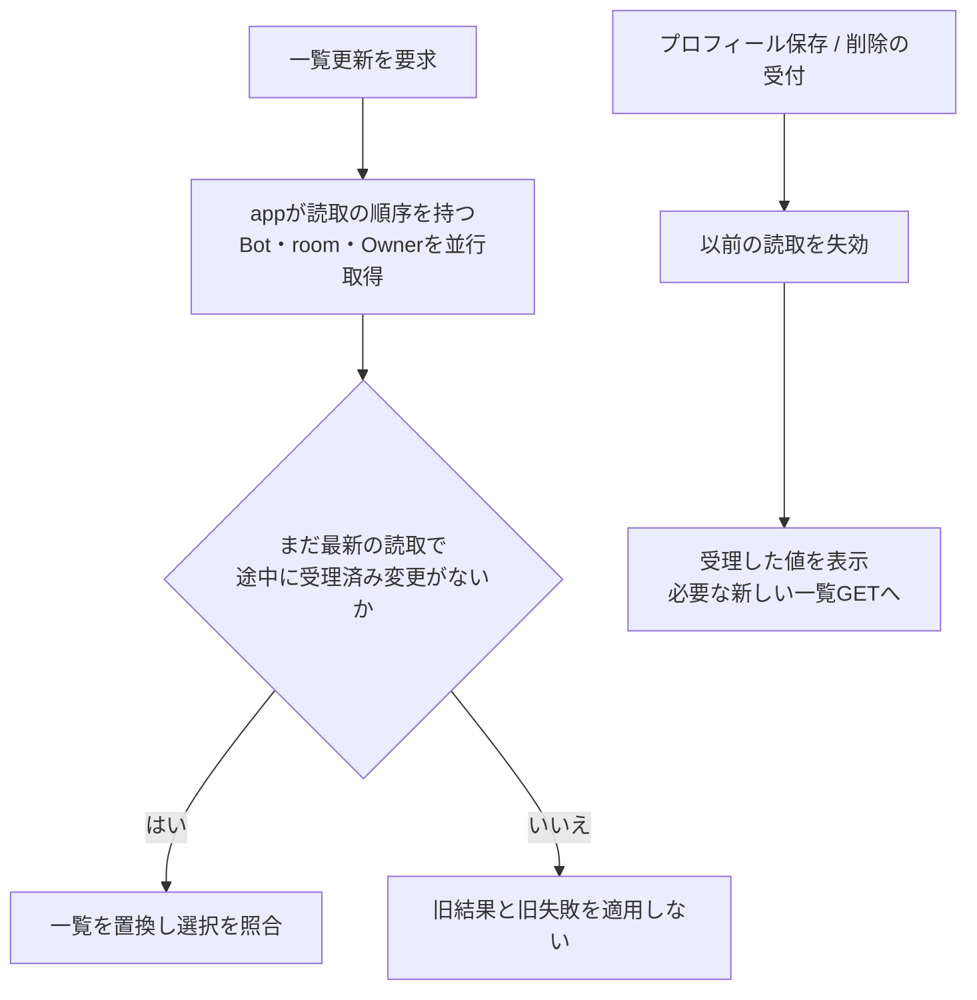
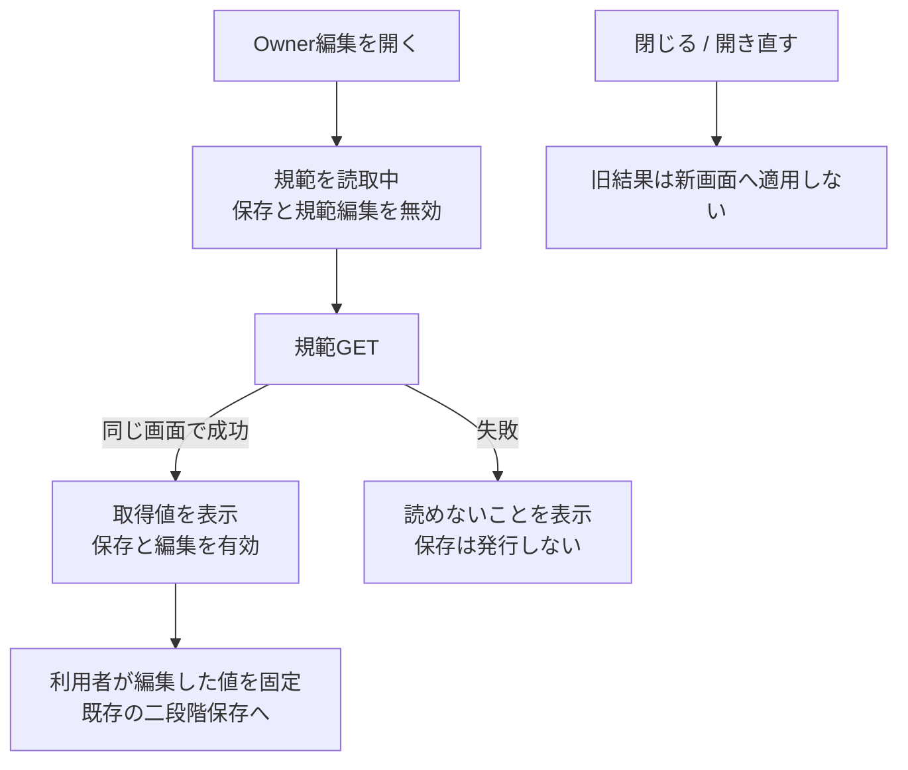

# 最終照合で見つけたWebの残る接続

Astraが製品head `4704446416ffa56ac8f3c6ab8e78bac57234056e` を図と照合して確認した追加設計。**G1〜G4はSolで実装し局所確認済み。Astraの図/code再照合と全体試験は未完**。旧事故の根因や実端末での発生を示すものではない。既存の状態・API・保存形式で修理し、永続queue/新ID/自動再送は足さない。

Root原本は `integrations/feature-map-refactor-20261101/final-map-probes/`。`ownership.json`は現loadBots実関数のVM実行＋現Owner editorの人工DOM/応答、`feature-browser/result.json`は現HTML/実module＋人工APIのブラウザ観測。3＋2の反例であり、局所の旧成功を否定せず未検証だった順序を追加する。

## G1 一覧の取得と、受理した変更の順序

現`app.loadBots`は三つのGETが揃ったら無条件にbots/rooms/ownerを置換する。二回の一覧取得を逆順に完了させると、新しい一覧のBotを選択した後、古い空一覧からclearSelectionが呼ばれた。保存済みOwnerの`onOwner`、削除受付の`onDeleted`も、前から走っているGETに対して新しさを持たない。

所有は引き続きappの一覧機能。ページ内の読取番号/実体だけで足りる。サーバーへ世代を送ったり、台帳の新しい正本を作ったりしない。`loadBots`の結果適用を小関数へまとめても、全stateを別moduleに渡すためのwrapperにはしない。

最新の成功だけが一覧、選択、既読、timeline.updateTargetを更新する。古い失敗を新操作の失敗として表示しない。受理したOwner更新・削除で先行読取を失効させる。Bot/room保存後はその後に始める通常一覧更新を使用する。

callerは起動、送信受付後、Bot/roomの保存/削除/restart、停止後、SSE。**古い読取を無視した結果をGET失敗と同じfalseにしない**。適用/旧結果を区別して、保存後の自動選択はその更新が適用された場合だけ行い、composerに架空の表示失敗を返さない。最新GETの本当の失敗は既画面を保持し、既callerの表示エラーへ返す。新しい反復GETは追加しない。

必要確認：新旧返却逆転、古い失敗、最新失敗、選択とtimeline、Owner保存/削除後に先行GETが戻る順序。既`web-bot-avatar-list`の軽量画像表示契約、SSE・送信受付後・editor callbackの試験を維持する。全体試験をこの修理のために先走らせない。

## G2 規範の読取が終わる前に空欄を保存しない

今回のowner editorはdialogを先に開くようにした。規範GET待ち中の保存でも、GET失敗後の保存でも、profile PATCHの後に空のrules PUTが発行される反例を確認した。現コードは未読と利用者が明示的に空にした状態を区別していない。

同じopenの`rulesLoaded`と既ownerだけで実装する。初回GET中/失敗後は保存buttonを無効にし、submit handlerでも未読を拒否する。規範欄は読み込み中disabled、他のプロフィール入力は保持できる。成功後だけ規範欄と保存を有効にする。失敗後は閉じて開き直す明示操作で読む。自動GET再試行や規範の別storeは作らない。

これは規範の空文を禁止する修理ではない。成功した読取の後、利用者が消した空文は元契約どおり送る。profile成功/rules失敗の部分成功と、保存中の新入力・別open保全は既実装のまま維持する。

必要確認：GET pending/failed時にPATCH/PUTとも0、成功後の明示空文は許容、close/reopen旧結果は適用0、profile部分成功は維持。実HTMLの保存buttonはform外のheaderにあり、参照とdisabledも実DOMで確認する。

## G3 任意機能の保存で、別の入力を描き直さない

`owner-editor.refreshFeatures`は保存後も全機能へ`renderFeatureSettings`を呼び直す。ブラウザ反例では、機能AのPATCH待ち中に機能Bへ書いた新入力が消えた。さらに`onChange: () => refreshFeatures()`がその時のownerを読むため、旧画面のPATCH成功から再openした新画面まで描き直した。

既存の初回描画と状態更新の二窓口を使う。open時だけ`renderFeatureSettings`で入力を作る。以後の保存後GET/SSEは`refreshFeatureSettingsStatus`で状態・適用エラーを更新し、別のフォームやその間の新入力をreplaceしない。必要な登録済みplaceholderも入力valueを変えずに更新する。新しい汎用form基盤は不要。

callbackは描いた時の`opened`を捕まえ、開始前とawait後に現ownerか確認する。同openで重なるfeature読取にも局所の順序を持つ。旧画面の完了から新画面のGET/DOM更新を始めない。設定の保存bodyとenabledはsubmit時に固定し、秘密値は既規則どおりsubmit/close/非表示で除く。

`renderFeatureSettings`はPATCH成功と後続表示更新失敗も分ける。保存済みなのに表示GETが失敗した場合は、その段階を示す。Cloudflare設定後に認証が必要な場合の既案内は維持し、判定に送信後のcheckboxを使わない。再PATCHは利用者の明示操作だけ。

必要確認：A保存中のB新入力、A自身の新入力、close/reopen、GET逆転、PATCH成功→GET失敗、送信時enabled/秘密値の除去。既onboarding/auth/feature UIの契約は維持。実ブラウザで二つの観測反例が修理されたことを確認する。

## G4 背景削除の受付を完了と呼ばない

`bot-editor.remove`の受理後表示エラー文は「削除しました」になっているが、Bot DELETE202は背景受付である。「削除操作を受け付けました。表示を更新できませんでした」等の受付表現へ揃える。room DELETE204は完了後なので同じ文言へ機械的に変えない。対象固定とsingle-flight、旧画面への失敗表示抑制は維持する。

## 実装と次の確認

上のまとまりをSol Highで実装する。先に全caller/test/fixture/asset mapを確認し、観測した順序の小さい試験を残す。既部品を移動しただけとして完了せず、元の保存API・認可・秘密方針を変えない。

その後Astraでこの計画と現状図を同期し、全利用機能の説明に新しい穴がないか確認する。必要全体試験一回とセンチ独立採否はその後。未修理を図だけで解決済みにせず、試験/本番/元事故回復はそれぞれ分ける。

## Sol実装の確認

一覧read順と受理済み変更の失効、規範rulesLoaded、初回描画と状態更新の分離/開いた対象とread順、背景削除の受付文言を実装した。関連20passと追加6passは重複があり合算しない。実HTML/実module＋人工APIで規範未読時write0、同open/再openの新入力保持、設定GET逆転、保存済みGET失敗を確認。実規範/実秘密/本番を操作した証明ではない。旧5反例は別原本を保持し、今回全体試験はまだ実行していない。
