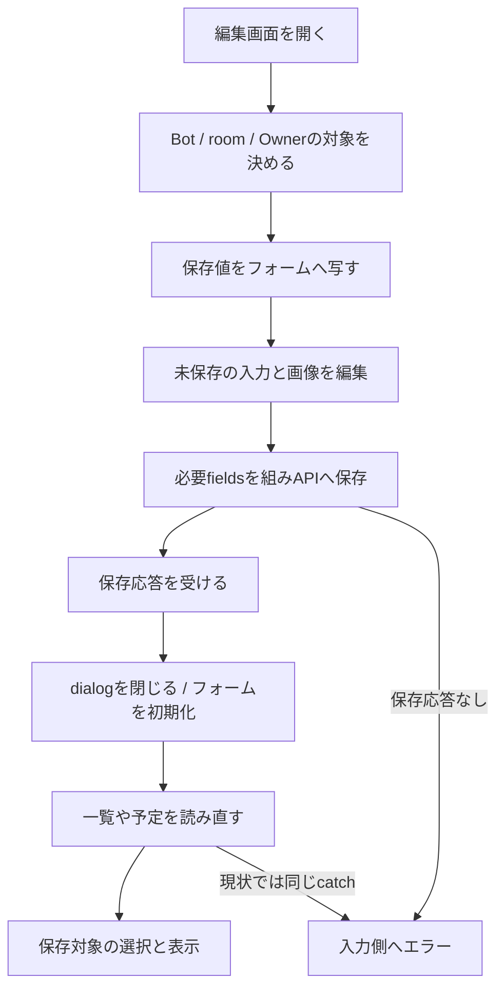
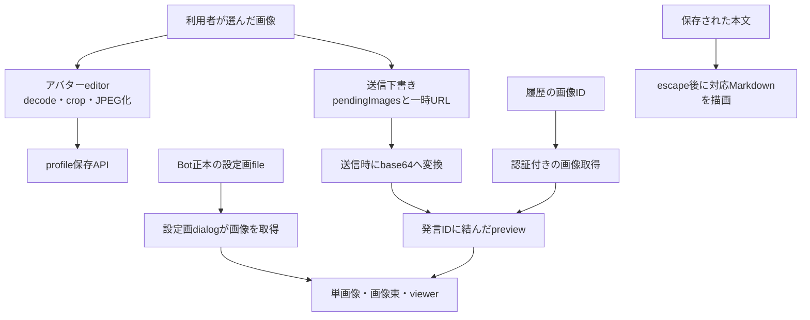
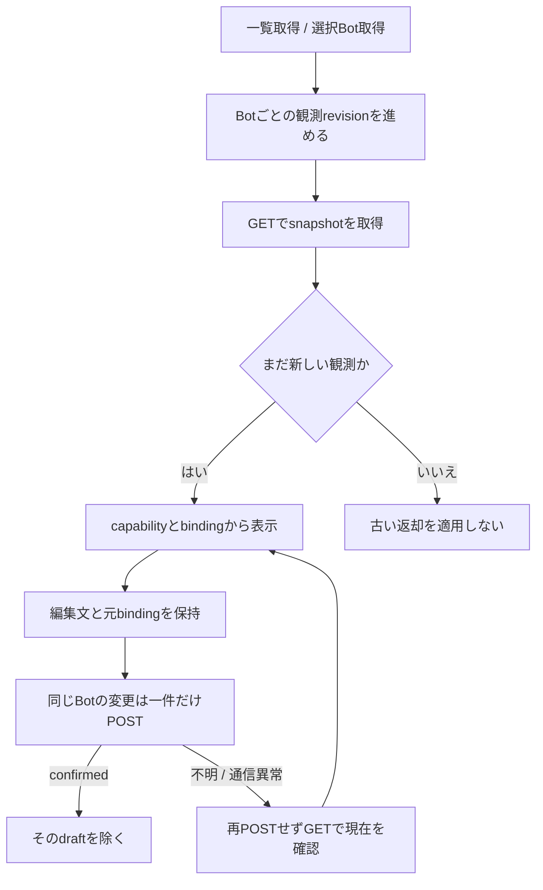

# Webの編集・画像・Goal

固定source `546f232180515a2a8cd9098b943673170c49e3d4`。[会話Web](web-details.md)に加え、画面で編集する対象と非同期結果の持ち主を示す。Apple単独UIの設計ではない。

## 編集している対象を、会話選択から分ける

| 機能/入口 | 主な関数 | 所有する状態・返却後の振舞い |
| --- | --- | --- |
| Owner設定 | `openOwnerDialog/saveOwner/renderOwnerLinkRows/addOwnerLinkRow` | ownerとrulesは別API。任意機能/認証部品は既存別module。閉じる/非表示でpassword入力を空にし、認証pollだけ止める |
| Bot編集 | `openBotDialog/renderModelOptions/selectableEfforts/renderEffortOptions/saveBot` | editingBot・modelLoad・models・avatar editor。dialog closeでモデル読取をabort。候補外の保存effortを黙って変更しない。保存APIはPOST/PATCH、一件のsingle flight |
| Bot設定表示 | `renderBotConfigurationStatus` | pending/failed/acceptedと保存値を区別。GET失敗を「適用済み」にしない |
| 部屋編集 | `openRoomDialog/renderRoomRepresentativeOptions/saveRoom` | editingRoomと参加者チェック、代表は選択参加者内。保存後一覧GET/選択まで現状同じtry。Bot保存と同じsingle-flight実装は持たない |
| 削除・restart | `deleteSelectedBot/deleteSelectedRoom/restartSelectedSession` | 確認と操作中ボタン。サーバー側背景受付と削除完了を混ぜない。部屋削除は履歴/予定も対象と表示 |
| 記憶・知識 | `openMemoryDialog/remember/recallMemory/recordKnowledge/searchKnowledge` | 現状はeditingBotを対象として再利用。scopeを明示してAPIへ渡す。読取結果はtextContent。保存成功で入力を空にする |
| 予定フォーム | `openScheduleDialog/editSchedule/scheduleFormValues/scheduleRequest` | editingScheduleとフォーム値。ただしAPIの対象は`schedulePath`が現在のselected/typeから毎回作る。編集対象の独立snapshotはまだない |
| 予定操作 | `saveSchedule/loadSchedules`内run/remove listener | 保存→フォームreset→再読。完了したonceを表示から除外。runは一度POSTしボタン表示を変える。timerはボタンを戻すだけで再送しない |
| 時刻変換 | `localDateTimeValue/scheduleFormValues/scheduleRequest` | onceはローカル入力↔ISO、定型cronはフォームへ戻し、複雑なcronは式を維持。既timezone優先、未指定はブラウザtimezone |
| 部屋の返信担当 | `selectedTargets/renderTargetPicker/renderTargetButton` | roomTargetsはroom別の画面内Set。退会者を除き未選択はnull。自動選定の有効状態と、全員へ配送する仕様を別に表示 |

保存API成功後の一覧GET失敗を「保存失敗」とするcatchはBot/room/予定にも存在する。会話POSTの[D4](detail-status.md)とは別のcaller群である。整理する場合、対象・保存結果・後続表示結果を分け、元操作を勝手に再発行しない。フォーム間で検証や削除の副作用が違うため、汎用CRUD画面は導入しない。

## 画像には三つの所有単位がある

| 部品 | 所有と片付け |
| --- | --- |
| `createAvatarEditor` | Bot/Owner/roomの3instanceが別のavatarData/crop/drag/changedを持つ。decode用blob URLはfinallyでrevoke。name/color/DOMだけを注入し、既に共通化されている |
| `readFile/zoomImage/startDrag/moveImage/endDrag/clamp/draw/syncPreview` | canvasの範囲へcropを制限し、確定時にJPEGデータをpreviewへ反映。未保存editorから台帳を直接変更しない |
| `addPendingImages/renderPendingImages/removePendingImage/clearPendingImages/readImage` | 下書きFileとobject URL、送信前変換を担当。履歴の画像cacheと別。D4で旧送信と新入力の所有を分ける必要がある |
| `loadStoredMessageImages/rerenderItem/renderItem` | timelineTokenと会話項目IDを使う。秘密/質問cardもtoken一致時だけ該当項目を置換。preview未取得/取得失敗を表示で区別 |
| `openCharacterSheetDialog` | editingBotの正本一覧→各認証付きblobを表示。現状はclose時のURL回収・非同期結果の世代検証を持たない。単なるfetch成功を長期資源管理まで成立としない |
| `renderImageStack/openImageViewer/stepIndex` | viewerはURL配列・現在index・altを自身で所有。前後/矢印/swipe、dialog closeは表示srcを除く。渡されたURLの生成者ではないので独断でrevokeしない |
| `avatarColor/rgbToHsl` | Bot IDごとの色Promise cache。decode失敗は空色、会話/台帳の事実には影響しない |
| `richTextHtml/renderBlocks/renderList/renderTable/inlineHtml` | 文字列をescapeし対応MarkdownだけHTML化、URLは既`linkifyHtml`。新ライブラリや別parserを増やさない |

画面取得`openScreen/refreshScreen/closeScreen`は開いている間の2秒pollと80桁表示を所有する。会話本文を取得するAPIとは別。現状refreshScreenは送信前のBotを捕まえるが返却時の選択token確認はない。D5の非同期表示所有を検証する具体的なcallerとして扱う。

## Goal画面は既に別の観測状態を持つ

`goalsView`はappの巨大stateへGoalを保存せず、snapshots/pending/drafts/observationsを閉包内に持つ。`refresh`の一覧revisionとBot別revisionは違う用途で、他Botの新しい変更結果を古い一覧で消さない。`refreshSelected/select/refreshOnEvent`は現在の選択を窓口にする。

`mutate`は対象Bot IDと画面のbindingを固定する。応答失敗では一回GETするだけでPOSTを繰り返さない。処理中に別の観測が進んだ場合、finallyは同じbindingの時だけ現在値を照合し、違うthreadやunknownを古い変更返却で置換しない。field capabilityがcombined=falseなら目的と予算を別々に編集し、予算空欄を消去命令へ変えない。

## 次の分割案

`createAvatarEditor`は局所状態を既に閉じているので、3callerの引数を保って`avatar-editor.js`へ置ける。予定は`{type,id,memberIds}`を開いた時に固定するeditorがフォームとAPI pathを所有し、一覧再読完了を会話選択変更へ直結させない。timelineは[Web詳細](web-details.md)の読取・適用・描画を一つの窓口で持ち、appは選択と機能間接続を担う。Goal/秘密/質問/認証の既存部品は再包装しない。

これらは設計案。まだ製品変更もブラウザ操作も行っていない。選択変更中の保存/GET、decode中のdialog再開、URL寿命について局所反例を作ってから、必要な範囲を整理する。

実装：[app.js](../../web/app.js)、[goals.js](../../web/goals.js)、[image-gallery.js](../../web/image-gallery.js)、[rich-text.js](../../web/rich-text.js)。API接続先は[入口索引](entrypoints.md)、[台帳](registry-details.md)、[記憶](memory-details.md)、[制御](control-details.md)。
