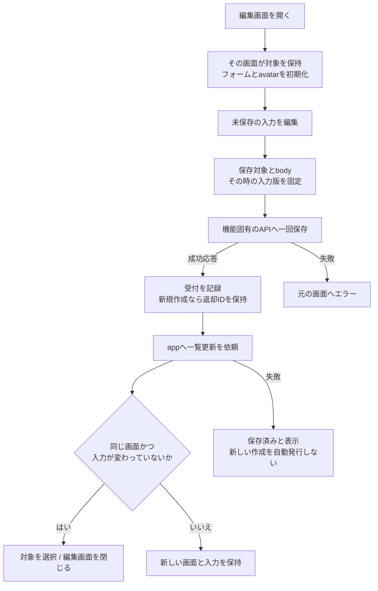
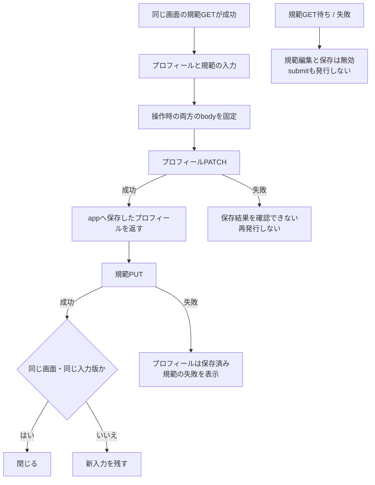
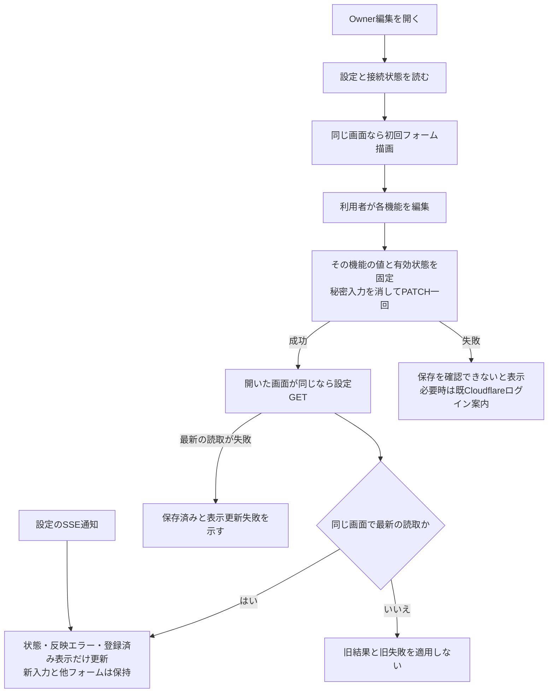
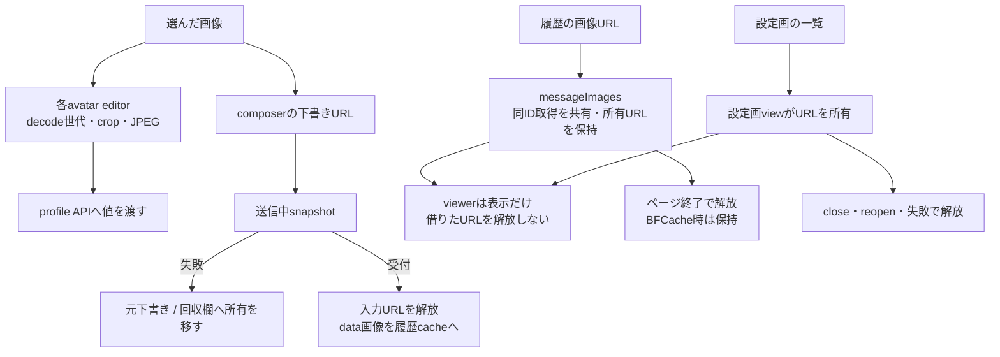
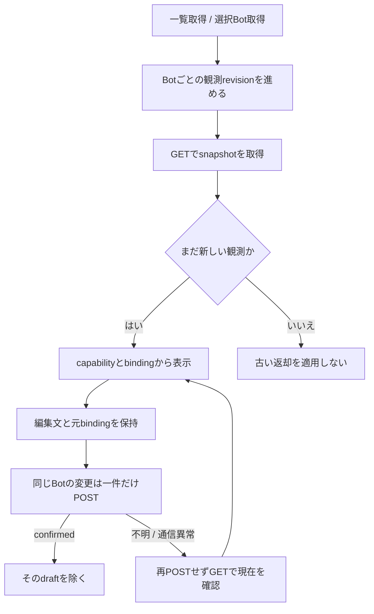

# Webの編集・画像・Goal

[会話Web](web-details.md)に加え、各画面が開いた対象と非同期結果をどう持つかを示す。本branchの実装を説明し、最終照合で見つかった問題と修理は[追加修理](web-final-gaps.md)へ記録する。Apple単独UIの設計ではない。

## 編集対象は各画面が持つ

| 機能 / app側caller | 実装と主な関数 | 所有・保存後の結果 |
| --- | --- | --- |
| Bot作成・編集 / `openBotDialog` | [bot-editor.js](../../web/bot-editor.js) `createBotEditor/open/saveBot` | owner.bot、saving、editRevision、avatar。保存時target/bodyを固定。成功後の一覧GET失敗でも返却Bot IDを保持し次の手動保存はPATCH |
| Botモデル・適用表示 / editor.open | 同上 `renderModelOptions/selectableEfforts/renderEffortOptions/renderBotConfigurationStatus` | models/AbortController。close/reopenで旧読取をabort。保存済み候補外effortは表示に残す。configurationApplicationと希望設定を区別 |
| Bot再起動・削除 / editorのbutton | 同上 `restart/remove` → appの`onRestarted/onDeleted/onStatus` | 操作時Botを固定。再起動202と削除202は背景受付。appが一覧・選択を更新する。表示更新失敗でも背景削除の受付と示す |
| 部屋編集・削除 / `openRoomDialog` | [room-editor.js](../../web/room-editor.js) `open/saveRoom/remove/renderRoomRepresentativeOptions` | owner.room、参加者、代表、avatar。代表は選んだ参加者内。保存対象/bodyと再open後の結果所有を保持 |
| Ownerプロフィール・規範 / `openOwnerDialog` | [owner-editor.js](../../web/owner-editor.js) `open/save/renderOwnerLinkRows/addOwnerLinkRow` | 開いたprofile、入力版、saving、avatar。profile PATCH→rules PUTは別要求。部分成功を表示し自動再発行しない |
| 任意機能・公式認証 / Owner.open | 同上 `refreshFeatures` → 既`renderFeatureSettings/renderHarnessAuth` | openごとの子DOM。closeでpassword欄を空にしauth pollを停止。閉じても公式認証状態そのものを取消さない。設定保存後callbackも開いたowner/read順を照合する |
| 記憶・知識 / Bot editor→`onMemory` | [memory-view.js](../../web/memory-view.js) `open/write/search/renderResults` | 対象Bot、form別pending、resource別最新read。bodyとscopeを固定。保存後も新入力を消さず検索は同じ画面の最新結果だけ描く |
| 予定 / `openScheduleDialog` | [schedule-editor.js](../../web/schedule-editor.js) `open/loadSchedules/saveSchedule/editSchedule/resetScheduleForm` | type/id/name/memberIds、editingSchedule、read/edit版。保存後GETと受付を分離。run/removeはrow作成時対象、2.5秒timerは表示だけ |
| 予定の値変換 / editorの読取・保存 | 同上 `scheduleFormValues/scheduleRequest/localDateTimeValue/scheduleDescription` | once/cron/interval/timezoneを維持。roomではcommandを作らず、targetsは開いたmemberIdsから選ぶ |
| 部屋返信者 / appの選択 | app `selectedTargets/renderTargetPicker/renderTargetButton` | room別Setはページ内。退会者を除き、未選択nullと自動選定の可否を区別。投稿は全員へ配送 |
| native画面 / `openScreen/closeScreen` | [bot-read-views.js](../../web/bot-read-views.js) `createScreenView/open/refresh/close/fit` | 対象・最新読取・2秒timer。初回GET待ち中closeからtimerを復活させず、80桁表示を維持 |
| 設定画 / Bot editor→`onSheets` | 同上 `createCharacterSheetView/open/release` | 開いたBotとURL集合。close/reopen後の画像は適用せず、途中失敗で作成済みURLを解放 |

機能ごとにAPI・検証・保存順・完了時点が違うので、汎用CRUDやtransactionにまとめない。共通avatar/表示関数を使い、appから全stateを渡す接続も作らない。

## Ownerは二つの保存結果を区別する

`onOwner`はプロフィール保存応答を一覧ヘッダへ返す。後段の規範失敗をプロフィール未保存へ戻さない。HTTP応答が失われた場合は、サーバーに何も保存されていないとは断定しない。

`open`は規範GET成功まで`rulesLoaded=false`。規範欄とform外の保存buttonを無効にし、`save`も未読なら発行しない。読取に成功した後で利用者が明示的に空にすることは許容する。close/reopen後の旧GETは適用しない。失敗後は利用者が閉じて開き直す。自動再送や別の規範storeは持たない。

### 任意機能の入力と適用状況

`refreshFeatures(opened)`が同openの`featureRead`を持つ。`renderFeatureSettings`は初回だけ、以後は`refreshFeatureSettingsStatus`がタイトル・適用エラー・秘密の登録済みplaceholderだけを更新し、input.value/checkboxを変えない。SSEも同じ状態更新窓口へ入る。

保存callbackは描いた時のopenedを捕まえる。古い画面の保存完了から新画面のGETを始めず、既に走ったGETも画面/read順を照合する。PATCHの成功後に表示取得だけ失敗した場合はその段階を表示する。Cloudflareの案内判断は送信時enabledを使い、後から変えたcheckboxには依存しない。秘密入力はsubmit/close/非表示で消し、自動再PATCHはしない。

## 画像の所有者がURLを片付ける

| 部品 | 実関数と責任 |
| --- | --- |
| [avatar-editor.js](../../web/avatar-editor.js) | `createAvatarEditor/reset/value/changed/cancelRead`。各3editorの別instance。`readFile`はdecodeの世代を確認しURLをfinallyで解放。`zoomImage/startDrag/moveImage/endDrag/clamp/draw/syncPreview`はcropだけを更新 |
| composer | `addImages/paint/send/renderRecovery`。FileとURLは下書き→送信→回収へ移す。受付・破棄・添付削除で解放。失敗した旧画像と新入力の画像を混ぜない |
| messageImages | `remember/read/load/close`。同IDのfetchを共有し、複数画像の途中失敗も全完了を集めて不要URLを解放。旧fetchは新data previewを上書きしない |
| timeline | `loadStoredMessageImages/rerenderItem`。cacheを読むだけ、同tokenのDOMだけ更新。`avatarColor/rgbToHsl`は局所の色cacheで、台帳を更新しない |
| [image-gallery.js](../../web/image-gallery.js) | `renderImageStack/openImageViewer/stepIndex`。URL配列と現在index、矢印/swipe/alt。closeでsrcを外すがURLの生成者ではない |
| [rich-text.js](../../web/rich-text.js) | `richTextHtml/renderBlocks/renderList/renderTable/inlineHtml`。本文をescapeし対応Markdownと既linkifyだけをHTML化 |
| [view-format.js](../../web/view-format.js) | `applyAvatar/dayLabel/initials/memberDisplay/formatTime/formatDateTime/escapeClass/escapeHtml`。表示値の変換を共通化。台帳・選択・APIを読まない |

cacheの差替え前URLはviewerが使い得るためページ終了まで保持する。pagehideのpersisted=trueではBFCache復帰を妨げない。これは永続画像保存や全端末のcache管理ではない。

## Goal画面はnativeの観測を表示する

[goals.js](../../web/goals.js)の`goalsView`がsnapshots/pending/drafts/observationsを閉包に持つ。一覧revisionとBot別revisionは違う用途で、他Botの新しい変更結果を古い一覧で消さない。`refreshSelected/select/refreshOnEvent`がappの窓口。

`mutate`はBotとbindingを固定し、失敗時は一回GETだけ。finallyも同bindingの場合だけ照合し、別thread/unknownを古い結果で置換しない。combined=falseなら目的と予算を別々に編集し、空予算を消去へ変換しない。Goal・秘密・質問・認証は既存専用部品をそのまま使う。

確認先：editor-ownership、web-bot-avatar-list、bot-profile-ui、schedule-list/intervals、memory-view、bot-read-views、goals各試験。実dialog DOM＋人工APIで保存中の再open/部分成功も確認した。追加の一覧・未読規範・任意機能反例も局所修理を確認した。局所の成功を全体の完成へ広げない。
