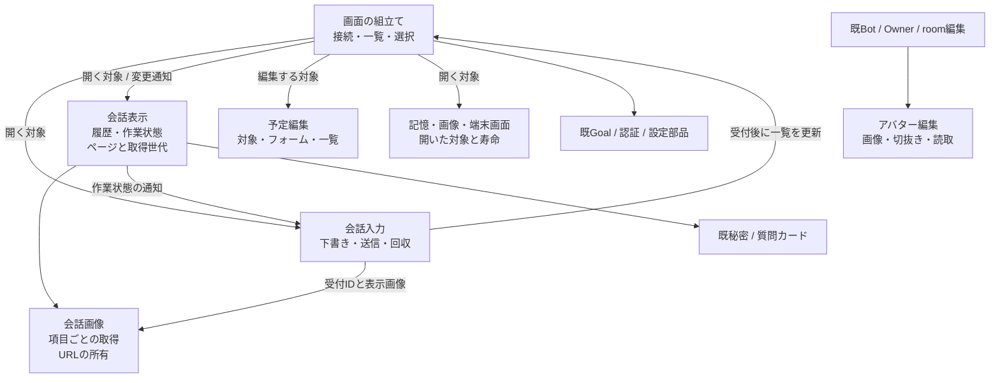
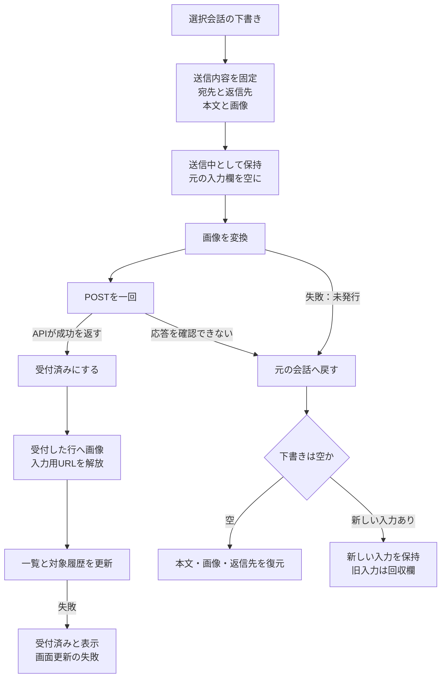
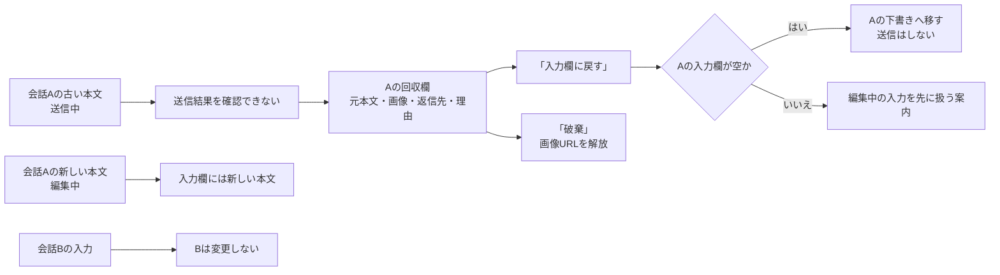
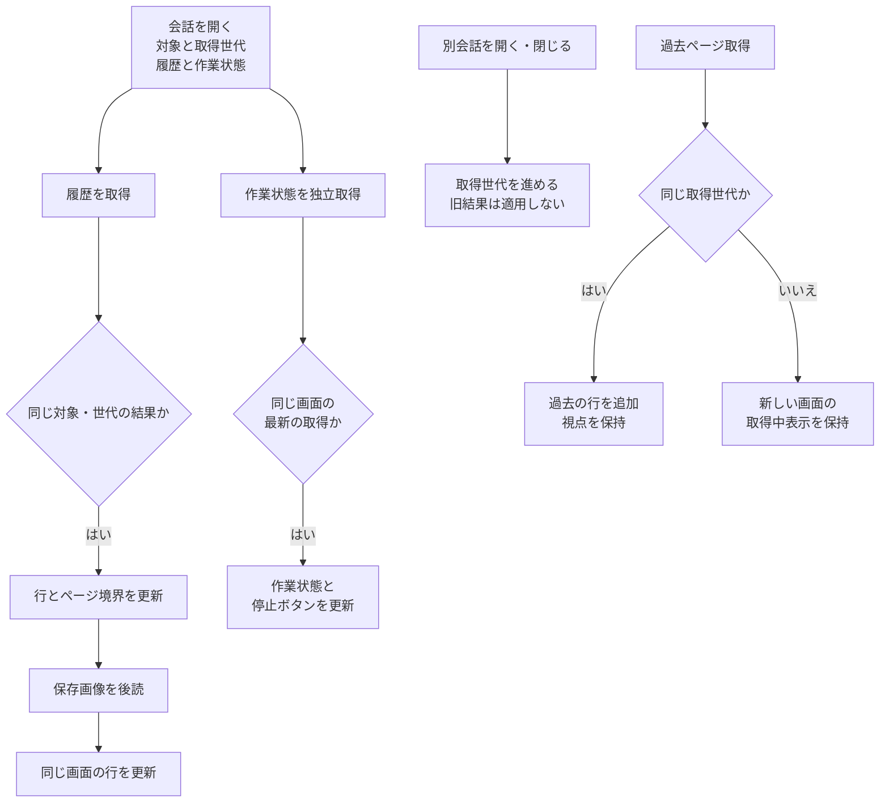
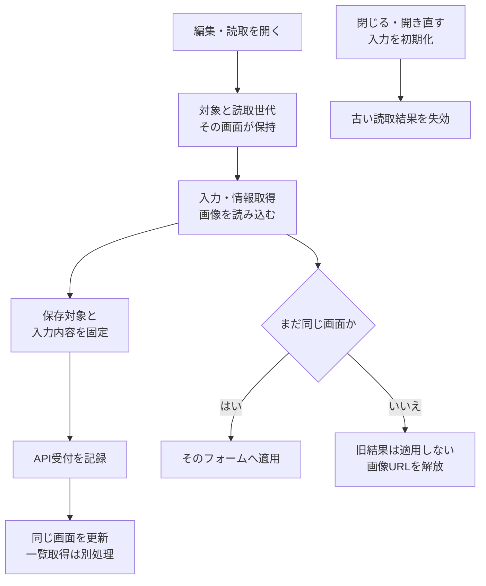

# Webの入力と表示を機能ごとに所有する設計

この文書はAstraが実装前に確定したD4/D5の設計経緯と保持条件。計画したmoduleは製品head4704446までで実装済み。現在の窓口は[Web詳細](web-details.md)・[管理詳細](web-management-details.md)、最終照合で見つかった未実装の修理は[追加設計](web-final-gaps.md)を正本とする。以下の未来形と基底の反例は当時の設計として読む。
設計時の製品sourceは`56e46a5`（Webは基底546fと同bytes）。この文書は**次の実装設計**であり、現在の挙動は[会話Web](web-details.md)と[管理Web](web-management-details.md)。実装後に関数名と実窓口へ同期する。

本branchではcomposer、avatar editor、会話画像cache、timeline、予定editor、記憶と読取補助、Bot/room/Ownerフォームを実装した。`conversation-composer.js:createConversationComposer`が`select/clear/addImages/send/update/showError`で会話別入力・添付・送信・回収欄を所有する。appは選択対象と受付後の一覧/履歴更新を渡す。`avatar-editor.js:createAvatarEditor`は既`reset/value/changed`と新`cancelRead`を公開し、画像読取世代を所有する。`message-images.js:createMessageImageCache`は`remember/load/get/failed/close`で項目別取得・URL・失敗を所有する。`conversation-timeline.js:createConversationTimeline`は`open/refresh/close/updateTarget/isBusy/updateStops`を公開し、ページ・queue・取得世代と行callbackを所有する。`schedule-editor.js:createScheduleEditor`の`open(target)`が予定の対象・編集・読取世代を所有し、`scheduleRequest/scheduleFormValues/scheduleDescription`が形式変換を担う。`memory-view.js:createMemoryView`は開いたBotと各フォーム/読取を所有し、`bot-read-views.js:createScreenView/createCharacterSheetView`は開いた対象とtimer/URLを所有する。`bot-editor.js/room-editor.js/owner-editor.js`は各`create*Editor(...).open`でフォーム・対象・操作中と補助部品を所有する。計画した所有整理の実装は揃ったが、Astraで現状図/関数表との最終整合と必要な不足修理を確認する。図全体を現実装済みとはしない。

## 画面で説明できる責任

一覧で会話を選ぶのはapp。選ばれた会話に何を入力しているかはcomposer、何を表示しているかはtimelineが持つ。予定やBotを編集する画面は、開いた対象を最後まで自分で持つ。画像URLは生成した部品が片付ける。

| 所有単位 | 作る/使う窓口（実装時に確定する名前） | 移す現関数と状態 | 外へ渡すもの |
| --- | --- | --- | --- |
| composer（実装済み） | `createConversationComposer` → `select/clear/addImages/send/update/showError` | 入力・添付追加/削除/描画、messageInput sizing、sending、画面内draft、回収欄。画像変換は既readImageを受ける | `onAccepted(target, result, previews)`。一覧やtimeline stateを直接変更しない。busy表示はtimeline分離まで既appが保持 |
| timeline（実装済み） | `createConversationTimeline` → `open/refresh/close/updateTarget/isBusy/updateStops` | open/refresh/older/queue/rerender/renderTail、Map/page/token/queue/stick、scroll/resize | queueの現在snapshotと読取結果。appに可変Mapを公開しない |
| 会話行 | timeline module内の`renderItem/roomTimelineItem/renderQueueStatus` | 意味の違う秘密/質問/peer/message/queue表示 | Bot名等は`getBot(id)`、停止は`stopMember(id)`、avatar/formatは共通純粋処理 |
| 会話画像（実装済み） | `createMessageImageCache` → `remember/load/get/failed/close` | imagePreviews/imageFailures、loadStoredMessageImages | 項目IDのURLと読取完了。会話選択や入力欄を操作しない |
| 予定editor（実装済み） | `createScheduleEditor` → `open(target)` | 全schedule関数、editingSchedule、対象snapshot、一覧の読取世代 | 保存/実行/削除の結果。現在の会話選択を内部から読まない |
| avatar editor | `createAvatarEditor`の既窓口＋`cancelRead` | 既3instanceのclosureを`avatar-editor.js`へ。reset/value/changedを保持 | 確定avatar値だけ。台帳・会話を読まない |
| 記憶表示（実装済み） | `createMemoryView` → `open(bot)` | openMemoryDialog/remember/recall/knowledge/renderMemoryResults | 明示targetとscopeでAPIを呼ぶ。Bot編集のeditingBotを参照しない |
| 読取補助（実装済み） | screenとcharacter-sheetの各小closure | 開いたBot、timer/読取世代、URL集合 | closeで資源解放。台帳の更新やnative起動はしない |

module数を増やすために分けない。timelineの描画とページは同じ所有なので一つに置ける。screenと設定画は同じfileに置いても各状態は別closure。既Goal/secret/question/auth moduleは窓口を使い続ける。format/escape/applyAvatarは既処理を一箇所へ移し、引数の束でapp全stateを渡さない。avatarColorのcacheは表示用module自身が持つ。

## 送信対象と入力の寿命

現`claimMessageSend`は本文trimと画像配列copy、宛先別sendingを行う。これを使い、**画像変換より前**にtype/id・本文・FileとURL・room targetsを取得する。UI操作のsnapshotは通常のJS objectで足り、配送IDや永続queueを増やさない。

送信処理のcatchは画像変換/POSTの範囲。API成功直後に受付段階を確定し、preview操作や後続GETの失敗から未受付へ戻らない。受付済みはAI回答完了ではない。POST応答不明は未配送と断定せず、会話を確認するよう表示する。実際の拒否理由は既readApiErrorで表示、追加送信は利用者の明示操作だけ。画像変換失敗はPOST0で入力を戻す。

`onAccepted`は一覧更新と対象timeline更新を行う。対象と選択が異なればその会話の表示を描き直さない。一覧GETが失敗しても独立な対象履歴GETは実行できる形（allSettledまたは個別catch）にし、どちらかの失敗で二回目のPOSTを発生させない。エラー文の所有は送信元target。別会話のcomposerへ後着結果を書かない。

### 新しい入力と失敗した入力を両方保つ

composer closureは既存の`conversationKey(type,id)`で画面内の下書きを持つ。値は本文・添付・返信先と必要な表示文。選択変更時は直前のDOM入力をそのtargetへ保存して次のtargetを表示する。localStorage/server保存は追加しない。ページを閉じると失われる範囲は既入力と同じである。

送信中snapshotはその下書きから切り離す。待ち時間に新しい本文を書ける。同じ宛先の送信single flightは既契約どおり。失敗したtargetの下書きが空ならそのtargetへ戻す。新入力があれば、失敗snapshotはそのtargetの**回収欄**へ置く。複数失敗でも配列のobject参照で保持でき、新ID・自動発行・再送timerは不要。

回収欄はcomposerが所有し、会話一覧の下に常時アクセスできる「保持した入力」のdetailsを置く。target名付きで各入力を出し、元本文は選択/コピーできるreadonly textarea、画像preview、理由を表示する。「入力欄に戻す」は元targetの下書きが空の時だけ移す。appへ元targetの選択を依頼し、入力を表示するだけで送信しない。「破棄」はその保存入力だけを除く。新入力を勝手に連結・差替えしない。未選択の会話の失敗もdetailsの件数に出す。元Bot/roomが削除されて選べない場合も本文と画像をここで読めるよう保持し、復元だけを無効にする。別の宛先へ自動的に置換しない。汎用通知機構は追加しない。

返信先は送信時にsnapshot。復元時は元targetsを既pickerへ戻し、既memberIdsで表示を正規化する。失われたメンバーを暗黙の新targetに置換しない。返信者必須の既検証は送信入口に残る。送信の画像URLは下書き→送信中→回収の間は所有を移し、受付/破棄/添付削除時に一度だけrevokeする。履歴previewは変換済みdata URLを渡すため、入力側blob URLの寿命に依存しない。

## 履歴は開いた会話と取得世代を所有する

- `messagesPath/queuePath/normalizeItems`はtimelineが保持したtargetを読む。戻り時にappのselectedTypeを読む処理をなくす。`close`はtokenを進めてDOM/queueを消す。clearSelectionから必ず呼ぶ。
- 初期履歴はqueueを待たない。最新/after、過去before、queueの各契約・上読scroll差・末尾追従を維持。新tokenのloadingOlderを古いfinallyでfalseにしない。
- 同じtargetで重なったrefreshの古い返却も新しい結果を上書きしないよう、既queueと同様に履歴読取の局所request順を所有する。永続generationや新しい配送IDではない。beforeページは新tokenかを判定し、Mapに追加する時の重複を再確認する。
- `renderItemElement`はtargetと行を描き、秘密/質問完了callbackは同じ取得世代か確認してその行だけ更新する。停止buttonのsingle flightはappの既stopMemberへ委譲。timelineが停止結果を確定しない。
- `setBusy`へ渡すのは選択targetと現在queueの必要情報だけ。composerがtimelineMapを読む接続を作らない。appのstopMember結果は開始targetの通知窓口へ戻す。
- image cacheは発言ID単位。複数画像の途中失敗で生成済みblob URLを回収する。取得中Promiseを同IDで共有し、旧完了が新しい送信previewを置換しない。失敗集合と既lazy表示を維持。viewerはURL生成者ではないのでrevokeしない。ページ離脱で生成者がcloseする。
- SSE接続の方式は変更しない。`refreshFromEvent`が各viewのrefreshを呼ぶ。ready/all/未知fallback、一覧取得、Goal等の専用更新を維持。表示GET失敗は表示のエラーへ返し、SSE接続のcatchに混ぜない。実stream切断時の既分岐は別責任として残す。

## 編集画面と画像decodeの結果は、開いた対象へ戻す

### 予定

`open(target)`でtype/id/name/memberIdsをcopyし、フォーム/一覧/各row listenerが同じownerを使う。`schedulePath`・command可否・targets・timezoneを会話のselectedから読む箇所は全て置換する。時計変換/cron/interval計算の既関数は維持。

load中に別の対象を開いたら旧結果と旧エラーを表示しない。保存前にtarget・editingId・bodyを固定。保存成功時だけ同じフォームをresetし、その後のGET失敗は「保存しました。予定一覧を更新できません」と表示する。close/reopen後の返却から新フォームをresetしない。run/removeはrow作成時のtarget/idを使い、二重操作は既single-flightを再利用。runの2.5秒timerはbutton表示だけ、追加POST0。削除後に編集が残る場合のresetも同じtarget/idだけ。

### アバター

既closureを独立moduleへ移し、入力引数/reset/value/changedを維持。`readFile`開始ごととreset/cancelReadで局所読取世代を進め、decode成功/失敗後はその世代の場合だけcrop/errorを更新する。blob URLは古いdecodeもfinallyでrevokeする。close時はcancelReadし、次のBotのresetを旧decodeが上書きしない。canvas/crop/JPEG/drag処理は既関数を保持する。

### 記憶・設定画・screenと残るフォーム

記憶/知識はopen時botを持つclosureにし、旧editingBotの共有参照をやめる。保存は送信時bodyを固定し、新しい入力を返却後に消さない（同じ入力snapshotの場合だけ空にする）。検索やエラーは同じtarget/読取世代へ戻す。scope・API・改訂は変更しない。

設定画はopen/closeで読取世代を更新し、作ったURLをdialogの集合で管理。古い一覧/画像/エラーを新dialogへ追加せず、closeと途中失敗で不要URLを回収する。screenは開いたBotを捕まえ、同じ画面の返却だけ表示。初回GET待ち中のcloseからtimerが復活しないよう開始後も同じopenか確認する。2秒周期と表示条件は維持。

Bot/room/Owner編集は既フォーム固有の保存処理を残せる。target/bodyと既操作中状態をそれぞれのclosureへ置き、保存受付と後続一覧GETを別に扱う。Bot modelLoadの既AbortControllerを維持する。Owner profile成功→rules失敗は二要求の部分成功なので、その結果を明示しprofileを自動再発行しない。保存後の自動選択は、保存した編集がまだ現在の操作である時だけ行う。close/reopen後の別フォームをfinallyで解除しない。汎用CRUDや万能transactionを追加しない。

## 反例と確認範囲

固定app.jsの実関数をVMで実行し、遅延した人工API応答で次を観測した（Root原本`web-ownership-probe.json`）。ブラウザ操作や実配送の証明ではない。

1. POSTは一回成功したがloadBots GET失敗で元本文が入力欄へ戻った。
2. AのPOST待ち中にBを選び新本文を書いた後、Aの失敗でBの本文が上書きされた。
3. 画像変換待ち中にroom返信者を変えると、送信時ではなく後の返信者がPOSTへ入った。
4. schedulePathは選択A→Bで保存先もBへ変わった。これはpath関数のみの確認で、dialog操作の再現は未実施。

実装時の局所試験は、実moduleとdeferred Promiseで制御し、必要なDOM動作だけ既設headless browserで確認する。全体試験は最後に一回。

| 契約 | 必要な反例と成立条件 |
| --- | --- |
| 受付後表示失敗 | POST成功→一覧/履歴GET各失敗。POST一回、旧入力復活0、受付済み表示、別targetへエラー0 |
| 送信失敗 | 画像変換失敗POST0、POST拒否/応答不明、A→B、新入力、A→B→A、同宛先連打。旧本文/画像＋新本文/画像を両保持 |
| 回収 | 空なら復元、編集中なら回収欄、複数失敗、restore/discard、URLを二重解放しない。UIから本文/画像を回収できる |
| 返信者 | encoding中の変更でも元snapshot。復元時の既member選択正規化、未設定時の返信者必須を保持 |
| timeline | queue後着、最新/after/beforeの選択変更、同target返却逆転、clearSelection、旧finally、秘密/質問callback、上読視点保持 |
| 画像 | 複数画像途中失敗、同ID同時取得、送信preview優先、close、viewer表示中の所有を保持 |
| 予定 | Aを開きBへ選択変更してもAへPOST/PUT/run/delete。再open後の旧返却は新フォームを消さない。保存成功GET失敗は再保存扱い0 |
| avatar/補助 | decodeのA→B逆転/reset/close、screen初回待ち中close、設定画close後の画像到着。正しい対象だけ表示しURL/timer回収 |
| 既窓口 | asset mapとimport graph、version置換、token/認証、既モデル候補/予定timezone/targets/sizing/改行/画像束を保持 |

## 実装順と触る場所

1. Composerの機能moduleと小さい純粋処理。`web/app.js`の選択/send/stop接続、`chat-input.js`の既helper、必要な回収UIの`index.html/styles.css`。既sending/添付のcallerを全置換。
2. Timeline/画像cacheの所有をmoduleへ。SSEとappは対象/更新理由を渡し、Map参照をなくす。共通表示関数は既実装を一箇所へ移す。
3. 予定editor、avatar editor、記憶/読取補助の対象と寿命。残るBot/room/Ownerフォームは同じ所有方針で小関数へ整え、意味の違うAPIは統合しない。
4. `src/http-assets.mjs`の明示asset mapへ新moduleを登録し、importを持つmoduleは`__ASSET_VERSION__`置換対象にも登録する。`test/http-server.test.mjs`の全import graph試験を通す。VMがappの文字列位置を抜く既試験は新公開窓口へ移し、検証内容を減らさない。該当：chat-input、timeline-open-queue、web-event-refresh、schedule-list/intervals、bot-profile-ui、web-bot-avatar-listと必要新局所試験。
5. 実装した境界と各反例が揃ってからAstraで図/codeを整合、必要全体一回、Centi独立採否、通常候補へ。別製品内部や本番停止へ権限を広げない。

この設計を決めたことと、製品を直し終えたことは別である。最終的な使い勝手・回収UI・ブラウザ挙動は実装後に確認する。

composerの局所6試験は受付後表示失敗、別target、新入力/旧入力・画像、回収/削除target、targets snapshot/single flight、変換失敗/明示拒否を確認した。既chat-input/HTTP関連と合わせたrunは45pass、timeline/SSEを含む別runは11pass（重複あり）。実Web全画面＋人工APIでも受付後GET失敗、A→Bの旧失敗、新旧本文の回収ボタンとPOST数を確認した。avatar既保存試験を公開module利用へ移し、decode逆転/reset/closeとURL回収の反例を加え、関連run38pass。これらは本番・実配送の確認ではなく、残るWeb所有整理や全体試験の完了でもない。

会話画像cacheは同ID取得の共有、後着保存画像から新送信previewの上書き防止、複数画像の部分失敗、closeと途中完了のURL一回解放を局所確認した。cache関連/HTTPのrun35pass、close競合追加後のcache4pass。差替え前の画像はviewerが使っている可能性があるためpage exitまでcacheがURLを所有する。pagehideのpersisted時はBFCache復帰に備えて解放しない。

timelineはappから可変Mapを外し、取得対象とページ/queue/世代をclosureへ移した。初期本文をqueueより先に表示、古いqueue/履歴/質問callbackと同対象の古いrefreshを無視、過去ページの旧finallyから新取得を解除しないことを実module局所試験で確認。before重複除去とscroll差を保持。共通表示関数8個はview-format.jsへ既定義を移した。履歴GET失敗をviewへ表示し、SSE上の表示更新失敗も接続失敗へ伝播しない。最終timeline/SSE10pass、HTTP/既avatar等38passは別runで重複あり。実全Web＋人工APIの入力/回収例も再確認した。

予定editorは対象snapshot、一覧の読取世代、保存中の入力変更と編集切替、保存受付後のGET失敗を分けた。row操作は描画時の対象を保持。旧一覧表示と間隔設定の文字列抜出し試験を公開moduleへ移し、既検証を維持。関連run44pass、別schedule局所7pass（重複あり）。実dialog DOMの人工API確認で、A保存後B再open/新入力保全、保存済み＋GET失敗、room targets/command除外を確認した。

記憶・知識は開いたBotを保持し、保存のbodyと対象を固定、新入力は同じ値の場合だけ初期化する。読取は対象と同resourceの最新結果だけ表示する。screenは初回GET待ち中closeからtimerを復活させず、新しい対象だけ表示する。設定画はclose/reopenと途中失敗でURLを回収し、古い画像を適用しない。関連HTTP/既avatarと合わせたrun42pass（重複あり）。全Web＋人工APIの起動・入力回収も再確認。この時点では残るフォームが未完だった。後段のフォーム実装結果は次段落を参照。

Bot/room/Ownerフォームも独立closureへ移した。Botのmodels/AbortController/Avatar、room member/representative、Ownerの規範/認証/任意機能の各固有窓口を維持する。保存時target/body、再open/新入力、API受付と一覧GETを区別し、新規作成の受付後に表示だけ失敗した場合は返却IDを保持する。Ownerはprofile/rulesを操作時に固定し、profile成功後rules失敗を部分成功として表示する。auth/featuresはopenごとの子DOMへ描画し古い非同期結果を新しい画面へ戻さない。関連最終54pass、実3フォームDOM＋人工APIと実Web起動/入力回収例が成功。全体試験と最終図整合・独立採否は未完。
