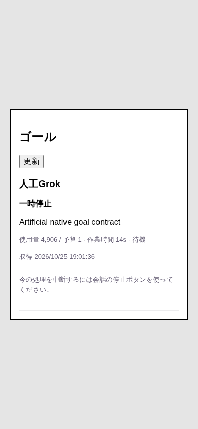
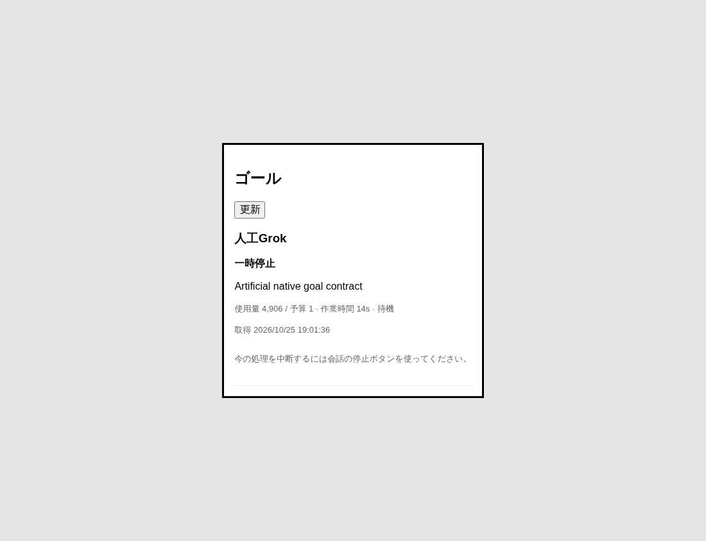
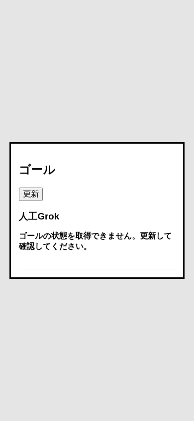

# Grokの現在状態を分けたGoal読取

Native128d000a0ea5aba3819c218d1429b8d46c99ab02の固定V2結果を取り込む。保存snapshotのphaseがExecutingでも、現在のCLIがUserPaused/Idleを返した場合は一時停止・待機として表示する。使用数と経過表示もcurrent_statusから取得する。元のnative snapshotはそのままHTTPへ保持し、欠測・不正なcurrent_statusを保存値で補わない。

Grokの現在の能力はinspectだけ。全変更falseと編集field全falseを維持する。busyで取得不能の場合はgoalを省略し、古いGoalや「ゴールなし」へ戻さない。

main0ed186cへ追従した際のMCP境界の競合は、Goal typed結果と認証起動前拒否typedの両方を保持して解決した。

検証は新しい反例3failから成功へ。関連40pass、完了時の全体816pass/fail・取消・skip0。HTTPは実BotGoals/AitermClient境界を通し、固定Native実結果を返す人工fixtureを使用。ブラウザは実module/CSSとHTTPで1100px・390pxの一時停止/取得不能を確認、書込0・pageerror0・全終了。保存phase/highwater/elapsed_msは現在表示へ使わない。

Native handoff SHA1186924a28538a9a2ceab2cf9bf6e15f15142b4fc4fd623b59a34b879e40c5a8/17参照を全SHA照合し、未公開tar c4d374bf7288a91ed3c71e0eb0273997cf4c8ac770ba4321cc62919ecd325ac3/636012B/118JSを固定。前463e候補とのruntime差はharnesses/grok-goal.jsだけ。Nativeの通常launchmetadata/fresh UserPaused結果は本人実証で、今回Root側の新NativeTTY/実Bot操作は0。正式Goal版・busy-active/同worker pause-clear・他OS・実image受入は未完。

原本はトロニー所有 `/srv/bellteam/bots/bot-7b140b27/integrations/goals-composer-20261025/grok-current-128d000/` のhandoff/17証拠、before.log、focused.log、full.log、browser-current.mjs、browser-current-result.jsonとcheckpoint.json。
