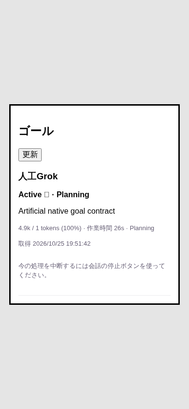

# Grok Goal detail current observation

Native source `d56b0d760af4c9ef92e5ca0df098802ef96b2c0f` adds the `goal detail` current-status variant. Root preserves its null phase/tokens and raw status, optional phase, budget and elapsed displays. The saved snapshot is not used to reconstruct current counters. The older `/goal status` signed counter variant remains accepted.

The producer demonstrated read-only detail inspection on an already fullscreen Grok 1.0.70 original worker while its existing artificial Goal remained Active. Ordinary minimal-mode busy inspection remains unavailable. All mutations remain unsupported. This PR uses captured Native result fixtures; it does not operate a Native worker, a real Bot or a provider.

The new HTTP and Web regressions failed in two conditions before the change and pass after it. Related tests: 20 pass. Full source suite: 819 pass, zero failures/cancellations/skips (`full-corrected.log`). The initial `full.log` contains only 168 tests and is retained without claiming full coverage. Browser checks use real HTTP/BotGoals/AitermClient and captured Native results at 1100px and 390px: raw text visible, no saved-number substitution, busy goal omitted, zero writes/errors. Browser and HTTP server closed.

Native schema, result, tar, producer checkpoint and Centi Native limited review were SHA-verified under the operator project `integrations/goals-composer-20261025/grok-detail-d56/`. Native runtime and consumer source acceptance are separate. Linux/other OS, ordinary busy control/pause/clear, formal Goal supply, future server image and actual deployment remain incomplete. Existing Auth19/eed deployment and Apple67 signing decisions are unchanged.
