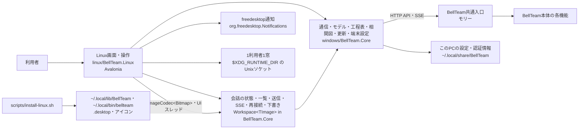
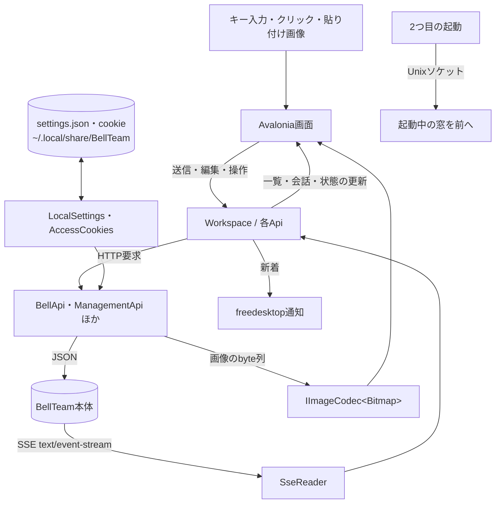

# Linuxアプリの機能図と作業手順

担当はネオン（`bot-208dcbab`）。この文書をLinux製品内部の機能図とデータの流れ図の正本とする。本体側の接続登録は[Linuxアプリ](architecture/modules/linux/README.md)、担当と変更手順は[機能担当と変更の手順](architecture/module-ownership.md)を参照する。

オーナー裁定（2026-11-12、工程 t24）：見た目はMac、コードはWindows。画面・配置・部品・状態の印・操作の流れ・文言はMac版（`ios/`、Mac Catalyst）に揃える。コードはWindowsアプリの共通部品`windows/BellTeam.Core`（plain `net10.0`）をそのまま参照し、Linuxで新しく作るのは画面の層だけとする。画面の部品はAvalonia（.NET 10）。OSの違いだけをLinuxの作法へ置き換える（⌘→Ctrl、窓の操作はデスクトップ環境の装飾、通知はfreedesktop通知）。Mac版の購入とAPNsの登録は移植しない（Windowsと同じ）。

## 機能図



- `BellTeam.Core`の所有者はアニス。LinuxはそのままProject参照で使い、Coreを変える時は小さなPRでアニスをレビューに入れる。条件はWindowsの挙動を変えないこと、[Windowsアーキテクチャ](windows-architecture.md)のCoreの節を同じ差分で更新すること、実行したBellTeam.Testsの範囲をPRに書くこと（2026-11-12 アニス合意）。
- `Workspace`（会話一覧・会話・送信・SSE・再接続・下書き）はWindowsの`BellTeam.App`からCoreへ移し、画像の型とUIスレッドへの戻りだけを各アプリが渡す。Windowsは`Workspace : Core.Workspace<BitmapSource>`で呼び出し側を変えない。
- 本体の状態は共通入口のHTTP APIとSSEだけで使う。本体の内部状態を直接読み書きしない。

## データの流れ



- 接続先・窓の大きさ・通知の設定・ログイン情報はCoreの`LocalSettings`（`SpecialFolder.LocalApplicationData`＝`$XDG_DATA_HOME`、既定`~/.local/share`）の`BellTeam/`に置く。アプリ本体とは別の場所で、削除しても残す。
- 書き込み（POST・PUT・DELETE）は自動で再送しない。SSEと一覧の読み直しは、Windowsと同じ上限付きバックオフで再試行を続ける（Coreの`ReconnectBackoff`）。

## 画面構成

Mac版と同じ構成で、[Windowsアーキテクチャ](windows-architecture.md)の「画面構成」の図と同じ部品・窓・シートを持つ（主窓1280×820・最小1100×640、サイドバー320〜420、詳細パネル、設定の項目一覧、主窓に重ねるシート、工程表と相関図の別窓）。Linuxでの置き換えは次だけとする。

| Mac | Linux |
| --- | --- |
| ⌘K・⌘2・⌘3・⌘4・⌘5・⌘,・⌘⇧I | Ctrl+K・Ctrl+2・Ctrl+3・Ctrl+4・Ctrl+5・Ctrl+,・Ctrl+Shift+I |
| 窓の信号ボタン・タイトルバー | デスクトップ環境の窓装飾 |
| macOS通知・APNs | 起動中だけのfreedesktop通知（既定はオフ） |
| 購入（StoreKit） | 「利用と課金」は案内とリンクだけ |
| Mac版の更新 | 設定の「アップデート」はBellTeam本体の更新（共通Update API）。アプリ自身の更新は導入手順の再実行 |

- 設定の「端末」は、Windowsの「このPCを追加」「このPCを確かめる」（16c）とオプション機能の案内を出さない。Coreの`ThisPc`がWindowsのOpenSSH鍵の置き場を読むためで、Linuxでは`NoThisPc`で自端末を持たない扱いにする。「通知」のスイッチは`DesktopNotifications`（`INotificationSwitch`）を切り替え、`SettingsStore.NotificationsEnabled`へ保存する。配信は`FreedesktopNotificationSink`がD-Bus（`org.freedesktop.Notifications`）で行い、通知を押すとその会話を開く。
- Cloudflare Accessのブラウザーでのログイン（WindowsはWebView2）はLinuxにまだ無い。ログインが必要な接続先では、その旨と「接続先を変更」を出す。LANのHTTP接続には要らない。

## 導入

```sh
scripts/install-linux.sh [--server-url http://サーバーのLANアドレス:18891] [--no-launch]
scripts/install-linux.sh --uninstall
```

.NET 10 SDKがあるLinux（x64・arm64）で、取り出してあるソースから通常の利用者として実行する。管理者権限は不要。.NETを同梱したビルドを`~/.local/lib/BellTeam`へ置き、`~/.local/bin/bellteam`、アプリ一覧の`~/.local/share/applications/bellteam.desktop`とアイコンを登録する。接続先を省略すると既存の設定を保持し、初回起動時に入力する。削除は本体・起動用リンク・登録だけを消し、`~/.local/share/BellTeam`の設定は残す。

導入と削除が置き換え・削除するのは、このinstallerが置いた物だけとする（既存の別の物を上書き・削除しないため）。本体のフォルダは印のファイル`.bellteam-installer`を持つ（印が無い最初の版の配置`BellTeam`と`bellteam.png`も含む）こと、`~/.local/bin/bellteam`は導入した本体へのシンボリックリンクであること、`bellteam.desktop`は導入した本体を`Exec=`で起動することで見分ける。どれかが別の物なら、何も変えずにその場所を名指しして終了する。利用者がその物を別の場所へ移すか不要なら消して、もう一度実行すれば進む。

## 開発と確認

```sh
dotnet build linux/BellTeam.Linux.slnx -c Release
dotnet test linux/BellTeam.Linux.slnx -c Release
```

試験は窓を表示しない。実画面での受け入れは、GNOME（Wayland）の実画面で導入手順から起動して行う。
