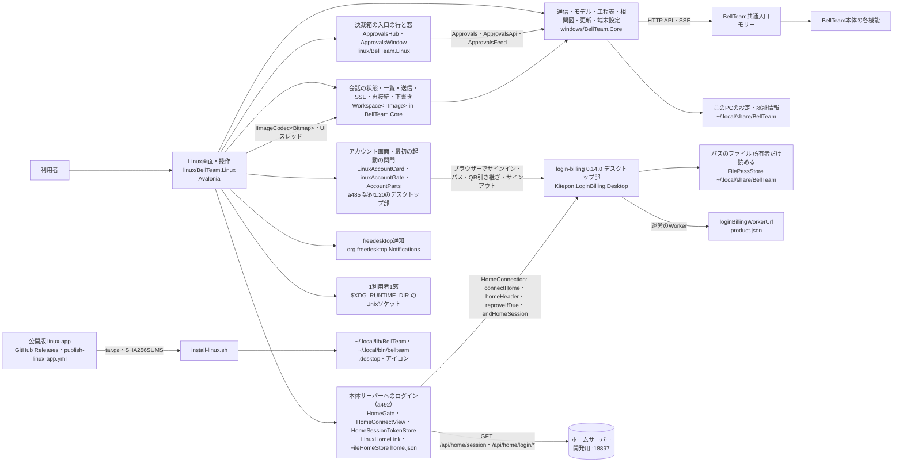
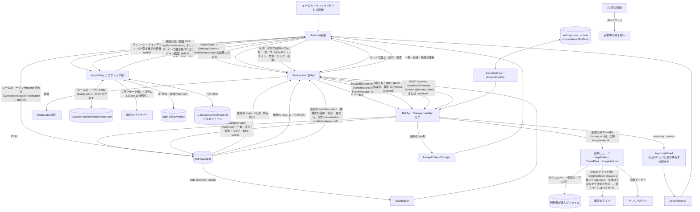
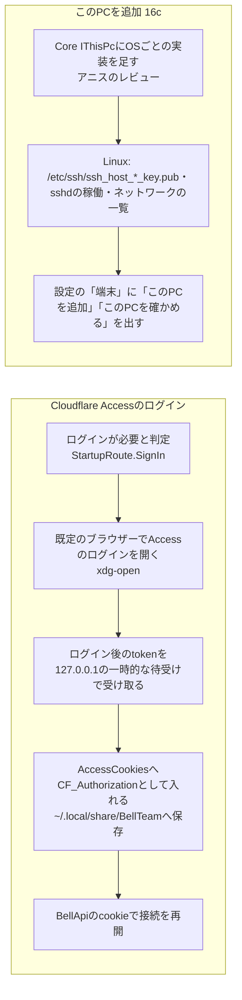

# Linuxアプリの機能図と作業手順

担当はネオン（`bot-208dcbab`）。この文書をLinux製品内部の機能図とデータの流れ図の正本とする。本体側の接続登録は[Linuxアプリ](architecture/modules/linux/README.md)、担当と変更手順は[機能担当と変更の手順](architecture/module-ownership.md)を参照する。

オーナー裁定（2026-11-12、工程 t24）：見た目はMac、コードはWindows。画面・配置・部品・状態の印・操作の流れ・文言はMac版（`ios/`、Mac Catalyst）に揃える。コードはWindowsアプリの共通部品`windows/BellTeam.Core`（plain `net10.0`）をそのまま参照し、Linuxで新しく作るのは画面の層だけとする。画面の部品はAvalonia（.NET 10）。OSの違いだけをLinuxの作法へ置き換える（⌘→Ctrl、窓の操作はデスクトップ環境の装飾、通知はfreedesktop通知）。Mac版の購入とAPNsの登録は移植しない（Windowsと同じ）。

## 機能図



- `BellTeam.Core`の所有者はアニス。LinuxはそのままProject参照で使い、Coreを変える時は小さなPRでアニスをレビューに入れる。条件はWindowsの挙動を変えないこと、[Windowsアーキテクチャ](windows-architecture.md)のCoreの節を同じ差分で更新すること、実行したBellTeam.Testsの範囲をPRに書くこと（2026-11-12 アニス合意）。
- `Workspace`（会話一覧・会話・送信・SSE・再接続・下書き）はWindowsの`BellTeam.App`からCoreへ移し、画像の型とUIスレッドへの戻りだけを各アプリが渡す。Windowsは`Workspace : Core.Workspace<BitmapSource>`で呼び出し側を変えない。
- 機械席（Claude machine mode）の質問と承認（a471）：履歴の`machine_event`のうち、`view`が`question`か`approval`の行は会話ログの白いカード（`MachineRequestCard`）として描く。質問は1問1答なら選択肢を押した時点で答え、複数問・複数選択は選んでから「送る」。「その他」は自由文。承認は「許可」「拒否」。答えは`POST /api/seat-requests/:request_id/answer`だけで返し、画面読み取りもキー送信もしない。`status`が`pending`以外のカードは選択肢を出さず結果の行にする。何も隠さない（`hide`は無く、`fold`以外の`display`は`show`）。`fold`の行は開閉できる1行（`MachineEntry`。既定は閉じ、押すと全文、`truncated`なら「全文を読み込む」で`GET /api/bots/:id/machine-events/:seq`の保存行）で、隣り合う同じ`fold_group`だけを1行にまとめ（Coreの`Timeline.VisibleMachine`。どの行も時間の位置から動かさず、`tool_result`を`tool_use`の下へ引き上げない）、行の名前は`fold_count`の合計n（無ければ1）で決める（`Timeline.FoldLabel`。n>1は「tools ×2」「hook ×3」、n=1は`fold_count`が1の行のメッセージ＝道具名、n=0は「group ×行数」）。開くとその行を時間順に並べ、各行はそれぞれ閉じた1行で、開くと全文（`tool_use`は`tool.summary`）。本体が`tool_use`を畳むと`tools`の行になり、畳まれる前の本体の`show`の`tool_use`は道具名と要約の1行のまま。開閉はアプリの状態で保存しない。`words`の行は、本体が`bubble: true`を付けた行（終わったターンの最後の発言）だけを通常の受信メッセージの吹き出し（保存済みメッセージと同じMarkdown描画）で描き、それ以外の`words`は吹き出しの無い1本の文章で描く（どれが最後かはアプリが決めず、`bubble`だけを読む。印は同じidの行へ後から付き、描き直す。a471-tune-answer。契約は[machine-stream.md](architecture/modules/conversation/machine-stream.md)「Turn answer bubble」）。会話は最初の1ページ（30件）を読んだあと、畳まれた行が多くて行が画面（表示領域）を埋めない間は、古いページを自動で読み続け、埋まるか古い分が無くなるまで続ける（窓を広げた時も同じ。a471-thinking-linux。スクロールと「以前のメッセージを読む」は今まで通り）。見た目と動きはWindowsと同じ。データ側（`TimelineMessage.MachineEvent`・`AnswerSeatRequestAsync`）は[Windowsアーキテクチャ](windows-architecture.md)のCoreの節（アニス）が正本。
- 本体の状態は共通入口のHTTP APIとSSEだけで使う。本体の内部状態を直接読み書きしない。

## データの流れ



- 接続先・窓の大きさ・通知の設定・ログイン情報はCoreの`LocalSettings`（`SpecialFolder.LocalApplicationData`＝`$XDG_DATA_HOME`、既定`~/.local/share`）の`BellTeam/`に置く。アプリ本体とは別の場所で、削除しても残す。
- 書き込み（POST・PUT・DELETE）は自動で再送しない。SSEと一覧の読み直しは、Windowsと同じ上限付きバックオフで再試行を続ける（Coreの`ReconnectBackoff`）。

## 画面構成

Mac版と同じ構成で、[Windowsアーキテクチャ](windows-architecture.md)の「画面構成」の図と同じ部品・窓・シートを持つ（主窓1280×820・最小1100×640、サイドバー320〜420、詳細パネル、設定の項目一覧、主窓に重ねるシート、工程表と相関図の別窓）。Linuxでの置き換えは次だけとする。

| Mac | Linux |
| --- | --- |
| ⌘K・⌘2・⌘3・⌘4・⌘5・⌘,・⌘⇧I | Ctrl+K・Ctrl+2・Ctrl+3・Ctrl+4・Ctrl+5・Ctrl+,・Ctrl+Shift+I |
| 窓の信号ボタン・タイトルバー | デスクトップ環境の窓装飾 |
| macOS通知・APNs | 起動中だけのfreedesktop通知（既定はオフ） |
| 購入（StoreKit） | 「利用と課金」は案内とリンクと、契約の状態と1文（`PurchaseEntry`。購入はしない。a485） |
| Mac版の更新 | 設定の「アップデート」はBellTeam本体の更新（共通Update API）。アプリ自身の更新は導入手順の再実行 |

- 設定の「端末」は、Windowsの「このPCを追加」「このPCを確かめる」（16c）とオプション機能の案内を出さない。Coreの`ThisPc`がWindowsのOpenSSH鍵の置き場を読むためで、Linuxでは`NoThisPc`で自端末を持たない扱いにする。「通知」のスイッチは`DesktopNotifications`（`INotificationSwitch`）を切り替え、`SettingsStore.NotificationsEnabled`へ保存する。配信は`FreedesktopNotificationSink`がD-Bus（`org.freedesktop.Notifications`）で行い、通知を押すとその会話を開く。
- 利用と課金（a485。[課金クライアント契約](billing-client-contract.md)はブレディが書き換える予定で、文言は確定済み）：LinuxとAndroidでは何も購入しない。`PurchaseEntry`は`GET /api/subscription`を読み、有効な契約があれば「購読中（{購入元}）」と有効期限を、なければ「iPhone・iPad・Macで購入し、このサーバーをログインさせてください。」を1文だけ出す（`SubscriptionText.BuyOnApple`）。`isTrial`・`billingSources`・`canPurchase`・`autoRenewing`が無くても「なし」として読む。開発者サーバーは何も出さない。「再確認」は`GET /api/subscription`を読み直すだけ。Stripeの購入・確認パネル・管理の呼び出しは使わない（Coreの`CheckoutAsync`等はWindowsの工程が外すまで残る）。
- メンバーのピン留め（a480。契約は[profiles.md](architecture/modules/members/profiles.md)「ピン留め」、データ側はCoreの`Bot.PinnedAt`・`Workspace.SetPinnedAsync`で[Windowsアーキテクチャ](windows-architecture.md)のCoreの節が正本。AndroidはこのLinuxの画面をそのまま使う）：メンバーの行（`ConversationRow`）を右クリック（Androidは長押し）すると「ピン留め」／「ピン留めを外す」のメニューが出て、`PATCH /api/bots/:id {"pinned":bool}`を一度送り、一覧を読み直す（失敗は`ReportActionError`の帯に出し、自動で再送しない。同じ操作は何度送っても結果が同じ）。ピン済みの行は名前の後ろに📌を出し、並びはCoreが本体の`pinnedAt`順で先頭へ置く（クライアントで並べ替えない）。ルームの行にはメニューも印も無い。
- 追加機能の画面（a479-switch-linux）：項目（`fields`）が空の機能（`thinkingDisplay`「AIの考えの表示」）は「有効にする」のスイッチだけを描き、「必要な項目を登録してから…」の案内と空の「設定」の見出しは出さない。保存は`{"values":{},"enabled":bool}`。AndroidはこのLinuxの画面をそのまま使う。
- サーバーへのログイン（a485。契約は[app-sessions.md](architecture/modules/usage/app-sessions.md)の節7（草稿）。LinuxとAndroidは同じ`ConnectView`）：`GET /api/session`の`login`キーで見分ける。`login.enforced`が真で`authenticated`が偽、または保存した鍵が401で断られた時（`Workspace.SessionLoginRequired`）、起動画面は`ConnectView`になる。キーが無い古いサーバーは今まで通り（Linuxは使えないAccessの画面）。画面は`POST /api/login/start {kind: "linux"|"android"}`を1回だけ送り（自動で再送しない）、`LoginFlow`が3秒ごとに`GET /api/login/{id}`を読む（読めない時は上限付きバックオフで続け、回数では止めない。`expiresAt`・`expired`・404で終わり、「もう一度始める」を出す）。「スマホで承認する」の下に`phone.shortCode`と`checkNumber`を大きく出し（QRは出さない）、「サーバーのコードで入る」の欄は常に出して`POST /api/login/console {code, kind}`で鍵を受ける。文言はTronieの裁定（節7e）どおり。鍵は1回だけ返るので、`approved`の応答でつぎのアプリに保存する：Linuxは`~/.local/share/BellTeam/sessions.json`（0600、サーバーごと。libsecretは後）、Androidは`KeystoreSessionTokenStore`（Keystoreの鍵でAES-GCM）。以後すべての要求に`Authorization: Bearer`を付ける（`BellApi.SessionToken`）。401を受けた鍵だけを消し、503 `SESSION_STORE_UNAVAILABLE`は鍵を残して「サーバーの準備中です。」と再試行する。承認する側の画面・ログアウト・「アプリを追加」・セッション一覧は別の工程。
- 本体サーバーへのログイン（a492、login-billing 0.16.0のHomeConnection。開発版で何も出荷しない）：接続の前に`GET /api/home/session`を探査し（`HomeGate.ProbeAsync`。capabilityが`login-billing-home/1`のサーバーだけ）、ホームサーバーで保存した鍵が無ければ`HomeConnectView`を出す（未結び付け＝サーバーに出るセットアップコードを入れる／結び付け済み＝このアプリのアカウントですぐ入る。kindは`linux`）。鍵は`IHomeLink`（`LinuxHomeLink`＝ライブラリの`lb.HomeConnection(FileHomeStore)`。AndroidはKeystore）の中にあり、`CompositeSessionTokenStore`が`BellApi.SessionToken`へ渡す（ホームの鍵が先、無ければ従来のアプリセッションの鍵）。消すのは401だけ（ライブラリが消し、アプリは`tokens.Clear`で鍵を忘れてもう一度つなぐ）。403・503・429・届かないは鍵を残し、「届きません」「準備中です」と出す。サインアウトは`endHomeSession`（`IHomeLink.EndAsync`）を先に呼ぶ（ライブラリの`signOut`はホームのセッションを終わらせない）。`reproveIfDue`は接続のたびに呼ぶ（7日）。探査に答えない従来のサーバーは今までの`ConnectView`のまま。
- アカウント（a485、契約1.20。**login-billing 0.14.0は開発版で、これで作ったものは出荷しない**。専用ブランチ`neon/a485-lb-linux-0140`でミントの受け入れ後にmainへ入れる）：「利用と課金」の先頭に`LinuxAccountCard`を出す（Androidの`AccountCard`と同じ並び：印・題・帯1つ、状態の1文、操作）。デスクトップは購入しない。「Googleでサインイン」「Appleでサインイン」が`DesktopLoginBilling.SignInWebAsync("google"|"apple")`（既定のブラウザーを開き、戻りは127.0.0.1の待受け。「やめる」で取り消す）、サインアウトは`SignOutAsync`、「ほかの端末をすべて止める」は確認のあと、使ったほうのGoogle／Appleを選んで`SignInWebAsync(provider, stopOthers: true)`（ライブラリは使ったほうを持たない）。ライブラリは1アプリに1つ（`LinuxAccountStore`。接続先は`product.json`の`loginBillingWorkerUrl`で、無い間は画面を出さない。パスは所有者だけが読めるファイル`FilePassStore.ForApp("BellTeam")`で、表示・ログ・送信をしない。メールも名前も無い）。ウェブでサインインして契約が無い端末（`PassKind.Signed`）だけ、まず`CheckAsync`でサーバーに尋ね、無ければ`StartLoginAsync`を1回呼んで7fのQR画面（`AccountParts.HandoffBlock`。QRは`QrView`がQRCoderで描く。コード・確認番号・待機・やめる）を出し、`WaitForPassAsync`で待つ。`StartLoginAsync`がnullなら「すでに使えます。」。初回起動は`MainWindow.StartAfterAccountAsync`が先にアカウントを求め（`LinuxAccountGate`。7e）、契約がある端末、またはライブラリに尋ねられない時（接続先なし・通信できない）はそのまま次へ進む。`pass_store_unavailable`は「サインアウトにはなっていません」と文で出す。Androidと共通の`AccountParts`・`QrView`はLinuxのファイルをAndroidが取り込んで使い、`LinuxAccount*.cs`だけAndroidは取り込まない。パッケージは`linux/fetch-login-billing.sh`が版とsha256を確かめて`linux/packages-local`へ置く。ブラウザーでのサインインを実際にやり通す確認はオーナーの手が要る（未確認）。承認する側の画面・承認した端末の一覧・端末の停止はLinuxに置かない（契約：approveQr・linkedDevices・stopは店の端末だけ。デスクトップは承認される側。トロニー裁定 2026-11-22）。Appleサインインの実際の確認はオーナーのApple設定（Sky、t4u）待ち。
- 購読画面（a485 節7e、Tronieの裁定）：接続したあと、LinuxとAndroidは`GET /api/subscription`の`subscription.entitlementState`を1回読む（`SubscriptionApi.PaywalledAsync`）。`none`の時だけ`StartupPhase.Paywall`（`StartupRoute.AfterConnect`の`paywalled`、ログインと失敗のあと・初期設定とアプリ本体の前）で`PaywallView`を出し、「このアプリは購読が必要です。無料で使うには、公開されているソースコードから自分でビルドしたものを使ってください。」と「再確認」「接続先を変更」を置く（ブラウザー版は廃止。Owner裁定、2026-11-22 JST、app-sessions.md 7e）。`active`・`unknown`・項目なし・読めなかった時はアプリを出す。購入の入口も課金の関門もLinuxには置かない（Androidも、店の端末になるまでPlay Billingは戻さない）。
- 取り外したAntigravity（a357・a357b。サーバーの契約はa365、Core部品はWindowsのa366）：Botの`harnessNotice`はメンバーのAI設定の先頭に、設定の`backgroundAgentNotice`は「仕事の要約を書くAI」の先頭と設定一覧の「要対応」に、サーバーの文のまま出す。どちらも読み取り専用で、保存では送り返さない。Antigravityのまま他の項目を編集でき、CLIの選択肢はClaude・Codex・Grok・Cursorの四つ（現在の設定は「（現在の設定）」付きで残る）。要約AIは未選択から選び直し、選ぶまで保存できない。
- AIのCLIの導入（a451。契約は[harness-cli](architecture/modules/usage/harness-cli.md)、Coreの読み方は[Windowsアーキテクチャ](windows-architecture.md)。AndroidはこのLinuxの画面をそのまま使う）：`HarnessInstallPanel`が1つのAIの`install.message`をサーバーの文のまま出し、`action`が`install`の時だけ「最新版を入れる」を出す（同じ押下が導入であり更新。Macと同じく、動かせないAI（`not_installed`・`installing`・`failed`）では主のボタン、動かせるAIでは控えめなボタンで、送っている間は「始めています…」、サーバーが入れている間は回る印を出す）。押すと`POST /api/harness-auth/:id/install`を一度だけ送り（失敗しても再送せず、`GET`で実際の状態を読む）、`busy`の間は`GET …/install`を3秒から30秒までのバックオフで読み続ける（回数では止めない）。AIの設定の各AIの行は、動かせないAI（`not_installed`・`installing`・`failed`）ではログインを読まず「未導入」などの状態とパネルを出し、動かせるかどうかが変わったら一覧を読み直す。ログインの窓は動かせないAIの間はパネルだけを出す。未導入はAIの設定の行の状態行と「要対応」の帯に、`SettingsSummary.Ai`の文で出る（帯と行は下のa452。帯が数えるのは未導入と導入失敗だけで、導入中は自分で進むので数えず、Claudeは2アカウントでも1回。トロニー裁定 2026-11-19）。初期設定は動かせないAIを選ぶとサーバーの文と「最新版を入れる」（`POST /api/setup/install`）を出し、`install`が忙しい間3秒ごとに状態を読み（窓の無いAndroidの起動画面でも読む。`OwnerWindow.IsActive`）、動かせる状態になるまで「認証を確認して始める」を押せなくする。Botの編集は選んだCLIが導入待ちならサーバーの文を「CLI」の下に出し、保存は止めない。`install`の無い本体は今まで通り。
- 設定の一覧の生きた状態（a452。Mac・Windowsと同じ仕様。正本は[設定の導線](architecture/modules/apple/settings-user-flow.md)、読み方はCoreの`SettingsSummary`）：`SettingsWindow`は設定を開いた時・主窓が前面に戻った時・頁を出た時（AIのログインの読み直しは除く）・AIのログインの窓を閉じた時・アップデート／端末の変化で全項目を読み（AIは`GET /api/harness-auth`と各AIのログイン状態、導入待ちのAIは状態を読まない。ほかは`/api/settings`・`/api/models`・`/api/user-rules`・`/api/ai-control`・`/api/updates`・`/api/terminals`）、各行の2行目の状態行と札、左上の「要対応」の帯を描き直す。帯は、この一覧に行が無い項目（仕事の要約を書くAI・1Password・チームの決まり）も数え、押すとそれを持つ頁（AIの設定・追加機能・プロフィール）へ行く。AIの行は、そのAIのログインの窓へは直接行かず、AIの設定の頁（各AIの行にログインと「最新版を入れる」がある）を開く。「稼働中に数えない処理」は、この一覧に頁が無く要対応に数えない状態なので読まない。Androidの携帯の形で一覧から外した頁（接続・利用と課金・このアプリについて・通知）の状態は出さず、帯にも数えない。頁の先頭の大きな見出しは今まで通り固定の説明文で、生きた状態は出さない。
- AIの設定のClaudeの行は、枠名が「1つ目のアカウント」「2つ目のアカウント」（`AccountText.SlotName`）、上限は1行（`AccountText.LimitLine`。「上限中・M/D HH:mmに戻ります（いまは2つ目で動いています）」）、使っているメンバーは人数だけを出す（`AccountText.UsersLine`。Botの`account`から「いまN人がこのアカウントで動いています」、古い本体は「N人が使用」。名前もidも並べない。[settings-user-flow](architecture/modules/apple/settings-user-flow.md) B20。Windowsと同じ読み）。
- 工程表の過去ログ（a457。契約は[Lattice](architecture/modules/lattice/README.md)の`history`と画面仕様の過去ログ、読み方はCoreの`LatticeHistoryFeed`・`LatticeChart.WithHistory`。AndroidはこのLinuxの画面をそのまま使う）：スナップショットの`cards`は開いたツリーだけで、閉じたツリーの終わった工程は`GET /api/lattice/charts/:id/history`から、**過去ログを開いた時だけ**読む（開いた時に1頁（limit 50）、一覧の末尾までスクロールしたら`next`で次の頁）。切り替えの数は`cards`の終わった工程＋`history.closed`で、要求は要らない。同じidはスナップショットの札を採り、頁の人物は名簿に足す。`history.closed`が開いている間に変われば頁を捨てて先頭頁を読み直し、過去ログを離れる・工程表を替える・閉じると頁を捨てる（保存しない）。頁が読めなければ今ある行を残し、末尾に「続きを読めませんでした。」と「読み直す」を出し、1, 2, 4 … 30秒で自動に読み直し続ける（読み直すは待たずに今すぐ）。404（古いサーバー）はその工程表では以後頁を求めず、スナップショットの行だけを出す。詳細は頁の札のまま開き、前の工程は出さない。ツリー・担当・数・段・線は今まで通り。
- 決裁箱（Approval Box拡張。[screen-spec](architecture/modules/approval-box-extension/screen-spec.md)、[契約](architecture/modules/approval-box-extension/contract/approvals-contract.md)。task a184）：入口は左の欄の最上段の行（検索欄の下、メンバーの一覧の上。決裁箱・回答待ちの件数・急ぎは琥珀の稲妻。待ちが1件以上なら輪郭と光、0なら「待っている決裁はありません」）。押すと別窓`ApprovalsWindow`（1360×860・最小1100×640・1つだけ）が開き、一覧｜詳細｜工程とのつながりの3列を出す。読み手は`ApprovalsHub`が持つ`ApprovalsFeed`1つで、アプリが接続した間だけsummaryとSSEを読み、窓が開いていなくても入口の数が動く（Core。読めない時だけ1, 2, 4 … 30秒で読み直し続け、404・402・403・409とログイン切れは待たずに止まって「読み直す」「契約を確かめる」「決裁箱につなぐ」で抜ける）。窓は`pending,held`の一覧を決定の通知（SSE）と再接続のたびに読み直し、済みは開いた時だけ読む。答えは選択肢→確認→「答える」の2段で、同じ押下はIdempotency-Keyを変えず、自動で再送しない。つなぐは決裁箱の同意画面を既定のブラウザー（xdg-open）で開き、窓は`GET /api/approvals/connection`を2秒ごとに読んで許可・拒否・期限切れを表す（コードは見せない）。「工程表で見る」「工程表の工程を開く」は工程表の窓でその工程を開き、工程表の詳細の「決裁」欄の「決裁を開く」はこの窓でその決裁を選ぶ。外部から届いた決裁（Claude Code・Codexなど）も隠さず、同じく答えられる。画面の描画の確認は`--render-approvals <場面> <PNG>`（`ApprovalsFixture`）。
- 工程表の窓の「接続」パネルは（Windowsのa161・Appleのa165と同じ。カードの`connections`の開いた項目だけが行になり、他条件に接続・優先接続は線にしない。前工程は線のまま「前工程：◯◯」の札、接続のあるカードは「接続 N」の札、数の帯は作業中・接続・ブロック、メンバーの列と一覧の札も接続の数。Coreの`LatticeChart.ConnectionRows`・`OpenConnections`、行の「工程へ移動」は別の工程表の工程なら`LatticeWindow.OpenCard`でその工程表の詳細を開く。task a166-linux）、Mac版と同じく既定で閉じて右端のつまみ（つなぎの印と件数。作り手がブロック中の行があれば件数を赤）にし、つまみで開いてパネルの閉じるで畳む。開閉はアプリを開いている間だけ`LatticeChartPage.WaitsOpen`が覚える（保存しない）。上の帯は「切り替え・ライブ・ツリー/担当/過去ログ N」と「進み具合・数」の2つのまとまりで、1行に入らない幅では後ろのまとまりを2行目へ送る（Owner 2026-11-14、task a75）。進み具合の輪の数は、3桁でも輪の内側に収まる大きさへ縮める。
- 工程表の窓の一番左上は切り替えのボタン（戻る矢印・工程表の名前・下向きの印）で、押すと一覧（すべての工程表）へ1回で移る。一覧は縦に送る1枚の画面で、工程表が何枚でも全部選べる。Mac版の切り替えの小窓（行が440ptを超えると送る）と左上の「すべての工程表」ボタンは、Linuxでは切り替え自体が一覧を開くため足さない（Windowsと同じ。task a88）。一覧と「工程表が1枚だけならそれを開く」は、一覧の`counts.total`が0の工程表を数えず出さない（Coreの`LatticeChart.Shown`。Owner 2026-11-14、task a107）。本体の一覧は全部を保ったまま読み、会話の右の欄のボタンと工程へ移動はその工程表も開く。
- 会話の右の欄の「AIと操作」には、そのメンバーが作った工程表（一覧の`createdBy`）ごとに「工程表「名前」を開く」のボタンを出し、押すと工程表の窓でその工程表を開く（Mac a91、task a93）。一覧はメンバーを表示するたびに1回だけ読む（`ProfileView.LoadChartsAsync`）。古い本体（404）とログインが必要な時はボタンを出さない。それ以外の失敗は「工程表の一覧を読めませんでした。再試行しています…」と出し、Coreの`ReconnectBackoff`の間隔で読めるか別のメンバーを表示するまで読み直す。
- 作業中の行の言葉（a471-spinner-words。契約は[working-word.md](architecture/modules/conversation/working-word.md)）：`/api/queue`の`running`の行が持つ`workingWord`（サーバーが一覧から1配達に1語を選ぶ。アプリは一覧も選択も持たない）をCoreの`QueueItem.WorkingWord`が読み、会話の下の処理中の行を「名前 · Mulling…」と描く（`QueueItem.Line`。`queued`の行は「送信待ち」のまま、言葉が無い＝古いサーバーは今まで通り「処理中」）。Linuxの画面はWindowsと同じCoreの文を使い、変更は無い。
- 機械席のbubble行の返信・転送（a471-reply-forward-broken。契約は[machine-stream.md](architecture/modules/conversation/machine-stream.md)「Reply, forward, quote and copy of a bubble」）：`bubble: true`の`machine_event`行は保存済みの吹き出しと同じく返信・引用して返信・転送・コピーを出す（Coreの`Timeline.IsQuotable`／`IsForwardable`）。送る識別子はその行の`id`（`me-<seq>-<part>`）で、引用・コピー・転送の文は`TimelineMessage.QuoteText`＝`machine_event.text`の全文（`message`は先頭の1行だけ）。`bubble`でない`words`・thinking・道具・カードは今まで通り何も出さない。本体の変更は無い。
- 機械席のthinking行（a471-thinking-full-linux。契約は[machine-stream.md](architecture/modules/conversation/machine-stream.md)「Thinking is always shown whole」）：`view: "thinking"`の表示行は、他の吹き出しと同じ`BuildRow`で`machine_event.text`を全文描く。`MarkdownView`と`CappedRow`に行数制限・省略・高さの上限はなく、40行・約2000字でも切れないことを`ThinkingFullTests`で確かめた。Linuxの変更は無く、確認だけで閉じた。
- 機械席のthinking行は吹き出し（a471-thinking-bubble-linux。契約は[machine-stream.md](architecture/modules/conversation/machine-stream.md)「Thinking is drawn as a bubble」、Coreの`Timeline.IsThinkingBubble`）：答えの吹き出しと同じ`BuildRow`の箱に、行の`text`全文を薄い色（`BellTheme.Muted`）の斜体で入れる。アクションはコピーだけで（`MessageCard.CopyText`は行の`text`全文、選んだ部分は右クリックのコピー）、返信・引用して返信・転送は答えの吹き出しだけに残す。Androidは同じ`MessageCard`を使う。`ThinkingFullTests`が確かめる。
- 会話の上の「以前のメッセージを読む」ボタン（a471-linux-android-older-button）：置かない。Mac・iOS・Webには無く、Windowsも#2104で外した。古い分は先読み（`MainWindow.PrefetchOlderAsync`、スクロールの動きから）だけで読み、読むかどうかは描いた高さで決め（`HistoryPaging.NeedsOlderPage`の3引数、a471-fill-drawn-linux）、畳んだ行ばかりの頁でも続け、最初の頁を読んだあとにもう一度確かめる。読みに失敗したら次のスクロールでまた読む。`ScrollbackTests`が、読む履歴が残っていてもボタンが出ないことを確かめる。
- 見ている行が動かないこと（a471-scroll-jump-linux）：最新を追っていない間（上へ読み戻している間）は、各`MessageCard`が、見えている領域を持つ`ScrollViewer`へ自分をスクロール固定の候補として登録する（`RegisterAnchorCandidate`）。古い頁が上に足された時も、上の行の高さが変わった時（画像が読めた・畳みが開いた）も、見ている行は動かない。以前は、頁を読む前の位置を覚えて読んだあとに戻していたため、読んでいる間にスクロールを続けると、その分だけ引き戻されていた（`LoadOlderPreservingPositionAsync`の手計算は廃止）。`ScrollJumpTests`が4つの場面（頁の読み込み・読みながらのスクロール・上の行の高さの変化・下に新着）で1px以内を確かめる。Androidは同じ`MessageCard`と同じ読み込みの形を使う。
- 会話は最新行を錨にして並ぶ（a471-open-newest-linux。四つのクライアントで同じ契約：開く・新着・送った吹き出し・取り直し・ウィンドウへ戻る、のどれにもスクロール命令と追いつきの動きを要さず、古い頁は表示を動かさず上に入り、上へ読み戻している間は何も動かない）：会話の列`NewestColumn`（`MainWindow.messageColumn`）が追従状態`Following`を持ち、`Following`の間は、`ScrollContentPresenter`が`Extent`・`Viewport`の変化を知った瞬間（描画の前のレイアウトの繰り返しの中）に`Offset`を末尾へ置く（`SetCurrentValue`。直接代入するとテンプレートのバインドが隠れ、`ScrollViewer`側の`Offset`が届かなくなる）。最初の枠から最新が下にあり、`BottomFollower`の33px刻みの追いつきと、後から`SnapToEnd`を呼ぶ方式は廃止した（`BottomFollower.cs`も削除。Androidの`PhoneShell`も同じ`NewestColumn`を使う）。`Following`は、読む人が`Offset`を末尾から離すと（ホイール・キー・ドラッグ・引用へのジャンプ）終わり、末尾へ戻る・会話を開く・送る（Coreの`ScrollToBottom(true)`）・「最新へ」で始まる。`Following`でない間の新着は「新着メッセージ ↓」を出すだけで、見ている行は動かさない。`ScrollFollowTests`が、開いた最初の枠が最新・新着と送った行が同じ描画で最新・読み戻し中は下の新着も上の古い頁も1px以内で動かず、末尾へ戻れば追従に戻ること、読み戻している途中で送っても（Coreの`ScrollToBottom(true)`）送った吹き出しが同じ描画で最新に入り以後の行も追うこと（a471-send-follow）を確かめる。`ScrollViewer.ScrollToEnd()`は使わない（呼ぶとビューが末尾へ吸い付く）。
- 過去ログの読み込み（a471-scrollback。契約は[machine-stream.md](architecture/modules/conversation/machine-stream.md)「History pages of a long stream」、Coreの`HistoryPaging`・`Workspace.LoadOlderAsync`は[Windowsアーキテクチャ](windows-architecture.md)が正本）：最初のページも古いページも`limit=1000`（Coreの`HistoryPaging.FirstPageLimit`・`OlderPageLimit`。古いページは`&before=<id>&before_at=<そのidの行のat>`付き）。最新の頁の取り直しは`limit=10`（Coreの`Workspace.RefreshMessagesAsync`）。`MainWindow`が`ScrollChanged`・表示領域と大きさの変化・最初の読み込みの終わりから`PrefetchOlderAsync`を動かし、表示の上に読み込み済みの分が`HistoryPaging.NeedsOlderPage`（描いた高さで1画面と、上向きのスクロール速度の2秒分の大きい方。行の数では判断しない。速度は0.5秒止まれば0。11/21裁定で3画面から1画面）に満たず`HasMore`が真なら次のページを読む。開いた直後（最新に追従していて何もスクロールしていない間）は、この余白ではなく`HistoryPaging.NeedsFirstScreen`（描いた行が1画面に満たない間だけ）で読む。読み込みは同時に1件で、1ページごとに描画と入力へ譲り、届くたびにまた確かめる。行が増えない（失敗を含む）と止まり、次のスクロールで再び読む。最初の表示の後に、スクロールが無いまま古いページを背景で読むことはしない（`ReadOlderAfterFirstPaintAsync`は廃止）。行が上に足されても、見ている行は各`MessageCard`のスクロール固定が保つ（下の「見ている行が動かないこと」）。再接続・取り直しでも保たれる（Coreの再接続は開いている会話と読んだ行を残す）。画面が埋まらない短い最初のページもこの規則で埋まる（a471-thinking-linux）。
- 機械席の画面（a471。契約は[画面の観測](architecture/modules/execution/screen-observation.md)、計画はKiroの`plan_claude-machine-interface-20261120`の契約6）：`GET /api/bots/:id/screen`の応答の`machine`（真偽値。機械モードで起動したClaudeの席だけ`true`、端末の席は`false`、無ければ`false`として今まで通り）をCoreの`Workspace.ScreenMachine`が持つ（画面を開くたびに`false`から読み直す）。`true`の間、`ScreenView`は鍵のバー（取消・Tab・決定・中断・矢印・数字）を出さず、画面の文字と状態行は今まで通り出す。許可の帯は今まで通り`GET …/screen/approval`の読みだけで動き、求めが来ている間だけ帯を単独で出す。
- 会話の画像を押すと窓いっぱいの画像ビューア（`ImageGallery`。task a278、Mac a275に倣う）が開く。画像は契約`image-original`の`image_urls[i]`（原寸のまま）を1回だけ読み、ホイール（ポインターの位置を中心に拡大）・ピンチで拡大（フィットの1〜8倍、フィット以下には縮めない）、拡大中はドラッグで動かし、ダブルクリックでフィット⇔等倍（等倍が2倍未満なら2倍）に切り替え、`+` `-` `0`でも操作できる（`ZoomView`が計算。ピンチは`PinchGestureRecognizer`でタッチ操作の実機確認はまだ）。右上の3つのボタンが「ダウンロード」（Ctrl+S。保存ダイアログで、名前はURL末尾に画像の型の拡張子を合わせたもの）、「ほかのアプリで開く」（Ctrl+O。`$TMPDIR/bellteam-images/`へ原寸を書き`xdg-open`。失敗は「開けるアプリが見つかりません。ダウンロードして開いてください」と平易に示し、xdg-open名と終了コードは標準エラーのログにだけ出す）、「画像をコピー」（Ctrl+C）。LinuxにはOS共通の共有シートが無いため、共有はこの2つで代える。結果と失敗は画面下の帯に出し、握りつぶさない。
- Cloudflare Accessのブラウザーでのログイン（WindowsはWebView2）はLinuxにまだ無い。ログインが必要な接続先では、その旨と「接続先を変更」を出す。LANのHTTP接続には要らない。
- 返信（task a272。契約は[reply.md](architecture/modules/conversation/reply.md)、Windowsのa271と同じCore：`ReplyReference`・`StartQuote`・`CancelQuote`・`JumpToAsync`・`ScrollToMessage`）：吹き出しの右下の下に常に見える小さな3つのアイコン（返信・転送（箱から真上へ出る矢印。返信の矢印と見分けるため。a310）・コピー。a304、Owner 2026-11-17、全プラットフォーム共通の仕様。コピーは発言の全文）の返信か、本文の右クリック「返信」「引用して返信」（選んだ範囲だけ。1つの段落の中だけで、段落をまたぐ選択は最初の段落）で、入力欄の上に「◯◯への返信／◯◯の発言の一部への返信」の帯を出す（×で取り消し。送信できたら空にし、失敗したら下書きと一緒に戻す）。送った行は本文の上に引用の箱を出し、押すと元の行へ移って短く光らせる。範囲の引用は元の本文の中で見つかれば選択の色で3秒塗る（見つからなくても移動はする）。元が消えている時は固定文「元のメッセージを表示できません」だけで押せず、範囲の引用なら保存された抜粋の下にその固定文を出す。引用は履歴の`reply_to`の保存済みの写しだけから描き、読み直して結び直さない。描画確認は`--render-conversation <reply|reply-pick|reply-jump|reply-part|reply-part-pick|reply-part-jump>`（参照モックの場面。Windowsと同じ名前）。
- 転送と共有（task a284。契約は[forward.md](architecture/modules/conversation/forward.md)、Core：`MessageOrigin`・`ForwardSource`・`Workspace.ForwardAsync`・`ShareContent`・`Workspace.ShareAsync`・`Timeline.OriginParts/OriginMark/ForwardRefusal/ShareRefusal`はWindowsのa283と共通）：吹き出しの右下の転送アイコンと本文の右クリック「転送」で、転送のシート（`DestinationSheet.Forward`：転送する発言を会話と同じMarkdown描画で数行に切った抜粋、転送先＝サイドバーと同じ行（アイコン・名前・要約）をルーム／メンバーの見出しで分けて並べ、選んだ行はサイドバーの選択と同じ見た目、任意のコメント）が開く。送るのは発言の識別子とコメントだけで、中身はサーバーが写す。画像つきの発言はa291まで415で、平易な文で断る。履歴の`origin`のある行は、印（「転送・名前・時刻」「共有・アプリ名」）、Ownerのコメント（`content_start`までを吹き出しの本文）、内容を引用の箱で描く。Linuxには共通の共有シートが無いため、他のアプリから会話の上へ文章やリンクをドラッグして入れると共有のシート（`DestinationSheet.Share`。開いている会話が既定の宛先）が開き、リンクだけならURL、混じっていれば文章全体として送る（`ShareDrop.Parse`）。画像ファイルのドロップは従来どおり下書きに添付し、画像ではないファイルは断る。入力欄への文章のドロップは従来どおり文字として入る。Linuxの共有は会話へのドラッグインだけとし、「BellTeamで開く」（`.desktop`の関連付け）は作らない（Owner・トロニー裁定 2026-11-16）。描画確認は`--render-conversation <forward|forward-sheet|forward-failed|share-sheet|share-skipped>`。

- 外部のアドレスを開く処理は`ExternalLink.Launch`の一か所（既定は.NETのシェル実行＝xdg-open）。シェルの無いアプリ（Android）が`Opener`を差し替えるための窓口で、Linuxの動作は変わらない。

## 導入と更新

導入も更新も、ターミナルで次の1行を実行する（x64・arm64のLinux、通常の利用者、管理者権限・.NET・ソースの取得は不要）。

```sh
curl -fsSL https://github.com/kitepon/BellTeam/releases/download/linux-app/install-linux.sh | sh
```

- 接続先を一緒に保存する時は末尾を`| sh -s -- --server-url http://サーバーのLANアドレス:18891`にする。省略すると既存の設定を保持し、初回起動時に入力する。導入後に起動しない時は`--no-launch`。
- 更新は同じ1行をもう一度実行する（BellTeamを閉じてから）。設定とログイン情報は`~/.local/share/BellTeam`にあり、更新でも削除でも残る。
- 削除は`| sh -s -- --uninstall`。本体・起動用リンク・アプリ一覧の登録だけを消す。

installerは公開版`linux-app`から、このCPUの`BellTeam-linux-<x64|arm64>.tar.gz`（.NET同梱）と`SHA256SUMS`を取り、照合してから`~/.local/lib/BellTeam`へ置き、`~/.local/bin/bellteam`とアプリ一覧の`~/.local/share/applications/bellteam.desktop`を登録する。取得できない・照合が合わない時は何も入れずに理由を出して終わり、もう一度実行すれば取り直す。開発者はソースから`scripts/install-linux.sh --from-source`で同じ導入を行える（.NET 10 SDKが要る）。

導入と削除が置き換え・削除するのは、このinstallerが置いた物だけとする（既存の別の物を上書き・削除しないため）。本体のフォルダは印のファイル`.bellteam-installer`を持つ（印が無い最初の版の配置`BellTeam`と`bellteam.png`も含む）こと、`~/.local/bin/bellteam`は導入した本体へのシンボリックリンクであること、`bellteam.desktop`は導入した本体を`Exec=`で起動することで見分ける。どれかが別の物なら、何も変えずにその場所を名指しして終了する。利用者がその物を別の場所へ移すか不要なら消して、もう一度実行すれば進む。

## 公開

公開は`.github/workflows/publish-linux-app.yml`を既定ブランチで手動実行する（担当はネオン）。Linuxの試験を通してから`scripts/package-linux-app.sh`で2つのCPUの配布物・`SHA256SUMS`・`install-linux.sh`を作り、GitHubの公開版`linux-app`（タグも同名で、公開した版のcommitへ動かす）の中身を置き換える。題名に`linux/BellTeam.Linux`の`Version`を出す。版はWindowsと同じく手で上げる：利用者に見える変更を公開する時は同じPRで`Version`を上げ、設定の「アプリの版」が新旧で変わるようにする（0.1.0の再公開を繰り返さない。a324）。導入済みのアプリに新しい版を知らせる仕組み（アプリ自身の更新通知）はWindows・Macにも無い共通の未定仕様で、今は利用者が導入の1行を再実行して取る。ロゴ横の「Update」バッジと設定の「アップデート」はBellTeam本体の更新で、アプリ自身の版は扱わない。この公開版は「Latest」にしない。「Latest」は本体の更新カタログが使い（`scripts/container-update-host.py`）、カタログの選び方は`updates-`で始まるタグだけを読むため、`linux-app`はカタログに混ざらない。

## まだ無いものと計画



- Cloudflare Accessのログイン：今はログインが必要な接続先でその旨と「接続先を変更」を出すだけで、LANの外からは使えない。WindowsはWebView2の中でログインしてcookieを取り出す。Linuxは埋め込みのブラウザーを持たないため、既定のブラウザーでログインし、Accessがログイン後に渡すtokenを手元の一時的な待受けで受け取る方式を計画する（`cloudflared access login`と同じ受け渡し）。受け取り方はAccess側の実際の動きで確かめてから作る。
- このPCを追加（16c）：Coreの`ThisPcSystem`がWindowsのOpenSSHの鍵の置き場を読むため、Linuxは`NoThisPc`で出していない。Coreの`IThisPc`にLinuxの実装（ホスト鍵の公開鍵・sshdの稼働・インターフェースの一覧）を足すPRをアニスのレビューで出し、Windowsの動きは変えない。

## 開発と確認

```sh
dotnet build linux/BellTeam.Linux.slnx -c Release
dotnet test linux/BellTeam.Linux.slnx -c Release
```

試験は窓を表示しない。実画面での受け入れは、GNOME（Wayland）の実画面で導入手順から起動して行う。
