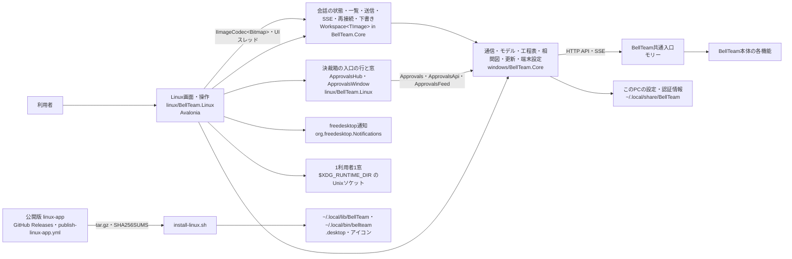
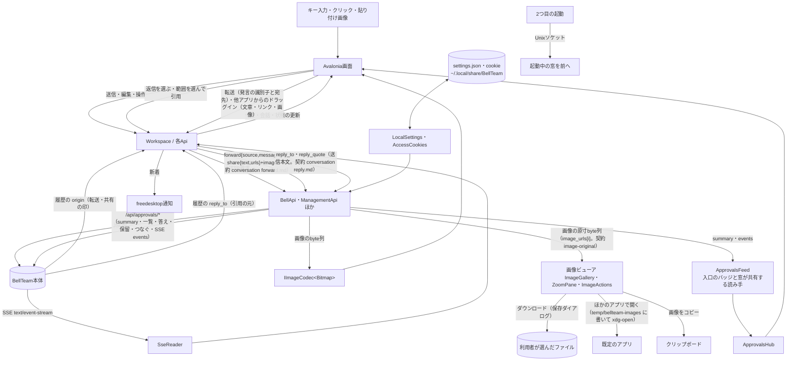
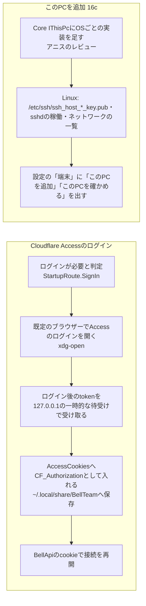

# Linuxアプリの機能図と作業手順

担当はネオン（`bot-208dcbab`）。この文書をLinux製品内部の機能図とデータの流れ図の正本とする。本体側の接続登録は[Linuxアプリ](architecture/modules/linux/README.md)、担当と変更手順は[機能担当と変更の手順](architecture/module-ownership.md)を参照する。

オーナー裁定（2026-11-12、工程 t24）：見た目はMac、コードはWindows。画面・配置・部品・状態の印・操作の流れ・文言はMac版（`ios/`、Mac Catalyst）に揃える。コードはWindowsアプリの共通部品`windows/BellTeam.Core`（plain `net10.0`）をそのまま参照し、Linuxで新しく作るのは画面の層だけとする。画面の部品はAvalonia（.NET 10）。OSの違いだけをLinuxの作法へ置き換える（⌘→Ctrl、窓の操作はデスクトップ環境の装飾、通知はfreedesktop通知）。Mac版の購入とAPNsの登録は移植しない（Windowsと同じ）。

## 機能図



- `BellTeam.Core`の所有者はアニス。LinuxはそのままProject参照で使い、Coreを変える時は小さなPRでアニスをレビューに入れる。条件はWindowsの挙動を変えないこと、[Windowsアーキテクチャ](windows-architecture.md)のCoreの節を同じ差分で更新すること、実行したBellTeam.Testsの範囲をPRに書くこと（2026-11-12 アニス合意）。
- `Workspace`（会話一覧・会話・送信・SSE・再接続・下書き）はWindowsの`BellTeam.App`からCoreへ移し、画像の型とUIスレッドへの戻りだけを各アプリが渡す。Windowsは`Workspace : Core.Workspace<BitmapSource>`で呼び出し側を変えない。
- 本体の状態は共通入口のHTTP APIとSSEだけで使う。本体の内部状態を直接読み書きしない。

## データの流れ



- 接続先・窓の大きさ・通知の設定・ログイン情報はCoreの`LocalSettings`（`SpecialFolder.LocalApplicationData`＝`$XDG_DATA_HOME`、既定`~/.local/share`）の`BellTeam/`に置く。アプリ本体とは別の場所で、削除しても残す。
- 書き込み（POST・PUT・DELETE）は自動で再送しない。SSEと一覧の読み直しは、Windowsと同じ上限付きバックオフで再試行を続ける（Coreの`ReconnectBackoff`）。

## 画面構成

Mac版と同じ構成で、[Windowsアーキテクチャ](windows-architecture.md)の「画面構成」の図と同じ部品・窓・シートを持つ（主窓1280×820・最小1100×640、サイドバー320〜420、詳細パネル、設定の項目一覧、主窓に重ねるシート、工程表と相関図の別窓）。Linuxでの置き換えは次だけとする。

| Mac | Linux |
| --- | --- |
| ⌘K・⌘2・⌘3・⌘4・⌘5・⌘,・⌘⇧I | Ctrl+K・Ctrl+2・Ctrl+3・Ctrl+4・Ctrl+5・Ctrl+,・Ctrl+Shift+I |
| 窓の信号ボタン・タイトルバー | デスクトップ環境の窓装飾 |
| macOS通知・APNs | 起動中だけのfreedesktop通知（既定はオフ） |
| 購入（StoreKit） | 「利用と課金」は案内とリンクだけ |
| Mac版の更新 | 設定の「アップデート」はBellTeam本体の更新（共通Update API）。アプリ自身の更新は導入手順の再実行 |

- 設定の「端末」は、Windowsの「このPCを追加」「このPCを確かめる」（16c）とオプション機能の案内を出さない。Coreの`ThisPc`がWindowsのOpenSSH鍵の置き場を読むためで、Linuxでは`NoThisPc`で自端末を持たない扱いにする。「通知」のスイッチは`DesktopNotifications`（`INotificationSwitch`）を切り替え、`SettingsStore.NotificationsEnabled`へ保存する。配信は`FreedesktopNotificationSink`がD-Bus（`org.freedesktop.Notifications`）で行い、通知を押すとその会話を開く。
- 決裁箱（Approval Box拡張。[screen-spec](architecture/modules/approval-box-extension/screen-spec.md)、[契約](architecture/modules/approval-box-extension/contract/approvals-contract.md)。task a184）：入口は左の欄の最上段の行（検索欄の下、メンバーの一覧の上。決裁箱・回答待ちの件数・急ぎは琥珀の稲妻。待ちが1件以上なら輪郭と光、0なら「待っている決裁はありません」）。押すと別窓`ApprovalsWindow`（1360×860・最小1100×640・1つだけ）が開き、一覧｜詳細｜工程とのつながりの3列を出す。読み手は`ApprovalsHub`が持つ`ApprovalsFeed`1つで、アプリが接続した間だけsummaryとSSEを読み、窓が開いていなくても入口の数が動く（Core。読めない時だけ1, 2, 4 … 30秒で読み直し続け、404・402・403・409とログイン切れは待たずに止まって「読み直す」「契約を確かめる」「決裁箱につなぐ」で抜ける）。窓は`pending,held`の一覧を決定の通知（SSE）と再接続のたびに読み直し、済みは開いた時だけ読む。答えは選択肢→確認→「答える」の2段で、同じ押下はIdempotency-Keyを変えず、自動で再送しない。つなぐは決裁箱の同意画面を既定のブラウザー（xdg-open）で開き、窓は`GET /api/approvals/connection`を2秒ごとに読んで許可・拒否・期限切れを表す（コードは見せない）。「工程表で見る」「工程表の工程を開く」は工程表の窓でその工程を開き、工程表の詳細の「決裁」欄の「決裁を開く」はこの窓でその決裁を選ぶ。外部から届いた決裁（Claude Code・Codexなど）も隠さず、同じく答えられる。画面の描画の確認は`--render-approvals <場面> <PNG>`（`ApprovalsFixture`）。
- 工程表の窓の「接続」パネルは（Windowsのa161・Appleのa165と同じ。カードの`connections`の開いた項目だけが行になり、他条件に接続・優先接続は線にしない。前工程は線のまま「前工程：◯◯」の札、接続のあるカードは「接続 N」の札、数の帯は作業中・接続・ブロック、メンバーの列と一覧の札も接続の数。Coreの`LatticeChart.ConnectionRows`・`OpenConnections`、行の「工程へ移動」は別の工程表の工程なら`LatticeWindow.OpenCard`でその工程表の詳細を開く。task a166-linux）、Mac版と同じく既定で閉じて右端のつまみ（つなぎの印と件数。作り手がブロック中の行があれば件数を赤）にし、つまみで開いてパネルの閉じるで畳む。開閉はアプリを開いている間だけ`LatticeChartPage.WaitsOpen`が覚える（保存しない）。上の帯は「切り替え・ライブ・ツリー/担当/過去ログ N」と「進み具合・数」の2つのまとまりで、1行に入らない幅では後ろのまとまりを2行目へ送る（Owner 2026-11-14、task a75）。進み具合の輪の数は、3桁でも輪の内側に収まる大きさへ縮める。
- 工程表の窓の一番左上は切り替えのボタン（戻る矢印・工程表の名前・下向きの印）で、押すと一覧（すべての工程表）へ1回で移る。一覧は縦に送る1枚の画面で、工程表が何枚でも全部選べる。Mac版の切り替えの小窓（行が440ptを超えると送る）と左上の「すべての工程表」ボタンは、Linuxでは切り替え自体が一覧を開くため足さない（Windowsと同じ。task a88）。一覧と「工程表が1枚だけならそれを開く」は、一覧の`counts.total`が0の工程表を数えず出さない（Coreの`LatticeChart.Shown`。Owner 2026-11-14、task a107）。本体の一覧は全部を保ったまま読み、会話の右の欄のボタンと工程へ移動はその工程表も開く。
- 会話の右の欄の「AIと操作」には、そのメンバーが作った工程表（一覧の`createdBy`）ごとに「工程表「名前」を開く」のボタンを出し、押すと工程表の窓でその工程表を開く（Mac a91、task a93）。一覧はメンバーを表示するたびに1回だけ読む（`ProfileView.LoadChartsAsync`）。古い本体（404）とログインが必要な時はボタンを出さない。それ以外の失敗は「工程表の一覧を読めませんでした。再試行しています…」と出し、Coreの`ReconnectBackoff`の間隔で読めるか別のメンバーを表示するまで読み直す。
- 会話の画像を押すと窓いっぱいの画像ビューア（`ImageGallery`。task a278、Mac a275に倣う）が開く。画像は契約`image-original`の`image_urls[i]`（原寸のまま）を1回だけ読み、ホイール（ポインターの位置を中心に拡大）・ピンチで拡大（フィットの1〜8倍、フィット以下には縮めない）、拡大中はドラッグで動かし、ダブルクリックでフィット⇔等倍（等倍が2倍未満なら2倍）に切り替え、`+` `-` `0`でも操作できる（`ZoomView`が計算。ピンチは`PinchGestureRecognizer`でタッチ操作の実機確認はまだ）。右上の3つのボタンが「ダウンロード」（Ctrl+S。保存ダイアログで、名前はURL末尾に画像の型の拡張子を合わせたもの）、「ほかのアプリで開く」（Ctrl+O。`$TMPDIR/bellteam-images/`へ原寸を書き`xdg-open`。終了コードが0以外なら理由を出す）、「画像をコピー」（Ctrl+C）。LinuxにはOS共通の共有シートが無いため、共有はこの2つで代える。結果と失敗は画面下の帯に出し、握りつぶさない。
- Cloudflare Accessのブラウザーでのログイン（WindowsはWebView2）はLinuxにまだ無い。ログインが必要な接続先では、その旨と「接続先を変更」を出す。LANのHTTP接続には要らない。
- 返信（task a272。契約は[reply.md](architecture/modules/conversation/reply.md)、Windowsのa271と同じCore：`ReplyReference`・`StartQuote`・`CancelQuote`・`JumpToAsync`・`ScrollToMessage`）：行の時刻の並びの「返信」（ポインターが行にある間だけ見え、キーボードでも届く）か、本文の右クリック「返信」「引用して返信」（選んだ範囲だけ。1つの段落の中だけで、段落をまたぐ選択は最初の段落）で、入力欄の上に「◯◯への返信／◯◯の発言の一部への返信」の帯を出す（×で取り消し。送信できたら空にし、失敗したら下書きと一緒に戻す）。送った行は本文の上に引用の箱を出し、押すと元の行へ移って短く光らせる。範囲の引用は元の本文の中で見つかれば選択の色で3秒塗る（見つからなくても移動はする）。元が消えている時は固定文「元のメッセージを表示できません」だけで押せず、範囲の引用なら保存された抜粋の下にその固定文を出す。引用は履歴の`reply_to`の保存済みの写しだけから描き、読み直して結び直さない。描画確認は`--render-conversation <reply|reply-pick|reply-jump|reply-part|reply-part-pick|reply-part-jump>`（参照モックの場面。Windowsと同じ名前）。
- 転送と共有（task a284。契約は[forward.md](architecture/modules/conversation/forward.md)、Core：`MessageOrigin`・`ForwardSource`・`Workspace.ForwardAsync`・`ShareContent`・`Workspace.ShareAsync`・`Timeline.OriginParts/OriginMark/ForwardRefusal/ShareRefusal`はWindowsのa283と共通）：行の時刻の並びの「転送」と本文の右クリック「転送」で、転送のシート（`DestinationSheet.Forward`：転送する発言の抜粋、転送先＝全メンバーと全ルーム、任意のコメント）が開く。送るのは発言の識別子とコメントだけで、中身はサーバーが写す。画像つきの発言はa291まで415で、平易な文で断る。履歴の`origin`のある行は、印（「転送・名前・時刻」「共有・アプリ名」）、Ownerのコメント（`content_start`までを吹き出しの本文）、内容を引用の箱で描く。Linuxには共通の共有シートが無いため、他のアプリから会話の上へ文章やリンクをドラッグして入れると共有のシート（`DestinationSheet.Share`。開いている会話が既定の宛先）が開き、リンクだけならURL、混じっていれば文章全体として送る（`ShareDrop.Parse`）。画像ファイルのドロップは従来どおり下書きに添付し、画像ではないファイルは断る。入力欄への文章のドロップは従来どおり文字として入る。Linuxの共有は会話へのドラッグインだけとし、「BellTeamで開く」（`.desktop`の関連付け）は作らない（Owner・トロニー裁定 2026-11-16）。描画確認は`--render-conversation <forward|forward-sheet|forward-failed|share-sheet|share-skipped>`。

## 導入と更新

導入も更新も、ターミナルで次の1行を実行する（x64・arm64のLinux、通常の利用者、管理者権限・.NET・ソースの取得は不要）。

```sh
curl -fsSL https://github.com/kitepon/BellTeam/releases/download/linux-app/install-linux.sh | sh
```

- 接続先を一緒に保存する時は末尾を`| sh -s -- --server-url http://サーバーのLANアドレス:18891`にする。省略すると既存の設定を保持し、初回起動時に入力する。導入後に起動しない時は`--no-launch`。
- 更新は同じ1行をもう一度実行する（BellTeamを閉じてから）。設定とログイン情報は`~/.local/share/BellTeam`にあり、更新でも削除でも残る。
- 削除は`| sh -s -- --uninstall`。本体・起動用リンク・アプリ一覧の登録だけを消す。

installerは公開版`linux-app`から、このCPUの`BellTeam-linux-<x64|arm64>.tar.gz`（.NET同梱）と`SHA256SUMS`を取り、照合してから`~/.local/lib/BellTeam`へ置き、`~/.local/bin/bellteam`とアプリ一覧の`~/.local/share/applications/bellteam.desktop`を登録する。取得できない・照合が合わない時は何も入れずに理由を出して終わり、もう一度実行すれば取り直す。開発者はソースから`scripts/install-linux.sh --from-source`で同じ導入を行える（.NET 10 SDKが要る）。

導入と削除が置き換え・削除するのは、このinstallerが置いた物だけとする（既存の別の物を上書き・削除しないため）。本体のフォルダは印のファイル`.bellteam-installer`を持つ（印が無い最初の版の配置`BellTeam`と`bellteam.png`も含む）こと、`~/.local/bin/bellteam`は導入した本体へのシンボリックリンクであること、`bellteam.desktop`は導入した本体を`Exec=`で起動することで見分ける。どれかが別の物なら、何も変えずにその場所を名指しして終了する。利用者がその物を別の場所へ移すか不要なら消して、もう一度実行すれば進む。

## 公開

公開は`.github/workflows/publish-linux-app.yml`を既定ブランチで手動実行する（担当はネオン）。Linuxの試験を通してから`scripts/package-linux-app.sh`で2つのCPUの配布物・`SHA256SUMS`・`install-linux.sh`を作り、GitHubの公開版`linux-app`（タグも同名で、公開した版のcommitへ動かす）の中身を置き換える。題名に`linux/BellTeam.Linux`の`Version`を出す。この公開版は「Latest」にしない。「Latest」は本体の更新カタログが使い（`scripts/container-update-host.py`）、カタログの選び方は`updates-`で始まるタグだけを読むため、`linux-app`はカタログに混ざらない。

## まだ無いものと計画



- Cloudflare Accessのログイン：今はログインが必要な接続先でその旨と「接続先を変更」を出すだけで、LANの外からは使えない。WindowsはWebView2の中でログインしてcookieを取り出す。Linuxは埋め込みのブラウザーを持たないため、既定のブラウザーでログインし、Accessがログイン後に渡すtokenを手元の一時的な待受けで受け取る方式を計画する（`cloudflared access login`と同じ受け渡し）。受け取り方はAccess側の実際の動きで確かめてから作る。
- このPCを追加（16c）：Coreの`ThisPcSystem`がWindowsのOpenSSHの鍵の置き場を読むため、Linuxは`NoThisPc`で出していない。Coreの`IThisPc`にLinuxの実装（ホスト鍵の公開鍵・sshdの稼働・インターフェースの一覧）を足すPRをアニスのレビューで出し、Windowsの動きは変えない。

## 開発と確認

```sh
dotnet build linux/BellTeam.Linux.slnx -c Release
dotnet test linux/BellTeam.Linux.slnx -c Release
```

試験は窓を表示しない。実画面での受け入れは、GNOME（Wayland）の実画面で導入手順から起動して行う。
