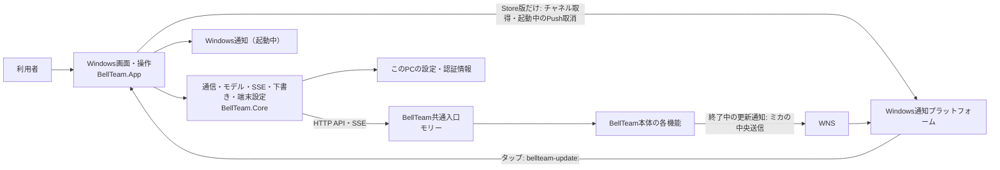
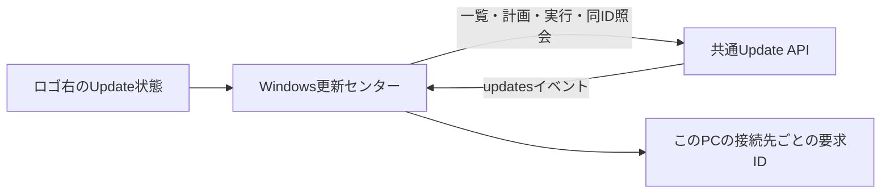
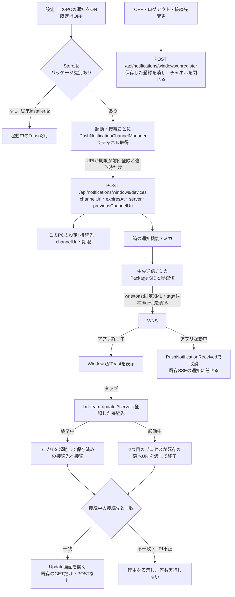

# Windowsアプリの機能図と作業手順

担当はベル（Windows）。この文書をWindows製品内部の機能図の正本とする。本体側の接続登録は[Windowsアプリ](architecture/modules/windows/README.md)、担当と変更手順は[機能担当と変更の手順](architecture/module-ownership.md)を参照する。

## 現在の接続と所有

画面、端末での操作と通知、接続先・窓・通知設定、端末の認証情報はWindowsアプリが扱う。会話、メンバー、予定、利用設定など本体の状態は共通入口を通じて利用する。画面の具体的な機能と端末設定は[Windowsアプリ](windows-app.md)を参照する。接続登録上の本体公開窓口は統合の `HTTP/MCP` で、現行Windows実装が利用するのはHTTP APIとSSEである。本体の内部状態を直接読み書きしない。

会話履歴の `deliveryTracking` は本体が受付の根拠を保存・投影し、Windowsは既知の値だけを表示する。直接会話の受付済み・完了未確認と、部屋の宛先別の完了未確認を区別し、部屋の他の配送失敗や振り分け失敗を優先する。履歴のない値や未知の値は従来の表示を維持する。

## 変更時の手順

変更前に[全体図](architecture/feature-map.md)からこの図、呼出元と接続先の図へ辿り、機能・入出力・状態所有・接続・失敗の扱いを確認して図の変更要否を決める。全caller、データ、test、fixture、設定、exportまで影響範囲を確認する。必要な図と接続情報はコードと同じ差分で更新し、図を変えない場合は既存図に収まる理由を変更説明に記す。全体図の生成と直接境界の検証は[共通手順](architecture/module-ownership.md)に従う。

## 更新センター

ロゴ右の入口は共通の更新状態を表示する。更新センターは更新の有無、提供された変更内容、現在必要な操作を先に示し、対象ごとの状態と診断情報は利用者が開く詳細に置く。状態・計画・影響・実行結果の正本は[共通入口](architecture/modules/integration/README.md)のUpdate API。Windowsは計画の内容を見せ、明示操作で固定planを実行し、requestIdを保持して同じ要求を照会する。結果が不明な操作を成功へ変えず、自動再送しない。

更新対象が複数ある場合は利用者が対象を選び、単独または共通APIの全体計画を取得する。計画の対象と影響を確認してから実行する。処理中・結果不明・失敗・検証済み完了を区別し、結果不明の要求は同じIDで照会する。通常画面では内部識別子や版のハッシュを表示せず、提供された分かりやすい公開版だけを示す。変更内容がなければ欄を出さない。

人工データを使う非表示の実画面previewは[通常幅](assets/windows-update-page/update.png)、[最小幅](assets/windows-update-page/update-narrow.png)、[最小幅の詳細](assets/windows-update-page/update-detail-narrow.png)。画面は固定fixtureを表示し、実環境の更新を示さない。

起動中の更新通知は共通inventoryの `notificationCandidates` だけを使用し、同じ接続先と機能の最新digestを端末に保持して重複を抑止する。既存のWindows通知設定とToastを使い、押すと同じ接続先の更新センターを開く。受信による更新POSTはしない。終了中の受信は次節のStore版だけが持つ。

## 終了中の更新通知（Microsoft Store版）

工程L-2。オーナー裁定で、Microsoft Storeの個人開発者として配布し、StoreがMSIXへ署名する無料の経路を使う。有料のコード署名証明書・Azure・Entra・Windows App SDKは使わない。チャネルはWindows標準のWinRT `PushNotificationChannelManager`、送信はミカの中央送信がPartner CenterのPackage SIDと秘密値でWNSへ認証する。箱は取消可能な送信用の合言葉だけを持つ。サーバー・中央・WNSへの送信はミカの担当で、Windowsはチャネルの取得・登録・解除と、タップの受け口だけを持つ。

- 状態の所有: このPCの設定 `pushChannel` に、登録した接続先・channelUri・期限だけを置く。新しい端末IDは作らない。登録の台帳・失効（WNSの404/410）・送信はミカが持つ。
- 登録の時機: 通知ON・Store版・接続済みの時、接続ごとにチャネルを取り直し、URIか期限が前回と違う時だけ登録する。URIが替わった時は`previousChannelUri`を付ける。チャネルは最長30日で、起動していない間の期限切れは扱わない。登録の失敗は表示し、自動で繰り返さない。次の接続で取り直す。
- 解除の時機: 通知OFF、ログアウト、接続先変更の前に、接続中の箱へ解除を送る。アプリの削除後はWNSが404/410を返し、ミカ側で失効する。
- タップ: 通知はWindowsが表示するため、アプリは中身を検証しない。受け口は`bellteam-update:`のURIから`server`だけを読み、既存の`OpenNotificationAsync`へ渡す。接続中の接続先と一致した時だけUpdate画面を開き、既存のGETだけを行う。
- 起動中の重複: 起動中に届いたWNSのToastは取り消し、既存のSSEと`notificationCandidates`による通知だけを出す。終了中に表示された候補は、次の起動時にSSEでもう一度通知され得る（このPCの既出digestへ記録する処理は終了中に動かないため）。
- 従来のinstaller版はパッケージ識別を持たないため、終了中の通知を受けない。既存利用者向けに残し、起動中の通知は従来どおり。
- 対象は更新通知だけ。会話・秘密入力・問いの終了中通知は、同じチャネルを使う別の段階で扱う。
