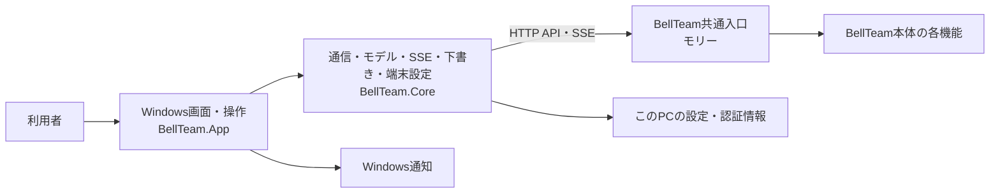
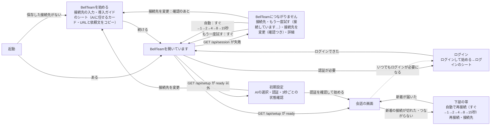
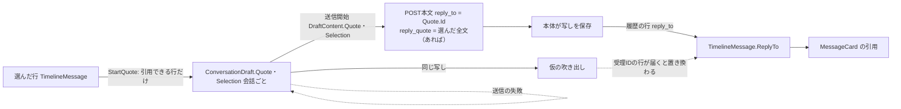
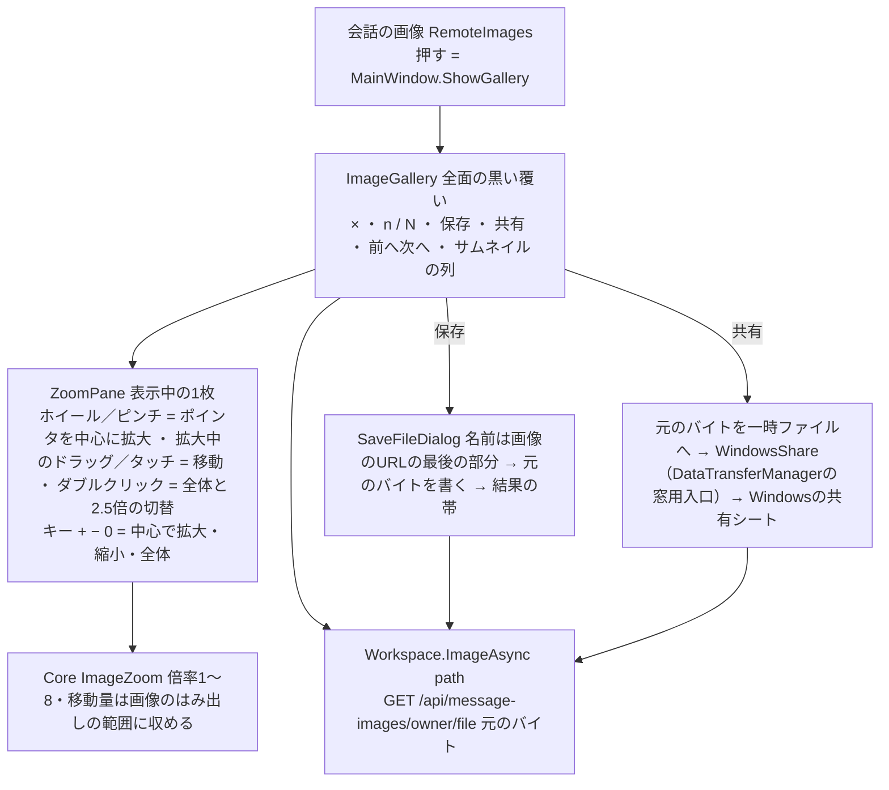
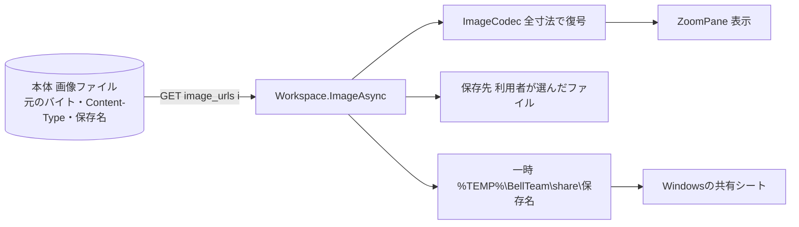
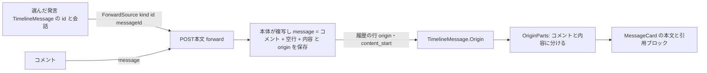
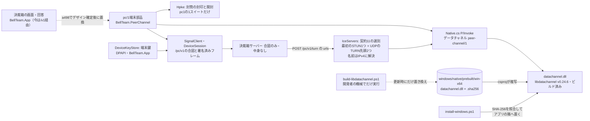
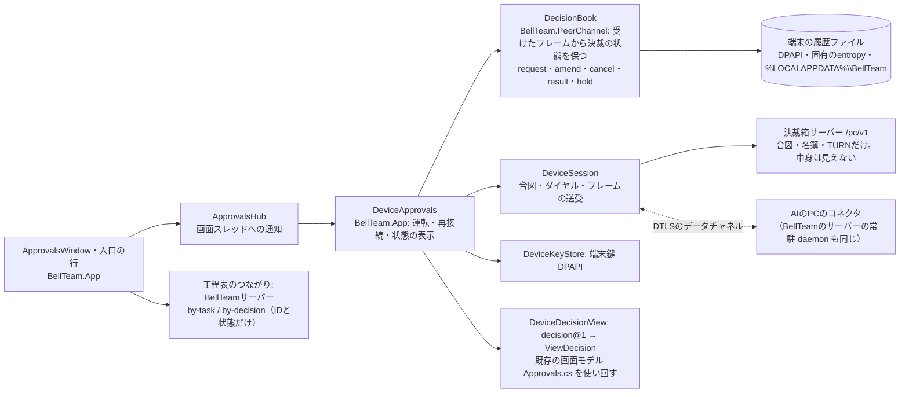
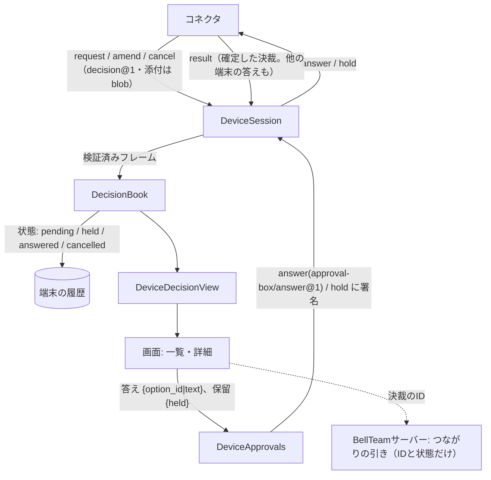
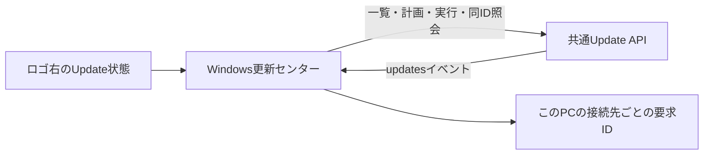

# Windowsアプリの機能図と作業手順

担当はアニス（`bot-0d7da1c1`）。この文書をWindows製品内部の機能図の正本とする。本体側の接続登録は[Windowsアプリ](architecture/modules/windows/README.md)、担当と変更手順は[機能担当と変更の手順](architecture/module-ownership.md)を参照する。

## 現在の接続と所有



画面、端末での操作と通知、接続先・窓・通知設定、端末の認証情報はWindowsアプリが扱う。会話、メンバー、予定、利用設定など本体の状態は共通入口を通じて利用する。画面の具体的な機能と端末設定は[Windowsアプリ](windows-app.md)を参照する。接続登録上の本体公開窓口は統合の `HTTP/MCP` で、現行Windows実装が利用するのはHTTP APIとSSEである。本体の内部状態を直接読み書きしない。

会話履歴の `deliveryTracking` は本体が受付の根拠を保存・投影し、Windowsは既知の値だけを表示する。直接会話の受付済み・完了未確認と、部屋の宛先別の完了未確認を区別し、部屋の他の配送失敗や振り分け失敗を優先する。履歴のない値や未知の値は従来の表示を維持する。配送の状態名はMacの7状態に合わせ、ルームの振り分け失敗、メッセージ自身の値、宛先ごとの最悪の値の順で決め、その上へ完了未確認を重ねる。ルームの返信先の自動選択は、`/api/settings`の`routing`が有効な間だけ使える。

## 画面構成（Mac版と同じ構成）

工程W-MAC（オーナー指示 2026-11-08）で、Windowsの画面をMac版（main `f62a4286`の`ios/`、Mac Catalyst）と同じ構成へ作り直す。下の2つの図は作り直し後の構成で、各PRがこの図に沿って画面を置き換える。差分と進み具合は[差分一覧](windows-mac-parity-gaps.md)に置く。OSの違いだけをWindowsの作法へ置き換える（⌘→Ctrl、窓の操作ボタン、タイトルバー）。Mac版の購入とAPNsの登録は移植しない。「利用と課金」は案内とリンクだけ、「通知」は起動中の通知の切替だけを置く（トロニー裁定 2026-11-08）。

```mermaid
flowchart LR
  subgraph Main[主窓 1280×820・最小1100×640]
    Sidebar[サイドバー 幅320〜420<br/>BellTeam・＋▾ メンバーを追加/ルームを作成<br/>Updateバッジ（更新がある時だけ）<br/>検索 Ctrl+K<br/>ルーム・メンバーの行: アバター57.6・2行の今の仕事・起動できない理由の赤い行（メンバーだけ）・在席の点・ファスト<br/>予定 Ctrl+2・ゴール Ctrl+3・相関図 Ctrl+4・工程表 Ctrl+5・設定 Ctrl+,<br/>N人オンライン・利用者名]
    Detail[詳細の領域]
    Status[接続状態の帯]
  end
  Sidebar -->|行を選ぶ| Conversation
  Sidebar -->|予定| Schedules[予定のページ]
  Sidebar -->|ゴール| Goals[ゴールのページ]
  Sidebar -->|設定| Settings
  Sidebar -->|相関図 Ctrl+4| WorkGraphWindow[相関図の別窓 題名「相関図」・最小480×360・1つだけ（2回目は前へ出す）<br/>窓が見えている間だけ新着を受け取る・毎フレームの描画<br/>メンバーのクリック・Tabと矢印で選んでEnter・Spaceで本体の窓を前へ出してその会話を開く<br/>線へのホバーで待っている札・ホイールで箱の中の文を送る<br/>読み上げ: メンバーと依頼の要素]
  Sidebar -->|決裁箱（一覧の一番上の固定の行）| ApprovalsWindow[決裁箱の別窓 題名「決裁箱」1360×860・最小1000×600・1つだけ（2回目は前へ出す）<br/>一覧（待ち／保留／済み・出どころ すべて／BellTeam／外部・急ぎ→期限→古い順）｜詳細（答えを選ぶ→その場の確認→答える・選ばずに指示を書いて返す・保留にする・添付・経過）｜工程とのつながり<br/>未接続は「決裁箱につなぐ」（ブラウザで同意→待つ）・契約なし／切れ／旧本体／再接続の各画面<br/>窓が見えている間だけ読み、何も保存しない]
  Sidebar -->|工程表 Ctrl+5| LatticeWindow[工程表の別窓 題名「工程表」1360×860・最小900×600・1つだけ・Windows 11ではMica<br/>一覧（統括をピン留め・進み具合の輪・動いているメンバー・接続N・新しい工程表の説明・題の横にブロック一覧）→ 工程表（1枚だけなら一覧を飛ばす）<br/>ブロック一覧（全部の工程表のブロックを新しい順・行に担当/理由/ブロックした人と時刻・外すは行の中で一度確かめる・行を押すとその工程表と詳細・読み直すとF5・Escは確認を閉じるか一覧へ）<br/>上の帯（一番左に「すべての工程表」のボタン→一覧（Appleと同じ。Owner 2026-11-14）・切り替え→一覧・ライブ・ツリー/担当/過去ログ Nの切り替え（各札は自分の文字の幅）・進み具合（輪の中の数は入らなければ60%まで縮める）・作業中/接続（開いている接続の数）/ブロック。1行に入らなければ進み具合と数を2行目へ）・一覧から元の工程表へ戻る（工程表名の戻るボタン・Esc）・帯（未検証・最後の確認＋統括と話す）・左のメンバーの列（押すと強調）<br/>終わった工程（archived）はツリーと担当に描かず、過去ログ（終わった工程をJSTの日ごと・新しい順、押すと詳細）に並べる。閉じたツリーの終わった工程はsnapshotに無く（a457）、過去ログを開いた時だけGET /api/lattice/charts/{id}/historyで1ページ目、一覧の末尾までスクロールで次のページを読んで並べる（末尾に読み込み中の行、失敗は「続きを読めませんでした。」と読み直す）。切り替えの件数＝snapshotの終わった工程＋history.closed。中央はツリー（既定。工程表→まとまり→工程をparentで入れ子、箱を押すと詳細、依存は箱の右の弧）か、担当ごとのレーン（担当＝producer、無ければ工程表に書かれたlaneの文字、無ければ担当なし）×depthの列・前工程の辺の粒と札「前工程：◯◯」・開いた接続のある札の「接続 N」・右の接続（既定は閉じて右端のつまみ＝リンクの印と件数、作り手がブロック中の行があれば件数を赤。押すと開き、見出しの閉じるで畳む。他条件に接続と優先接続の行だけで、線にはしない。会話を開く・工程へ移動）・札から育つ詳細（Esc。Ownerの札は決裁箱拡張の決裁の題と状態を終了条件の下に。決裁を開くは決裁箱の画面がアプリに入るまで出さない）<br/>窓が見えている間だけ読む。失敗の表示はscreen-specの表のまま]
  Sidebar -->|Updateバッジ| UpdateSheet[Updateシート]
  Detail --> Conversation[会話<br/>帯・メンバーの起動できない理由の上端の行・吹き出し（分身の印）・受付確認中の仮の吹き出し・配送状態・Bot間の連絡・画像<br/>秘密入力（ラベルだけ・鍵の行・状態の札）・問い（選択肢は1行に1つ・番号つき・全幅、主ボタン「送る」、警告つきの失敗行）・機械席の出来事の行（`kind=machine_event`。a471-askuser、conversationの[machine-stream](architecture/modules/conversation/machine-stream.md)が正。`view`で描き、生の行は読まない。何も隠さない（`hide`は無く、`fold`以外の`display`は`show`。`shown_elsewhere`は目印だけ。`words`の行は本体が`bubble: true`を付けた行（終わったターンの最後の発言。Coreの`MachineEvent.Bubble`）だけ通常の受信吹き出しで描き、他は吹き出しの無い文章。a471-tune-answer）。`fold`の行は開閉できる1行（既定は閉じ、押すと全文、`truncated`なら「全文を読み込む」で`GET /api/bots/:id/machine-events/:seq`の保存行）で、隣り合う同じ`fold_group`だけを1行にまとめ（Coreの`Timeline.VisibleMachine`・`Expand`。どの行も時間の位置から動かさず、`tool_result`を`tool_use`の下へ引き上げない。a471-tune-tools）、行の名前はCoreの`Timeline.FoldLabel`（`fold_count`の合計n。n>1は「tools ×2」、n=1は`fold_count`が1の行の道具名、n=0は「group ×行数」）、開くと各行が閉じた1行で並び、押すとその全文（`tool_use`は`tool.summary`）が開く（Windowsの`MachineEntry`は`FoldLabel`で名前を決め、複数行の行は中を`Fold`で入れ子にする）。開閉はアプリの状態で保存しない。`question`は問ごとに番号つきの選択肢と「その他」の文章欄、1問・単一選択は押すだけで送り、複数問・複数選択は主ボタン「送る」。`approval`は「許可」「却下」。どちらも`POST /api/seat-requests/:id/answer`、`pending`の間だけ操作でき、結果は`request.status`を読み直して描く）・処理中の帯と止める<br/>入力欄の上の帯（読み返している間は「最新へ」、新着があれば「新着メッセージ」。矢印アイコンつき・本文に重ねない）<br/>返信先・ゴールのカプセル（言い切りの文。ゴール機能の無いメンバーには出さない。読めない時は一文と「状態を更新」と閉じた詳細）・入力欄]
  Detail --> Inspector[詳細パネル Ctrl+Shift+I<br/>メンバー: 大画像（左下に重ねた84の小画像・白縁と影）・名前と役職の2行・オンライン・オフラインの札・AIと操作（AIのアイコン・名前・CLIの既定かの一行、モデル・エフォート・アカウント・ファストの札、主ボタン「Botの画面を見る」、枠なしの再起動は待つ間「再起動しています…」。「Botの画面を見る」の下に、そのメンバーが作った工程表（一覧の`createdBy`）ごとの「工程表「名前」を開く」ボタン。一覧は開いたメンバーごとに1回読み、読めなければボタンを出さずtraceへ。押すと工程表の窓でその工程表（`IInspectorHost.OpenLatticeChart`→`LatticeWindow.OpenChart`。Owner 2026-11-14）・プロフィール（担当する仕事・性格・考え方・口調・背景・見た目・関係性の色付きカード。120字を超えると4行で畳み「続きを読む」）・全幅の「メンバーを編集」<br/>ルーム: 共有する仕事・参加メンバー（顔34・名前と役職の2行・矢印）・全幅の「ルームを編集」]
  Inspector --> Screen[Botの画面<br/>1秒ごと・キーバー（機械席は出さない）・許可の帯]
  subgraph Settings[設定 項目一覧300＋ページ（Mac settings-user-flow。各行は題名・いまの状態の一行・札）]
    SA[要対応の帯<br/>失敗・ログインし直す・確認できません・更新あり・停止中を一覧の最上段に集める<br/>押すとその項目（AIの認証はそのAI・スロットの認証画面）]
    S1[プロフィール<br/>Ownerだけを保存]
    S2[AIの認証<br/>AIごとの行・Claudeは1つ目/2つ目・上限の1行・N人が使用<br/>主ボタンはログインが必要・失敗・途中の行だけ<br/>各行にサーバーの一文（install.message）と「最新版を入れる」（入れていない時は一文とこのボタンだけ・ログインは出さない。Mac同様、動けないAIか入れ直しの失敗の一文は橙・ボタンは主ボタン、それ以外は灰色の一文と静かなボタン。送信中は「始めています…」、サーバーが入れている間はスピナー）<br/>行を押すとログインは右のページの1枚のカード（名前・メール・札・上限・段階の一文とその段階の操作だけ）] --- SS[仕事の要約を書くAI] --- ST[端末 16a<br/>一覧・追加・旧本体の一行・詳細（先頭のアイコン・名前・OSと持ち主・つながるか／鍵の札、接続先の1行と畳んだ詳細、主ボタン「つながるか確かめる」、結果がある時だけ「つながるか」、ホスト鍵・鍵の行・C8・登録を消す）] --- SX[稼働中に数えない処理 a65<br/>承認済みの処理（アイコン・処理の名前・対象のメンバー・承認日・理由・外す）と<br/>承認を待っている提案（提案した人・日時。押すものは無い）、空なら一行<br/>外すは確かめてから1回だけ送り、開いた時と外した後に読み直す] --- SO[1Password<br/>先頭の札と一行、読める保管庫・token・結果] --- S4[通知<br/>4状態（サーバーで無効・端末でオフ・未登録・届きます）と主ボタン1つ] --- S3[追加機能<br/>1Password以外の機能設定]
    SR[チームの決まり<br/>決まりごとのカード・全文の編集]
    S5[接続<br/>接続先を変える前に確認] --- S6[表示<br/>会話の開き方]
    S7[利用と課金<br/>案内とリンク・買う場所の文と契約の状態行（a485）] --- S8[アップデート] --- S9[このアプリについて<br/>版だけ]
    S10[全体停止]
  end
  subgraph Sheets[主窓に重ねるシート 720×540〜820×680]
    MemberSheet[メンバーを追加] --- RoomSheet[ルームを作る・編集<br/>参加メンバー（外す行）・名前や役職で探す・すべてのメンバーから選ぶ（加える行）・代表] --- GoalSheet[ゴールの編集] --- ScheduleSheet[予定の追加・編集<br/>コマンドは「コマンドを表示して編集」に畳む・空なら開く・等幅・8行まで]
    ImageSheet[小画像・大画像の操作] --- Crop[切り抜き 680×520] --- PeerSheet[メンバー間の連絡] --- SecretSheet[秘密の入力<br/>会話のカードと端末の鍵から開くモーダル窓 720幅]
    TerminalSheet[端末を追加・編集 16a<br/>ID・ホスト・ユーザー・ポート・OS・持ち主] --- HostKeySheet[ホスト鍵 16a<br/>端末で読んだ指紋を入れる]
  end
  ST -->|端末を追加・編集| TerminalSheet
  ST -->|詳細「ほかの方法」| HostKeySheet
  ST -->|鍵の「設定する」「設定し直す」・「この端末にこの鍵を入れる」| SecretSheet
  Inspector -->|メンバーを編集| MemberWindow[メンバー編集の別窓 1120×900]
  Conversation --> Gallery[画像の閲覧<br/>主窓いっぱいの黒い覆い・×・n / N・‹ ›・64のサムネイル]
  Conversation --> Corner[窓の右上の紫の丸いボタン<br/>詳細パネル・会話を書き出す]
  UpdateSheet -.同じ内容.- S8
```

起動の画面（Mac版RootViewと同じ段階）。接続できなかった時は、失敗の画面（Mac版のConnectionFailureView：「BellTeamにつながりません」・接続先のホスト・主ボタン「もう一度試す」・「接続先を変更」・生のエラーを畳んだ「詳細」）を出したまま自動で接続し直す。「もう一度試す」は失敗の画面を残したまま「接続しています…」と読み替えて押せなくし、「接続先を変更」は先に「接続先を変更しますか？」の確認を出す（取り消せば何も変えない）。待ち時間は共通の再接続の段階（すぐ→1→2→4→8→15秒、以後15秒。各±20%）で、認証が必要・画面を離れる・接続先の変更・ログアウト・窓を閉じる時だけ止まる。「もう一度試す」はすぐに1回つなぐ（段階は戻さない）。つながるか認証が必要になれば段階を最初に戻す。



```mermaid
flowchart LR
  subgraph App[BellTeam.App 画面]
    A1[サイドバー]
    A2[会話・詳細パネル]
    A3[Botの画面]
    A4[ゴール<br/>カプセルの文と失敗の一文はCoreのGoalPillText。読取の失敗はErrorTextに書かずReadError（閉じた詳細だけ）]
    A5[予定]
    A6[設定の各ページ<br/>行の一行・札・要対応の帯はCoreのSettingsSummaryが決め、SettingsWindowが開いた時・前面に戻った時に読む]
    A7[Update]
    A8[相関図の窓<br/>WorkGraphWindow・WorkGraphCanvas・WorkGraphText<br/>毎フレームの描画・入力・読み上げ。状態は持たない]
    A13[決裁箱の窓 a183<br/>ApprovalsHub（接続中の1本のApprovalsFeedを持ち、入口の行と窓へ知らせる）・ApprovalsEntryRow（左メニュー最上段の行。数・急ぎの稲妻・0の時は静か）・ApprovalsWindow・ApprovalsPage・ApprovalsLook<br/>描画・入力・読み上げ。言葉と規則はCoreのApprovals、状態の保存はしない（出どころの選びはアプリを開いている間だけ）]
    A12[工程表の窓<br/>LatticeWindow・LatticeChartPage・LatticeStopsPage（ブロック一覧）・LatticeTreeView・LatticeBoard・LatticeViews<br/>描画・入力・読み上げ・動き。図の状態はLatticeChartFeedが持つ<br/>LatticeFixtureは--render-latticeの描画用の模擬サーバー（本番では使わない）]
    A9[秘密の入力の窓 14<br/>SecretInputWindow（会話のカードから開くモーダル）<br/>1Passwordから選ぶ・読み出す / ここに入力する・貼り付ける<br/>一回だけの値（1Passwordを出さない・ログインは「パスワードを渡す」、ほかは「渡して続ける」）・検索欄・一覧<br/>欄は送信・閉じる・窓が非アクティブで消す]
    A10[設定の「端末」 16a・16c<br/>TerminalListView・TerminalDetailView・TerminalEditorView・HostKeyView<br/>描くだけ。状態はTerminalsModelが持つ<br/>16c：追加の「このPCを追加」、詳細の「このPCを確かめる」「オプション機能を開く」（ms-settings:optionalfeatures）]
    A11[メンバー編集の「端末とフォルダ」 16b<br/>MemberTerminalSection（動かす場所・フォルダの読み取り専用の表示・畳んだ「ほかの方法」の中の「パスを入力」・組の問題）<br/>FolderPickerView（編集の窓または追加のシートの中に重ねる。主窓のシートは使わない）<br/>保存の拒否の文と、FOLDER_MISSINGだけの「このフォルダを作って保存」はMemberEditorView]
  end
  subgraph Core[BellTeam.Core 通信とモデル]
    C1[Workspace&lt;TImage&gt;・MessageItem・BellApi<br/>一覧・会話・送信・SSE・下書き<br/>画像はIImageCodec、最初のページの描画後はafterFirstRenderをアプリが渡す（WindowsはWorkspace : Workspace&lt;BitmapSource&gt;とContextIdle）<br/>メンバーのseatLaunch・configurationApplicationと行のseatは寛容に読む（不正な型は無しとして扱い、一覧・履歴を壊さない）]
    C2[ManagementApi<br/>メンバー・ルーム・画像・書き出し・再起動（待ち180秒）・停止・モデル候補（display_name）<br/>メンバーのterminalId・projectRoot（応答にある本体だけ送る）とcreateFolder（その保存の本文だけ。保存結果の照合には入れない）]
    C3[ScreenInputModel<br/>キー・許可の送信と確認]
    C4[GoalsApi]
    C5[PlanningApi]
    C6[SettingsApi<br/>所有者・規範・追加機能（guide・connectionは寛容に読む）・AIの認証・仕事の要約・全体停止]
    C9[HarnessAccountsApi<br/>Claudeの1st・2ndアカウントの一覧]
    C10[WorkGraphModel・WorkGraphSimulation<br/>相関図の図の状態・シミュレーション・札の置き場所・入れ替え・clearance・当たり判定<br/>永続状態なし。文字の測り方は画面から受け取る]
    C14[LatticeChart・LatticeChartFeed・LatticeApi<br/>工程表の計算（web/lattice-chart-model.jsの移植：一覧に出す工程表（LatticeChart.Shown＝shownCharts。分母0は一覧・切り替え・一枚だけ開く判定から外す、a107。メンバーの工程表ボタンは全件）・名前・レーン・ツリー（LatticeChart.Tree＝layoutTree）・過去ログ（LatticeChart.History・HistoryCount・WithHistory、閉じたツリーのページはLatticeHistoryFeedが過去ログを開いている間だけ持つ、a457）・待ちの文・詳細・帯・粒・差分）<br/>開いている工程表1枚の最後のsnapshotと接続の状態。永続状態なし<br/>LatticeStops（web/lattice-stops.jsの純粋部分の移植：止めの行・新しい順・顔の規則・時刻・読み上げ・外すの答えの仕分け）]
    C7[UpdateCenter]
    C8[LocalSettings<br/>接続先・窓・通知・会話の開き方・要求ID]
    C11[SecretRequestApi・SecretInputModel 14<br/>inputOptions・oneTimeは寛容に読む（型違いは無し）<br/>onepassword-items（404は旧本体）・検索と絞り込み・文言・送信の本文]
    C12[TerminalsApi・TerminalsModel 16a・16b・16c<br/>端末は寛容に読む（新しい項目は省略可）・一覧の状態（未読込・対応・旧本体・失敗＋前の一覧）<br/>確かめ結果・鍵の導入の待ち（上限なし・1秒間隔）はこのアプリの中だけ<br/>理由の文・OSごとの文（Mac・Windows PC・Linuxマシン）・端末の入力の検査・指紋の形・エラー符号の文<br/>16b：フォルダ一覧の読み・作成（folders・folder）・旧本体の判定（FoldersUnsupported）<br/>MemberBinding（組の規則・OSごとの絶対パス）・MemberFolder（既定のフォルダ・OSごとのprefill・FOLDER_*の文）・TerminalFolderPicker（名前の規則・パスの結合・一文）・TerminalFolderPickerModel（読み込み中・一覧・失敗・旧本体。作成は1回だけ送る）<br/>16c：このPCの確かめ中・結果の一行・試した端末もこのアプリの中だけ]
    C16A[Approvals・ApprovalsApi・ApprovalsFeed 決裁箱（a183-gate-core-neon、Linuxの決裁箱a184が先に使う）<br/>/api/approvals/*の型は寛容に読む（追加項目は無視、不明な値は「その他」）<br/>Approvals＝web/approvals-model.jsの移植（失敗の種類・出どころ・札・つながりの一行・済みの日付まとめ・答えの確認文と結果・届いた文・工程とのつながり・数え方・入口）<br/>ApprovalsApi＝BellApi.RawAsyncで402・403・409の本文を読んで返す（ログインが切れた時だけ401）。書き込みは自動で再送しない（答えはIdempotency-Key付き）<br/>ApprovalsFeed＝summaryを読みeventsを保つ。読めない時だけ1, 2, 4 … 30秒で読み直し続ける。404・402・403・409とログイン切れは待たずに止まりRefreshで再開]
    C15[RunningExclusions a65<br/>一覧と提案を寛容に読む（scopeは"all"かBot IDの配列）・行の文・設定の一行と札]
    C13[ThisPc 16c<br/>IThisPc：このPCの事実を読む入口（試験は差し替える）<br/>ThisPcFacts：主なIPv4・ドメインのアカウントか・ホストがこのPCか<br/>HostKeyFile：ssh_host_ed25519_key.pubから指紋<br/>ThisPcTrust：結果の一行]
  end
  PC[("このPC<br/>ネットワークの設定・127.0.0.1の22番・<br/>ProgramData\ssh\ssh_host_ed25519_key.pub")]
  A1 --> C1
  A2 --> C1
  A2 --> C2
  A3 --> C3
  A4 --> C4
  A5 --> C5
  A6 --> C6
  A6 --> C15
  A6 --> C9
  A6 --> C8
  A7 --> C7
  A8 --> C10
  A12 --> C14
  A13 --> C16A
  A13 -->|"工程表で見る・工程表の工程を開く・前後の工程（MainWindow.ShowLattice → LatticeWindow.OpenCard）"| A12
  A12 -->|"決裁を開く（Ownerの札の詳細。ApprovalsHub.Show → 決裁箱の窓でその決裁の詳細）"| A13
  A12 -->|"アバター（既存の画像キャッシュ）・名簿の名前（作った人の工程表）"| C1
  A12 -->|"会話を開く・統括と話す（MainWindow.OpenFromLatticeAsync）"| A2
  Inspector -->|"メンバーの工程表ボタン（MainWindow.OpenLatticeChart）"| A12
  A2 -->|"秘密のカード「安全な入力欄を開く」"| A9
  A9 --> C11
  A6 --> A10
  A10 --> C12
  A2 -->|"メンバー編集（別の窓・追加のシート）"| A11
  A11 --> C12
  A11 -->|"保存の本文にterminalId・projectRoot"| C2
  A10 -->|"このPCを追加：IPv4・ユーザー・22番の応答"| C13
  C12 -->|"このPCを確かめる：ホスト鍵の指紋（追加の保存後に1回・一覧を読んだ時に未信用でこのPCのホスト・詳細のボタン）"| C13
  C13 -->|"読むだけ。書かない・秘密を扱わない"| PC
  A10 -->|"鍵の依頼（botId:null）を窓へ渡す"| A9
  A8 -->|"アバター（既存の画像キャッシュ）"| C1
  C1 -->|"/api/session・bots（currentWork・seatLaunch・configurationApplication）・rooms・messages（seat）・queue・events"| API[共通入口 HTTP API・SSE]
  C2 -->|"/api/bots・rooms・avatar・avatar-large・export・restart（応答は新しい席が立ってから。要求の待ちは180秒、再送しない）・stop・models（display_name。選ぶ値と保存する値はid）"| API
  C3 -->|"/api/bots/{id}/screen・screen/key・screen/approval"| API
  C4 -->|"/api/goals・/api/bots/{id}/goal"| API
  C5 -->|"/api/schedules"| API
  C6 -->|"/api/owner・user-rules・settings・settings/{id}（onePasswordは{enabled, values:{token}}を1回だけ送る。応答のsettingで結果を決め、成功後に/api/settingsを読み直す。tokenは画面に戻さず、記録しない）・settings/backgroundAgent・harness-auth（Claudeは?slot=2nd）・ai-control"| API
  C7 -->|"/api/updates・plans・operations"| API
  C9 -->|"GET /api/accounts（404は旧本体。上限だけで席のアカウントが決まり、設定する規則は無い）"| API
  C10 -->|"GET /api/work-graph/events（BellApi.WorkGraphEventsAsync。snapshot・changeの名前付きイベント。35秒無音・切断・読めない応答は再接続、404は60秒ごとに確かめ直す、ログインが必要なら止まる）"| API
  C14 -->|"GET /api/lattice/charts（開いている間10秒ごと。404は旧本体）・GET /api/lattice/charts/{id}/events（BellApi.EventStreamAsync。snapshotごとに置き換え。35秒無音・切断・503は図を残して1, 2, 4 … 30秒で再接続し続ける、404はLATTICE_CHART_NOT_FOUNDなら見つからない・それ以外は旧本体で60秒ごとに確かめ直す、ログインが必要なら止まる）・GET /api/lattice/charts/{id}/history?limit=50&before=（a457。過去ログを開いた時に1ページ目、末尾までスクロールで次のページ、history.closedが変わったら最初から読み直す。過去ログを離れると捨てる。404は旧本体で、その工程表では以後読まない。失敗は行を残して1, 2, 4 … 30秒で読み直し続け、読み直すで直ちに）・GET /api/lattice/blockers（ブロック一覧を開いた時・読み直す・外すの答えのあと・窓が前面に戻った時だけ。503・通信・読めない応答だけ1, 2, 4 … 30秒で読み直し続ける、404は旧本体、ログインが必要なら止まる）・GET /api/approvals/by-task?project&plan&task（決裁箱拡張。producerがownerの札の詳細を開いた時に一度だけ。200で形の正しい答えだけ決裁の欄、それ以外は何も出さず読み直さない）・POST /api/lattice/charts/{id}/unblock（本文は{stopId}だけ。200 removed/already-goneは行を消す、409は行に理由、それ以外は行に「いまは外せませんでした」。自動で再送しない）"| API
  C11 -->|"GET /api/secret-requests/{id}/onepassword-items（{items:[{title,vault,reference}]}。404は旧本体で入力欄だけ）・POST …/submit（{value}か{source:onepassword,reference}。op://で始まらない参照は送らない）・POST …/cancel（{}）。値は専用POSTだけで、一般の欄・ログ・例外へ出さない"| API
  C16A -->|"GET /api/approvals/summary・GET /api/approvals?status=・GET /api/approvals/{id}・POST /api/approvals/{id}/answer（Idempotency-Key）・POST …/hold・…/unhold・GET /api/approvals/events（SSE。35秒無音・切断は読み直す）・GET /api/approvals/connection・POST・DELETE /api/approvals/connect・DELETE /api/approvals/connection・GET /api/approvals/{id}/attachments/{aid}"| API
  C15 -->|"GET /api/running-exclusions（{entries, pending}。404は旧本体で一行の案内、503 RUNNING_EXCLUSIONS_UNAVAILABLE・通信の失敗は理由を出して1, 2, 4 … 30秒で読み直し続ける）・DELETE /api/running-exclusions/{id}（Ownerが外す。1回だけ送り、答えにかかわらず一覧を読み直す。404 RUNNING_EXCLUSION_NOT_FOUNDはもう無い）"| API
  C12 -->|"GET /api/terminals（404・405は旧本体、503 TERMINALS_UNAVAILABLEは失敗で前の一覧は残す）・GET・PUT・DELETE /api/terminals/{id}（PUTは登録・編集とconfirmHostKey）・POST …/check・POST・DELETE …/keys/{ssh,sudo}（本文は空）・POST …/keys/ssh/authorize（本文は空）・GET …/folders[?path=]（pathなしは端末のユーザーのホーム。読むだけ。404はTERMINAL_NOT_FOUND以外・405が旧本体）・POST …/folder（{path, create:true}。1回だけ）・POST …/trust（本文は{fingerprint}だけ。16c）。書き込みは自動で再送しない"| API
```

- 状態の所有：会話・メンバー・予定・ゴール・追加機能・全体停止など本体の状態は、共通入口のAPIだけで読み書きする。Windowsが持つのは、このPCの設定（接続先・窓・起動中の通知・会話の開き方・Updateの要求ID）とログイン情報だけ。
- 新しいCoreの窓口（`ScreenInputApi`・`GoalsApi`・`SettingsApi`の追加分）は、Mac版が使う同じAPIを呼ぶ。サーバーの変更は要らない。
- `Workspace`（一覧・会話・送信・SSE・再接続・下書き）と`ConversationEntry`・`ActivityRow`・`MemberChoice`・`AttachmentPreview`・`MessageItem`はCoreに置き、WindowsとLinuxで共有する。Windowsは`BellTeam.App.Workspace : Workspace<BitmapSource>`で呼び出し側を変えず、画像は`WpfImageCodec`、最初のページの吹き出しの`Opening`はContextIdleで下ろす（`MessageCard`がLoadedで読むため、通常の優先度のPostでは足りない）。在席の点は`PresenceTone`をWindowsの`PresenceBrushConverter`が色にする。「仕事中」（`ConversationEntry.Working`）は`/api/bots`の`currentWork.state == "working"`だけで決め、相関図と同じ源にする（配達の列`/api/queue`は会話の「処理中」の行だけに使う。`running`の行の`workingWord`は`QueueItem.WorkingWord`が持ち、あれば「名前 · Mulling…」、無ければ従来の「処理中」と描く（[working-word.md](architecture/modules/conversation/working-word.md)）。機械席の`bubble: true`の行は`Timeline.IsQuotable`／`IsForwardable`が通し（a471-reply-forward-broken、[machine-stream.md](architecture/modules/conversation/machine-stream.md)）、引用・コピー・転送の文は`TimelineMessage.QuoteText`（`machine_event.text`の全文）を使う。予定や自分の続きで始まったターンには処理中の配達が無いため）。添付する画像ファイルの25MBの上限と形式の判定はCoreの`ImageFile`。設定の置き場`SettingsStore.UserDirectory`は`SpecialFolderOption.Create`で求める（Windowsの`%LOCALAPPDATA%`は常にあるので動きは同じ。Linuxで`~/.local/share`がまだ無い時に、作業フォルダからの相対の場所へ書かないため）。アプリのログイン（a485。契約は[app-sessions.md](architecture/modules/usage/app-sessions.md)の節7）：Coreは`SessionInfo.Login`・`SessionId`、`LoginApi`（start／poll／cancel／console）、`LoginFlow`（3秒ごとのポーリング。開始は1回だけで自動再送しない）、`ISessionTokenStore`、`BellApi.SessionToken`（全要求に`Authorization: Bearer`）、`Workspace.Login`・`SessionLoginRequired`（`login.enforced`で未認証なら`NeedsLogin`）を持つ。503 `SESSION_STORE_UNAVAILABLE`は「サーバーの準備中です。」で再試行し鍵を消さない。`SubscriptionText.BuyOnApple`はブレディの確定文。Windowsの画面と鍵の保存（DPAPI）はアニス（a485-windows）で、既存の`CheckoutAsync`等とAccess系は残す。ピン留め（a480。契約は[profiles.md](architecture/modules/members/profiles.md)「ピン留め」）：`Bot.PinnedAt`（`GET /api/bots`の`pinnedAt`。無い・nullはピンなし）と`ConversationEntry.Pinned`を持ち、`Workspace.Filter`は部屋の次にピン済みを`pinnedAt`の古い順（同時刻は`id`順）で先頭へ、残りを従来の最近順に並べる。書込みは`ManagementApi.SetPinnedAsync`＝`PATCH /api/bots/:id {"pinned":bool}`だけで、`Workspace.SetPinnedAsync`が送ったあとに一覧を読み直す（並びは本体の`pinnedAt`から来る）。Windowsの画面（a480-pin-windows）：メンバーの行（`MainWindow.xaml`の一覧テンプレート）を右クリックすると「ピン留め」／「ピン留めを外す」（`ConversationEntry.PinMenuText`）のメニューが出て、`MainWindow.Pin_Click`が`Workspace.SetPinnedAsync`を一度だけ呼ぶ（失敗は`ReportActionError`の帯に出し、自動で再送しない）。ピン済みの行は名前の後ろに📌（`ConversationEntry.PinBadge`）を出し、ルームの行にはメニューも印も無い（`Row_ContextMenuOpening`が止める）。並びはCoreが決め、画面は並べ替えない。Linuxの画面は[Linuxアーキテクチャ](linux-architecture.md)。
- 会話の過去ページ（a471-thinking-windows。仕様は全クライアント共通）：最初の読み込みは`GET …/messages?limit=30`、古い分は`before`で上へスクロールした時に読む。それだけだと、最初の30件で画面が埋まらない（折りたたみ行が多い・窓が大きい）時にスクロールできず、古い分にある考えた要約や道具の行が出ない。そこで、最初の画面も次の「過去ログの読み込み」の先読みと同じ1つのループ（`MainWindow.PrefetchOlderAsync`。a471-fill-drawn-windowsで`FillViewportAsync`をこれに一本化した）が埋める：会話が表示されていて、`HasMore`が真で、読み込み中でなく、描いた中身が表示の上に足りない（短い一覧は表示の上が0なので足りない）間、`LoadOlderPreservingPositionAsync`を繰り返す。`Loading`が偽に戻った時・`MessageScroll`の大きさが変わった時（窓の拡大）・スクロールした時に動き、足りるか`HasMore`が偽になれば止まる。読み込みが失敗した時は`Workspace.ConnectionError`に出して止め、既存の再接続・スクロールで続ける。1ページごとに`Messages`が増えるので、同じページを読み続けることはない（`VisibleMachine`は何も隠さない）。
- 過去ログの読み込み（a471-scrollback。契約は[machine-stream.md](architecture/modules/conversation/machine-stream.md)「History pages of a long stream」、仕様は全クライアント共通）：最初のページも古いページも`limit=1000`（オーナー13:4x「100は少ない。1回で1000読め」。サーバーの上限と同じ。本番で601KB・0.25秒）、古いページは`limit=1000&before=<id>&before_at=<そのidの行の at>`（Coreの`HistoryPaging.FirstPageLimit`・`OlderPageLimit`・`BeforeAt`。数は1行ずつ）。古いページの読み込み（`Workspace.LoadOlderAsync`）は同時に1件で、読んでいる間に呼ばれた側はその読み込みを待ち、`Loading`を立てない（先読みで送信ボタンを止めない）。先読みは`MainWindow`が`ScrollChanged`から決める：表示の上に**描いた中身**が`HistoryPaging.NeedsOlderPage`（1画面・今の上向きのスクロール速度の2秒分の大きい方。11/21裁定で3画面から1画面。更新の取り直しは`limit=10`。Coreの`NeedsFirstScreen`は開いた直後に描いた行が1画面に満たない間だけ読む判断で、`MainWindow.NeedsOlder`が、最新の端に錨がある間（開いた直後・スクロールしていない間）は`NeedsFirstScreen`（`MessageList`の描いた高さが表示に満たない間だけ。それ以上は先読みしない）、利用者が上へ動かした後は`NeedsOlderPage`を使う。持っている行数では測らない。a471-fill-drawn：畳まれた行だけの頁はほとんど何も描かないので、行の数は画面の埋まり具合を表さない）に満たず、`has_more`が真なら次のページを読み、届くたびにまた確かめ（速いスクロールはページが続く。ページの間に描画と入力へ譲る。畳まれた行だけの頁が届いても止まらず、足りるか`has_more`が偽になるまで続ける）、読み込みが失敗するか、ページが届かず先頭の行も変わらなければ止まり次のスクロールで再び読む（畳まれた行だけの頁は先頭の連続行に合流して行数は増えないが、先頭の行のIDは変わるので止まらない）。最初の表示の後の背景読みは無い（Fill rule：開いた時は1画面が埋まるまで、それ以後はスクロールが決める）。会話の一覧は**最新の行を錨にして下から並べる**（a471-open-newest。全クライアント共通の契約。`BottomAnchoredScroller`が`MessageScroll`の中身で、`IScrollInfo`を持つ）：見ている位置は「最新の端」か「ある1行とその上端の距離」のどちらかの錨で、配置のたびにその錨の位置へ置く。スクロールの指示も追いかけのアニメーションも使わない。会話を開く・新しい行・送った吹き出し・再取得・窓の戻り・過去ページが上に足される・行が伸びる、のどれも、最新の端に錨がある時はそのまま最新が見え、1行に錨がある時は見ている行が動かない。錨が動くのは利用者自身の操作（ホイール・バー・キー）だけで、最新の端まで戻れば最新を追う状態に戻る。`Workspace.ScrollToBottom(true)`（開く・送る）と「最新へ」は`FollowNewest`、引用ジャンプは`Reveal`（その行を中央の錨にする）、読み返し中の新着は`ScrollToBottom(false)`が「新着メッセージ」の帯を出す。スクロールバーには通常の上端基準の位置を見せるので、`HistoryPaging.NeedsOlderPage`は`VerticalOffset`をそのまま使える。止まった後の上向きの速度は0として扱う（0.5秒）。`OlderRowsAdding`／`OlderRowsAdded`は共通Coreに残るが、Windowsは使わない（錨が位置を保つ）。会話の上に「以前のメッセージを読む」ボタンは置かない（Mac・Webと同じ。読む入口はスクロールの先読みだけで、失敗は`ConnectionError`に出て、再接続かスクロールで続ける）。
- 下に届いた行の追従（a471-scroll-smooth → a471-open-newest で置き換え）：最新の端に錨がある間は、届いた行は同じ配置で最新が見える。`DispatcherTimer`による追いかけのアニメーションと`MainWindow.FollowEnd`・`StopFollowing`・`ScrollToBottomNow`は廃止した（上の「最新の行を錨にして下から並べる」を参照）。
- 再接続しても読んでいる場所を保つ（a471-scroll-jump。トロニー経由のオーナー指摘）：`Workspace.ConnectAsync`は、会話を開いていて接続先が今と同じ（`api.Origin`が同じ）なら、開いている会話・持っている行・`HasMore`・送信の仮表示（`pendingSends`）・返信先・メンバー一覧を消さず、`selection`だけ新しい接続につなぎ直す。最後のロスター読み込みが、いつもの取り直しと同じ併合（`RefreshMessagesAsync`＝和集合、10件を超える分は`after`で補う）で新しい行を足すので、見ている行は動かない。会話を開いていない時と別のサーバーへつなぐ時は、これまでどおり空から始める。会話を選び直す・送る時は別の経路で、そこで初めて入れ替わる。再接続の間は`StartupHost`の「開いています」ページが窓を覆うが、会話は後ろにそのまま残る。
- 機械席のthinking（a471-thinking-full。契約は[machine-stream.md](architecture/modules/conversation/machine-stream.md)「Thinking is always shown whole」、仕様は全クライアント共通）：`view: "thinking"`で出す（`display`が`show`、文がある）行は、`machine_event.text`の全文を、行数の制限も省略も高さの上限も無く折り返して描く。a471-thinking-bubble（契約は同じ文書の「Thinking is drawn as a bubble」）で、描く入れ物は回答の吹き出しと同じ受信の吹き出しになった：`MessageCard.Render`が`Timeline.IsThinkingBubble`（共通Core）の行を、`machine_event.text`を本文にした普通の受信の吹き出しとして作り、文字は薄く斜め（`UpdateRow`が`Source`のあとに`Document`へ当てる）。1行に吹き出し1つ、順序と時刻は行のまま。操作はコピーだけ（アイコンもコピーのみ。返信・引用して返信・転送は`IsQuotable`が行をそのまま読むので出ない）。コピーは行の`text`全文。1行の`message`は畳んだ行と一覧の要約だけに使う。文の無い`thinking (no text)`は畳んだ1行のまま（`MachineEntry`）。
- 機械席のターンの答え（a471-tune-answer。契約は[machine-stream.md](architecture/modules/conversation/machine-stream.md)「Turn answer bubble」、仕様は全クライアント共通）：`machine_event`の`view`が`words`で`bubble: true`の行（本体が付ける、終わったターンの最後の発言）だけを、`MessageCard.Render`が通常の受信メッセージの吹き出し（`BuildRow`・`UpdateRow`、保存済みメッセージと同じ`MarkdownView`なので`**`は生で出ない。本文は行の`text`）で描く。それ以外の`words`は今まで通り`MachineEntry`の吹き出しの無い文章。どれが最後かはアプリが決めず、`Bubble`だけを読む。印はターンの終わりに同じidの行へ後から付くので、カードは行のidに「吹き出しか」を足した形で作り直す。コピーは行の本文（`text`）を使う。返信・引用して返信・転送・コピーは、`bubble: true`の行だけ通常の吹き出しと同じに出す（a471-reply-forward。Coreの`Timeline.IsQuotable`／`IsForwardable`、文は`QuoteText`。`UpdateRow`のアイコン表示は描画用の写し（`machine_event`を外したもの）でなく、届いた行`Message`で判定し、転送シートの抜粋も`QuoteText`）。印の無い`words`・thinking・道具・カードは何も出さない。
- 相関図の窓はWindowsの状態を何も保存しない。描画中の図はWorkGraphModelだけが持ち、窓を閉じたら捨てる。窓を閉じるか最小化している間は新着を受け取らず、開き直すと新しいsnapshotを今の図と突き合わせて動かす。接続が替わる（ログインし直し・接続先の変更）と、その接続の新着へ取り直す。窓は描いている図の接続先（`WorkGraphWindow.Origin`）を持つ。同じ接続先へのつなぎ直しは図を残して新しいsnapshotと突き合わせ、別の接続先になったら図を捨てて空の図から始め、その接続先の最初のsnapshotで埋まる。接続先の違う図のメンバーを押しても会話は開かず、その時点で図を捨てて今の接続先の新着へ取り直す。
- 決裁箱の窓（[決裁箱拡張 screen-spec](architecture/modules/approval-box-extension/screen-spec.md)、a183）。データは本体の`/api/approvals/*`だけ（決裁箱そのものは呼ばない。契約は同じ拡張のcontract）で、言葉・出どころ・札・つながり・数え方・答えの結果はCoreの`Approvals`、読みはCoreの`ApprovalsApi`と`ApprovalsFeed`が決める。窓は`ApprovalsHub`（接続中は1本のフィードを持ち、入口の行と窓へ知らせる。別の接続先では作り直す）を使い、保存はしない。入口は左メニュー一番上の固定の行（選択肢A。数・急ぎは稲妻、0の時はグローなしで「待っている決裁はありません」）で、数は出どころの絞り込みに関係なく全部。一覧は待ち／保留／済み、出どころは既定「すべて」で何も隠さず、絞った間は「外部の決裁 N件を隠しています。」を出す（選びはアプリを開いている間だけ）。答えは選ぶ→その場の確認（「…答えますか？」）→答える：確認の「答える」だけが送り（Returnだけでは送らない）、送信中は「答えを送っています…」、同じ押下の再送は同じIdempotency-Keyと版、409は最新の決裁に置き換えて「答える前に、◯◯が内容を直しました…」（自動では答えない）、届いたかは届きました／会話に戻ると届きます／届いたか不明（再開の文をコピー）。保留・保留を戻すは1回送り、失敗はその下に一行。未接続（409 not_connected）は「決裁箱につなぐ」：モジュールが返したhttpsの同意ページをブラウザで開き、窓は`GET /api/approvals/connection`を見て待つ（許可・断り・期限で抜ける。やめる・もう一度開く・閉じる）。つながっている間は「つなぎを外す」（二段）。契約なし・切れ・旧本体は言葉と一つの出口だけ（待っても変わらないので読み直さない）、通信の不良・503は前の画面を薄くして「決裁箱に再接続しています…」と1, 2, 4 … 30秒で読み続ける。添付は一覧にサムネイルだけ（png/jpeg/gif/webpで、大きさとsha256が本文と合うものだけ描く）。画面に決裁・Bot・工程のIDは出さない。工程表の詳細（Owner（lane approval-box）の札）の「決裁」の下の「決裁を開く」でこの窓がその決裁の詳細を開く。最小幅は1000（3列を保つ）。決裁箱の購読を買う入口（決裁箱で購読する）は、開く先の仕様が決まるまで出さない。
- 工程表の窓（[lattice screen-spec](architecture/modules/lattice/screen-spec.md)）はWindowsの状態を何も保存しない。一覧は`LatticeWindow`、開いた1枚の最後のsnapshotと接続は`LatticeChartFeed`だけが持ち、窓を閉じる・最小化する・一覧へ戻ると読むのを止める。接続先が替わると一覧から始め直す。画面の文字と読み上げに`projectId`・Bot ID・符号・パスを出さない（工程表の名前は`LatticeChart.ChartName`）。王冠と「統括」は`coordinator: true`の工程表だけ。名簿にない担当は「?」と「名簿にないメンバー」で、会話を開くは押せない。担当は[lattice README](architecture/modules/lattice/README.md)の「Owner on screen」どおり`LatticeChart.Owner`一つで決める（レーン・接続の欄・詳細が同じ規則）。書かれたlaneの文字は頭文字の顔と文字だけで、メンバーの後ろに自分のレーンを持ち、左の列に出ず、会話を開けない。札の本文は状態の行・題（2行まで）・一行の注記を縦に積み、注記は題に重ならない。ツリー／担当／過去ログと、接続の欄を開いているか（既定は閉じる。Owner 2026-11-14）は、アプリを開いている間だけ覚え（保存しない）。進み具合の分数（上の帯の輪・ツリーの工程表とまとまりの完了数）は`counted`の工程だけで数える（終わりきっていない木の工程すべて、描かない工程も含む。終わりきった木はどこにも数えない。`counted`が無い古い子では archived でない工程。Owner 2026-11-14、a96。[lattice README](architecture/modules/lattice/README.md)のProjection rules）。作業中・接続・ブロックの数は変わらない（接続＝終わりきっていない木の工程が持つ、開いている接続の数）。工程へ移動・前後の工程は描かれていない工程でも詳細を開く。producerの予約値`owner`は指揮官で、窓が各snapshotへ載せたOwnerのプロフィール（Workspace.Ownerの名前と`/api/owner/avatar`、読めるまでは「指揮官」と頭文字）で描き、自分のレーンを持ち、左の列に出ず、会話を開けない、詳細・強調・選んだ工程の位置は切り替えても残る。Ownerの札（producerが`owner`）の詳細は、開いた時に一度だけ決裁箱拡張へ`GET /api/approvals/by-task`を聞き（snapshotごとには聞かない）、200 `{decisionId, status, title}`なら終了条件の下に「決裁」と題（待ち／保留／回答済み／取り下げ）を出す。404・401・503・通信・形違いは何も出さず読み直さない（次に詳細を開くとまた聞く）。決裁のIDは出さない。決裁を開くは、決裁箱の窓（a183）をその決裁の詳細で開く（R3、screen-specの「詳細 of an Owner-lane card」）。接続の欄（a161）は札の`connections`（開いているものだけ。`waits[]`・辺は使わない）だけから作り、古い順に並べる。行は単独で読める形（接続している工程と担当・理由の一行→種類の文）。task＝ほかの工程表の工程（「この工程の完了が条件になっています」→題→工程表→つくっている人と状態、会話を開く・工程へ移動）、schedule＝「予定の結果が条件になっています」（ボタンなし）、priority＝「◯◯が、着手できるようになったらすぐ動きたいと伝えています」（工程へ移動だけ）。ほかの工程表の工程（snapshotの`externals[]`）は文字だけで描き（題、無ければ「ほかの工程表の工程」と「<工程表の名前、無ければほかの工程表>の工程表」、読めていない状態は「読めていません」）、接続は担当にもツリーにも線を引かず、欄と札の「接続 N」だけに出す。その工程へ移動はその工程表をその工程の詳細で開く（ブロック一覧の行と同じ`LatticeWindow.OpenCard`）。詳細の前の工程・次の工程は同じ工程表の辺だけで、次の工程は取り下げた工程を出さない（続きではない。a185、Webと同じ。前の工程は変えない）。前工程の辺の札は「前工程：◯◯」（◯◯＝辺の始まりの工程の担当、無ければ担当なし）。強調は札と、その担当の接続（担当・つくっている人・優先接続を伝えた人）だけを残し、辺は両端のどちらかが担当の札なら残す。画面の状態遷移は[lattice screen-spec](architecture/modules/lattice/screen-spec.md)の状態図に従う。動きを減らす設定（Windowsのアニメーション効果オフ）では粒・回転・脈・花を出さない。ブロック一覧（`LatticeStopsPage`）は開いている間だけ読み、読めている間はタイマーで読まない。外すの答え（行の消去・理由・後で）は行ごとに出し、次の外すまで残す。消える行は200 msで薄れる（動きを減らす設定では即座）。色はライトだけ（アプリ全体と同じ）。
- メンバーを開くと`MainWindow.OpenFromWorkGraphAsync`が、通知と同じ会話の開き方（`OpenConversationAsync`）で本体の窓の会話を開く。相関図の窓は残る。
- メンバーの状態の行（W-MAC 17）：Coreは`/api/bots`の`seatLaunch`・`configurationApplication`と`messages`の`seat`を、型の違う値を「無し」として読む（`MemberState.cs`）。画面は、サイドバーの行と会話の上端に赤い「端末で起動できません：…」、メンバー編集の「AI」の最後に状態の印付きの1行、時刻の前の「分身」の札を出す。モデル候補は`display_name`（空ならid）を見せ、選ぶ値と保存する値はid。再起動は1回だけ送り、待ちは180秒。新しい状態の保存は無い。
- 設定の作り直し（W-MAC 20、Mac #1114。正本は[設定の導線](architecture/modules/apple/settings-user-flow.md)）：項目・題名・順・旧来の一行はCoreの`SettingsPages`、各項目のいまの状態の一行と札（灰・緑・紫・橙）と要対応はCoreの`SettingsSummary`（認証の段階は`AuthenticationProgress`、決まりの読み分けは`UserRules.cs`）が決める。`SettingsWindow`は設定を開いた時と主窓が前面に戻った時に全項目を読み（AIの認証は`GET /api/harness-auth`・`/api/accounts`・各AIの状態、ほかは`/api/settings`・`/api/models`・`/api/user-rules`・`/api/ai-control`・`/api/updates`・`/api/terminals`）、読み終えるたびに左の行・要対応の帯・開いているページの先頭を描き直す。Updateの新着（`UpdatesChanged`）と端末の一覧の変化でも描き直す。要対応の行はその項目へ、AIの認証はそのAI・スロットのログインの窓へ直接行く。通知は、Windowsが端末の登録をせず起動中だけ通知するので、Macの4状態のうち「届きます」「未登録」（と登録の失敗）だけを使う。「利用と課金」はアプリ内で購読を売らないので旧来のWindowsの一行のまま。接続先を変える前に確認を出す。「このアプリについて」は版だけ。
- AIのCLIの導入状態（a451。契約は[harness-cli](architecture/modules/usage/harness-cli.md)、サーバーはミカ）：Coreは`GET /api/harness-auth`の各項目の追加項目`install`を`HarnessCliInstall`として読み（無い本体は`null`＝動かせるものとして扱う）、`GET|POST /api/harness-auth/:id/install`（`HarnessAuthenticationApi.InstallStatusAsync`・`InstallAsync`）と`POST /api/setup/install`（`SetupApi.InstallAsync`。契約の「onboarding」はこの`/api/setup`）を呼ぶ。文（`message`）と状態はサーバーのまま出し、アプリは判断しない。`state`が`not_installed`・`failed`のAIだけを`SettingsSummary.Ai`が「<AI>がまだ入っていません」「<AI>を入れられませんでした」で要対応に数え（`installing`は自分で進むので、`checking`・`installed`は更新の失敗があっても数えない。Claudeは2アカウントでも1回。トロニー裁定 2026-11-19）、行は`HarnessRowState.FromInstall`で「最新版を入れる」を出す。ログインの操作は`installed`の時だけ出す。
- 利用と課金（a485。Windowsでは何も売らない。a336・a360のStripeの購入入口`PurchaseEntry`は廃止）：ページは案内文の下に、買う場所を言う文（「Windowsでは購入できません。iPhone・iPad・MacのBellTeamアプリで購入し、その端末からこのサーバーにログインしてください。Androidはまだ購入できません。」）と、サーバーの`GET /api/subscription`の状態行（Coreの`SubscriptionText.StateLines`。有効期限・無料期間）だけを出す。読めなければ理由を帯に出す。購入・購読の管理・解約のボタンは無い。Coreの`SubscriptionApi`・`SubscriptionText`はLinux・Androidの画面が使うので残る（その撤去は各画面の担当）。
- サーバーへのログイン（a485/a487、login-billing 0.17.0のホーム部品 `HomeConnection`、ホーム線 `docs/home-wire-v1.md`＝開発版）：ホームサーバーは`GET /api/home/session`（`capability: "login-billing-home/1"`・`bound`・`enforced`）で分かり、無ければ従来の道（Cloudflare Accessの`LoginView`）のまま。`HomeGate.MustBindAsync`が接続のたびに先に読み、ホームでトークンが無ければ`StartupPhase.SignIn`に`HomeConnectView`を出す（`MainWindow.ShowHomeSignInAsync`。401で`NeedsLogin`になった時も同じ）。`HomeConnectView`は紐付け前（`bound:false`）だけセットアップコード欄を出し、紐付け済みなら押さずに`ConnectHomeAsync(<接続先>/api/home, "windows", setupCode)`を1回呼ぶ（ライブラリが`login/nonce`→`ProveStartAsync`→`login/prove`。audienceは入力した接続先のorigin）。失敗はコードごとの文で出し、通信不良は「サーバーに届きません」で、サインインし直せとは言わない。トークンは`AccountStore.Home`の`HomeConnection`が持ち、記録（base・token・session id）は`DpapiHomeStore`が`%LOCALAPPDATA%\\BellTeam\\home.bin`へDPAPI（CurrentUser・固有のentropy）で封じ、`AccountStore.HomeToken`がそのoriginにだけ`BellApi.SessionToken`（`Authorization: Bearer`）として渡す。再証明は接続のたびに`ReproveIfDueAsync`（既定7日）。401だけがトークンを消し（ライブラリの呼出し内）、403・503・届かないは残す。ログアウトは`EndHomeSessionAsync`でサーバー側のセッションを終わらせ（ライブラリのsignOutは終わらせない）、失敗は後で帯に出して記録は再試行用に残す。設定の接続ページは、ホームで入っている時に「ログアウト」を出す。古い電話承認・コンソールコード（`ConnectView`・`SessionViews`・`DpapiSessionTokenStore`）は消した。Coreの`LoginApi`・`LoginFlow`・`ISessionTokenStore`はLinuxが使うため残す。
- 最初の画面・サインインの入口は次のとおり。新しい入口の画面は`SignInView`（文言は`SignInText`、app-sessions.md 7fの表）で、使えるボタン（`AccountStore.Providers`。Appleは持ち主のApple席が済むまで出さない）・ブラウザー待ち（やめる）・結果が届かない時・持ち主でない時・初回の紐付けだけのセットアップコード欄を描くだけにする。
- 最初の画面（a487、7d。ライブラリのC#デスクトップ部品`Kitepon.LoginBilling.Desktop` 0.17.0＝開発版、`windows/nuget.config`のpackages-local）：`StartupRoute.Initial(savedServer, signedIn)`は、パス（`AccountStore.SignedIn`）が無いか接続先が無ければ`StartupPhase.Account`、サインイン済みで接続先があれば`Checking`。`Account`は`AccountGateView`：パスが無い間は`SignInView`、その後は`AccountView`（アカウントと購読。契約が無い端末にはQRの引き継ぎ：`QrView`が`StartLoginAsync`の`QrPayload`を描き、`ShortCode`・`CheckNumber`を出し、`WaitForPassAsync`で待つ。契約があれば`サーバーにつなぐ`が出て、保存済みの接続先があれば`ConnectAsync`、無ければ`ServerSetupView`へ進む）。`AccountStore`がアプリで1つの`DesktopLoginBilling`（Workerの接続先は環境変数`BELLTEAM_LOGIN_BILLING_URL`、無ければ`product.json`の`loginBillingWorkerUrl`。未設定の間は「購読の接続先がまだ決まっていません。」）を持ち、パスはライブラリがDPAPIのファイルに持つ（アプリのコードは見ない）。`AccountView`は設定の「利用と課金」にも入り、サインアウト・再確認・ほかの端末をすべて止める（Appleのシート相当はブラウザー再サインイン）を持つ。Windowsは購入しない。サーバー側のproof（`ConnectHomeAsync`）の送り先は`/api/home`（ミカ）。セットアップコードは、紐付け前のホームサーバーの`HomeConnectView`で送る。`AppSessionsView`は設定の接続ページ（`login.enforced`の時だけ）に入っているアプリの一覧（種別・入り方・最後の利用）と「取り消す」（`DELETE /api/sessions/{id}`。このアプリの行は「ログアウト」で、既存のサインアウト経路が自分のセッションを終わらせて鍵を消す）を持つ（`/api/sessions`の通信の形はミントのt3hまで保留）。書込み（取り消し）は自動で再送しない。
- 購読の関門（a485/a486 7e。Tronie裁定、2026-11-22のOwner決定でブラウザー版は廃止：ネイティブのアプリは本体の契約の状態を出す。Coreは`SubscriptionState.EntitlementState`・`SubscriptionApi.PaywalledAsync`・`SubscriptionText.Paywall`・`StartupPhase.Paywall`・`StartupRoute.AfterConnect(..., paywalled)`でネオンのa485-paywall）：`MainWindow.EnterAsync`が接続のたびに設定の読込み後に`GET /api/subscription`を1回読み（読めない時・項目が無い時・`active`・`unknown`は「アプリを出す」）、`entitlementState`が`none`の時だけ、`StartupPhase.Paywall`で全画面の`PaywallView`（「このアプリは購読が必要です。無料で使うには、公開されているソースコードから自分でビルドしたものを使ってください。」と「再確認」「接続先を変更」。ブラウザーで開くボタンは無い）をアプリの代わりに出す。ログイン要求が先（`needsLogin`が勝つ）で、オンボーディングより前。ブラウザー版は無い。購入の関門はWindowsに無い（購入は店のスマホ側。Windowsは`AccountView`のQR引き継ぎで契約を受ける）。
- 1Password連携の設定（W-MAC 15、20で独立した項目）：設定の「1Password」の行に状態の札（連携中・未連携・失敗）と平易な失敗の文を出し、開くと専用のページになる。状態・結果の一行・`ops_`の検査・https限定の案内リンクはCoreの`OnePassword.cs`。`guide`・`connection`は型の違う値を「無し」として読み、旧本体・崩れた本体でも一覧を壊さない（`onePassword`項目が無ければ何も足さない）。tokenは`PasswordBox`で、保存後も戻さず、ページを離れる・窓が非アクティブになる時に消す。保存は`PATCH /api/settings/onePassword`を1回だけ送り（自動再送なし）、応答の`setting`だけで結果の一行を決め、成功後に一覧を読み直してバッジを更新する。
- 秘密の入力の窓（W-MAC 14）：`inputOptions.onePasswordAvailable`の時だけ入力方法を出し、1Passwordを上・既定にする（`preferred:'stored'`なら入力側が既定）。言い方は値の出どころだけを言う（1Passwordから選ぶ／読み出す、ここに入力する／貼り付ける）。保存するかどうかは欄の下の注意文だけが言う。`terminal.login`と`oneTime`は1Passwordを出さず、送信はログインが「パスワードを渡す」（Macと同じ）、`oneTime`が「渡して続ける」。`terminal.ssh`・`terminal.sudo`は`onepassword-items`の一覧から選ぶ（sudoは`/password`で終わる参照だけ。検索欄は題名・保管庫名、選択が外れたら解除）。`terminal.ssh`の入力は改行を保つ複数行の欄。値の欄と選択は、送信の直前・閉じた時・窓が非アクティブになった時に消す。検索語は秘密でなく送らない。状態と文言は`SecretInputModel`（Core）、窓は描くだけ。
- 設定の「端末」（W-MAC 16a。契約は[terminals](architecture/modules/terminals/README.md)、Macは[apple/terminals](architecture/modules/apple/terminals.md)）：一覧は`GET /api/terminals`で、404・405（旧本体）は一行の案内、503 `TERMINALS_UNAVAILABLE`などの失敗は理由と「もう一度読み込む」で、読めていた一覧がある間は一覧を残して一行の注意だけを足す。詳細は接続先・確認結果・ホスト鍵・鍵・Claude Codeの更新（C8）・登録を消す。確認結果の理由の文（`CONNECTION_REFUSED`・`AUTH_FAILED`・`UNREACHABLE`ほか）はサーバーの`action`があればそれを、無ければOSごとの文（Mac・Windows PC・Linuxマシン）を出す。「ホスト鍵を確かめる」は確認結果がホスト鍵の理由の時（16cでは、このPCのホスト鍵のファイルを読めなかった時も）だけ「ほかの方法」の中に出し、指紋は`SHA256:`＋43文字で検査して`PUT /api/terminals/{id} {confirmHostKey}`（Macの手入力のシートと同じ。`POST …/trust`は16cの自分のホスト鍵の確かめ）で送る。鍵の行（SSH鍵・sudo鍵。sudo鍵は`os`がwindowsの端末では出さない）は`POST・DELETE …/keys/{ssh,sudo}`（本文は空）で、返った依頼（`botId:null`）を秘密の入力の窓で開く。`AUTH_FAILED`の「この端末にこの鍵を入れる」は`POST …/keys/ssh/authorize`（本文は空）→`terminal.login`の窓→`GET /api/terminals/{id}`を1秒ごと（上限なし。詳細を離れると止める）→結果の文、鍵が入ったら確かめを自動で1回。確かめ結果と導入の待ちはこのアプリの中だけで、`Workspace.Terminals`が接続ごとに持ち、つなぎ直し（接続先の変更を含む）とログアウトで空に戻す。書き込み（PUT・DELETE・POST）は自動で再送しない。
- 設定の「稼働中に数えない処理」（a65。契約は[execution current-work「Owner read and remove (a62)」](architecture/modules/execution/current-work.md)）：承認済みの処理と、承認箱の答えを待つ提案を並べる。処理は「<exe> <args>」、子の席は「<harness>の子の席」、対象は「全員」か`/api/bots`の名前（無ければ「名簿にないメンバー」）、日時はJST。外すはOwnerの操作で、確かめの窓のあと1回だけ`DELETE`し、結果にかかわらず読み直す。提案には押すものを置かない（加えるのはメンバーの提案を承認箱で承認した時だけ）。外す提案には理由を出さない（届く理由は加えた時のもの）。設定の一覧の行は件数と承認待ちの数。旧本体（404）は一行の案内、読めない時は理由と自動の読み直し。
- メンバー編集の「端末とフォルダ」（W-MAC 16b。契約は[members C1・S5](architecture/modules/members/remote-seat.md)と[terminals「Folder picker」](architecture/modules/terminals/README.md)、Macは[apple/terminals](architecture/modules/apple/terminals.md)の`MemberTerminalSection`）：端末の一覧が読めて（200）メンバーの応答に`terminalId`がある本体だけ、保存の本文に`terminalId`・`projectRoot`を載せる（このBellTeamは両方空。片方だけは保存しない）。旧本体・一覧が読めない時は一行の案内だけで、項目を送らない。端末を選ぶと、空の（または前回のprefillのままの）フォルダ欄をその端末のOSの形（macOS `/Users/<user>/BellTeam/<slug>`、Linux `/home/<user>/…`、Windows `C:\Users\<user>\BellTeam\<slug>`）で埋め、名前・端末の変更に追従する。打ち込んだ値・選んだ値・保存済みの値は書き換えない。フォルダは読み取り専用の文字で出し、その下の「フォルダを選ぶ」が、窓の中に重ねるシート（`GET /api/terminals/{id}/folders`。必ず端末のユーザーのホームから。上へ・サブフォルダ・「このフォルダにする」・新しいフォルダ）を開く。新しいフォルダの名前は前後の空白を除き、空・`.`・`..`・`/`・`\`・NUL・255バイト超（Windowsは`:`も）を送らずに止め、`POST …/folder {path, create:true}`を1回だけ送って（通信失敗は作れたか不明なので再送せず一覧を読み直す）、現在の場所を読み直して作ったフォルダを開く。文字入力は畳んだ「ほかの方法 > パスを入力」の中だけで、フォルダの一覧の経路が無い本体（404が`TERMINAL_NOT_FOUND`以外、または405）は最初から出す。保存は組の規則（端末のOSの絶対パス）を先に検査し、拒否の`FOLDER_*`はフォームのフォルダ入りの符号ごとの文にして、`FOLDER_MISSING`だけ「このフォルダを作って保存」（同じ保存＋`createFolder:true`。保存済みの設定にも照合にも入れず、フォームを編集すると消える）を出す。シートは主窓のシートでなく、編集の窓（または追加のシート）の中に重ねる。
- このPCを追加・このPCを確かめる（W-MAC 16c。契約は[terminals「Windows app on that PC」](architecture/modules/terminals/README.md#self-service-registration-and-assignment-trony-request-2026-11-10-design)、MacのS1・S2は[apple/terminals](architecture/modules/apple/terminals.md)）：端末の追加の最初の区に「このPCを追加」を置く（新規のときだけ）。押すとOSをWindows、ホストをこのPCの主なIPv4（既定ゲートウェイのあるアダプターを先に、127.とリンクローカルの169.254.を除く）、ユーザーを`Environment.UserName`（ローカルのアカウント名。マイクロソフトアカウントのPCも同じ。ドメインのアカウントは`DOMAIN\user`を入れず空のままにして一行で知らせる）、ポート22、持ち主を自分の端末にし、`127.0.0.1:22`へTCPでつないで答えを見る（拒否＝「OpenSSH サーバーがオンになっていません」と「オプション機能を開く」＝`ms-settings:optionalfeatures`、それ以外の失敗は「確かめられませんでした」でオフとは言わない）。欄はあとから直せる。127.0.0.1に答えてもLANから届くとは限らない（ファイアウォール）ので、届くことの証明は「つながるか確かめる」のまま。ホスト鍵の指紋は`C:\ProgramData\ssh\ssh_host_ed25519_key.pub`を読んで`SHA256:`＋43文字にし（ファイルが無い・読めない・ed25519でない・形が違うときは理由を一行で出し、何も送らず、「ほかの方法」の指紋入力を出す）、`POST /api/terminals/{id}/trust`へ`{fingerprint}`だけを送る。送るきっかけは3つで、それぞれ1回だけ送り、自動で再送しない：①「このPCを追加」で保存した直後、②一覧を読んだ時に未信用の端末のホストがこのPC（このPCのネットワークのIPv4・IPv6のアドレス、127.0.0.1・::1、localhost、マシン名）のとき（接続ごとに端末ごと1回）、③ホストがこのPCの端末の詳細の「このPCを確かめる」。結果は一行：200は一覧の端末を置き換え、409 `HOST_KEY_FINGERPRINT_MISMATCH`は「このアドレスで答えているのは、このPCではありません」（何も書かれない）、409 `TERMINAL_CHANGED`は「もう一度押してください」、503 `TERMINAL_UNAVAILABLE`は「あとでもう一度」、`TERMINAL_NOT_FOUND`以外の404（旧本体）は何も言わず、ほかは符号の文。結果の一行と確かめ中は`TerminalsModel`が持ち、このアプリの中だけ。別のPCの未信用の端末の詳細は、確かめ結果のサーバーの案内（`HOST_TRUST_MISSING`のとき「<host> のWindowsを確かめてください。そのWindowsでBellTeamアプリを開くと、自動で確かめます」）をそのまま出す。


- 端末と鍵の値はこのPCに置かない。鍵・パスワードは秘密の入力カードから本体へ送るだけで、一般の欄やログへ書かない。

- AI CLIの導入（a451、正本は[harness-cli](architecture/modules/usage/harness-cli.md)）：`GET /api/harness-auth`の各AIの`install`をそのまま読み、Windowsは状態を判断しない。AIの認証の各行と、そのログイン画面は`install.message`をサーバーの言葉のまま出し、`action`が`install`の時だけ「最新版を入れる」を出す（同じ押下が更新）。押すと`POST /api/harness-auth/:id/install`を1回送り、`busy`か`checking`の間`GET`を3秒ごとに読む（読み取りの失敗は理由を出して間隔を倍にし30秒を上限に続ける）。入っていない・入れている・失敗の間はログインの読み取り（サーバーが409 `HARNESS_NOT_INSTALLED`で断る）も操作も出さず、入ったらログインを1回読む。`not_installed`・`failed`は設定ホームの要対応に数え（`installing`と`checking`は自分で進むので数えない。Claudeは2アカウントでも1件）、そのAIの画面へ行く。初回導入は選んだAIが未導入なら一文と「最新版を入れる」（`POST /api/setup/install`。サーバーが導入の後にログインを始める）を出し、導入中は`GET /api/setup`を3秒ごとに読む。Botの編集のAIは、選んだCLIが動けない（`not_installed`・`installing`・`failed`）時だけ、橙の一文と灰色の「設定の「AIの認証」で入れられます。」を出す。一文の色・主ボタン・「始めています…」（押下の`POST`が飛んでいる間だけ）・スピナーはMacの`CLIInstallSection`と同じで、`InstallLook`と`HarnessCliInstall.Warns`が持つ。実装は`HarnessInstallRunner`・`HarnessAuthenticationWindow`・`SettingsPages`・`OnboardingView`・`ModelPicker`。
- 失敗の扱い：理由を表示する。接続の失敗（起動の失敗の画面と新着のSSE）は、Mac・Webと同じ段階で自動に再接続する。新着は、切れた時（「更新の接続が切れました。再接続しています。」）と、つながらない・429・5xx（「更新へ接続できません。再接続しています。」）で続け、30秒を超えて保てた接続の後は段階を最初に戻す。止めるのは認証が必要・取り消し・ログアウトの時だけで、形式の異常など想定外の失敗も理由を添えて再接続を続ける。その他の操作の失敗（送信など）は自動で繰り返さない。例外はMac版と同じ定期の読み取り（Botの画面と許可の確認は1秒ごと、AIの認証待ちは3秒ごと）で、表示している間だけ動かす。

## 返信（選んだメッセージ・選んだ範囲への返信。a271）

契約は[conversation reply.md](architecture/modules/conversation/reply.md)（N102。範囲の引用は「Quoting a selected part」）。直接会話とルームで同じ。Windowsが持つのは、選ぶ・引用を描く・飛ぶ・`reply_to`を送る、の4つだけで、引用の文はサーバーが保存した`reply_to`の写しだけから描く（読み込み済みの行から作らない）。

```mermaid
flowchart TD
  subgraph App[BellTeam.App]
    Btn[MessageCard: 行の「返信」ボタン・右クリックの「返信」「引用して返信」<br/>「引用して返信」は本文の選択があるときだけ有効で、選んだ文を QuoteSelection として渡す<br/>押下 = Workspace.StartQuote(行, 選択)]
    Draw[MessageCard: 吹き出しの上端に引用<br/>送り主名・本文（範囲なら選んだ部分。切れていれば…）・画像のみは「（画像）」<br/>available=false は固定の一行「元のメッセージを表示できません」で押せない（範囲の返信は保存された抜粋の下にその一行）]
    Bar[MainWindow 入力欄の上の引用の帯<br/>送り主名への返信・本文の1行・×でCancelQuote]
    Jump[MainWindow.ScrollToMessageRow<br/>行を縦の中央へ置き、MessageCard.Flashで光らせる<br/>範囲なら選んだ文を表示中の本文から探して3秒だけ塗る（見つからなければ塗らず、移動だけ）]
  end
  subgraph Core[BellTeam.Core]
    Quote[Workspace.Quote = 下書きの選択<br/>ConversationDraft.Quote・Selection 会話ごと・送信開始で空・失敗で戻る]
    Send[Workspace.SendAsync → BellApi.SendAsync replyTo・selection<br/>replyToが無い時は鍵を送らない。reply_quote {text} は選択がある時だけ（startは描画後の本文から生の位置が分からないので送らない）]
    Echo[PendingSend.ReplyTo 仮の吹き出しの引用<br/>ReplyReference.Local 300字で切る]
    Read[TimelineMessage.ReplyTo ← ReplyReferenceReader<br/>part・range{start,end}も読む。型違い・idなしは返信ではない扱いで行を落とさない]
    JumpTo[Workspace.JumpToAsync quote<br/>読込済みならScrollToMessage、なければ before で古い順に読み、has_more が偽になれば「元のメッセージは見つかりません」]
  end
  Server[(本体 POST .../messages {message, reply_to}<br/>GET .../messages の行 reply_to)]
  Btn --> Quote --> Bar
  Quote --> Send --> Server
  Send --> Echo --> Draw
  Server --> Read --> Draw
  Draw -->|引用を押す| JumpTo --> Jump
```



- 引用できる行：種別が`message`・`interim`・`schedule`で、秘密・問いのカードと仮の吹き出しは除く。ルームの「返信者」（`ReplyMembers`・誰が答えるか）とは別物で、名前も分ける（`Quote`・`StartQuote`）。
- 範囲の返信：選んだ文は入力欄の帯・仮の吹き出しに300字で切って出し、送るのは全文（1〜10000字）。履歴の`reply_to.text`は本体が切って保存した選択部分で、`range`は生の本文の位置なので描画済みの本文では使わず、文を探して塗る（Mac・Webと同じ決まり）。元が消えた範囲の返信は保存された抜粋に固定の一行を添える。
- 古い本体は`reply_to`を知らない。履歴に鍵が無ければ引用は出ず、送った鍵は無視される（契約のCompatibility）。
- Coreの公開名を変えたのでlinux/BellTeam.Linuxもビルドして確かめる。LinuxのUI（a272）はこのCoreの上に載る。

## 画像ビューア（拡大・保存・共有。a271の後のa277）

契約は[conversation image-original.md](architecture/modules/conversation/image-original.md)（N102）。サーバーは何も増やさず、履歴の`image_urls[i]`が元のバイトをそのまま返す（`Content-Disposition`に保存名）。Windowsは既存の全面ギャラリー（`ImageGallery`）へ、拡大・移動・保存・共有だけを足す。





- 保存・共有の失敗は理由を帯に出す（赤）。保存の取消（ダイアログを閉じる）は何も出さない。保存名の拡張子は画像の種類のまま変えない。
- 共有の一時ファイルは名前を固定して上書きする（残りは`%TEMP%`が掃除する）。共有シートは窓の外のWindowsの部品で、画面の確認は実機で行う。
- Coreの追加は`ImageZoom`（拡大の計算だけ）。Linuxは同じ計算を使ってよい（a278）。

## 転送（選んだ発言を別の担当・ルームへ。a283の前半）

契約は[conversation forward.md](architecture/modules/conversation/forward.md)（N102）。Windowsが持つのは、転送する発言と転送先を選ぶ・`forward`を送る・履歴の`origin`を描く、の3つだけで、中身の複写はサーバーがする。共有先（他のアプリからBellTeamへ共有）は後半で、方式の裁定（決裁箱 K-TRQYQF）を待つ。

```mermaid
flowchart TD
  subgraph App[BellTeam.App]
    Btn[MessageCard: 行の「転送」ボタン・右クリックの「転送」<br/>押下 = MainWindow.ShowForwardSheet]
    Sheet[ForwardView（シート ISheetSave） 転送する発言の抜粋・転送先の一覧（全メンバーとルーム）・コメント（任意）<br/>転送ボタンで ForwardAsync・断られたら理由を赤で出して閉じない]
    Draw[MessageCard: originのある行<br/>吹き出しの上端に「転送 · 送り主 · 時刻」または「共有 · アプリ名」<br/>コメントは通常の本文・内容は左線の引用ブロック（content_startで分ける）]
  end
  subgraph Core[BellTeam.Core]
    Fwd[Workspace.ForwardAsync 開いている会話の発言だけ<br/>BellApi.SendAsync forward = {source{kind,id}, message_id}<br/>転送先が開いていれば読み直す]
    Read[TimelineMessage.Origin ← MessageOriginReader kind forward・share以外や型違いは普通のメッセージ]
    Words[Timeline.ForwardRefusal 415 FILE_NOT_SUPPORTED = 画像つきはまだ転送できない ・404 FORWARD_SOURCE_NOT_FOUND ・413 ・400]
    Parts[Timeline.OriginParts / OriginMark / IsForwardable]
  end
  Server[(本体 POST .../messages {message=コメント, forward}<br/>GET .../messages の行 origin)]
  Btn --> Sheet --> Fwd --> Server
  Server --> Read --> Draw
  Fwd --> Words --> Sheet
  Draw --> Parts
```



- 転送できる行：種別が`message`・`interim`・`peer`・`schedule`で、秘密・問いのカードと仮の吹き出しは除く。サーバーが画像つきの発言の転送を断る間（a290/a291まで）は、415を「画像つきの発言はまだ転送できません。本文だけを新しいメッセージとして送ってください。」と言い換えて出す。
- 古い本体は`forward`を知らず無視する（コメントだけの普通のメッセージになる）。転送を見せる条件は、サーバーの公開後にこのアプリを配ることで守る（契約の公開順）。
- Coreの公開名の追加なのでlinux/BellTeam.Linuxもビルドして確かめる。LinuxのUI（a284）は同じCoreの上に載る。

## 共有先（他のアプリからBellTeamへ共有。a283の後半）

契約は[conversation forward.md](architecture/modules/conversation/forward.md)「Share-in」。方式はオーナーの裁定（決裁箱 K-TRQYQF、2026-11-16）で**疎パッケージ**：導入フォルダ（`%LOCALAPPDATA%\Programs\BellTeam`）はそのままに、識別だけを持つ小さなパッケージを登録してWindowsの共有シートへBellTeamを出す。受け取るのはテキスト・URL・画像で、画像ではないファイルは本体が断る間（a289まで）は外して知らせる。

```mermaid
flowchart TD
  Inst[scripts/install-windows.ps1 の最後（-SkipShareTarget で省ける。Windows SDKが無ければ入れ方を警告して登録しない）] --> Reg
  Reg[scripts/register-windows-share-target.ps1<br/>実行のたびに新しい自己署名の証明書 CN=BellTeam を作る → 管理者の確認で前のCN=BellTeamの信頼を外して新しいものを信頼へ入れる（この1回だけ管理者）<br/>windows/Packaging/AppxManifest.xml を makeappx で固め signtool で署名 → 署名の直後に鍵と利用者の保管庫の証明書を消す → Add-AppxPackage -ExternalLocation 導入フォルダ]
  Reg --> Pkg[(疎パッケージ BellTeam.Windows 識別だけ・windows.shareTarget Text/URI/Bitmap/StorageItems)]
  Other[他のアプリの「共有」] --> Sheet[Windowsの共有シート] -->|BellTeamを選ぶ| Pkg
  Pkg -->|BellTeam.exe を共有の起動で開く| Start[App.OnStartup<br/>ShareActivation.ReadAsync AppInstance.GetActivatedEventArgs<br/>識別が無い通常の起動は例外 → null で何も変わらない]
  Start -->|共有の起動だけ| Win[ShareWindow 内容の抜粋・共有先の一覧・コメント（任意）・共有<br/>主窓も単一起動の引き継ぎも使わず、窓を閉じるとプロセスも終わる]
  Win --> Core[Core Workspace.ShareAsync → BellApi.SendAsync share{app,text,urls} と images]
  Core --> Server[(本体 POST .../messages)]
  Win -.->|断られたら理由を赤で出して閉じない| Win
```

```mermaid
flowchart LR
  Data[DataPackageView<br/>Text・WebLink・StorageItems・Bitmap・ApplicationName] --> Read[ShareActivation<br/>文章・http(s)のURL（20個まで）・画像（png/jpeg/webp/gif・20MiBまで）]
  Read -->|読めない・画像ではない| Skip[数えて外す → 窓に「Nつ外しました」]
  Read --> Content[ShareContent + ImageAttachment[]]
  Content --> Post[POST message=コメント, share, images] --> Row[履歴の行 origin kind share]
```

- 共有の起動は、識別（疎パッケージ）が無いと起きない。登録していない端末では共有シートにBellTeamは出ず、通常の起動は何も変わらない。登録の解除は`-Unregister`で、パッケージと一緒に端末の信頼（`Cert:\LocalMachine\TrustedPeople`のCN=BellTeam）も外す（管理者の確認がもう一度出る）。署名の鍵は署名の直後に消す（署名の後は誰も鍵を使わない）。端末が信頼する証明書の鍵を利用者の保管庫に残すと、そのPCで利用者として動く全てのプロセスが、このPCが信頼するパッケージへ署名できてしまうため。登録し直すと新しい証明書を作り、前の信頼を同じ管理者の確認で入れ替える。中断で鍵が残っても、次の実行と`-Unregister`が消す。
- 導入の入口は`scripts/install-windows.ps1`で、最後に登録を呼ぶ（管理者の確認は同じ1回。`-SkipShareTarget`で登録を省くと、共有先が出ないだけで他は変わらない）。アンインストールは導入フォルダへ写した登録スクリプトの`-Unregister`を呼んで、パッケージと信頼を外す。
- 窓の接続先とサインインは主窓と同じ保存場所（`SettingsStore`・`DesktopAccess`）から読む。接続先が無い・接続できない時は理由を出す。
- Windows SDK（makeappx・signtool）が要る。無い端末では、登録スクリプトが入れ方を言って止まり、導入スクリプトは登録を行わず入れ方を警告する（アプリの導入は成功のまま）。
- Coreの追加は`ShareContent`・`BellApi.SendAsync(share)`・`Workspace.ShareAsync`・`Timeline.ShareRefusal`。LinuxにWindowsの共有先に当たるものは無い（a284は別の方式）。

## peer-channel（決裁箱の端末部品。a498）



BellTeam.PeerChannel（net10.0、OS非依存。LinuxのNeonも使う）は peer-channel 契約0.5.8（kitepon/peer-channel 2df08c1）の端末側をC#で持つ。段階は、1) HPKE（RFC 9180 mode_base、DHKEM(P-256,HKDF-SHA256)/HKDF-SHA256/AES-256-GCMの1スイートだけを.NET標準の暗号部品で実装。新しい依存なし）→ 2) 契約のテストデータ全件（バイト列・鍵・名簿・封筒・フレーム）→ 3) WebRTC・シグナリング・承認（`SignalClient`・`DeviceSession`。TSのコネクタ相手の通し試験は `PC_E2E_FILE` を指した時だけ動く `PeerChannelE2eTests`）→ 4) 決裁箱画面の接続替え（デルタの設計 a490e の合流後）。段階1は、RFC 9180の既知値、`pc1-hpke.json`と`pc1-envelope.json`の全件、C#で封印した出力をTS側（hpke-js 1.10.1）が開けること、をアイリの受け入れ前の条件にする。テストデータは `windows/BellTeam.Tests/fixtures/peer-channel/` に固定commitのまま置く。端末鍵（署名鍵・封印鍵）は `DeviceIdentity` が作り、`BellTeam.App/DeviceKeyStore` が DPAPI（CurrentUser・固有のentropy）で `%LOCALAPPDATA%\BellTeam` のファイルに封じる（名簿の保護区分は `os_store`）。読めないファイルは鍵が無いものとして新しい鍵を作る。

**パスの終わりと中継の拒否（契約0.5.8 signaling 第2・3章）**：署名ソケットをサーバーが4401 `pass_ended` で閉じたら、ネットワーク切れではなくサインアウトとして扱う（`SignalSocket.CloseCode`、`DeviceSession` が `Error("pass_ended")` を出す）。`POST /pc/v1/turn` が権利の無いパスを拒むと403で、本文の `error` に製品の not_entitled コードが入る（`TurnRefusedException.Code`）。BellTeamの決裁箱画面には端末の取り外し画面が無いので、SEC-086（取り外し・紛失の時に、その端末が `added_by` の鎖でつないだ有効な鍵を全て並べて同じ手順で外せるようにする）は、その画面を足す時に適用する。

**中継（TURN）の選び方（契約0.5.7 第11章、ナユタ 2026-11-22）**：libjuiceは名前の最初のアドレスだけにつなぎ、TURNは2つまで、中継はUDPだけなので、`IceServers.Select`（`WebRtc.cs`。TSの`iceServers`の移植）が `POST /pc/v1/turn` の `urls` から、最初の `stun:` を1つと、UDPの `turn:`（`transport=tcp`は除く）の先頭2つだけを取り、それぞれのホスト名をIPv4に解決して（IPv4が無い時だけIPv6。解決できない名前は外す。解決は2秒で打ち切る）libdatachannelのICEサーバーに渡す。

**datachannel.dll の届け方（トロニー裁定 2026-11-22）**：利用者の機械ではビルドしない（MSVC・vcpkgは要らない）。WebRTCは libdatachannel v0.24.6（commit 6b1e2e62）を `Native.cs` のP/Invokeで呼ぶ。ビルド済みの `datachannel.dll`（x64。OpenSSL 3.6.5を静的に含み、Visual C++ ランタイムだけを要する）を `windows/native/prebuilt/win-x64/` に **SHA-256（`datachannel.dll.sha256`）と一緒にリポジトリへ置く**。Windows用のCIがまだ無いため（既存のCIはLinuxとサーバーだけ）、リポジトリ内の置き場にしている。CIができたら、固定ソースからそこでビルドしてリリースへ添付する形に替える。置き換えるのは、ピン（libdatachannel・5つのサブモジュール・vcpkg 2026.10.16・OpenSSL）を上げる時だけで、`windows/native/build-libdatachannel.ps1`（開発者の機械でだけ実行。MSVC・CMake・Ninja・vcpkgが要り、固定commit以外は停止）が `prebuilt/win-x64` へDLLと `.sha256` を書く。ビルドは同じバイト列を再現しないので、置き換えたcommitの `.sha256` が正本になる。`BellTeam.PeerChannel.csproj` が `prebuilt/win-x64/datachannel.dll` をビルド出力と`dotnet publish`の出力へ複写し（`win-arm64`のpublishには複写しない）、`scripts/install-windows.ps1` が publish の直後に、複写された `datachannel.dll` のSHA-256を `.sha256` と照合して一致しなければ導入を止め、一致すればアプリの他のファイルと同じ手で導入先へ置く。**win-arm64 にはDLLが無い**（x64のDLLはarm64のプロセスに読めない）：導入は警告を出し、決裁箱の端末部品はarm64では動かない（arm64のビルドが要る時に別途）。`PeerChannelNativeTests`（同一プロセスの2接続がデータチャネルで往復する）はこの複写されたDLLでP/Invokeを確かめる。同梱するのは libdatachannel（MPL-2.0）、libjuice（MPL-2.0）、libsrtp・usrsctp（BSD）、plog・nlohmann/json（MIT）、OpenSSL（Apache-2.0）で、ソースは上のピンのcommitから取れる。
### 決裁箱画面の接続替え（段階4、a498。デルタの設計 v0.2 §3〜§5、peer-channel-v0.2.md）

決裁箱の画面（`ApprovalsWindow`・入口の行 `ApprovalsEntryRow`・`ApprovalsHub`）は、BellTeamのサーバー（`/api/approvals/*`）から決裁を読むのをやめ、この端末の `DeviceSession` から読む。決裁の中身（題・本文・選択肢・答え・添付）はAIのPCのコネクタと、この端末の履歴にだけあり、BellTeamのサーバーには渡らない（Ownerの裁定 2026-11-21）。工程表とのつながり（バッジ・「決裁を開く」）に要る、IDと状態だけの引きは、BellTeamのサーバーに残る `/api/approvals/by-task`・`by-decision` を引き続き使う。





- **所有と入口**: `DecisionBook`（OS非依存。Linuxも使う）が決裁の状態の持ち主。画面は `ViewDecision`（既存の `Approvals` モデル）を受けるだけで、ID・署名・バージョンの扱いは持たない。
- **接続の維持**: 画面の有無に関わらず、サインイン済みの間は `DeviceApprovals` が合図の接続を保つ。`join` で待ち（wait）が来たらダイヤルし、切れたら 1・2・4…30秒の上限つきバックオフで回数の上限なしに自動で再接続する。手動の再試行は待機中の次の試行を直ちに行う（並列は増やさない）。サインアウト・接続先の変更・`pass_ended`（4401）では旧処理を終える。`not_entitled`・名簿が確かめられない状態は、理由を出して待つ（自動で変わらないので）。
- **失敗の見え方**: 接続できない間は最後の一覧を薄くして理由と手動再試行を出す。答えの送信が失敗しても決裁の状態は変えず、同じボタンをもう一度出す。結果が分からない送信は「不明」と出す。
- **端末の履歴**: 受けた request と result を端末にだけ保つ（契約10.1）。保管期間の設定は端末側。他の端末にしか届かなかった決裁は、この端末に無いことがある（Ownerの許容済み）。
- **この段でやらないこと**: 端末の取り外し画面（SEC-086は画面を足す時）、コネクタの追加の承認画面（BellTeamのサーバーの常駐 daemon は、Ownerのスマホで一度だけ承認する。Nayutaの手順）、サーバー側の報告（D7b。経路は設計の Q5 で決まってから）。端末の追加の承認（5.3）の画面は、この端末が2台目の時に必要になるので別の工程で行う。
- **検証**: 純粋な部分（`DecisionBook`・`DeviceDecisionView`）は、契約のテストデータと既存の画面モデルの試験へつなぐ。通しは foxで、決裁箱のローカル開発サーバー（`npm run dev:server`・実験用の承認役 `dev:approve`、127.0.0.1だけ）とコネクタの daemon を立て、AIの要求 → この端末の画面 → 答え → AIの受け取りまでを人手なしで動かす。


## 変更時の手順

変更前に[全体図](architecture/feature-map.md)からこの図、呼出元と接続先の図へ辿り、機能・入出力・状態所有・接続・失敗の扱いを確認して図の変更要否を決める。全caller、データ、test、fixture、設定、exportまで影響範囲を確認する。必要な図と接続情報はコードと同じ差分で更新し、図を変えない場合は既存図に収まる理由を変更説明に記す。全体図の生成と直接境界の検証は[共通手順](architecture/module-ownership.md)に従う。

## 更新センター

入口は、一覧の見出しのUpdateバッジ（更新がある時だけ。押すとUpdateシート）と、設定の「アップデート」ページ。Mac版と同じ内容を両方に出す。Updateシートはメイン窓の中の重ね表示（暗い背景、中央のカード、最小720x540・標準820x680、窓に収まる大きさ）で、題名「アップデート」と「閉じる」を持ち、Escでも閉じ、開くたびに読み直す。新しい最上位窓は作らない。シートと設定のページは同じ部品（`UpdateContent`）を使い、状態と文言の対応は`BellTeam.Core`の`UpdateScreen`に置く。状態は、確認中・確認できない・更新中・結果確認中・失敗・更新済み・更新あり・すべて最新・待ち・不明の10種で（待ち＝Macの`Status.waiting`：すべての機能が確認済みの公開版と一致か`incompatible`で、`incompatible`が1つ以上。「更新できるものはすべて最新です」と、合う版がまだ無い機能の名前を出す。`incompatible`の機能の状態バッジは「使えない版」）、上段のカード、確認が必要な機能の帯、機能の一覧（版と状態バッジ）、更新内容、ジョブの状態（旧サーバーだけ）、機能の問題、閉じた「詳細」の順に出す。更新中は主ボタンを出さず、同じ要求IDを5秒ごとにGETで読む。更新センターは更新の有無、提供された変更内容、現在必要な操作を先に示し、対象ごとの状態と診断情報は利用者が開く詳細に置く。状態・計画・影響・実行結果の正本は[共通入口](architecture/modules/integration/README.md)のUpdate API。Windowsは計画の内容を見せ、明示操作で固定planを実行し、requestIdを保持して同じ要求を照会する。結果が不明な操作を成功へ変えず、自動再送しない。

更新対象が複数ある場合は利用者が対象を選び、単独または共通APIの全体計画を取得する。計画の対象と影響を確認してから実行する。処理中・結果不明・失敗・検証済み完了を区別し、結果不明の要求は同じIDで照会する。通常画面では内部識別子や版のハッシュを表示せず、提供された分かりやすい公開版だけを示す。変更内容がなければ欄を出さない。

人工データを使う非表示の実画面previewは[設定のページ（混在）](assets/windows-update-page/update.png)、[すべて最新](assets/windows-update-page/update-current.png)、[Updateシート](assets/windows-update-page/update-sheet.png)、[最小幅](assets/windows-update-page/update-narrow.png)、[最小幅の詳細](assets/windows-update-page/update-detail-narrow.png)。画面は固定fixtureを表示し、実環境の更新を示さない。

起動中の更新通知は共通inventoryの `notificationCandidates` だけを使用し、同じ接続先と機能の最新digestを端末に保持して重複を抑止する。既存のWindows通知設定とToastを使い、押すと同じ接続先の更新センターを開く。受信による更新POSTはしない。アプリを閉じている間の通知は扱わない（オーナー判断 2026-11-08）。


