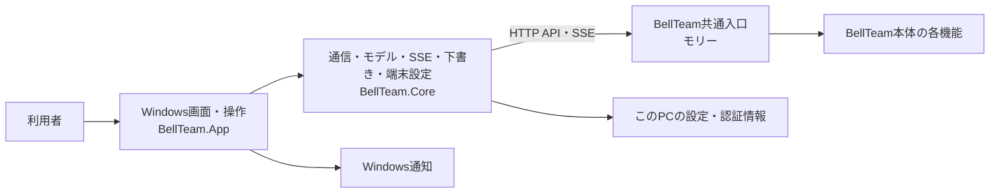
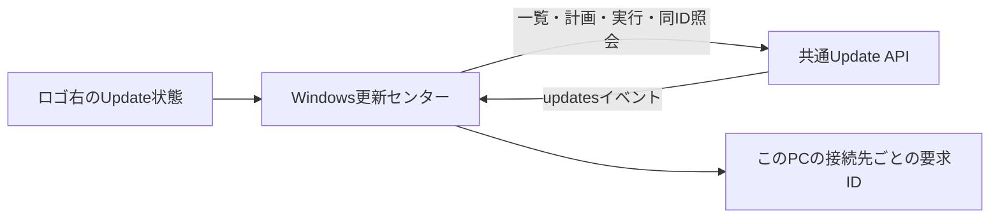

# Windowsアプリの機能図と作業手順

担当はベル（Windows）。この文書をWindows製品内部の機能図の正本とする。本体側の接続登録は[Windowsアプリ](architecture/modules/windows/README.md)、担当と変更手順は[機能担当と変更の手順](architecture/module-ownership.md)を参照する。

## 現在の接続と所有

画面、端末での操作と通知、接続先・窓・通知設定、端末の認証情報はWindowsアプリが扱う。会話、メンバー、予定、利用設定など本体の状態は共通入口を通じて利用する。画面の具体的な機能と端末設定は[Windowsアプリ](windows-app.md)を参照する。接続登録上の本体公開窓口は統合の `HTTP/MCP` で、現行Windows実装が利用するのはHTTP APIとSSEである。本体の内部状態を直接読み書きしない。

会話履歴の `deliveryTracking` は本体が受付の根拠を保存・投影し、Windowsは既知の値だけを表示する。直接会話の受付済み・完了未確認と、部屋の宛先別の完了未確認を区別し、部屋の他の配送失敗や振り分け失敗を優先する。履歴のない値や未知の値は従来の表示を維持する。

設定の「仕事の要約」は共通設定とモデル候補を読み、ハーネス・モデル・エフォートを選ぶ。旧版で設定が未供給なら編集できない。モデルごとの候補外は現在値として残し、選び直すまで保存しない。保存は読み取ったrevisionで一回だけ行い、競合と反映未確認を区別して読み直す。設定変更イベントでは下書きを保持して最新値を知らせる。設定の保存は要約の実行成功を意味しない。

メンバー一覧の補助行は共通APIのcurrentWorkだけを使い、未供給・不正は未取得と表示する。要約の生成元と観測状態を区別し、要約から実行状態を推測しない。ルーム行は参加者の有効な要約を最大2人表示し、残人数には要約未取得の参加者も含む。発言本文を代わりに表示しない。

## 変更時の手順

変更前に[全体図](architecture/feature-map.md)からこの図、呼出元と接続先の図へ辿り、機能・入出力・状態所有・接続・失敗の扱いを確認して図の変更要否を決める。全caller、データ、test、fixture、設定、exportまで影響範囲を確認する。必要な図と接続情報はコードと同じ差分で更新し、図を変えない場合は既存図に収まる理由を変更説明に記す。全体図の生成と直接境界の検証は[共通手順](architecture/module-ownership.md)に従う。

## 更新センター

ロゴ右の入口は共通の更新状態を表示する。更新センターは更新の有無、提供された変更内容、現在必要な操作を先に示し、対象ごとの状態と診断情報は利用者が開く詳細に置く。状態・計画・影響・実行結果の正本は[共通入口](architecture/modules/integration/README.md)のUpdate API。Windowsは計画の内容を見せ、明示操作で固定planを実行し、requestIdを保持して同じ要求を照会する。結果が不明な操作を成功へ変えず、自動再送しない。

更新対象が複数ある場合は利用者が対象を選び、単独または共通APIの全体計画を取得する。計画の対象と影響を確認してから実行する。処理中・結果不明・失敗・検証済み完了を区別し、結果不明の要求は同じIDで照会する。通常画面では内部識別子や版のハッシュを表示せず、提供された分かりやすい公開版だけを示す。変更内容がなければ欄を出さない。

人工データを使う非表示の実画面previewは[通常幅](assets/windows-update-page/update.png)、[最小幅](assets/windows-update-page/update-narrow.png)、[最小幅の詳細](assets/windows-update-page/update-detail-narrow.png)。画面は固定fixtureを表示し、実環境の更新を示さない。

起動中の更新通知は共通inventoryの `notificationCandidates` だけを使用し、同じ接続先と機能の最新digestを端末に保持して重複を抑止する。既存のWindows通知設定とToastを使い、押すと同じ接続先の更新センターを開く。受信による更新POSTはしない。終了中のPush受信口は未提供で、別途方式と登録主体を設計する。

