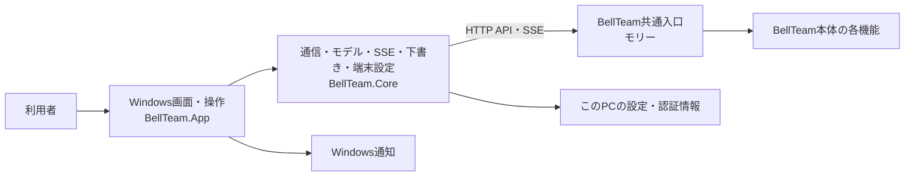
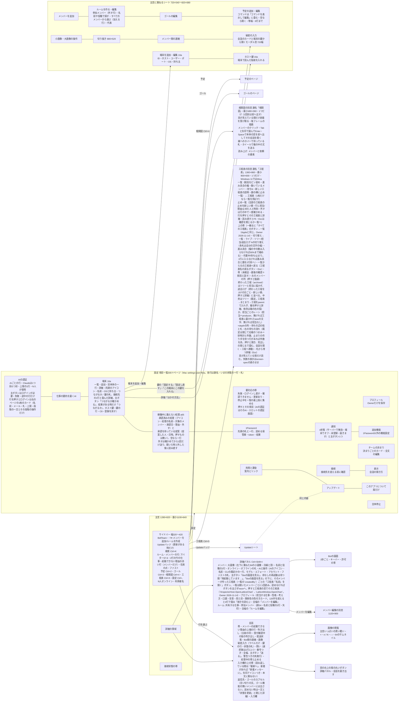
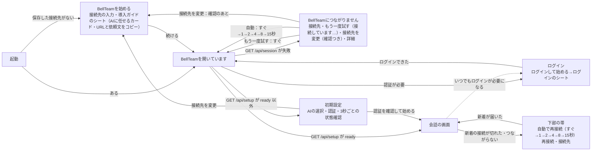
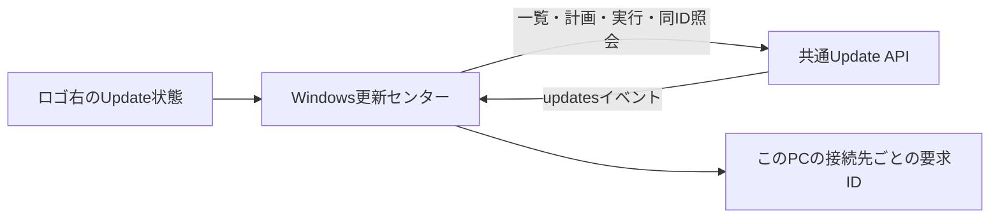

# Windowsアプリの機能図と作業手順

担当はアニス（`bot-0d7da1c1`）。この文書をWindows製品内部の機能図の正本とする。本体側の接続登録は[Windowsアプリ](architecture/modules/windows/README.md)、担当と変更手順は[機能担当と変更の手順](architecture/module-ownership.md)を参照する。

## 現在の接続と所有



画面、端末での操作と通知、接続先・窓・通知設定、端末の認証情報はWindowsアプリが扱う。会話、メンバー、予定、利用設定など本体の状態は共通入口を通じて利用する。画面の具体的な機能と端末設定は[Windowsアプリ](windows-app.md)を参照する。接続登録上の本体公開窓口は統合の `HTTP/MCP` で、現行Windows実装が利用するのはHTTP APIとSSEである。本体の内部状態を直接読み書きしない。

会話履歴の `deliveryTracking` は本体が受付の根拠を保存・投影し、Windowsは既知の値だけを表示する。直接会話の受付済み・完了未確認と、部屋の宛先別の完了未確認を区別し、部屋の他の配送失敗や振り分け失敗を優先する。履歴のない値や未知の値は従来の表示を維持する。配送の状態名はMacの7状態に合わせ、ルームの振り分け失敗、メッセージ自身の値、宛先ごとの最悪の値の順で決め、その上へ完了未確認を重ねる。ルームの返信先の自動選択は、`/api/settings`の`routing`が有効な間だけ使える。

## 画面構成（Mac版と同じ構成）

工程W-MAC（オーナー指示 2026-11-08）で、Windowsの画面をMac版（main `f62a4286`の`ios/`、Mac Catalyst）と同じ構成へ作り直す。下の2つの図は作り直し後の構成で、各PRがこの図に沿って画面を置き換える。差分と進み具合は[差分一覧](windows-mac-parity-gaps.md)に置く。OSの違いだけをWindowsの作法へ置き換える（⌘→Ctrl、窓の操作ボタン、タイトルバー）。Mac版の購入とAPNsの登録は移植しない。「利用と課金」は案内とリンクだけ、「通知」は起動中の通知の切替だけを置く（トロニー裁定 2026-11-08）。



起動の画面（Mac版RootViewと同じ段階）。接続できなかった時は、失敗の画面（Mac版のConnectionFailureView：「BellTeamにつながりません」・接続先のホスト・主ボタン「もう一度試す」・「接続先を変更」・生のエラーを畳んだ「詳細」）を出したまま自動で接続し直す。「もう一度試す」は失敗の画面を残したまま「接続しています…」と読み替えて押せなくし、「接続先を変更」は先に「接続先を変更しますか？」の確認を出す（取り消せば何も変えない）。待ち時間は共通の再接続の段階（すぐ→1→2→4→8→15秒、以後15秒。各±20%）で、認証が必要・画面を離れる・接続先の変更・ログアウト・窓を閉じる時だけ止まる。「もう一度試す」はすぐに1回つなぐ（段階は戻さない）。つながるか認証が必要になれば段階を最初に戻す。



```mermaid
flowchart LR
  subgraph App[BellTeam.App 画面]
    A1[サイドバー]
    A2[会話・詳細パネル]
    A3[Botの画面]
    A4[ゴール<br/>カプセルの文と失敗の一文はCoreのGoalPillText。読取の失敗はErrorTextに書かずReadError（閉じた詳細だけ）]
    A5[予定]
    A6[設定の各ページ<br/>行の一行・札・要対応の帯はCoreのSettingsSummaryが決め、SettingsWindowが開いた時・前面に戻った時に読む]
    A7[Update]
    A8[相関図の窓<br/>WorkGraphWindow・WorkGraphCanvas・WorkGraphText<br/>毎フレームの描画・入力・読み上げ。状態は持たない]
    A12[工程表の窓<br/>LatticeWindow・LatticeChartPage・LatticeStopsPage（止め一覧）・LatticeTreeView・LatticeBoard・LatticeViews<br/>描画・入力・読み上げ・動き。図の状態はLatticeChartFeedが持つ<br/>LatticeFixtureは--render-latticeの描画用の模擬サーバー（本番では使わない）]
    A9[秘密の入力の窓 14<br/>SecretInputWindow（会話のカードから開くモーダル）<br/>1Passwordから選ぶ・読み出す / ここに入力する・貼り付ける<br/>一回だけの値（1Passwordを出さない・ログインは「パスワードを渡す」、ほかは「渡して続ける」）・検索欄・一覧<br/>欄は送信・閉じる・窓が非アクティブで消す]
    A10[設定の「端末」 16a・16c<br/>TerminalListView・TerminalDetailView・TerminalEditorView・HostKeyView<br/>描くだけ。状態はTerminalsModelが持つ<br/>16c：追加の「このPCを追加」、詳細の「このPCを確かめる」「オプション機能を開く」（ms-settings:optionalfeatures）]
    A11[メンバー編集の「端末とフォルダ」 16b<br/>MemberTerminalSection（動かす場所・フォルダの読み取り専用の表示・畳んだ「ほかの方法」の中の「パスを入力」・組の問題）<br/>FolderPickerView（編集の窓または追加のシートの中に重ねる。主窓のシートは使わない）<br/>保存の拒否の文と、FOLDER_MISSINGだけの「このフォルダを作って保存」はMemberEditorView]
  end
  subgraph Core[BellTeam.Core 通信とモデル]
    C1[Workspace&lt;TImage&gt;・MessageItem・BellApi<br/>一覧・会話・送信・SSE・下書き<br/>画像はIImageCodec、最初のページの描画後はafterFirstRenderをアプリが渡す（WindowsはWorkspace : Workspace&lt;BitmapSource&gt;とContextIdle）<br/>メンバーのseatLaunch・configurationApplicationと行のseatは寛容に読む（不正な型は無しとして扱い、一覧・履歴を壊さない）]
    C2[ManagementApi<br/>メンバー・ルーム・画像・書き出し・再起動（待ち180秒）・停止・モデル候補（display_name）<br/>メンバーのterminalId・projectRoot（応答にある本体だけ送る）とcreateFolder（その保存の本文だけ。保存結果の照合には入れない）]
    C3[ScreenInputModel<br/>キー・許可の送信と確認]
    C4[GoalsApi]
    C5[PlanningApi]
    C6[SettingsApi<br/>所有者・規範・追加機能（guide・connectionは寛容に読む）・AIの認証・仕事の要約・全体停止]
    C9[HarnessAccountsApi<br/>Claudeの1st・2ndアカウントの一覧]
    C10[WorkGraphModel・WorkGraphSimulation<br/>相関図の図の状態・シミュレーション・札の置き場所・入れ替え・clearance・当たり判定<br/>永続状態なし。文字の測り方は画面から受け取る]
    C14[LatticeChart・LatticeChartFeed・LatticeApi<br/>工程表の計算（web/lattice-chart-model.jsの移植：一覧に出す工程表（LatticeChart.Shown＝shownCharts。分母0は一覧・切り替え・一枚だけ開く判定から外す、a107。メンバーの工程表ボタンは全件）・名前・レーン・ツリー（LatticeChart.Tree＝layoutTree）・過去ログ（LatticeChart.History）・待ちの文・詳細・帯・粒・差分）<br/>開いている工程表1枚の最後のsnapshotと接続の状態。永続状態なし<br/>LatticeStops（web/lattice-stops.jsの純粋部分の移植：止めの行・新しい順・顔の規則・時刻・読み上げ・外すの答えの仕分け）]
    C7[UpdateCenter]
    C8[LocalSettings<br/>接続先・窓・通知・会話の開き方・要求ID]
    C11[SecretRequestApi・SecretInputModel 14<br/>inputOptions・oneTimeは寛容に読む（型違いは無し）<br/>onepassword-items（404は旧本体）・検索と絞り込み・文言・送信の本文]
    C12[TerminalsApi・TerminalsModel 16a・16b・16c<br/>端末は寛容に読む（新しい項目は省略可）・一覧の状態（未読込・対応・旧本体・失敗＋前の一覧）<br/>確かめ結果・鍵の導入の待ち（上限なし・1秒間隔）はこのアプリの中だけ<br/>理由の文・OSごとの文（Mac・Windows PC・Linuxマシン）・端末の入力の検査・指紋の形・エラー符号の文<br/>16b：フォルダ一覧の読み・作成（folders・folder）・旧本体の判定（FoldersUnsupported）<br/>MemberBinding（組の規則・OSごとの絶対パス）・MemberFolder（既定のフォルダ・OSごとのprefill・FOLDER_*の文）・TerminalFolderPicker（名前の規則・パスの結合・一文）・TerminalFolderPickerModel（読み込み中・一覧・失敗・旧本体。作成は1回だけ送る）<br/>16c：このPCの確かめ中・結果の一行・試した端末もこのアプリの中だけ]
    C15[RunningExclusions a65<br/>一覧と提案を寛容に読む（scopeは"all"かBot IDの配列）・行の文・設定の一行と札]
    C13[ThisPc 16c<br/>IThisPc：このPCの事実を読む入口（試験は差し替える）<br/>ThisPcFacts：主なIPv4・ドメインのアカウントか・ホストがこのPCか<br/>HostKeyFile：ssh_host_ed25519_key.pubから指紋<br/>ThisPcTrust：結果の一行]
  end
  PC[("このPC<br/>ネットワークの設定・127.0.0.1の22番・<br/>ProgramData\ssh\ssh_host_ed25519_key.pub")]
  A1 --> C1
  A2 --> C1
  A2 --> C2
  A3 --> C3
  A4 --> C4
  A5 --> C5
  A6 --> C6
  A6 --> C15
  A6 --> C9
  A6 --> C8
  A7 --> C7
  A8 --> C10
  A12 --> C14
  A12 -->|"アバター（既存の画像キャッシュ）・名簿の名前（作った人の工程表）"| C1
  A12 -->|"会話を開く・統括と話す（MainWindow.OpenFromLatticeAsync）"| A2
  Inspector -->|"メンバーの工程表ボタン（MainWindow.OpenLatticeChart）"| A12
  A2 -->|"秘密のカード「安全な入力欄を開く」"| A9
  A9 --> C11
  A6 --> A10
  A10 --> C12
  A2 -->|"メンバー編集（別の窓・追加のシート）"| A11
  A11 --> C12
  A11 -->|"保存の本文にterminalId・projectRoot"| C2
  A10 -->|"このPCを追加：IPv4・ユーザー・22番の応答"| C13
  C12 -->|"このPCを確かめる：ホスト鍵の指紋（追加の保存後に1回・一覧を読んだ時に未信用でこのPCのホスト・詳細のボタン）"| C13
  C13 -->|"読むだけ。書かない・秘密を扱わない"| PC
  A10 -->|"鍵の依頼（botId:null）を窓へ渡す"| A9
  A8 -->|"アバター（既存の画像キャッシュ）"| C1
  C1 -->|"/api/session・bots（currentWork・seatLaunch・configurationApplication）・rooms・messages（seat）・queue・events"| API[共通入口 HTTP API・SSE]
  C2 -->|"/api/bots・rooms・avatar・avatar-large・export・restart（応答は新しい席が立ってから。要求の待ちは180秒、再送しない）・stop・models（display_name。選ぶ値と保存する値はid）"| API
  C3 -->|"/api/bots/{id}/screen・screen/key・screen/approval"| API
  C4 -->|"/api/goals・/api/bots/{id}/goal"| API
  C5 -->|"/api/schedules"| API
  C6 -->|"/api/owner・user-rules・settings・settings/{id}（onePasswordは{enabled, values:{token}}を1回だけ送る。応答のsettingで結果を決め、成功後に/api/settingsを読み直す。tokenは画面に戻さず、記録しない）・settings/backgroundAgent・harness-auth（Claudeは?slot=2nd）・ai-control"| API
  C7 -->|"/api/updates・plans・operations"| API
  C9 -->|"GET /api/accounts（404は旧本体。上限だけで席のアカウントが決まり、設定する規則は無い）"| API
  C10 -->|"GET /api/work-graph/events（BellApi.WorkGraphEventsAsync。snapshot・changeの名前付きイベント。35秒無音・切断・読めない応答は再接続、404は60秒ごとに確かめ直す、ログインが必要なら止まる）"| API
  C14 -->|"GET /api/lattice/charts（開いている間10秒ごと。404は旧本体）・GET /api/lattice/charts/{id}/events（BellApi.EventStreamAsync。snapshotごとに置き換え。35秒無音・切断・503は図を残して1, 2, 4 … 30秒で再接続し続ける、404はLATTICE_CHART_NOT_FOUNDなら見つからない・それ以外は旧本体で60秒ごとに確かめ直す、ログインが必要なら止まる）・GET /api/lattice/blockers（止め一覧を開いた時・読み直す・外すの答えのあと・窓が前面に戻った時だけ。503・通信・読めない応答だけ1, 2, 4 … 30秒で読み直し続ける、404は旧本体、ログインが必要なら止まる）・POST /api/lattice/charts/{id}/unblock（本文は{stopId}だけ。200 removed/already-goneは行を消す、409は行に理由、それ以外は行に「いまは外せませんでした」。自動で再送しない）"| API
  C11 -->|"GET /api/secret-requests/{id}/onepassword-items（{items:[{title,vault,reference}]}。404は旧本体で入力欄だけ）・POST …/submit（{value}か{source:onepassword,reference}。op://で始まらない参照は送らない）・POST …/cancel（{}）。値は専用POSTだけで、一般の欄・ログ・例外へ出さない"| API
  C15 -->|"GET /api/running-exclusions（{entries, pending}。404は旧本体で一行の案内、503 RUNNING_EXCLUSIONS_UNAVAILABLE・通信の失敗は理由を出して1, 2, 4 … 30秒で読み直し続ける）・DELETE /api/running-exclusions/{id}（Ownerが外す。1回だけ送り、答えにかかわらず一覧を読み直す。404 RUNNING_EXCLUSION_NOT_FOUNDはもう無い）"| API
  C12 -->|"GET /api/terminals（404・405は旧本体、503 TERMINALS_UNAVAILABLEは失敗で前の一覧は残す）・GET・PUT・DELETE /api/terminals/{id}（PUTは登録・編集とconfirmHostKey）・POST …/check・POST・DELETE …/keys/{ssh,sudo}（本文は空）・POST …/keys/ssh/authorize（本文は空）・GET …/folders[?path=]（pathなしは端末のユーザーのホーム。読むだけ。404はTERMINAL_NOT_FOUND以外・405が旧本体）・POST …/folder（{path, create:true}。1回だけ）・POST …/trust（本文は{fingerprint}だけ。16c）。書き込みは自動で再送しない"| API
```

- 状態の所有：会話・メンバー・予定・ゴール・追加機能・全体停止など本体の状態は、共通入口のAPIだけで読み書きする。Windowsが持つのは、このPCの設定（接続先・窓・起動中の通知・会話の開き方・Updateの要求ID）とログイン情報だけ。
- 新しいCoreの窓口（`ScreenInputApi`・`GoalsApi`・`SettingsApi`の追加分）は、Mac版が使う同じAPIを呼ぶ。サーバーの変更は要らない。
- `Workspace`（一覧・会話・送信・SSE・再接続・下書き）と`ConversationEntry`・`ActivityRow`・`MemberChoice`・`AttachmentPreview`・`MessageItem`はCoreに置き、WindowsとLinuxで共有する。Windowsは`BellTeam.App.Workspace : Workspace<BitmapSource>`で呼び出し側を変えず、画像は`WpfImageCodec`、最初のページの吹き出しの`Opening`はContextIdleで下ろす（`MessageCard`がLoadedで読むため、通常の優先度のPostでは足りない）。在席の点は`PresenceTone`をWindowsの`PresenceBrushConverter`が色にする。「仕事中」（`ConversationEntry.Working`）は`/api/bots`の`currentWork.state == "working"`だけで決め、相関図と同じ源にする（配達の列`/api/queue`は会話の「処理中」の行だけに使う。予定や自分の続きで始まったターンには処理中の配達が無いため）。添付する画像ファイルの25MBの上限と形式の判定はCoreの`ImageFile`。設定の置き場`SettingsStore.UserDirectory`は`SpecialFolderOption.Create`で求める（Windowsの`%LOCALAPPDATA%`は常にあるので動きは同じ。Linuxで`~/.local/share`がまだ無い時に、作業フォルダからの相対の場所へ書かないため）。Linuxの画面は[Linuxアーキテクチャ](linux-architecture.md)。
- 相関図の窓はWindowsの状態を何も保存しない。描画中の図はWorkGraphModelだけが持ち、窓を閉じたら捨てる。窓を閉じるか最小化している間は新着を受け取らず、開き直すと新しいsnapshotを今の図と突き合わせて動かす。接続が替わる（ログインし直し・接続先の変更）と、その接続の新着へ取り直す。窓は描いている図の接続先（`WorkGraphWindow.Origin`）を持つ。同じ接続先へのつなぎ直しは図を残して新しいsnapshotと突き合わせ、別の接続先になったら図を捨てて空の図から始め、その接続先の最初のsnapshotで埋まる。接続先の違う図のメンバーを押しても会話は開かず、その時点で図を捨てて今の接続先の新着へ取り直す。
- 工程表の窓（[lattice screen-spec](architecture/modules/lattice/screen-spec.md)）はWindowsの状態を何も保存しない。一覧は`LatticeWindow`、開いた1枚の最後のsnapshotと接続は`LatticeChartFeed`だけが持ち、窓を閉じる・最小化する・一覧へ戻ると読むのを止める。接続先が替わると一覧から始め直す。画面の文字と読み上げに`projectId`・Bot ID・符号・パスを出さない（工程表の名前は`LatticeChart.ChartName`）。王冠と「統括」は`coordinator: true`の工程表だけ。名簿にない担当は「?」と「名簿にないメンバー」で、会話を開くは押せない。担当は[lattice README](architecture/modules/lattice/README.md)の「Owner on screen」どおり`LatticeChart.Owner`一つで決める（レーン・待ちの流れ・辺の札・詳細が同じ規則）。書かれたlaneの文字は頭文字の顔と文字だけで、メンバーの後ろに自分のレーンを持ち、左の列に出ず、会話を開けない。札の本文は状態の行・題（2行まで）・一行の注記を縦に積み、注記は題に重ならない。ツリー／担当／過去ログと、待ちの流れを開いているか（既定は閉じる。Owner 2026-11-14）は、アプリを開いている間だけ覚え（保存しない）。archivedの工程は進み具合・数・まとまりの完了数には数える。工程へ移動・前後の工程は描かれていない工程でも詳細を開く。producer／waiterの予約値`owner`は指揮官で、窓が各snapshotへ載せたOwnerのプロフィール（Workspace.Ownerの名前と`/api/owner/avatar`、読めるまでは「指揮官」と頭文字）で描き、自分のレーンを持ち、左の列に出ず、会話を開けない、詳細・強調・選んだ工程の位置は切り替えても残る。待ちの流れの行は単独で読める形（待っている工程と担当→「この工程が終わるのを待っています」→待たれている工程→つくっている人と状態）。ほかの工程表の工程（snapshotの`externals[]`、task a60）は文字だけで描き（題、無ければ「ほかの工程表の工程」と「<工程表の名前、無ければほかの工程表>の工程表」、読めていない状態は「読めていません」）、レーン・ツリーに線を引かない。待ちの流れの工程へ移動と詳細の前の工程からは、その工程表をその工程の詳細で開く（止め一覧の行と同じ`LatticeWindow.OpenCard`）。担当のない待ちの札は「次の工程が待っています」。画面の状態遷移は[lattice screen-spec](architecture/modules/lattice/screen-spec.md)の状態図に従う。動きを減らす設定（Windowsのアニメーション効果オフ）では粒・回転・脈・花を出さない。止め一覧（`LatticeStopsPage`）は開いている間だけ読み、読めている間はタイマーで読まない。外すの答え（行の消去・理由・後で）は行ごとに出し、次の外すまで残す。消える行は200 msで薄れる（動きを減らす設定では即座）。色はライトだけ（アプリ全体と同じ）。
- メンバーを開くと`MainWindow.OpenFromWorkGraphAsync`が、通知と同じ会話の開き方（`OpenConversationAsync`）で本体の窓の会話を開く。相関図の窓は残る。
- メンバーの状態の行（W-MAC 17）：Coreは`/api/bots`の`seatLaunch`・`configurationApplication`と`messages`の`seat`を、型の違う値を「無し」として読む（`MemberState.cs`）。画面は、サイドバーの行と会話の上端に赤い「端末で起動できません：…」、メンバー編集の「AI」の最後に状態の印付きの1行、時刻の前の「分身」の札を出す。モデル候補は`display_name`（空ならid）を見せ、選ぶ値と保存する値はid。再起動は1回だけ送り、待ちは180秒。新しい状態の保存は無い。
- 設定の作り直し（W-MAC 20、Mac #1114。正本は[設定の導線](architecture/modules/apple/settings-user-flow.md)）：項目・題名・順・旧来の一行はCoreの`SettingsPages`、各項目のいまの状態の一行と札（灰・緑・紫・橙）と要対応はCoreの`SettingsSummary`（認証の段階は`AuthenticationProgress`、決まりの読み分けは`UserRules.cs`）が決める。`SettingsWindow`は設定を開いた時と主窓が前面に戻った時に全項目を読み（AIの認証は`GET /api/harness-auth`・`/api/accounts`・各AIの状態、ほかは`/api/settings`・`/api/models`・`/api/user-rules`・`/api/ai-control`・`/api/updates`・`/api/terminals`）、読み終えるたびに左の行・要対応の帯・開いているページの先頭を描き直す。Updateの新着（`UpdatesChanged`）と端末の一覧の変化でも描き直す。要対応の行はその項目へ、AIの認証はそのAI・スロットのログインの窓へ直接行く。通知は、Windowsが端末の登録をせず起動中だけ通知するので、Macの4状態のうち「届きます」「未登録」（と登録の失敗）だけを使う。「利用と課金」はアプリ内で購読を売らないので旧来のWindowsの一行のまま。接続先を変える前に確認を出す。「このアプリについて」は版だけ。
- 1Password連携の設定（W-MAC 15、20で独立した項目）：設定の「1Password」の行に状態の札（連携中・未連携・失敗）と平易な失敗の文を出し、開くと専用のページになる。状態・結果の一行・`ops_`の検査・https限定の案内リンクはCoreの`OnePassword.cs`。`guide`・`connection`は型の違う値を「無し」として読み、旧本体・崩れた本体でも一覧を壊さない（`onePassword`項目が無ければ何も足さない）。tokenは`PasswordBox`で、保存後も戻さず、ページを離れる・窓が非アクティブになる時に消す。保存は`PATCH /api/settings/onePassword`を1回だけ送り（自動再送なし）、応答の`setting`だけで結果の一行を決め、成功後に一覧を読み直してバッジを更新する。
- 秘密の入力の窓（W-MAC 14）：`inputOptions.onePasswordAvailable`の時だけ入力方法を出し、1Passwordを上・既定にする（`preferred:'stored'`なら入力側が既定）。言い方は値の出どころだけを言う（1Passwordから選ぶ／読み出す、ここに入力する／貼り付ける）。保存するかどうかは欄の下の注意文だけが言う。`terminal.login`と`oneTime`は1Passwordを出さず、送信はログインが「パスワードを渡す」（Macと同じ）、`oneTime`が「渡して続ける」。`terminal.ssh`・`terminal.sudo`は`onepassword-items`の一覧から選ぶ（sudoは`/password`で終わる参照だけ。検索欄は題名・保管庫名、選択が外れたら解除）。`terminal.ssh`の入力は改行を保つ複数行の欄。値の欄と選択は、送信の直前・閉じた時・窓が非アクティブになった時に消す。検索語は秘密でなく送らない。状態と文言は`SecretInputModel`（Core）、窓は描くだけ。
- 設定の「端末」（W-MAC 16a。契約は[terminals](architecture/modules/terminals/README.md)、Macは[apple/terminals](architecture/modules/apple/terminals.md)）：一覧は`GET /api/terminals`で、404・405（旧本体）は一行の案内、503 `TERMINALS_UNAVAILABLE`などの失敗は理由と「もう一度読み込む」で、読めていた一覧がある間は一覧を残して一行の注意だけを足す。詳細は接続先・確認結果・ホスト鍵・鍵・Claude Codeの更新（C8）・登録を消す。確認結果の理由の文（`CONNECTION_REFUSED`・`AUTH_FAILED`・`UNREACHABLE`ほか）はサーバーの`action`があればそれを、無ければOSごとの文（Mac・Windows PC・Linuxマシン）を出す。「ホスト鍵を確かめる」は確認結果がホスト鍵の理由の時（16cでは、このPCのホスト鍵のファイルを読めなかった時も）だけ「ほかの方法」の中に出し、指紋は`SHA256:`＋43文字で検査して`PUT /api/terminals/{id} {confirmHostKey}`（Macの手入力のシートと同じ。`POST …/trust`は16cの自分のホスト鍵の確かめ）で送る。鍵の行（SSH鍵・sudo鍵。sudo鍵は`os`がwindowsの端末では出さない）は`POST・DELETE …/keys/{ssh,sudo}`（本文は空）で、返った依頼（`botId:null`）を秘密の入力の窓で開く。`AUTH_FAILED`の「この端末にこの鍵を入れる」は`POST …/keys/ssh/authorize`（本文は空）→`terminal.login`の窓→`GET /api/terminals/{id}`を1秒ごと（上限なし。詳細を離れると止める）→結果の文、鍵が入ったら確かめを自動で1回。確かめ結果と導入の待ちはこのアプリの中だけで、`Workspace.Terminals`が接続ごとに持ち、つなぎ直し（接続先の変更を含む）とログアウトで空に戻す。書き込み（PUT・DELETE・POST）は自動で再送しない。
- 設定の「稼働中に数えない処理」（a65。契約は[execution current-work「Owner read and remove (a62)」](architecture/modules/execution/current-work.md)）：承認済みの処理と、承認箱の答えを待つ提案を並べる。処理は「<exe> <args>」、子の席は「<harness>の子の席」、対象は「全員」か`/api/bots`の名前（無ければ「名簿にないメンバー」）、日時はJST。外すはOwnerの操作で、確かめの窓のあと1回だけ`DELETE`し、結果にかかわらず読み直す。提案には押すものを置かない（加えるのはメンバーの提案を承認箱で承認した時だけ）。外す提案には理由を出さない（届く理由は加えた時のもの）。設定の一覧の行は件数と承認待ちの数。旧本体（404）は一行の案内、読めない時は理由と自動の読み直し。
- メンバー編集の「端末とフォルダ」（W-MAC 16b。契約は[members C1・S5](architecture/modules/members/remote-seat.md)と[terminals「Folder picker」](architecture/modules/terminals/README.md)、Macは[apple/terminals](architecture/modules/apple/terminals.md)の`MemberTerminalSection`）：端末の一覧が読めて（200）メンバーの応答に`terminalId`がある本体だけ、保存の本文に`terminalId`・`projectRoot`を載せる（このBellTeamは両方空。片方だけは保存しない）。旧本体・一覧が読めない時は一行の案内だけで、項目を送らない。端末を選ぶと、空の（または前回のprefillのままの）フォルダ欄をその端末のOSの形（macOS `/Users/<user>/BellTeam/<slug>`、Linux `/home/<user>/…`、Windows `C:\Users\<user>\BellTeam\<slug>`）で埋め、名前・端末の変更に追従する。打ち込んだ値・選んだ値・保存済みの値は書き換えない。フォルダは読み取り専用の文字で出し、その下の「フォルダを選ぶ」が、窓の中に重ねるシート（`GET /api/terminals/{id}/folders`。必ず端末のユーザーのホームから。上へ・サブフォルダ・「このフォルダにする」・新しいフォルダ）を開く。新しいフォルダの名前は前後の空白を除き、空・`.`・`..`・`/`・`\`・NUL・255バイト超（Windowsは`:`も）を送らずに止め、`POST …/folder {path, create:true}`を1回だけ送って（通信失敗は作れたか不明なので再送せず一覧を読み直す）、現在の場所を読み直して作ったフォルダを開く。文字入力は畳んだ「ほかの方法 > パスを入力」の中だけで、フォルダの一覧の経路が無い本体（404が`TERMINAL_NOT_FOUND`以外、または405）は最初から出す。保存は組の規則（端末のOSの絶対パス）を先に検査し、拒否の`FOLDER_*`はフォームのフォルダ入りの符号ごとの文にして、`FOLDER_MISSING`だけ「このフォルダを作って保存」（同じ保存＋`createFolder:true`。保存済みの設定にも照合にも入れず、フォームを編集すると消える）を出す。シートは主窓のシートでなく、編集の窓（または追加のシート）の中に重ねる。
- このPCを追加・このPCを確かめる（W-MAC 16c。契約は[terminals「Windows app on that PC」](architecture/modules/terminals/README.md#self-service-registration-and-assignment-trony-request-2026-11-10-design)、MacのS1・S2は[apple/terminals](architecture/modules/apple/terminals.md)）：端末の追加の最初の区に「このPCを追加」を置く（新規のときだけ）。押すとOSをWindows、ホストをこのPCの主なIPv4（既定ゲートウェイのあるアダプターを先に、127.とリンクローカルの169.254.を除く）、ユーザーを`Environment.UserName`（ローカルのアカウント名。マイクロソフトアカウントのPCも同じ。ドメインのアカウントは`DOMAIN\user`を入れず空のままにして一行で知らせる）、ポート22、持ち主を自分の端末にし、`127.0.0.1:22`へTCPでつないで答えを見る（拒否＝「OpenSSH サーバーがオンになっていません」と「オプション機能を開く」＝`ms-settings:optionalfeatures`、それ以外の失敗は「確かめられませんでした」でオフとは言わない）。欄はあとから直せる。127.0.0.1に答えてもLANから届くとは限らない（ファイアウォール）ので、届くことの証明は「つながるか確かめる」のまま。ホスト鍵の指紋は`C:\ProgramData\ssh\ssh_host_ed25519_key.pub`を読んで`SHA256:`＋43文字にし（ファイルが無い・読めない・ed25519でない・形が違うときは理由を一行で出し、何も送らず、「ほかの方法」の指紋入力を出す）、`POST /api/terminals/{id}/trust`へ`{fingerprint}`だけを送る。送るきっかけは3つで、それぞれ1回だけ送り、自動で再送しない：①「このPCを追加」で保存した直後、②一覧を読んだ時に未信用の端末のホストがこのPC（このPCのネットワークのIPv4・IPv6のアドレス、127.0.0.1・::1、localhost、マシン名）のとき（接続ごとに端末ごと1回）、③ホストがこのPCの端末の詳細の「このPCを確かめる」。結果は一行：200は一覧の端末を置き換え、409 `HOST_KEY_FINGERPRINT_MISMATCH`は「このアドレスで答えているのは、このPCではありません」（何も書かれない）、409 `TERMINAL_CHANGED`は「もう一度押してください」、503 `TERMINAL_UNAVAILABLE`は「あとでもう一度」、`TERMINAL_NOT_FOUND`以外の404（旧本体）は何も言わず、ほかは符号の文。結果の一行と確かめ中は`TerminalsModel`が持ち、このアプリの中だけ。別のPCの未信用の端末の詳細は、確かめ結果のサーバーの案内（`HOST_TRUST_MISSING`のとき「<host> のWindowsを確かめてください。そのWindowsでBellTeamアプリを開くと、自動で確かめます」）をそのまま出す。


- 端末と鍵の値はこのPCに置かない。鍵・パスワードは秘密の入力カードから本体へ送るだけで、一般の欄やログへ書かない。

- 失敗の扱い：理由を表示する。接続の失敗（起動の失敗の画面と新着のSSE）は、Mac・Webと同じ段階で自動に再接続する。新着は、切れた時（「更新の接続が切れました。再接続しています。」）と、つながらない・429・5xx（「更新へ接続できません。再接続しています。」）で続け、30秒を超えて保てた接続の後は段階を最初に戻す。止めるのは認証が必要・取り消し・ログアウトの時だけで、形式の異常など想定外の失敗も理由を添えて再接続を続ける。その他の操作の失敗（送信など）は自動で繰り返さない。例外はMac版と同じ定期の読み取り（Botの画面と許可の確認は1秒ごと、AIの認証待ちは3秒ごと）で、表示している間だけ動かす。

## 変更時の手順

変更前に[全体図](architecture/feature-map.md)からこの図、呼出元と接続先の図へ辿り、機能・入出力・状態所有・接続・失敗の扱いを確認して図の変更要否を決める。全caller、データ、test、fixture、設定、exportまで影響範囲を確認する。必要な図と接続情報はコードと同じ差分で更新し、図を変えない場合は既存図に収まる理由を変更説明に記す。全体図の生成と直接境界の検証は[共通手順](architecture/module-ownership.md)に従う。

## 更新センター

入口は、一覧の見出しのUpdateバッジ（更新がある時だけ。押すとUpdateシート）と、設定の「アップデート」ページ。Mac版と同じ内容を両方に出す。Updateシートはメイン窓の中の重ね表示（暗い背景、中央のカード、最小720x540・標準820x680、窓に収まる大きさ）で、題名「アップデート」と「閉じる」を持ち、Escでも閉じ、開くたびに読み直す。新しい最上位窓は作らない。シートと設定のページは同じ部品（`UpdateContent`）を使い、状態と文言の対応は`BellTeam.Core`の`UpdateScreen`に置く。状態は、確認中・確認できない・更新中・結果確認中・失敗・更新済み・更新あり・すべて最新・待ち・不明の10種で（待ち＝Macの`Status.waiting`：すべての機能が確認済みの公開版と一致か`incompatible`で、`incompatible`が1つ以上。「更新できるものはすべて最新です」と、合う版がまだ無い機能の名前を出す。`incompatible`の機能の状態バッジは「使えない版」）、上段のカード、確認が必要な機能の帯、機能の一覧（版と状態バッジ）、更新内容、ジョブの状態（旧サーバーだけ）、機能の問題、閉じた「詳細」の順に出す。更新中は主ボタンを出さず、同じ要求IDを5秒ごとにGETで読む。更新センターは更新の有無、提供された変更内容、現在必要な操作を先に示し、対象ごとの状態と診断情報は利用者が開く詳細に置く。状態・計画・影響・実行結果の正本は[共通入口](architecture/modules/integration/README.md)のUpdate API。Windowsは計画の内容を見せ、明示操作で固定planを実行し、requestIdを保持して同じ要求を照会する。結果が不明な操作を成功へ変えず、自動再送しない。

更新対象が複数ある場合は利用者が対象を選び、単独または共通APIの全体計画を取得する。計画の対象と影響を確認してから実行する。処理中・結果不明・失敗・検証済み完了を区別し、結果不明の要求は同じIDで照会する。通常画面では内部識別子や版のハッシュを表示せず、提供された分かりやすい公開版だけを示す。変更内容がなければ欄を出さない。

人工データを使う非表示の実画面previewは[設定のページ（混在）](assets/windows-update-page/update.png)、[すべて最新](assets/windows-update-page/update-current.png)、[Updateシート](assets/windows-update-page/update-sheet.png)、[最小幅](assets/windows-update-page/update-narrow.png)、[最小幅の詳細](assets/windows-update-page/update-detail-narrow.png)。画面は固定fixtureを表示し、実環境の更新を示さない。

起動中の更新通知は共通inventoryの `notificationCandidates` だけを使用し、同じ接続先と機能の最新digestを端末に保持して重複を抑止する。既存のWindows通知設定とToastを使い、押すと同じ接続先の更新センターを開く。受信による更新POSTはしない。アプリを閉じている間の通知は扱わない（オーナー判断 2026-11-08）。


