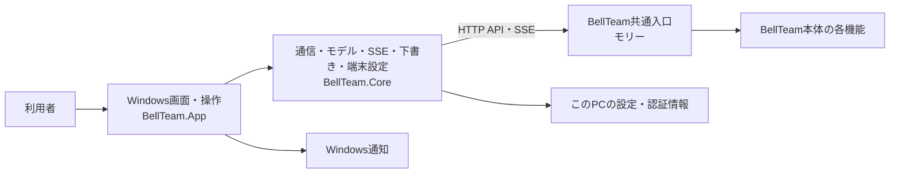
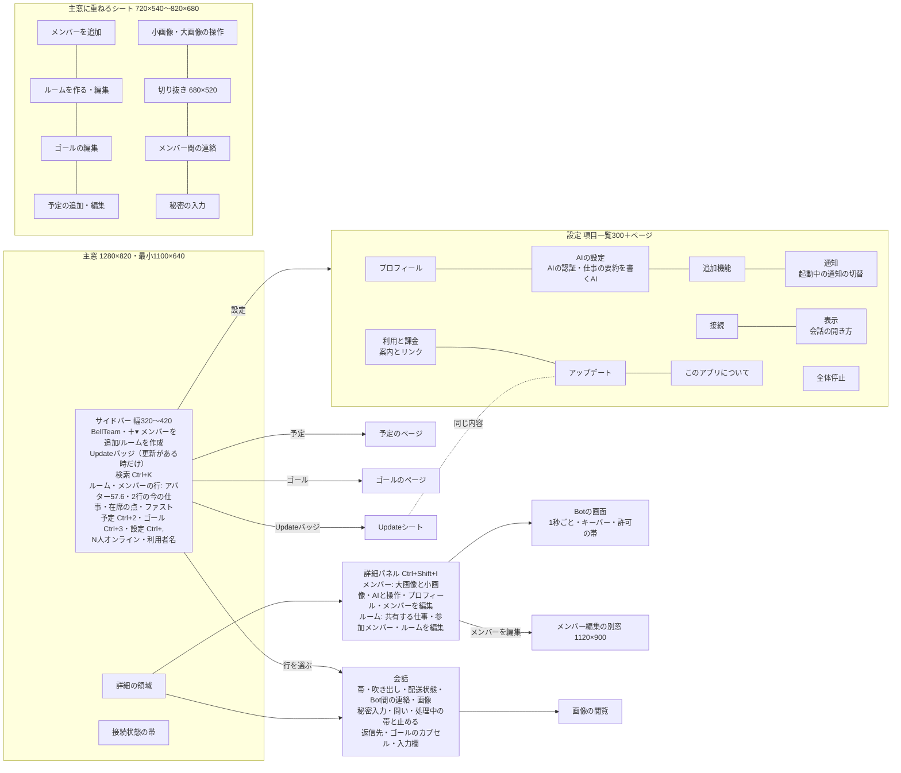
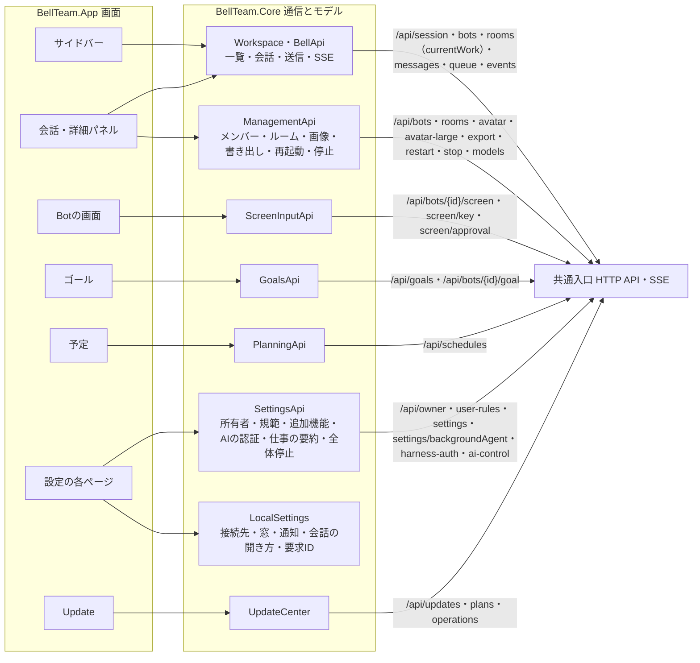
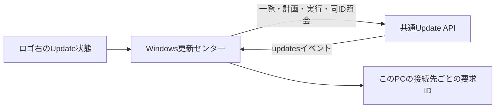

# Windowsアプリの機能図と作業手順

担当はベル（Windows）。この文書をWindows製品内部の機能図の正本とする。本体側の接続登録は[Windowsアプリ](architecture/modules/windows/README.md)、担当と変更手順は[機能担当と変更の手順](architecture/module-ownership.md)を参照する。

## 現在の接続と所有

画面、端末での操作と通知、接続先・窓・通知設定、端末の認証情報はWindowsアプリが扱う。会話、メンバー、予定、利用設定など本体の状態は共通入口を通じて利用する。画面の具体的な機能と端末設定は[Windowsアプリ](windows-app.md)を参照する。接続登録上の本体公開窓口は統合の `HTTP/MCP` で、現行Windows実装が利用するのはHTTP APIとSSEである。本体の内部状態を直接読み書きしない。

会話履歴の `deliveryTracking` は本体が受付の根拠を保存・投影し、Windowsは既知の値だけを表示する。直接会話の受付済み・完了未確認と、部屋の宛先別の完了未確認を区別し、部屋の他の配送失敗や振り分け失敗を優先する。履歴のない値や未知の値は従来の表示を維持する。

## 画面構成（Mac版と同じ構成）

工程W-MAC（オーナー指示 2026-11-08）で、Windowsの画面をMac版（main `f62a4286`の`ios/`、Mac Catalyst）と同じ構成へ作り直す。下の2つの図は作り直し後の構成で、各PRがこの図に沿って画面を置き換える。差分と進み具合は[差分一覧](windows-mac-parity-gaps.md)に置く。OSの違いだけをWindowsの作法へ置き換える（⌘→Ctrl、窓の操作ボタン、タイトルバー）。Mac版の購入とAPNsの登録は移植しない。「利用と課金」は案内とリンクだけ、「通知」は起動中の通知の切替だけを置く（トロニー裁定 2026-11-08）。

- 状態の所有：会話・メンバー・予定・ゴール・追加機能・全体停止など本体の状態は、共通入口のAPIだけで読み書きする。Windowsが持つのは、このPCの設定（接続先・窓・起動中の通知・会話の開き方・Updateの要求ID）とログイン情報だけ。
- 新しいCoreの窓口（`ScreenInputApi`・`GoalsApi`・`SettingsApi`の追加分）は、Mac版が使う同じAPIを呼ぶ。サーバーの変更は要らない。
- 失敗の扱いは従来どおり：理由を表示し、自動で繰り返さない。例外はMac版と同じ定期の読み取り（Botの画面と許可の確認は1秒ごと、AIの認証待ちは3秒ごと）で、表示している間だけ動かす。

## 変更時の手順

変更前に[全体図](architecture/feature-map.md)からこの図、呼出元と接続先の図へ辿り、機能・入出力・状態所有・接続・失敗の扱いを確認して図の変更要否を決める。全caller、データ、test、fixture、設定、exportまで影響範囲を確認する。必要な図と接続情報はコードと同じ差分で更新し、図を変えない場合は既存図に収まる理由を変更説明に記す。全体図の生成と直接境界の検証は[共通手順](architecture/module-ownership.md)に従う。

## 更新センター

入口は、一覧の見出しのUpdateバッジ（更新がある時だけ。押すとUpdateシート）と、設定の「アップデート」ページ。Mac版と同じ内容を両方に出す。Updateシートはメイン窓の中の重ね表示（暗い背景、中央のカード、最小720x540・標準820x680、窓に収まる大きさ）で、題名「アップデート」と「閉じる」を持ち、Escでも閉じ、開くたびに読み直す。新しい最上位窓は作らない。シートと設定のページは同じ部品（`UpdateContent`）を使い、状態と文言の対応は`BellTeam.Core`の`UpdateScreen`に置く。状態は、確認中・確認できない・更新中・結果確認中・失敗・更新済み・更新あり・すべて最新・不明の9種で、上段のカード、確認が必要な機能の帯、機能の一覧（版と状態バッジ）、更新内容、ジョブの状態（旧サーバーだけ）、機能の問題、閉じた「詳細」の順に出す。更新中は主ボタンを出さず、同じ要求IDを5秒ごとにGETで読む。更新センターは更新の有無、提供された変更内容、現在必要な操作を先に示し、対象ごとの状態と診断情報は利用者が開く詳細に置く。状態・計画・影響・実行結果の正本は[共通入口](architecture/modules/integration/README.md)のUpdate API。Windowsは計画の内容を見せ、明示操作で固定planを実行し、requestIdを保持して同じ要求を照会する。結果が不明な操作を成功へ変えず、自動再送しない。

更新対象が複数ある場合は利用者が対象を選び、単独または共通APIの全体計画を取得する。計画の対象と影響を確認してから実行する。処理中・結果不明・失敗・検証済み完了を区別し、結果不明の要求は同じIDで照会する。通常画面では内部識別子や版のハッシュを表示せず、提供された分かりやすい公開版だけを示す。変更内容がなければ欄を出さない。

人工データを使う非表示の実画面previewは[設定のページ（混在）](assets/windows-update-page/update.png)、[すべて最新](assets/windows-update-page/update-current.png)、[Updateシート](assets/windows-update-page/update-sheet.png)、[最小幅](assets/windows-update-page/update-narrow.png)、[最小幅の詳細](assets/windows-update-page/update-detail-narrow.png)。画面は固定fixtureを表示し、実環境の更新を示さない。

起動中の更新通知は共通inventoryの `notificationCandidates` だけを使用し、同じ接続先と機能の最新digestを端末に保持して重複を抑止する。既存のWindows通知設定とToastを使い、押すと同じ接続先の更新センターを開く。受信による更新POSTはしない。アプリを閉じている間の通知は扱わない（オーナー判断 2026-11-08）。

