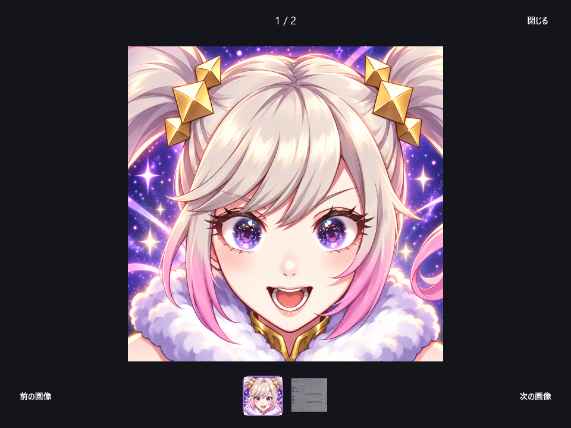

# Windowsの画像閲覧

Mac版のMessageImageGalleryに合わせ、サムネイルからの直接選択、左右キーでの循環、Escapeで閉じる操作を追加した。背景を暗くして画像を見やすくし、番号とサムネイルを中央へ配置する。画像が1枚の時は切替の列を出さない。



この画像は、既存のブランド画像と、作り物データのMac画面だけを模擬サーバーから取得して描いた。Windowsの窓は表示していない。

サムネイルは長辺128pxまで縮小して読み、縦横比とEXIFの回転を保つ。小さい元画像は引き伸ばさない。大きく表示する画像は元の大きさで読み込む。縮小はWindows標準のBitmapTransformとSoftwareBitmapで行い、PNG・JPEG・WebP・GIFの元の読み込みも保つ。

## 確認

- GalleryTestsの7件で、異なる画像へのサムネイル選択・左右キーの循環・Escapeで閉じること、1枚の時の表示、縦長・横長・正方形・小さい画像・EXIF付きJPEGの縮小を確認した。キー試験のWin32入力元は非表示、閲覧窓のHWNDは未作成と検査した。
- 既存の画像・カード関連16件、最終の単体試験163件、.NET同梱x64ビルドが成功した。
- 閲覧画面を非表示で描画して配置を確認し、確認後のBellTeam.exeとBellTeam.UiChecks.exeは0件だった。本番への送信や設定変更、前面の操作は行っていない。

```powershell
node windows/BellTeam.Tests/fixtures/mac-ui-reference.mjs windows/artifacts/publish-gallery/BellTeam.exe windows/artifacts/gallery-reference gallery
```

修正版の利用者による実画面操作、IME、画像の貼付・ドロップ、通知など、残る確認は[前面確認の記録](windows-final-check.md)に従う。取り込みとFOXへの導入はトロニーが行う。
