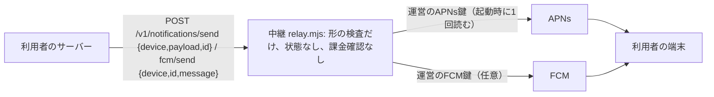
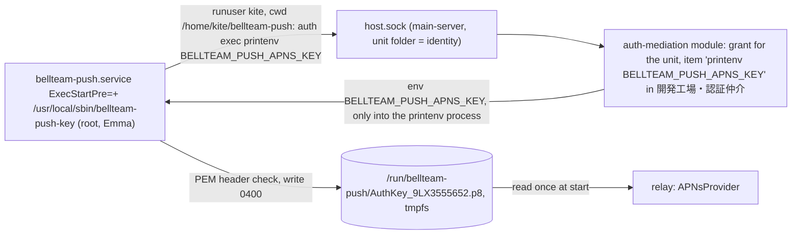

# 運営の通知中継

Owner: Mika (the usage module; notifications are hers; Tronie ruling 2026-11-27, task o-bt-push-relay). The OS parts of the production host (unit, user, Caddy route, the key script) are Emma's; the code under `services/notifications` and its `src/` files are listed in the usage module's `module.json`.

利用者のコンテナはAPNsの秘密鍵を持たず、利用者のサーバーが通知をこのサービスへ送る。**購読や課金の確認はしない**（a540-form、クライアントだけで課金を確かめる形、オーナー2026-11-23）。サービスは運営のAPNs・FCMの鍵を持つだけで、要求の形（端末トークン、接続先、通知の文面）が正しければ送る。旧い形のサーバーが付ける `ticket`・`signedTransaction`・`proof` は読まずに捨てる（無くてもよい）。APNsの要求は `{device,payload,id}`、FCMの要求は `{device,id,message}`。

一つの通知が運ぶもの: 端末トークン、利用者のサーバーのアドレス、通知の見出しと短い文面（メンバー名・ルーム名と定型の一言）、メンバーID・ルームID・メッセージIDの識別子。会話本文・秘密入力値・課金情報・Appleの鍵は含めない。中継は保存も再試行もしない。

追加の利用者ID・端末台帳・配送キューは持たず、失敗の再試行もしない。端末登録は利用者のコンテナが既存の保存先で所有する。サービスのエラーはコンテナへ返し、既存の通知診断へ記録する。会話本文・秘密入力値・Appleの鍵は通知の送信データへ含めない。

## 起動

リポジトリ直下で `npm ci` し、`node services/notifications/index.mjs` で起動する。運営のHTTPS公開先からこのNode.jsサービスへ転送する。`HOST` と `PORT` はNode.jsの待受設定に使う。

`BELLTEAM_APNS_DIRECTORY` は運営が保存した `config.json` と `.p8` ファイルのあるディレクトリを指定する。形式は既存の [APNs設定](../../docs/push-notifications.md) と同じ。鍵は鍵ごとに `{keyId, file}`（`.p8`）か `{keyId, reference}`（`op://<保管庫のID>/<アイテムのID>/<フィールド>`、値は `.p8` の全文）を選べる。referenceを使う時は `op`（PATH上か `OP_CLI_PATH`）と `OP_SERVICE_ACCOUNT_TOKEN` を起動環境に置く。鍵を替える時は `config.json` を書き換えてサービスを再起動する。中継はApple・Googleの課金の鍵もkKeyも持たない。鍵と環境変数の値をリポジトリや利用者向けイメージへ含めない。

利用者は追加機能の通知設定へこのサービスのルートURLを登録する。通知設定の変更時は `GET /v1/notifications/status` で実接続とAPNsの設定済み環境を確認する。`POST /v1/notifications/send` は `{signedTransaction,device,payload,id}` を受け取る。`device` と `payload` は `src/push-notifications.mjs` の共通実装が生成する。

BellTeamは `await notifications.configure({enabled,relayUrl})` で保存済み設定を起動時と変更時に反映する。既存のAPNs設定がある個人環境は初回だけ通知ONへ移行し、relayURLが空なら直送する。画面でOFFを保存すると次回起動もOFFを守る。空の公開volumeは未設定・OFFから始まる。relayの接続確認と送信の失敗は `notifications.status().error` と既存の `SERVER_PUSH_FAILED` 診断へ残す。

## 運営の公開先

本番の中継は `https://bellteam-push.kitepon.dev`（main-server の独立したサービス `bellteam-push`、`HOST=172.18.0.1`、`PORT=18920`、Cloudflare Tunnel と Caddy の先）。購読の確認はせず、旧形の証明は無視する。`GET /v1/notifications/status` は認証なしで、鍵が読めていれば200（運営の死活確認に使う）。APNsの鍵は起動時に1回だけ読んでメモリに持つ（読み方は下の「本番の鍵の渡り方」）。再配置は main の `services`・`src`・パッケージ定義を `/home/kite/bellteam-push` へ置いて `npm ci --omit=dev` し、再起動を依頼する。`BELLTEAM_TICKET_CHECK_URL` はもう使わない（設定が残っていても読まない）。

## 本番の鍵の渡り方 (key hand-over, 2026-11-27)

The relay process never reaches 1Password or the mediator: the unit's pre-start step puts the key into a tmpfs file, and the relay reads that file once (`{keyId, file}` in `/etc/bellteam-push/config.json`).

| Step | Contract |
| --- | --- |
| Item and grant | Sakura keeps the item (title = the command words as typed after `auth exec`, one field labelled `BELLTEAM_PUSH_APNS_KEY`) and the grant (unit `/home/kite/bellteam-push`, that command). The value is never in this repository, the unit text or an env file. |
| One read per start | One `auth exec` per service start; the module caches the item, so a restart is at most one 1Password read. `RestartSec=900` and `StartLimitBurst=3` per 2 h stay so a failing read cannot loop. |
| Failure | A refused or failed `auth exec` (no grant, module down, bad PEM header) makes the pre-start step exit 1; the service does not start and retries after `RestartSec`. A running relay is not affected, because the key is already in memory. Self-exit: the grant or the module comes back and the next retry starts it. |
| Exposure | The key exists only in the `printenv` process environment, the pre-start script's pipe and the tmpfs file (0400, gone on stop or reboot). |

## Android（FCM）

`BELLTEAM_FCM_DIRECTORY` に運営のFirebaseサービスアカウントの設定（`config.json` と鍵のJSON、形式は [fcm-push](../../docs/architecture/modules/usage/fcm-push.md) の「Server configuration」）を置くと、`POST /v1/notifications/fcm/send` が有効になり、`GET /v1/notifications/status` に `android:true` が付く。無ければ従来の応答のまま。`{device,id,message}` を受け取って送る（`proof` は読まない）。`message` は閉じた形（利用者の端末のtokenとserver、固定チャンネル）だけを通す。Appleの経路は変えない。

## 検証の根拠

APNsの認証キーと送信ヘッダーはAppleの [token-based connection](https://developer.apple.com/documentation/usernotifications/establishing-a-token-based-connection-to-apns) と [notification requests](https://developer.apple.com/documentation/usernotifications/sending-notification-requests-to-apns) に従う。

自動試験は `node --test test/push-notifications.test.mjs test/notification-relay.test.mjs`。実際のApple照会、公開relayへの接続、端末の通知表示は未確認。
