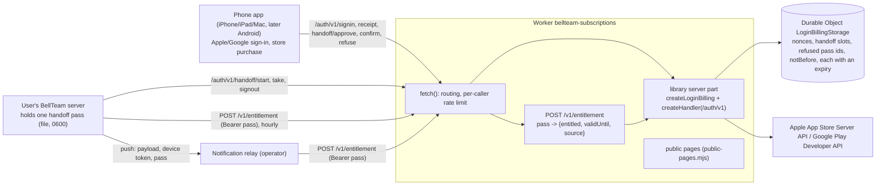

# BellTeam login and billing Worker (operator side)

Owner: Bready (bot-823b56e9). Since a485 this Worker is the server part of the shared login/billing library `@kitepon/login-billing` (pinned **0.7.2**, contract 1.16, `vendor/kitepon-login-billing-0.7.2.tgz`, sha256 `cd65aeef2f1ffcffb0faa299185e4c1fc74be5ea9a3d6e3005a5234e95bcb848`). Mechanism: Mint's `docs/login-billing/design-qr-pass.md`; ruling for BellTeam: `rulings/bellteam.md`. Owner decisions: App Store + Google Play only, Stripe abolished (2026-11-20), D1 = B, D2 no cap on servers per contract, D3 developer mode stays the user server's own switch.

The Worker holds the library's secrets (kKey, pass keys, store keys). It runs only at the operator and is never embedded in a user's BellTeam server: the user's server is a *device that the owner's phone logs in*, and it calls the Worker; the operator never calls a user's server.

## Function diagram

Gone since a485: `POST /v1/subscriptions/verify` (verify by receipt), Stripe checkout / portal / verify, the Stripe and Apple/Google receipt code the library replaces, `STRIPE_*` and `APPLE_ENVIRONMENT` variables. Kept untouched, not used by the Worker: `apple-jwt.mjs`, `apple-roots.json` and the Apple library dependency (the probes under `experiments/subscription-worker-probe` and `test/subscription-native-verifier.test.mjs` use them); `endpoints.json` and `product.json` stay because the user server's `src/subscriptions.mjs` reads them until a485-lb-server changes it.

## Data flow
| Data | Created by | Held where | Lifetime | Notes |
|---|---|---|---|---|
| Sign-in nonce | `signin/nonce` | LoginBillingStorage | 5 min, single use | tied to no account |
| Handoff slot (slot id, short code, take secret, label, payloads) | `handoff/start` | LoginBillingStorage | 5 min or pickup | label is a fixed app kind, no person's name |
| Refused pass id | `refuse`, `signout`, `signin` with `replaces` | LoginBillingStorage | until the pass would have ended (14 days) | random number |
| `{K, notBefore}` for "stop all others" | `signin` with `stopOthers` | LoginBillingStorage | notBefore + 14 days | K is a number from the provider id and kKey |
| Pass (sealed) | library | the device or the user's server | 14 days, renewed on use | never stored at the operator |
| Store answer | Apple / Google | Worker isolate memory | 10 min | best effort, not needed for correctness |
| Caller rate counters | `fetch()` | Worker isolate memory | 1 min | key = hash of the connecting address, never persisted or logged |
Nothing else is written: no account row, no subscription row, no e-mail, no IP address, no id token. Cloudflare Workers Logs stay off (`observability.enabled: false`).

## Routes
All answers are JSON, `Cache-Control: no-store` for the product route.
| Route | Pass | Answer |
|---|---|---|
| `POST /auth/v1/*` | per library | the library's wire contract v1 (`docs/wire-v1.md` of the library): `signin/nonce`, `signin`, `receipt`, `handoff/start`, `handoff/approve`, `handoff/confirm`, `handoff/take`, `refuse`, `signout`; errors `{error: <code>}` |
| `POST /v1/entitlement` | any live pass (`Authorization: Bearer`) | `{entitled, validUntil?, source?}`. `entitled` is true when the pass's account has a live `dev.kitepon.bellbot.monthly` subscription (`apple` or `google`); `validUntil` is its end (ISO 8601, no trial flag: entitlement is the store contract only); a renewed pass comes in the `Login-Billing-Pass` header. Errors are the library's codes (`pass_invalid`, `pass_expired`, `pass_refused`: 401). A live pass with no contract answers 200 `{entitled:false}` |
| `GET /`, `/support`, `/privacy`, `/server/*` | - | unchanged redirects and server install files (`public-pages.mjs`) |
Rate limit on the two anonymous writers (`signin/nonce`, `handoff/start`): per caller, 30 per minute, in the isolate's memory. `rate_limited` (429) also when the storage cap (100 000 rows) is reached. shortcut: per-isolate counters, upgrade to a Durable Object counter if abuse appears.

## Configuration
Product values are in `product.json` (bundle id / package name / product id) and `wrangler.jsonc` vars; secrets are set with `wrangler secret put` through the shared 1Password tool, never printed.
| Name | Kind | Meaning |
|---|---|---|
| `LB_KKEY` | secret | kKey (32 random bytes, base64url). **Different for the test Worker and production** (contract 1.13); a lost kKey cannot be repaired |
| `LB_PASS_KEY_CURRENT`, `LB_PASS_KEY_CURRENT_ID`, optional `LB_PASS_KEY_PREVIOUS`, `LB_PASS_KEY_PREVIOUS_ID` | secret / var | pass sealing keys (rotation: previous stays for 14 days) |
| `APPLE_ISSUER_ID`, `APPLE_KEY_ID`, `APPLE_PRIVATE_KEY` | var, secret, secret | App Store Server API in-app purchase key (existing) |
| `GOOGLE_PLAY_SERVICE_ACCOUNT` | secret | Play Developer API service account JSON (existing) |
| `APPLE_SIGNIN_AUDIENCES` | var | comma list: Apple bundle ids accepted as id-token audience |
| `GOOGLE_SIGNIN_AUDIENCES` | var | comma list: Google OAuth client ids accepted as audience |
Without `LB_KKEY` or the pass key every route answers 503 `{error: "not_configured"}`. A store whose key is missing is left out of the library's configuration: its receipts come back `invalid` and no entitlement is listed. The Worker never uses billing "off" and so never opens a free path.

## Durable Object
`LoginBillingStorage` (SQLite-backed, one instance `login-billing`): `get`, `put(key, value, ttlMs)`, `delete`; expired rows are swept on write (no alarms); `put` answers `full` at the cap and the front throws the library's `StorageFull`. The old class `SubscriptionVerifier` is removed by migration `login-billing-storage-v2` (it never stored anything).

## Release order and environments
- Test Worker `bellteam-subscriptions-sandbox` first, with its own kKey. Production `bellteam-subscriptions` is switched only when all apps and the user server ship (Tronie's release order). Real-store runs go to production from TestFlight / the internal track (contract 1.13 section "Test servers"); the test Worker is for the wire, the storage and the relay.
- Deploy: `npm exec --yes --package wrangler@latest -- wrangler deploy --env sandbox` (production `--env ""`), from a commit that is an ancestor of `origin/main`; Cloudflare key use is approved by the Owner each time. Rollback: `wrangler rollback <version>`.

## Tests
`node --test test/subscription-worker.test.mjs test/notification-relay.test.mjs test/fcm-notifications.test.mjs` run the Worker against the library's testing entry (fake sign-in keys and store answers, same code paths) and an in-memory SQLite stand-in for the Durable Object. The real stores are not called by tests.
