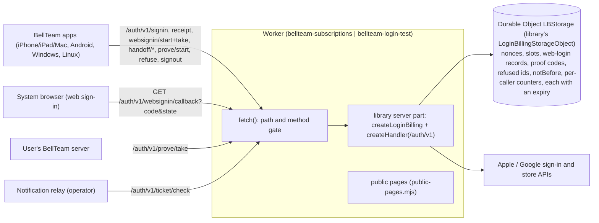

# BellTeam login and billing Worker (operator side)

Owner: Bready (bot-823b56e9). Since a485 this Worker is the server part of the shared login/billing library `@kitepon/login-billing` (pinned **0.18.8, development release**, contract: Mint library-contract.md, `vendor/kitepon-login-billing-0.18.8.tgz`, sha256 `2c1db4f5a25bc10ab0ce167a1f1aeff0ac59e86df8f4ed3513cbcac38c88a1ca`). Mechanism: Mint's `design-reading3.md`; ruling for BellTeam: `rulings/bellteam.md`. Owner decisions: App Store + Google Play only, Stripe abolished (2026-11-20), every device signs in itself and the person's phone hands over the contract (reading 3).

The Worker holds the library's secrets (kKey, pass keys, store keys, web-sign-in clients). It runs only at the operator and is never embedded in a user's BellTeam server; the user's server calls out, the operator never calls a user's server. The Worker keeps no copy of the library's behaviour: it mounts the library's handler and gives it the Durable Object storage, and nothing else. Production is not switched by this change.

## Function diagram

Gone since a485: `POST /v1/subscriptions/verify` (verify by receipt), Stripe checkout / portal / verify, `STRIPE_*` and `APPLE_ENVIRONMENT`, the earlier hand-built `/v1/entitlement` route (the library's `prove/take` and `ticket/check` replace it). Kept untouched and not used by the Worker: `apple-jwt.mjs`, `apple-roots.json`, the Apple library dependency (probes under `experiments/subscription-worker-probe` and `test/subscription-native-verifier.test.mjs`), `endpoints.json` and `product.json` (the user server's `src/subscriptions.mjs` reads them until a485-lb-server changes it).

## Data flow
Everything stored is a key, a value and an expiry in `LBStorage`; the library decides the kinds and the budgets (`DEFAULT_BUDGETS`), the Worker adds none. Nothing about a person is kept: no account row, subscription row, e-mail, IP address or id token. The per-caller counters are the library's, inside the storage object, keyed by an HMAC of the connecting address (CF-Connecting-IP); no address is stored. Cloudflare Workers Logs stay off (`observability.enabled: false`). Since 0.13.0 a failed web sign-in writes one line `login-billing websignin signin_failed <reason>` (a code only: no account number, IP, token or provider answer) through the library's default `console.warn`; with Workers Logs off nothing is kept, and it is visible only in a live `wrangler tail`. The Worker gives `config.log` no sink; a sink may keep only the code and reason, briefly. The redirect to the app carries the same code as `reason`.
| Data | Held where | Lifetime |
|---|---|---|
| sign-in nonce, handoff slot (old and new), web-login record, result code, proof code | `LBStorage` | 5 min / 10 min / 60 s, spent by `take(key)` |
| refused pass id, notBefore, per-caller counter | `LBStorage` | until the pass would have ended (14 days) |
| pass, ticket (sealed) | the device / the user's server | pass 14 days renewed on use; ticket 14 days or until its pass ends |
| store answer | isolate memory | 10 min, best effort |

## Routes
All under `/auth/v1` (the library's wire v1, `docs/wire-v1.md` of the library): every route is POST except the provider's callback, `GET /auth/v1/websignin/callback` (contract 1.20; answers a 302 to the stored return with `Referrer-Policy: no-referrer`, `Cache-Control: no-store`). Anything else under the prefix is 405, anything outside it is 404; `GET /`, `/support`, `/privacy`, `/server/*` are the unchanged public pages (`public-pages.mjs`). Also served by the Worker itself: `GET /.well-known/assetlinks.json` (when `LB_ASSETLINKS` is set), `GET /.well-known/apple-app-site-association` (when `LB_APPLE_APP_SITE_ASSOCIATION` is set) and `GET /auth/return/android` and `/auth/return/apple`, the https fallback return of a web sign-in for a browser that does not hand the link to the app (a page with no content from the sign-in, `Referrer-Policy: no-referrer`, `no-store`). Anonymous paths limited per caller by the library (`Storage.hit`, counted in the storage object so every isolate sees it): `signin/nonce` 30, `handoff/start` 10 per caller unless the route opened a pass, `handoff/start:signed` (a signed start) 10 per pass id, `websignin/start` 10, `prove/take` 30, `ticket/check` 60 per minute (contract 1.22; the Worker overrides none); over the limit 429 `rate_limited`; a full counter store lets requests through. The Worker adds no limiter.

## Configuration
Product ids are in `product.json`; vars in `wrangler.jsonc`; secrets are set with `wrangler secret put` (values piped from the shared 1Password tool or generated at deploy, never printed).
| Name | Kind | Meaning |
|---|---|---|
| `LB_KKEY` | secret | kKey (32 random bytes, base64url). **Different for every Worker** (contract 1.13); a lost kKey cannot be repaired |
| `LB_PASS_KEY_CURRENT`, `LB_PASS_KEY_CURRENT_ID`, optional `LB_PASS_KEY_PREVIOUS`, `LB_PASS_KEY_PREVIOUS_ID` | secret / var | pass sealing keys (rotation: previous stays for 14 days) |
| `APPLE_ISSUER_ID`, `APPLE_KEY_ID`, `APPLE_PRIVATE_KEY`, `GOOGLE_PLAY_SERVICE_ACCOUNT` | var, secrets | store API keys (the test Worker has the Apple key only, set 2026-11-22 for sandbox purchases; no Google key) |
| `APPLE_SIGNIN_AUDIENCES`, `GOOGLE_SIGNIN_AUDIENCES` | var | accepted id-token audiences: the Apple bundle id; the BellTeam Google Web client id |
| `LB_PUBLIC_ORIGIN` | var | the Worker's own https origin; the callback is this origin + `/auth/v1/websignin/callback` |
| `WEBSIGNIN_GOOGLE_CLIENT_ID`, `WEBSIGNIN_GOOGLE_CLIENT_SECRET` | var, secret | the Google web client of the code flow (its id is accepted as an audience by the library) |
| `WEBSIGNIN_APPLE_SERVICES_ID`, `WEBSIGNIN_APPLE_TEAM_ID`, `WEBSIGNIN_APPLE_KEY_ID`, `WEBSIGNIN_APPLE_PRIVATE_KEY` | vars, secret | Sign in with Apple for the web (Services ID in the apps' Apple team) |
| `LB_RETURN_LINKS`, `LB_RETURN_SCHEMES` | vars | extra places a web sign-in may return to (exact https links; session schemes). Loopback `http://127.0.0.1:<port>/<random>` is always allowed |
| `LB_ASSETLINKS` | var | the JSON served at `/.well-known/assetlinks.json` (Android App Links): the app's signing certificate fingerprints. The test host lists Neon's debug certificate; production lists the upload and Play signing certificates |
| `LB_APPLE_APP_SITE_ASSOCIATION` | var | the JSON served at `/.well-known/apple-app-site-association`: applinks for `/auth/return/apple` and webcredentials (the https callback of `ASWebAuthenticationSession`) for app `TPWX489GV4.dev.kitepon.bellbot` |
| `LB_EXEMPT_K` | var | comma list of account numbers (K) that always get the product's entitlement (the Owner's account in production, contract 2.3; test accounts on the test Worker) |
| `LB_BILLING` | var | `off` only on the test Worker: every signed-in account gets the product's entitlement and no store is asked (contract 1.13, option c). Anything else is `store` |
| `LB_OLD_HANDOFF` | var | `off` refuses the old pass-less handoff once every app carries the new sign-in; default on |
Without `LB_KKEY` or the pass key every route answers 503 `{error: "not_configured"}`. Web sign-in is on only with `LB_PUBLIC_ORIGIN` and at least one complete provider client; a provider without one answers `provider_unknown`. A store whose key is missing is left out: its receipts come back `invalid`. The Worker never uses billing "off" unless `LB_BILLING` says so.

## Durable Object
`LBStorage extends LoginBillingStorageObject` (exported from `index.mjs`, bound as `LB_STORAGE`, one object named by the library). One object processes one request at a time, so `take` is one read-and-delete. Expiry by alarm; a budget per record kind so anonymous writes cannot push out the others. The old class `SubscriptionVerifier` is removed by migration `login-billing-storage-v2` (it never stored anything).

## Environments and release order
- **Test Worker** `bellteam-login-test` at `https://bellteam-login-test.kitepon.dev` (custom domain in the Owner's zone, `--env test`): its own kKey and pass key, `LB_BILLING=off`, no store keys. For the apps' first device runs and the Worker's own real-service checks. Real-store purchases are never run against it.
- `bellteam-subscriptions-sandbox` and `bellteam-subscriptions` (production) are configured in `wrangler.jsonc` for the same code but **not deployed by this change**; production switches only when all apps and the user server ship (Tronie's release order), on the Owner's domain that Mint asks for.
- Deploy: `npm exec --yes --package wrangler@latest -- wrangler deploy --env test` from `services/subscriptions`; the Cloudflare key is read from 1Password by the deploy step and never printed; use is approved by Tronie. Rollback: `wrangler rollback <version> --env test`.

## Tests
`node --test test/subscription-worker.test.mjs` covers the mount: configuration, routing, billing mode, the callback GET, the strict return check, that the library's limit answers 429 per caller. The library's behaviour is the library's suite; the Durable Object storage is checked on Cloudflare itself (see the a485 evidence).
